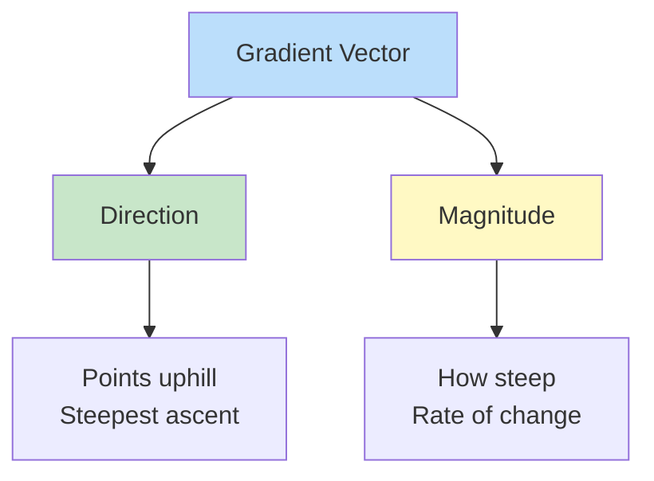
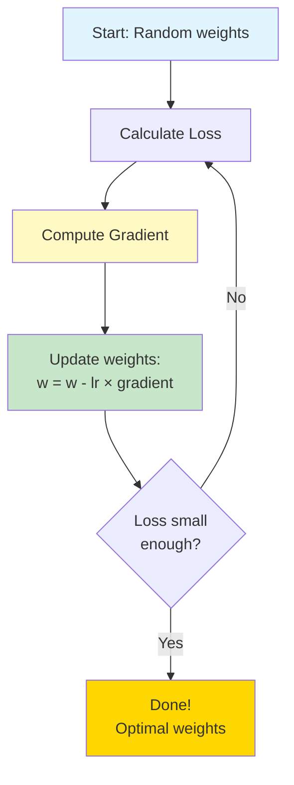
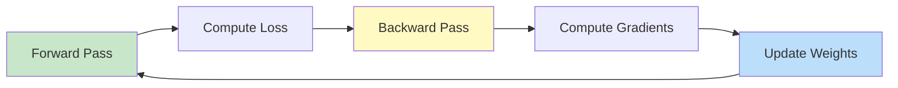
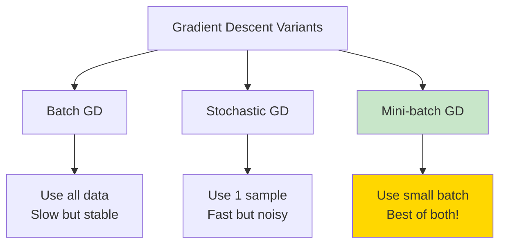

# 📐 CALCULUS - How Neural Networks Learn

**⭐ THE ENGINE OF MACHINE LEARNING!**
Calculus is HOW neural networks learn! No calculus = No deep learning!

**Time to Complete:** 1-2 weeks  
**Difficulty:** ⭐⭐⭐ Medium  
**Interview Weight:** ⭐⭐⭐ CRITICAL for ML Engineer roles!

---

## 🗺️ CALCULUS LEARNING ROADMAP


---

## 📚 TABLE OF CONTENTS

| # | Topic | ML Application | Link |
|---|-------|----------------|------|
| 1 | **Derivatives** | Rate of change | [[#1-derivatives\|Jump]] |
| 2 | **Chain Rule** | Backpropagation! | [[#2-chain-rule\|Jump]] |
| 3 | **Partial Derivatives** | Multi-variable optimization | [[#3-partial-derivatives\|Jump]] |
| 4 | **Gradients** | Direction to optimize | [[#4-gradients\|Jump]] |
| 5 | **Gradient Descent** | Training algorithm | [[#5-gradient-descent\|Jump]] |
| 6 | **Backpropagation** | Neural net training | [[#6-backpropagation\|Jump]] |
| 7 | **Optimization Tricks** | Advanced training | [[#7-optimization-techniques\|Jump]] |

---

## 1. DERIVATIVES

**💙 What is a Derivative?**
The derivative measures **rate of change**. How much does output change when input changes slightly?

### Visual Understanding

```
Function f(x) = x²

    f(x)
     ↑
  9  |         ●  ← (3, 9)
     |        /
  4  |      ●    ← (2, 4)
     |     /
  1  |   ●       ← (1, 1)
     |  /
  0  |●          ← (0, 0)
     └─────────→ x
       0 1 2 3

Derivative f'(x) = 2x
At x=2: f'(2) = 4 ← Slope at that point!
```

**✅ Computing Derivatives**
```python
import numpy as np
import matplotlib.pyplot as plt

# Function: f(x) = x²
def f(x):
    return x**2

# Derivative: f'(x) = 2x
def f_prime(x):
    return 2*x

# At x=2:
x = 2
print(f"f({x}) = {f(x)}")           # f(2) = 4
print(f"f'({x}) = {f_prime(x)}")    # f'(2) = 4 (slope)

# Numerical derivative (approximation)
h = 0.0001  # Small change
numerical_derivative = (f(x + h) - f(x)) / h
print(f"Numerical: {numerical_derivative:.4f}")  # ~4.0
```

**💡 Common Derivatives to Know**
```
Power Rule:
f(x) = x^n  →  f'(x) = n·x^(n-1)

Examples:
f(x) = x²    →  f'(x) = 2x
f(x) = x³    →  f'(x) = 3x²
f(x) = x⁴    →  f'(x) = 4x³

Constant:
f(x) = 5     →  f'(x) = 0

Linear:
f(x) = 3x    →  f'(x) = 3

Exponential:
f(x) = e^x   →  f'(x) = e^x

Logarithm:
f(x) = ln(x) →  f'(x) = 1/x

Trigonometric:
f(x) = sin(x) →  f'(x) = cos(x)
f(x) = cos(x) →  f'(x) = -sin(x)
```

**⭐ Why Derivatives Matter in ML**
```python
# Loss function: How wrong is our prediction?
def loss(prediction, actual):
    return (prediction - actual)**2

# Derivative tells us: 
# "If I change prediction slightly, how much does loss change?"
def loss_derivative(prediction, actual):
    return 2 * (prediction - actual)

# Example:
prediction = 5
actual = 10

current_loss = loss(prediction, actual)
gradient = loss_derivative(prediction, actual)

print(f"Loss: {current_loss}")        # 25
print(f"Gradient: {gradient}")        # -10

# Gradient is negative → Increase prediction to reduce loss!
```

---

## 2. CHAIN RULE

**⚠️ THE MOST IMPORTANT RULE FOR DEEP LEARNING!**

**💙 What is Chain Rule?**
When functions are nested (composed), chain rule helps find the derivative!

### The Rule

```
If y = f(g(x)), then:

dy/dx = (dy/dg) × (dg/dx)

Outer derivative × Inner derivative
```

**✅ Simple Example**
```python
# Function: y = (2x + 1)³
# This is f(g(x)) where:
#   g(x) = 2x + 1
#   f(g) = g³

def y(x):
    return (2*x + 1)**3

# Using chain rule:
# dy/dx = 3·(2x+1)² · 2 = 6·(2x+1)²
def dy_dx(x):
    return 6 * (2*x + 1)**2

x = 1
print(f"y({x}) = {y(x)}")           # 27
print(f"dy/dx({x}) = {dy_dx(x)}")   # 54
```

**⭐ Chain Rule in Neural Networks**
```python
# Simple neural network: 2 layers
# Input → Hidden → Output

import numpy as np

def sigmoid(x):
    return 1 / (1 + np.exp(-x))

def sigmoid_derivative(x):
    s = sigmoid(x)
    return s * (1 - s)

# Forward pass
x = 2.0                          # Input
w1 = 0.5                         # Weight 1
w2 = 0.3                         # Weight 2

# Layer 1
z1 = x * w1                      # 1.0
a1 = sigmoid(z1)                 # 0.731

# Layer 2
z2 = a1 * w2                     # 0.219
a2 = sigmoid(z2)                 # 0.555 (final output)

# Backward pass (Chain Rule!)
# Want: dL/dw1 (how loss changes with w1)

# Suppose dL/da2 = -0.445 (from loss function)

# Chain rule: dL/dw1 = dL/da2 × da2/dz2 × dz2/da1 × da1/dz1 × dz1/dw1

dL_da2 = -0.445
da2_dz2 = sigmoid_derivative(z2)     # 0.247
dz2_da1 = w2                         # 0.3
da1_dz1 = sigmoid_derivative(z1)     # 0.197
dz1_dw1 = x                          # 2.0

# Full chain
dL_dw1 = dL_da2 * da2_dz2 * dz2_da1 * da1_dz1 * dz1_dw1
print(f"Gradient for w1: {dL_dw1:.6f}")  # -0.013

# This is backpropagation using chain rule!
```

**💎 Interview Question: Chain Rule**

**Q: Explain how chain rule is used in backpropagation**

**Perfect Answer:**
"Chain rule allows us to compute gradients through nested functions. In neural networks, each layer is a function composition:

Output = f₃(f₂(f₁(x)))

To update weights, we need ∂Loss/∂weights. Chain rule gives us:

∂Loss/∂w₁ = (∂Loss/∂output) × (∂output/∂f₃) × (∂f₃/∂f₂) × (∂f₂/∂w₁)

This is backpropagation - computing gradients backward through layers by multiplying local gradients (chain rule).

Example: 3-layer network
- Forward: x → layer1 → layer2 → layer3 → output
- Backward: Use chain rule to propagate gradient back

Each layer computes its local gradient, then multiplies with gradient from next layer."

---

## 3. PARTIAL DERIVATIVES

**💙 What are Partial Derivatives?**
For functions with multiple inputs, partial derivatives show change w.r.t. ONE variable while holding others constant.

### Visual Understanding

```
Function: f(x, y) = x² + y²

         z
         ↑
        /|
       / |
      /  |
     /   |
    ●────●─→ y
   /
  /
 ↓
x

∂f/∂x = 2x  ← Change along x-axis (y fixed)
∂f/∂y = 2y  ← Change along y-axis (x fixed)
```

**✅ Computing Partial Derivatives**
```python
import numpy as np

# Function: f(x, y) = x² + 3xy + y²
def f(x, y):
    return x**2 + 3*x*y + y**2

# Partial derivative w.r.t. x (treat y as constant)
# ∂f/∂x = 2x + 3y
def df_dx(x, y):
    return 2*x + 3*y

# Partial derivative w.r.t. y (treat x as constant)
# ∂f/∂y = 3x + 2y
def df_dy(x, y):
    return 3*x + 2*y

# At point (1, 2):
x, y = 1, 2
print(f"f({x}, {y}) = {f(x, y)}")           # 11
print(f"∂f/∂x = {df_dx(x, y)}")             # 8
print(f"∂f/∂y = {df_dy(x, y)}")             # 7

# Numerical verification
h = 0.0001
numerical_dx = (f(x+h, y) - f(x, y)) / h    # ~8.0
numerical_dy = (f(x, y+h) - f(x, y)) / h    # ~7.0
```

**⭐ In Machine Learning**
```python
# Loss function with multiple parameters
# L(w₁, w₂, b) = prediction error

def loss(w1, w2, b, x, y_true):
    # Simple linear model: y = w1*x1 + w2*x2 + b
    prediction = w1*x[0] + w2*x[1] + b
    return (prediction - y_true)**2

# We need partial derivatives w.r.t. each parameter!
# ∂L/∂w₁, ∂L/∂w₂, ∂L/∂b

def grad_w1(w1, w2, b, x, y_true):
    pred = w1*x[0] + w2*x[1] + b
    return 2 * (pred - y_true) * x[0]

def grad_w2(w1, w2, b, x, y_true):
    pred = w1*x[0] + w2*x[1] + b
    return 2 * (pred - y_true) * x[1]

def grad_b(w1, w2, b, x, y_true):
    pred = w1*x[0] + w2*x[1] + b
    return 2 * (pred - y_true)

# Example
w1, w2, b = 0.5, 0.3, 0.1
x = np.array([1.0, 2.0])
y_true = 5.0

print(f"Loss: {loss(w1, w2, b, x, y_true):.4f}")
print(f"∂L/∂w₁: {grad_w1(w1, w2, b, x, y_true):.4f}")
print(f"∂L/∂w₂: {grad_w2(w1, w2, b, x, y_true):.4f}")
print(f"∂L/∂b: {grad_b(w1, w2, b, x, y_true):.4f}")
```

---

## 4. GRADIENTS

**💙 What is a Gradient?**
The gradient is a vector of all partial derivatives. It points in the direction of steepest ascent!



### Visual Understanding

```
Mountain (Loss Surface):

         High Loss
            ↑
           /|\
          / | \
         /  |  \
        /   |   \
       /  ∇Loss  \  ← Gradient points uphill
      /     ↑     \
     /      |      \
    /       ●       \   ← Current position
   /    Go down!    \
  /_________________\
      Low Loss

We want to go DOWN → Move opposite to gradient!
```

**✅ Computing Gradients**
```python
import numpy as np

# Function: f(x, y) = x² + y²
def f(x, y):
    return x**2 + y**2

# Gradient: ∇f = [∂f/∂x, ∂f/∂y]
def gradient(x, y):
    df_dx = 2*x
    df_dy = 2*y
    return np.array([df_dx, df_dy])

# At point (3, 4):
x, y = 3, 4
grad = gradient(x, y)

print(f"Position: ({x}, {y})")
print(f"Function value: {f(x, y)}")      # 25
print(f"Gradient: {grad}")                 # [6, 8]
print(f"Gradient magnitude: {np.linalg.norm(grad):.2f}")  # 10.0

# Gradient points to (6, 8) - direction of steepest increase
# To minimize, go opposite direction: (-6, -8)
```

**⭐ Gradient for Neural Networks**
```python
# Neural network with multiple weights
# Need gradient of loss w.r.t. all weights

import numpy as np

def sigmoid(x):
    return 1 / (1 + np.exp(-x))

def loss(y_pred, y_true):
    return (y_pred - y_true)**2

# Network weights
W1 = np.array([[0.1, 0.2],
               [0.3, 0.4]])  # 2x2
W2 = np.array([[0.5],
               [0.6]])        # 2x1

# Input
x = np.array([[1], [2]])      # 2x1
y_true = 1.0

# Forward pass
z1 = W1.T @ x                 # Hidden layer
a1 = sigmoid(z1)
z2 = W2.T @ a1                # Output layer
y_pred = sigmoid(z2)

L = loss(y_pred, y_true)
print(f"Loss: {L[0,0]:.4f}")

# Backward pass - compute gradient for each weight
# This is what automatic differentiation does!
# In practice, frameworks like PyTorch/TensorFlow do this
```

---

## 5. GRADIENT DESCENT

**⚠️ THE ALGORITHM THAT TRAINS ALL NEURAL NETWORKS!**

**💙 What is Gradient Descent?**
An optimization algorithm that iteratively moves toward the minimum of a function.



### The Algorithm

```
1. Initialize weights randomly
2. Repeat until convergence:
   a. Calculate loss
   b. Compute gradient ∇L
   c. Update: w = w - learning_rate × ∇L
3. Done!

Key insight: Gradient points uphill, 
            we go downhill (negative gradient)
```

**✅ Simple Example: Finding Minimum**
```python
import numpy as np
import matplotlib.pyplot as plt

# Function: f(x) = (x - 3)²
# Minimum at x = 3
def f(x):
    return (x - 3)**2

# Derivative: f'(x) = 2(x - 3)
def gradient(x):
    return 2 * (x - 3)

# Gradient Descent
x = 0.0                # Starting point
learning_rate = 0.1
history = [x]

print("Iteration | x | f(x) | gradient")
print("-" * 40)

for i in range(20):
    grad = gradient(x)
    x = x - learning_rate * grad  # Update step!
    history.append(x)
    
    if i % 5 == 0:
        print(f"{i:9d} | {x:.4f} | {f(x):.4f} | {grad:.4f}")

print(f"\nFinal x: {x:.4f} (True minimum: 3.0)")
print(f"Final f(x): {f(x):.6f}")

# Plot convergence
plt.plot(history)
plt.xlabel('Iteration')
plt.ylabel('x value')
plt.title('Gradient Descent Convergence')
plt.axhline(y=3, color='r', linestyle='--', label='True minimum')
plt.legend()
plt.show()
```

**⭐ Training a Simple Model**
```python
import numpy as np

# Linear regression: y = wx + b
# Find w and b that minimize error

# Training data
X = np.array([1, 2, 3, 4, 5])
y = np.array([2, 4, 6, 8, 10])  # Perfect: y = 2x

# Initialize parameters
w = 0.0
b = 0.0
learning_rate = 0.01
epochs = 100

print("Epoch | w | b | Loss")
print("-" * 30)

for epoch in range(epochs):
    # Forward pass
    predictions = w * X + b
    
    # Loss (MSE)
    loss = np.mean((predictions - y)**2)
    
    # Gradients
    grad_w = np.mean(2 * (predictions - y) * X)
    grad_b = np.mean(2 * (predictions - y))
    
    # Update parameters
    w = w - learning_rate * grad_w
    b = b - learning_rate * grad_b
    
    if epoch % 20 == 0:
        print(f"{epoch:5d} | {w:.3f} | {b:.3f} | {loss:.4f}")

print(f"\nFinal: w={w:.4f}, b={b:.4f}")
print("True: w=2.0000, b=0.0000")
print("Perfect fit! 🎯")
```

**⚠️ Learning Rate is Critical!**
```python
# Too large → Diverges
# Too small → Very slow
# Just right → Converges fast

            Learning Rate Effect

Too Large (lr=1.0):          Too Small (lr=0.001):
    Loss                         Loss
     ↑                            ↑
     |    ●                       |
     |  ●   ●                     |●
     |●       ●                   ||●
     |         ●  Explodes!       |||●  Very slow...
     └────────────→               |||| (takes forever)
        Iterations                ||||
                                  └────────────→
                                     Iterations

Just Right (lr=0.1):
    Loss
     ↑
     |●
     | ●
     |  ●
     |    ●●●  Smooth!
     └────────────→
        Iterations
```

---

## 6. BACKPROPAGATION

**⚠️ HOW NEURAL NETWORKS LEARN!**

**💙 What is Backpropagation?**
Backpropagation = Gradient descent + Chain rule

It efficiently computes gradients for all weights in a neural network.

### The Process



**✅ Backpropagation from Scratch**
```python
import numpy as np

# Activation functions
def sigmoid(x):
    return 1 / (1 + np.exp(-x))

def sigmoid_derivative(x):
    return sigmoid(x) * (1 - sigmoid(x))

# 2-layer neural network
class SimpleNN:
    def __init__(self):
        # Initialize weights randomly
        self.W1 = np.random.randn(2, 3) * 0.1  # 2 inputs → 3 hidden
        self.b1 = np.zeros((1, 3))
        self.W2 = np.random.randn(3, 1) * 0.1  # 3 hidden → 1 output
        self.b2 = np.zeros((1, 1))
    
    def forward(self, X):
        # Layer 1
        self.z1 = X @ self.W1 + self.b1
        self.a1 = sigmoid(self.z1)
        
        # Layer 2
        self.z2 = self.a1 @ self.W2 + self.b2
        self.a2 = sigmoid(self.z2)
        
        return self.a2
    
    def backward(self, X, y, output):
        m = X.shape[0]  # Number of samples
        
        # Output layer gradients
        dz2 = output - y
        dW2 = (self.a1.T @ dz2) / m
        db2 = np.sum(dz2, axis=0, keepdims=True) / m
        
        # Hidden layer gradients (chain rule!)
        da1 = dz2 @ self.W2.T
        dz1 = da1 * sigmoid_derivative(self.z1)
        dW1 = (X.T @ dz1) / m
        db1 = np.sum(dz1, axis=0, keepdims=True) / m
        
        return dW1, db1, dW2, db2
    
    def update(self, dW1, db1, dW2, db2, learning_rate):
        self.W1 -= learning_rate * dW1
        self.b1 -= learning_rate * db1
        self.W2 -= learning_rate * dW2
        self.b2 -= learning_rate * db2
    
    def train(self, X, y, epochs, learning_rate):
        for epoch in range(epochs):
            # Forward pass
            output = self.forward(X)
            
            # Compute loss
            loss = np.mean((output - y)**2)
            
            # Backward pass
            dW1, db1, dW2, db2 = self.backward(X, y, output)
            
            # Update weights
            self.update(dW1, db1, dW2, db2, learning_rate)
            
            if epoch % 100 == 0:
                print(f"Epoch {epoch}: Loss = {loss:.6f}")

# XOR problem (classic test)
X = np.array([[0, 0],
              [0, 1],
              [1, 0],
              [1, 1]])
y = np.array([[0], [1], [1], [0]])  # XOR output

# Train
nn = SimpleNN()
nn.train(X, y, epochs=5000, learning_rate=0.5)

# Test
print("\nPredictions:")
predictions = nn.forward(X)
for i in range(len(X)):
    print(f"{X[i]} → {predictions[i][0]:.4f} (target: {y[i][0]})")
```

**💎 Interview Question: Backpropagation**

**Q: Explain backpropagation in simple terms**

**Perfect Answer:**
"Backpropagation is the algorithm for training neural networks. It has 2 phases:

**Forward Pass:**
- Input flows through network
- Each layer computes: output = activation(weights × input + bias)
- Final layer produces prediction
- Compute loss (error)

**Backward Pass:**
- Start from loss
- Use chain rule to compute gradient for each weight
- Propagate gradient backward through layers
- Each layer computes: local_gradient × gradient_from_next_layer

**Update:**
- Adjust each weight: weight -= learning_rate × gradient
- Repeat until loss is minimized

Key insight: Chain rule lets us efficiently compute gradients for all weights in one backward pass instead of computing them separately.

Real example: 3-layer network
- Forward: x → layer1 → layer2 → output → loss
- Backward: loss → ∂L/∂layer2 → ∂L/∂layer1 → ∂L/∂weights
- Each '→' is a chain rule multiplication!"

---

## 7. OPTIMIZATION TECHNIQUES

**💙 Beyond Basic Gradient Descent**

### Variants of Gradient Descent



**✅ Momentum**
```python
# Momentum: Accelerate in consistent direction
# Dampens oscillations

velocity = 0
momentum = 0.9
learning_rate = 0.01

for epoch in range(epochs):
    gradient = compute_gradient()
    
    # Update velocity
    velocity = momentum * velocity - learning_rate * gradient
    
    # Update weights
    weights += velocity

# Think of it as a ball rolling downhill
# Momentum helps it roll faster and not get stuck
```

**✅ Adam Optimizer (Most Popular!)**
```python
# Adam: Adaptive learning rates for each parameter
# Combines momentum + RMSprop

import numpy as np

class Adam:
    def __init__(self, learning_rate=0.001, beta1=0.9, beta2=0.999):
        self.lr = learning_rate
        self.beta1 = beta1
        self.beta2 = beta2
        self.m = None  # First moment
        self.v = None  # Second moment
        self.t = 0     # Time step
    
    def update(self, weights, gradients):
        if self.m is None:
            self.m = np.zeros_like(weights)
            self.v = np.zeros_like(weights)
        
        self.t += 1
        
        # Update moments
        self.m = self.beta1 * self.m + (1 - self.beta1) * gradients
        self.v = self.beta2 * self.v + (1 - self.beta2) * (gradients**2)
        
        # Bias correction
        m_hat = self.m / (1 - self.beta1**self.t)
        v_hat = self.v / (1 - self.beta2**self.t)
        
        # Update weights
        weights -= self.lr * m_hat / (np.sqrt(v_hat) + 1e-8)
        
        return weights

# Adam is default optimizer in most deep learning!
```

**💡 Choosing Optimizer**
```
Use Adam for:
✅ Default choice (works 90% of time)
✅ When you don't know what to use
✅ Complex neural networks

Use SGD with Momentum for:
✅ Very large models
✅ When you need best final performance
✅ When you have time to tune learning rate

Use RMSprop for:
✅ Recurrent neural networks
✅ Non-stationary objectives
```

---

## 🎯 CALCULUS INTERVIEW QUESTIONS

**⚠️ Must-Know Interview Questions**

### Q1: Gradient Descent

**💎 Q: Explain gradient descent and potential issues**
```
Answer:
"Gradient descent minimizes loss by iteratively moving opposite to gradient.

Algorithm:
1. Start with random weights
2. Compute gradient ∇L
3. Update: w = w - lr × ∇L
4. Repeat until convergence

Issues:
1. Local minima: Can get stuck (less issue with deep networks)
2. Learning rate: Too high → diverge, too low → slow
3. Saddle points: Gradient near zero but not minimum
4. Vanishing gradients: Deep networks, gradients become tiny

Solutions:
- Adaptive learning rates (Adam)
- Momentum
- Better initialization
- Skip connections (ResNet)"
```

### Q2: Chain Rule

**💎 Q: Why is chain rule important for deep learning?**
```
Answer:
"Chain rule is the foundation of backpropagation.

Neural network is nested functions:
y = f_n(...f_2(f_1(x)))

To train, need ∂L/∂w for each weight.
Chain rule: ∂L/∂w₁ = (∂L/∂y) × (∂y/∂f_n) × ... × (∂f_1/∂w₁)

Without chain rule:
- Would need to compute each gradient independently
- Computational cost: O(n²) or worse

With chain rule (backprop):
- Reuse intermediate computations
- Computational cost: O(n)

This makes training deep networks feasible!"
```

### Q3: Vanishing Gradients

**💎 Q: What is vanishing gradient problem?**
```
Answer:
"In deep networks, gradients can become extremely small (vanish) as they propagate backward.

Cause:
- Chain rule multiplies many small derivatives
- Sigmoid: derivative max 0.25
- 10 layers: 0.25^10 ≈ 0.0000001 (vanished!)

Effects:
- Early layers train very slowly
- Network can't learn long-term dependencies

Solutions:
1. ReLU activation (derivative 0 or 1, not small)
2. Batch normalization
3. Skip connections (ResNet)
4. Better initialization (Xavier/He)
5. LSTM/GRU for sequences

Modern networks rarely have this issue due to these techniques."
```

---

## 🔗 NEXT STEPS

**✅ After Mastering Calculus**

**Next Topic:** [[../Probability/README|Probability & Statistics for ML]]

**Practice:**
- Implement gradient descent from scratch
- Code backpropagation for 3-layer network
- Train a simple neural network without frameworks

---

**Tags:** #calculus #derivatives #gradient-descent #backpropagation #ml-math  
**Difficulty:** ⭐⭐⭐ Medium  
**Time to Master:** 1-2 weeks  
**Last Updated:** 2026-11-11
