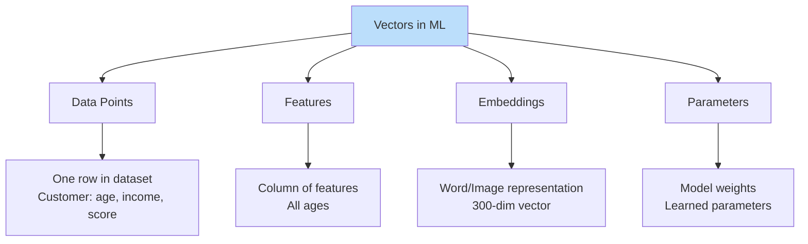
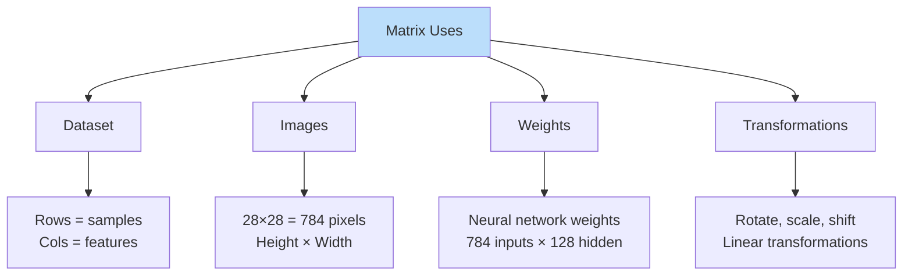
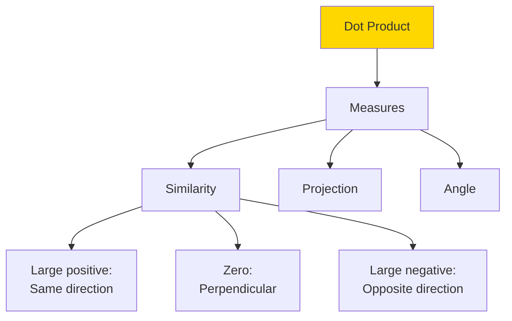
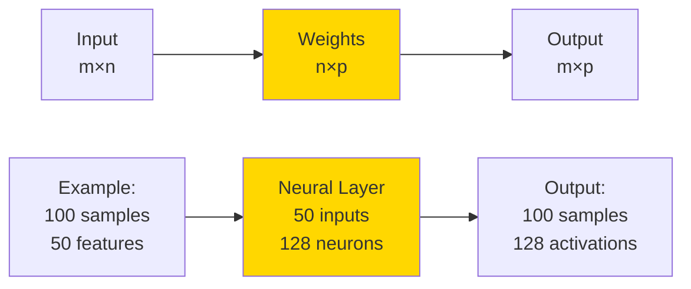
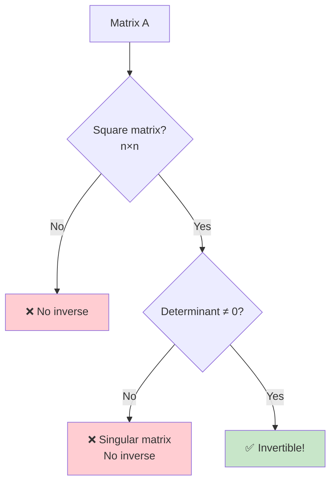
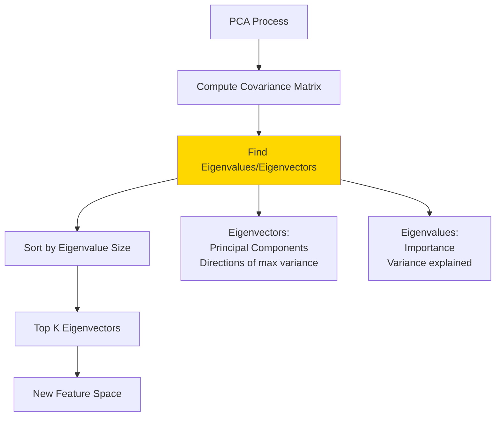
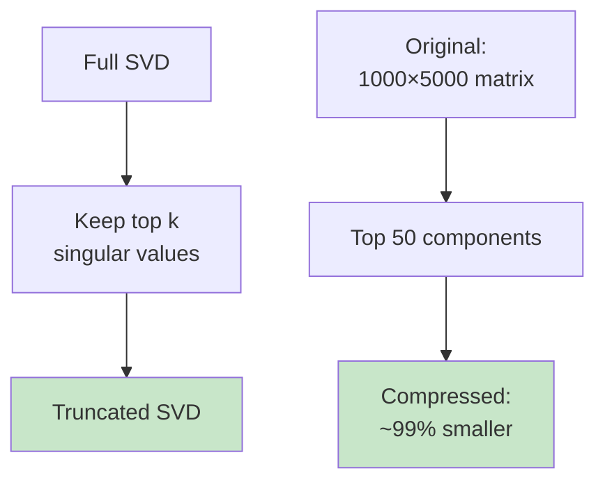

# ➗ LINEAR ALGEBRA - The Language of ML

**⭐ MOST IMPORTANT MATH FOR ML!**
40% of ML math is Linear Algebra. Master this and you'll understand most of ML!

**Time to Complete:** 2 weeks  
**Difficulty:** ⭐⭐⭐ Medium  
**Interview Weight:** ⭐⭐⭐⭐ CRITICAL!

---

## 🗺️ LINEAR ALGEBRA ROADMAP


---

## 📚 TABLE OF CONTENTS

| # | Topic | ML Application | Link |
|---|-------|----------------|------|
| 1 | **Vectors** | Data points, features | [[#1-vectors\|Jump]] |
| 2 | **Matrices** | Datasets, weights | [[#2-matrices\|Jump]] |
| 3 | **Vector Operations** | Transformations | [[#3-vector-operations\|Jump]] |
| 4 | **Dot Product** | Similarity, projections | [[#4-dot-product\|Jump]] |
| 5 | **Matrix Multiplication** | Neural networks | [[#5-matrix-multiplication\|Jump]] |
| 6 | **Matrix Inverse** | Solving equations | [[#6-matrix-inverse\|Jump]] |
| 7 | **Eigenvalues & Eigenvectors** | PCA | [[#7-eigenvalues--eigenvectors\|Jump]] |
| 8 | **SVD** | Recommendation systems | [[#8-svd-singular-value-decomposition\|Jump]] |

---

## 1. VECTORS

**💙 What is a Vector?**
A vector is an ordered list of numbers. In ML, vectors represent data points!

### Visual Understanding

```
2D Vector (in space):        Vector as Numbers:
     y
     ↑                        v = [3, 4]
   4 |   ● (3,4)
     |  ↗                     Position: x=3, y=4
   3 | ↗                      Magnitude: 5
   2 |↗                       Direction: ↗
   1 |
     └─────────→ x
       1 2 3 4

3D Vector:                   n-Dimensional Vector:
     z
     ↑                        v = [v₁, v₂, v₃, ..., vₙ]
    /|
   / |● (2,3,4)              Used in ML for:
  /  |                       - High-dimensional data
 /   |                       - Feature vectors
└────┼───→ y                 - Embeddings
     |
     ↓ x
```

### Vectors in Machine Learning



### Real-World Examples

**✅ Vectors Everywhere**

```
House as Vector:
v = [bedrooms, sq_ft, price, location_code]
v = [3, 1500, 300000, 5]

Customer as Vector:
v = [age, income, credit_score, years_customer]
v = [25, 50000, 720, 2]

Image as Vector:
28×28 grayscale image → Flatten to 784-dim vector
Each pixel (0-255) becomes one dimension

Word Embedding:
"king" → [0.2, -0.1, 0.5, ..., 0.3]  (300 dimensions)
Captures meaning in numbers!
```

### Vector Magnitude (Length)

```
Magnitude = Distance from origin

2D Example:
v = [3, 4]

Visual:
     y
   4 |   ● (3,4)
     |  ↗|
   3 | ↗ |
   2 |↗  | 4
   1 |   |
     └───┴───→ x
       3

Magnitude = √(3² + 4²) = √(9 + 16) = √25 = 5

Formula: ||v|| = √(v₁² + v₂² + ... + vₙ²)

ML Use:
- Distance between points
- Vector length/strength
- Normalization
```

### Unit Vector (Normalization)

```
Unit Vector = Vector with length 1

Original: v = [3, 4]
Magnitude: ||v|| = 5

Unit vector: v̂ = v / ||v||
v̂ = [3/5, 4/5] = [0.6, 0.8]

Check: √(0.6² + 0.8²) = √(0.36 + 0.64) = √1 = 1 ✓

ML Use:
- Feature normalization
- Direction only (ignore magnitude)
- Cosine similarity calculations
```

---

## 2. MATRICES

**💙 What is a Matrix?**
A matrix is a 2D grid of numbers. In ML, matrices represent entire datasets!

### Visual Understanding

```
Matrix A (3×3):

     Column 0  Column 1  Column 2
    ┌─────────┬─────────┬─────────┐
Row 0│    1    │    2    │    3    │
Row 1│    4    │    5    │    6    │
Row 2│    7    │    8    │    9    │
    └─────────┴─────────┴─────────┘

Shape: 3 rows × 3 columns = (3, 3)

Dataset as Matrix (100 samples, 5 features):

      age  income  score  exp  location
    ┌─────┬───────┬───────┬────┬─────────┐
  0 │ 25  │ 50000 │ 720   │ 2  │ 1       │
  1 │ 30  │ 60000 │ 750   │ 5  │ 2       │
  2 │ 35  │ 55000 │ 680   │ 3  │ 1       │
 ... 
 99 │ 28  │ 52000 │ 700   │ 4  │ 3       │
    └─────┴───────┴───────┴────┴─────────┘

Shape: (100, 5)
100 samples (rows)
5 features (columns)
```

### Matrix Representations



### Matrix Dimensions Matter

```
Shape notation: (rows, columns)

Small matrix (3×2):
┌───┬───┐
│ 1 │ 2 │
│ 3 │ 4 │
│ 5 │ 6 │
└───┴───┘
3 rows, 2 columns

Tall matrix: More rows than columns
Wide matrix: More columns than rows
Square matrix: Rows = Columns

ML Example:
Training data (1000 samples, 50 features):
Shape: (1000, 50)
- 1000 rows (one per customer)
- 50 columns (one per feature)
```

---

## 3. VECTOR OPERATIONS

**💙 Operating on Vectors**

### Vector Addition

```
Visual:
  v₁ = [2, 1]     v₂ = [1, 2]
  
     y                  y
     |                  |
   1 |  ● v₁          2 |    ● v₂
     | ↗                |   ↗
     └────→ x           └────→ x
       2                  1

Add them:
v₁ + v₂ = [2+1, 1+2] = [3, 3]

     y
     |
   3 |      ● (3,3)
     |     ↗
   2 |    ↗
   1 |   ↗
     └────────→ x
       1 2 3

Rule: Add component-wise
ML Use: Combining features, gradient updates
```

### Vector Subtraction

```
v₁ - v₂ = [2-1, 1-2] = [1, -1]

Geometric: Vector FROM v₂ TO v₁

     y
     |
   2 |● v₁
     | ↘ difference
   1 |  ●──→
     |  v₂
     └────→ x

ML Use: 
- Distance between points
- Error/residual calculation
- Gradient descent direction
```

### Scalar Multiplication

```
Scalar = Regular number
Vector = List of numbers

Multiply vector by scalar:
2 × [1, 2, 3] = [2, 4, 6]

Visual (2D):
v = [2, 1]
2v = [4, 2]  (twice as long, same direction)
0.5v = [1, 0.5]  (half as long, same direction)
-v = [-2, -1]  (opposite direction)

     y
     |
   2 |    ●─── 2v
     |   ↗
   1 |  ● v
     | ↗
     └────────→ x
       2  4

ML Use: Learning rate scaling, weight updates
```

---

## 4. DOT PRODUCT

**💙 Most Important Vector Operation!**

### What is Dot Product?

```
Dot Product: Multiply corresponding elements and sum

v₁ · v₂ = (v₁[0] × v₂[0]) + (v₁[1] × v₂[1]) + ...

Example:
v₁ = [1, 2, 3]
v₂ = [4, 5, 6]

v₁ · v₂ = (1×4) + (2×5) + (3×6)
        = 4 + 10 + 18
        = 32

Result: Single number (scalar)
```

### Geometric Interpretation



### Visual Understanding

```
v₁ · v₂ = ||v₁|| × ||v₂|| × cos(θ)

Where θ = angle between vectors

Same direction (θ = 0°):
v₁ ───→
v₂ ───→
cos(0°) = 1 → Large positive dot product

Perpendicular (θ = 90°):
v₁ ───→
v₂ 
  ↑
cos(90°) = 0 → Dot product = 0

Opposite direction (θ = 180°):
v₁ ───→
v₂ ←───
cos(180°) = -1 → Large negative dot product
```

### Dot Product Applications

**⭐ Critical for ML!**

```
1. Similarity Measurement:
   - Recommendation systems
   - Document similarity
   - Face recognition

   Example: Movie ratings
   User A: [5, 4, 1, 2]  (Action, Comedy, Drama, Horror)
   User B: [5, 5, 1, 1]
   
   Dot product: (5×5)+(4×5)+(1×1)+(2×1) = 25+20+1+2 = 48
   → Large positive → Similar taste!

2. Neural Networks:
   Every neuron computes dot product
   
   Input: [x₁, x₂, x₃]
   Weights: [w₁, w₂, w₃]
   
   Output: x · w = x₁w₁ + x₂w₂ + x₃w₃

3. Linear Regression:
   Prediction = X · β (features dot weights)

4. Cosine Similarity:
   cos(θ) = (v₁ · v₂) / (||v₁|| × ||v₂||)
   Range: -1 (opposite) to +1 (identical)
```

---

## 5. MATRIX MULTIPLICATION

**💙 The Heart of Neural Networks**

### Matrix Multiplication Rules

```
Matrix A (m×n) × Matrix B (n×p) = Matrix C (m×p)

Key Rule: Inner dimensions must match!

Valid:
(2×3) × (3×4) = (2×4) ✓
(100×50) × (50×10) = (100×10) ✓

Invalid:
(2×3) × (2×4) = ERROR ✗
(3×4) × (2×5) = ERROR ✗
```

### How It Works

```
A (2×3)  ×  B (3×2)  =  C (2×2)

A = [1 2 3]     B = [7 8]      C = [? ?]
    [4 5 6]         [9 10]         [? ?]
                    [11 12]

Step 1: First row of A · First column of B
[1, 2, 3] · [7, 9, 11] = (1×7)+(2×9)+(3×11) = 7+18+33 = 58

Step 2: First row of A · Second column of B
[1, 2, 3] · [8, 10, 12] = (1×8)+(2×10)+(3×12) = 8+20+36 = 64

Step 3: Second row of A · First column of B
[4, 5, 6] · [7, 9, 11] = (4×7)+(5×9)+(6×11) = 28+45+66 = 139

Step 4: Second row of A · Second column of B
[4, 5, 6] · [8, 10, 12] = (4×8)+(5×10)+(6×12) = 32+50+72 = 154

Result:
C = [58  64]
    [139 154]
```

### Matrix Multiplication Visual



### Neural Network Example

**⭐ This is how neural networks work!**

```
Forward Pass in Neural Network:

Input Layer (3 features):
X = [x₁, x₂, x₃]

Hidden Layer (4 neurons):
W = [w₁₁  w₁₂  w₁₃  w₁₄]
    [w₂₁  w₂₂  w₂₃  w₂₄]
    [w₃₁  w₃₂  w₃₃  w₃₄]

Output = X × W
Shape: (1×3) × (3×4) = (1×4)

Result: [h₁, h₂, h₃, h₄]  (4 hidden neurons activated)

Batch Processing (100 samples):
X: (100×3)  samples × features
W: (3×4)    features × neurons
Output: (100×4)  samples × neurons

One matrix multiplication processes entire batch!
```

---

## 6. MATRIX INVERSE

**💙 Solving Equations**

### Inverse Concept

```
Matrix inverse A⁻¹ "undoes" matrix A

A × A⁻¹ = I  (Identity matrix)

Identity Matrix I:
[1 0 0]
[0 1 0]
[0 0 1]

Like multiplying by 1 (does nothing)
```

### When Inverse Exists



### Solving Linear Equations

```
System of equations:
2x + 3y = 8
4x + 7y = 18

Matrix form: Ax = b
[2 3] [x]   [8]
[4 7] [y] = [18]

Solution: x = A⁻¹b

If A⁻¹ exists:
[x]     [2 3]⁻¹  [8]
[y] =   [4 7]    [18]

Compute A⁻¹ and multiply by b to get x, y
```

### ML Applications

**💡 Where Used**

```
1. Linear Regression (Closed Form):
   Normal Equation: β = (XᵀX)⁻¹Xᵀy
   
   Solves: min ||Xβ - y||²
   Finds optimal weights directly!

2. Covariance Matrix:
   Used in PCA, Gaussian processes
   Σ⁻¹ (inverse covariance) for Mahalanobis distance

3. Kalman Filters:
   State estimation in robotics, tracking

Note: 
- Computing inverse is expensive O(n³)
- For large matrices, use iterative methods
- Gradient descent often preferred over inverse
```

---

## 7. EIGENVALUES & EIGENVECTORS

**💙 Special Vectors for Transformations**

### What are Eigenvectors?

```
Eigenvector: Vector that doesn't change direction when transformed

A × v = λ × v

Where:
- A = transformation matrix
- v = eigenvector
- λ = eigenvalue (scaling factor)

Visual:
Most vectors change direction:
v ──→ Av  (rotated + scaled)

Eigenvector keeps direction:
v ──→ λv  (only scaled!)
```

### Visual Interpretation

```
Imagine stretching a rubber sheet:

Original:         After transformation:
    |                 /  /
    |                /  /
────┼────         ────────
    |               /  /
    |              /  /

Eigenvector 1: Horizontal (unchanged direction)
Eigenvector 2: Vertical (unchanged direction)

Everything else: Direction changes!
```

### PCA Connection



### Real-World Example

**✅ PCA for Dimensionality Reduction**

```
Original Data: 1000 features
Too many! Need to reduce.

PCA Steps:
1. Compute covariance matrix (1000×1000)
2. Find eigenvalues/eigenvectors
3. Sort eigenvalues (largest first)
4. Top 50 eigenvalues explain 95% of variance
5. Keep top 50 eigenvectors as new features

Result: 1000 → 50 features (95% info retained!)

Why it works:
Eigenvectors point in directions of maximum variance
These directions contain most information
```

### Applications

```
1. PCA (Principal Component Analysis):
   - Dimensionality reduction
   - Feature extraction
   - Data visualization

2. PageRank:
   - Google's original algorithm
   - Eigenvector of web graph
   - Importance = eigenvalue

3. Spectral Clustering:
   - Graph partitioning
   - Community detection

4. Stability Analysis:
   - Dynamical systems
   - Control theory
```

---

## 8. SVD (Singular Value Decomposition)

**💙 The Ultimate Matrix Factorization**

### What is SVD?

```
Any matrix A can be decomposed:
A = U × Σ × Vᵀ

Where:
- U: Left singular vectors (m×m)
- Σ: Singular values (m×n, diagonal)
- Vᵀ: Right singular vectors (n×n)

Think: Breaking matrix into simpler parts
```

### SVD Visualization

```
Original Matrix A (m×n):
┌─────────────┐
│             │
│      A      │  m rows
│             │
└─────────────┘
   n columns

Decompose:
┌────┐   ┌────────┐   ┌──────┐
│    │   │        │   │      │
│ U  │ × │   Σ    │ × │  Vᵀ  │
│    │   │        │   │      │
└────┘   └────────┘   └──────┘
 m×m       m×n          n×n

Σ = Diagonal matrix of singular values:
[σ₁  0   0   0]
[0   σ₂  0   0]
[0   0   σ₃  0]

Where: σ₁ ≥ σ₂ ≥ σ₃ ≥ ... ≥ 0
```

### Truncated SVD



### Recommendation System Example

**⭐ Netflix-style Recommendations**

```
User-Movie Rating Matrix:
         Movie1  Movie2  Movie3  ...  Movie1000
User1      5       ?       3           ?
User2      ?       4       ?           5
User3      3       ?       ?           4
...
User10000  ?       5       ?           ?

Problem: Lots of missing ratings (?)

SVD Solution:
1. Decompose: A = U × Σ × Vᵀ
2. Keep top 20 singular values (latent factors)
3. Reconstruct: A_approx = U₂₀ × Σ₂₀ × V₂₀ᵀ
4. A_approx has predictions for all ?

Latent factors represent:
- User preferences (U)
- Movie characteristics (V)
- Importance (Σ)

Example latent factors:
Factor 1: Action vs Drama
Factor 2: New vs Old
Factor 3: Hollywood vs Independent
```

### SVD Applications

```
1. Recommendation Systems:
   - Netflix movie recommendations
   - Amazon product recommendations
   - Collaborative filtering

2. Image Compression:
   - Keep top k singular values
   - Reduces storage 10-100x
   - Minimal quality loss

3. Noise Reduction:
   - Small singular values = noise
   - Remove them
   - Signal remains

4. Latent Semantic Analysis:
   - Document similarity
   - Topic modeling
   - Search engines

5. Pseudo-Inverse:
   - When matrix not invertible
   - Use SVD to compute pseudo-inverse
   - Solve least squares problems
```

---

## 💎 INTERVIEW QUESTIONS

**💎 Q: Explain dot product and its ML applications**

**Perfect Answer:**
"Dot product is a fundamental operation that takes two vectors and returns a scalar.

**Definition:**
v₁ · v₂ = v₁[0]×v₂[0] + v₁[1]×v₂[1] + ... + v₁[n]×v₂[n]

**Geometric meaning:**
Measures similarity and angle between vectors.
- Large positive: Same direction
- Zero: Perpendicular
- Large negative: Opposite direction

**Formula:** v₁ · v₂ = ||v₁|| × ||v₂|| × cos(θ)

**ML Applications:**

**1. Neural Networks:**
Every neuron computes weighted sum = dot product
Input × Weights = x₁w₁ + x₂w₂ + ... + xₙwₙ

**2. Similarity Measures:**
Cosine similarity for:
- Recommendation systems
- Document comparison
- Face recognition

**3. Linear Models:**
Prediction = features · weights
Linear regression, logistic regression, SVM

**4. Attention Mechanism:**
Transformer models use dot product attention
Query · Key = attention score

**Why important:**
Single most-used operation in deep learning!"

**💎 Q: How does PCA use eigenvalues/eigenvectors?**

**Perfect Answer:**
"PCA finds principal components using eigen-decomposition.

**Process:**

**1. Compute covariance matrix:**
Σ = (1/n) × XᵀX
Captures feature relationships

**2. Find eigenvalues and eigenvectors:**
Solve: Σv = λv
- Eigenvectors (v): Directions of variance
- Eigenvalues (λ): Amount of variance

**3. Sort by eigenvalue:**
Largest eigenvalue → Most important direction
Keep top k eigenvectors

**4. Project data:**
X_new = X × V_k
Transform to new coordinate system

**Intuition:**
Original data (1000 features):
- Features correlated
- Redundant information

PCA finds:
- Independent directions (eigenvectors)
- Ranked by importance (eigenvalues)
- Top 50 might explain 95% of variance

**Real example:**
Image dataset (784 pixels):
- Eigenvalue 1: 25% variance (brightness)
- Eigenvalue 2: 15% variance (edges)
- Eigenvalue 3: 10% variance (texture)
- Eigenvalues 4-50: 45% variance
- Eigenvalues 51-784: Only 5% variance

Keep top 50 → Reduce 784 to 50 dimensions!

**Why it works:**
Eigenvectors ARE the principal components
Eigenvalues tell us which ones matter"

**💎 Q: Explain matrix multiplication in neural networks**

**Perfect Answer:**
"Matrix multiplication is how data flows through neural networks.

**Single Layer:**
Input (batch × features) × Weights (features × neurons) = Output (batch × neurons)

**Example:**
```
Batch of 100 samples, 784 features (28×28 images):
X: (100 × 784)

First hidden layer with 128 neurons:
W1: (784 × 128)

Matrix multiplication:
H1 = X × W1
H1: (100 × 128)

Each of 100 samples now has 128 hidden features!
```

**Why matrix multiplication?**

**1. Batch processing:**
Process 100 samples at once
Parallelizes on GPU
Much faster than loops

**2. Linear transformation:**
Each neuron computes weighted sum of inputs
Weight matrix encodes all connections

**3. Dimension matching:**
(m×n) × (n×p) = (m×p)
Inner dimension must match!

**Deep network example:**
```
Input: (100×784)

Layer 1: (100×784) × (784×128) = (100×128)
Layer 2: (100×128) × (128×64) = (100×64)
Layer 3: (100×64) × (64×10) = (100×10)

Output: (100×10) - 10 classes for each sample
```

**Key insight:**
One matrix multiplication = Entire layer forward pass
This is why GPUs (optimized for matrix ops) are critical!

**Interview tip:**
Always mention shapes! Shows deep understanding."

---

**Tags:** #linear-algebra #vectors #matrices #eigenvalues #svd #pca  
**Difficulty:** ⭐⭐⭐ Medium  
**Time to Master:** 2 weeks  
**Last Updated:** 2026-11-11
