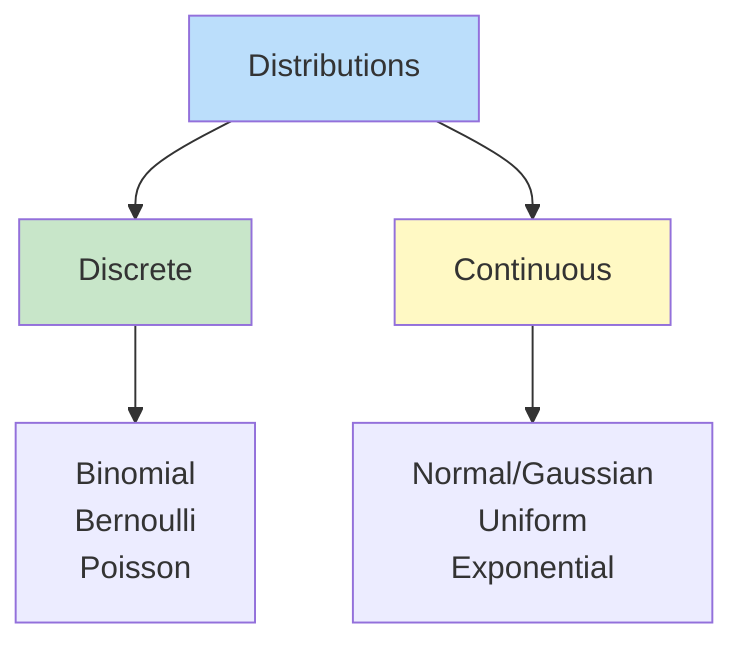

# 🎲 PROBABILITY - The Language of Uncertainty

> [!yellow] ⭐ **ML IS ALL ABOUT PROBABILITIES!**
> Every prediction is a probability! Understanding uncertainty is critical for ML.
> 
> **Time to Complete:** 1-2 weeks  
> **Difficulty:** ⭐⭐⭐ Medium  
> **Interview Weight:** ⭐⭐⭐⭐ VERY HIGH for ML roles!

---

## 🗺️ PROBABILITY LEARNING ROADMAP


---

## 📚 TABLE OF CONTENTS

| # | Topic | ML Application | Link |
|---|-------|----------------|------|
| 1 | **Probability Basics** | Foundation | [[#1-probability-basics\|Jump]] |
| 2 | **Bayes' Theorem** | Naive Bayes classifier | [[#2-bayes-theorem\|Jump]] |
| 3 | **Random Variables** | Modeling outcomes | [[#3-random-variables\|Jump]] |
| 4 | **Distributions** | Data modeling | [[#4-probability-distributions\|Jump]] |
| 5 | **Expectation & Variance** | Understanding data | [[#5-expectation-and-variance\|Jump]] |
| 6 | **Conditional Probability** | Decision making | [[#6-conditional-probability\|Jump]] |
| 7 | **Maximum Likelihood** | Model training | [[#7-maximum-likelihood-estimation\|Jump]] |

---

## 1. PROBABILITY BASICS

> [!blue] 💙 **What is Probability?**
> Probability measures the likelihood of an event occurring. It's a number between 0 and 1.

```
0 = Impossible
1 = Certain

0.5 = Equally likely to happen or not
```

### Key Concepts

> [!yellow] 💡 **Fundamental Rules**
> ```
> 1. Probability Range:
>    0 ≤ P(Event) ≤ 1
> 
> 2. Sum Rule:
>    P(All possible outcomes) = 1
> 
> 3. Complement Rule:
>    P(NOT A) = 1 - P(A)
> 
> 4. Addition Rule (Mutually Exclusive):
>    P(A OR B) = P(A) + P(B)
> 
> 5. Multiplication Rule (Independent):
>    P(A AND B) = P(A) × P(B)
> ```

> [!green] ✅ **Simple Examples**
> ```python
> import numpy as np
> 
> # Coin flip
> P_heads = 0.5
> P_tails = 0.5
> P_total = P_heads + P_tails  # = 1.0
> 
> # Two coin flips (independent)
> P_two_heads = P_heads * P_heads  # = 0.25
> 
> # Dice roll
> P_rolling_3 = 1/6  # ≈ 0.167
> P_rolling_even = 3/6  # = 0.5 (2, 4, or 6)
> 
> # NOT rolling 3
> P_not_3 = 1 - P_rolling_3  # = 5/6
> 
> print(f"P(heads) = {P_heads}")
> print(f"P(two heads) = {P_two_heads}")
> print(f"P(rolling 3) = {P_rolling_3:.3f}")
> print(f"P(not 3) = {P_not_3:.3f}")
> ```

> [!yellow] ⭐ **In Machine Learning**
> ```python
> # Binary classification: Logistic regression outputs probability
> from sklearn.linear_model import LogisticRegression
> import numpy as np
> 
> # Training data
> X = np.array([[1, 2], [2, 3], [3, 4], [5, 6], [6, 7]])
> y = np.array([0, 0, 0, 1, 1])  # Binary labels
> 
> # Train model
> model = LogisticRegression()
> model.fit(X, y)
> 
> # Predict PROBABILITIES (not just class!)
> X_test = np.array([[4, 5]])
> probabilities = model.predict_proba(X_test)
> 
> print(f"P(class=0) = {probabilities[0][0]:.3f}")  # ~0.45
> print(f"P(class=1) = {probabilities[0][1]:.3f}")  # ~0.55
> print(f"Sum = {probabilities[0].sum()}")          # 1.0
> 
> # This is probability in action!
> # ML models output probabilities, not certainties!
> ```

---

## 2. BAYES' THEOREM

> [!red] ⚠️ **ONE OF THE MOST IMPORTANT FORMULAS IN ML!**

> [!blue] 💙 **What is Bayes' Theorem?**
> A way to update probabilities based on new evidence.

### The Formula

```
P(A|B) = P(B|A) × P(A) / P(B)

In words:
P(Hypothesis|Evidence) = P(Evidence|Hypothesis) × P(Hypothesis) / P(Evidence)

Or in ML terms:
P(Class|Data) = P(Data|Class) × P(Class) / P(Data)

Posterior = Likelihood × Prior / Evidence
```

### Visual Understanding

```mermaid
graph LR
    A[Prior<br/>P(Class)] --> B[New Evidence<br/>P(Data|Class)]
    B --> C[Posterior<br/>P(Class|Data)]
    
    C --> D[Updated<br/>Belief!]
    
    style A fill:#fff9c4
    style B fill:#bbdefb
    style C fill:#c8e6c9
    style D fill:#ffd700
```

> [!green] ✅ **Classic Example: Medical Test**
> ```python
> # Disease detection
> # Given: Test is positive
> # Find: Probability of having disease
> 
> # Known probabilities:
> P_disease = 0.01           # 1% of people have disease (Prior)
> P_positive_given_disease = 0.99  # Test is 99% accurate (True Positive)
> P_positive_given_healthy = 0.05  # 5% false positive rate
> 
> # Calculate P(positive) - Total probability
> P_positive = (P_positive_given_disease * P_disease + 
>               P_positive_given_healthy * (1 - P_disease))
> 
> print(f"P(positive) = {P_positive:.4f}")  # 0.0594
> 
> # Bayes' Theorem: P(disease|positive)
> P_disease_given_positive = (P_positive_given_disease * P_disease) / P_positive
> 
> print(f"\nGiven positive test:")
> print(f"P(disease|positive) = {P_disease_given_positive:.2%}")  # 16.64%
> 
> # Surprising! Only 16.64% chance despite 99% accurate test!
> # Why? Disease is rare (1%), so most positives are false alarms
> ```

> [!yellow] ⭐ **Spam Email Detection (Naive Bayes)**
> ```python
> import numpy as np
> 
> # Spam detection using Bayes' Theorem
> 
> # Prior probabilities
> P_spam = 0.3        # 30% of emails are spam
> P_not_spam = 0.7    # 70% are legitimate
> 
> # Likelihoods: Word appears in email
> word = "FREE"
> P_word_given_spam = 0.7       # 70% of spam contains "FREE"
> P_word_given_not_spam = 0.05  # 5% of legit emails contain "FREE"
> 
> # Calculate P(word) - Evidence
> P_word = (P_word_given_spam * P_spam + 
>           P_word_given_not_spam * P_not_spam)
> 
> # Bayes' Theorem: P(spam|word)
> P_spam_given_word = (P_word_given_spam * P_spam) / P_word
> 
> print(f"Email contains '{word}'")
> print(f"P(spam|{word}) = {P_spam_given_word:.2%}")  # 85.71%
> 
> # Now with multiple words (Naive Bayes assumption: words are independent)
> words = ["FREE", "WIN", "CLICK"]
> P_words_given_spam = 0.7 * 0.6 * 0.5        # = 0.21
> P_words_given_not_spam = 0.05 * 0.01 * 0.1  # = 0.00005
> 
> P_words = (P_words_given_spam * P_spam + 
>            P_words_given_not_spam * P_not_spam)
> 
> P_spam_given_words = (P_words_given_spam * P_spam) / P_words
> 
> print(f"\nEmail contains {words}")
> print(f"P(spam|words) = {P_spam_given_words:.2%}")  # 99.94%
> 
> # This is how Naive Bayes classifier works!
> ```

> [!yellow] 💎 **Interview Question: Bayes' Theorem**
> 
> **Q: Explain Bayes' Theorem and its use in ML**
> 
> **Perfect Answer:**
> "Bayes' Theorem updates probabilities based on new evidence:
> 
> P(A|B) = P(B|A) × P(A) / P(B)
> 
> Components:
> - **Prior P(A)**: Initial belief before evidence
> - **Likelihood P(B|A)**: Probability of evidence given hypothesis
> - **Posterior P(A|B)**: Updated belief after seeing evidence
> 
> ML Applications:
> 
> 1. **Naive Bayes Classifier**:
>    - Text classification (spam detection)
>    - Assumes features are independent (naive assumption)
>    - Very fast and works well despite strong assumption
> 
> 2. **Bayesian Networks**:
>    - Model dependencies between variables
>    - Medical diagnosis, fault detection
> 
> 3. **Bayesian Optimization**:
>    - Hyperparameter tuning
>    - Sequential model-based optimization
> 
> Example: Spam detection
> - Prior: 30% emails are spam
> - See word 'FREE' (evidence)
> - Update to: 86% chance it's spam
> 
> Key insight: Start with prior belief, update with evidence!"

---

## 3. RANDOM VARIABLES

> [!blue] 💙 **What is a Random Variable?**
> A variable whose value depends on random chance. It maps outcomes to numbers.

### Types

```
Discrete Random Variable:
- Countable values
- Examples: Coin flips (0 or 1), Dice (1-6), Number of customers

Continuous Random Variable:
- Any value in a range
- Examples: Height, Temperature, Time
```

> [!green] ✅ **Discrete Random Variable**
> ```python
> import numpy as np
> import matplotlib.pyplot as plt
> 
> # Dice roll - Discrete random variable
> # X = outcome of rolling a die
> 
> outcomes = [1, 2, 3, 4, 5, 6]
> probabilities = [1/6, 1/6, 1/6, 1/6, 1/6, 1/6]
> 
> # Probability Mass Function (PMF)
> print("Dice Roll PMF:")
> for outcome, prob in zip(outcomes, probabilities):
>     print(f"P(X={outcome}) = {prob:.3f}")
> 
> # Simulate 1000 rolls
> rolls = np.random.choice(outcomes, size=1000, p=probabilities)
> 
> # Visualize
> plt.hist(rolls, bins=6, density=True, alpha=0.7, edgecolor='black')
> plt.xlabel('Outcome')
> plt.ylabel('Probability')
> plt.title('Dice Roll Distribution')
> plt.show()
> 
> print(f"\nAverage roll: {rolls.mean():.2f}")  # ~3.5
> ```

> [!green] ✅ **Continuous Random Variable**
> ```python
> import numpy as np
> import matplotlib.pyplot as plt
> 
> # Height - Continuous random variable
> # X = person's height
> 
> # Generate heights from normal distribution
> mean_height = 170  # cm
> std_height = 10    # cm
> 
> heights = np.random.normal(mean_height, std_height, 1000)
> 
> # Probability Density Function (PDF)
> plt.hist(heights, bins=30, density=True, alpha=0.7, edgecolor='black')
> plt.xlabel('Height (cm)')
> plt.ylabel('Density')
> plt.title('Height Distribution')
> plt.show()
> 
> # For continuous: P(X = exact value) = 0
> # Instead: P(a < X < b) = area under PDF curve
> 
> # Probability between 165 and 175 cm
> prob = np.sum((heights > 165) & (heights < 175)) / len(heights)
> print(f"P(165 < Height < 175) = {prob:.2%}")  # ~68% (1 std dev)
> ```

---

## 4. PROBABILITY DISTRIBUTIONS

> [!blue] 💙 **What are Distributions?**
> Mathematical functions that describe how probabilities are distributed across possible values.



### 1. Normal Distribution (Gaussian)

> [!yellow] ⭐ **MOST IMPORTANT DISTRIBUTION IN ML!**

```
Bell curve - Most data in nature follows this!

Properties:
- Symmetric around mean (μ)
- Spread controlled by standard deviation (σ)
- 68% within 1σ, 95% within 2σ, 99.7% within 3σ
```

```
         Normal Distribution
              
       *****
      *     *
     *       *
    *         *    68% within ±1σ
   *           *   95% within ±2σ
  *             *  99.7% within ±3σ
 *_______________*
μ-3σ  μ-1σ  μ  μ+1σ μ+3σ
```

> [!green] ✅ **Normal Distribution in Code**
> ```python
> import numpy as np
> import matplotlib.pyplot as plt
> from scipy import stats
> 
> # Parameters
> mean = 0
> std = 1  # Standard normal distribution
> 
> # Generate samples
> samples = np.random.normal(mean, std, 1000)
> 
> # Probability Density Function
> x = np.linspace(-4, 4, 100)
> pdf = stats.norm.pdf(x, mean, std)
> 
> # Plot
> plt.figure(figsize=(10, 6))
> plt.hist(samples, bins=30, density=True, alpha=0.6, label='Samples')
> plt.plot(x, pdf, 'r-', linewidth=2, label='PDF')
> plt.xlabel('Value')
> plt.ylabel('Density')
> plt.title('Normal Distribution')
> plt.legend()
> plt.grid(True, alpha=0.3)
> plt.show()
> 
> # Calculate probabilities
> # P(X < 1)
> prob_less_than_1 = stats.norm.cdf(1, mean, std)
> print(f"P(X < 1) = {prob_less_than_1:.2%}")  # 84.13%
> 
> # P(-1 < X < 1) - Within 1 standard deviation
> prob_within_1std = stats.norm.cdf(1, mean, std) - stats.norm.cdf(-1, mean, std)
> print(f"P(-1 < X < 1) = {prob_within_1std:.2%}")  # 68.27%
> ```

> [!yellow] ⭐ **Why Normal Distribution Matters in ML**
> ```python
> # 1. Central Limit Theorem
> # Average of large samples follows normal distribution!
> 
> # Roll dice 1000 times, average groups of 30
> averages = []
> for _ in range(1000):
>     dice_rolls = np.random.randint(1, 7, 30)
>     averages.append(dice_rolls.mean())
> 
> # Averages are normally distributed!
> plt.hist(averages, bins=30, density=True, alpha=0.7)
> plt.title('Distribution of Averages (CLT)')
> plt.xlabel('Average')
> plt.show()
> 
> # 2. Feature Normalization
> # ML models work better when features are normally distributed
> from sklearn.preprocessing import StandardScaler
> 
> data = np.array([[100], [150], [200], [250], [300]])
> scaler = StandardScaler()
> normalized = scaler.fit_transform(data)
> 
> print("Normalized data (mean=0, std=1):")
> print(normalized.flatten())  # [-1.41, -0.71, 0, 0.71, 1.41]
> 
> # 3. Gaussian Naive Bayes
> # Assumes features follow normal distribution
> from sklearn.naive_bayes import GaussianNB
> 
> # This classifier assumes P(feature|class) is Gaussian!
> ```

### 2. Binomial Distribution

> [!blue] 💙 **For Repeated Yes/No Trials**

```
Number of successes in n independent trials
Each trial has probability p

Example: Flip coin 10 times, count heads
```

> [!green] ✅ **Binomial Distribution**
> ```python
> from scipy import stats
> import numpy as np
> import matplotlib.pyplot as plt
> 
> # Flip coin 10 times, probability of heads = 0.5
> n = 10  # Number of trials
> p = 0.5  # Probability of success
> 
> # PMF: Probability of exactly k heads
> k_values = range(0, n+1)
> probabilities = [stats.binom.pmf(k, n, p) for k in k_values]
> 
> plt.bar(k_values, probabilities)
> plt.xlabel('Number of Heads')
> plt.ylabel('Probability')
> plt.title(f'Binomial Distribution (n={n}, p={p})')
> plt.show()
> 
> # Examples:
> # P(exactly 5 heads)
> print(f"P(5 heads) = {stats.binom.pmf(5, n, p):.3f}")  # 0.246
> 
> # P(at most 3 heads)
> print(f"P(≤3 heads) = {stats.binom.cdf(3, n, p):.3f}")  # 0.172
> 
> # Expected value: E[X] = n × p
> expected = n * p
> print(f"Expected heads: {expected}")  # 5.0
> ```

### 3. Poisson Distribution

> [!blue] 💙 **For Counting Events in Fixed Interval**

```
Number of events occurring in fixed time/space

Examples:
- Number of emails per hour
- Number of customers per day
- Number of bugs per 1000 lines of code
```

> [!green] ✅ **Poisson Distribution**
> ```python
> from scipy import stats
> 
> # Average 3 customers per hour
> lambda_rate = 3
> 
> # P(exactly k customers in next hour)
> for k in range(8):
>     prob = stats.poisson.pmf(k, lambda_rate)
>     print(f"P({k} customers) = {prob:.3f}")
> 
> # Visualize
> k_values = range(0, 12)
> probabilities = [stats.poisson.pmf(k, lambda_rate) for k in k_values]
> 
> plt.bar(k_values, probabilities)
> plt.xlabel('Number of Customers')
> plt.ylabel('Probability')
> plt.title(f'Poisson Distribution (λ={lambda_rate})')
> plt.show()
> ```

---

## 5. EXPECTATION AND VARIANCE

> [!blue] 💙 **Describing a Distribution**

### Expectation (Mean)

```
Expected Value E[X] = Average outcome if repeated many times

Discrete: E[X] = Σ x·P(X=x)
Continuous: E[X] = ∫ x·f(x) dx

It's the "center" of the distribution
```

### Variance

```
Variance Var(X) = Average squared distance from mean
Var(X) = E[(X - μ)²] = E[X²] - (E[X])²

Standard Deviation σ = √Var(X)

It measures "spread" of the distribution
```

> [!green] ✅ **Computing Expectation & Variance**
> ```python
> import numpy as np
> 
> # Dice roll
> outcomes = np.array([1, 2, 3, 4, 5, 6])
> probabilities = np.array([1/6, 1/6, 1/6, 1/6, 1/6, 1/6])
> 
> # Expectation: E[X] = Σ x·P(x)
> expectation = np.sum(outcomes * probabilities)
> print(f"E[X] = {expectation}")  # 3.5
> 
> # Variance: E[X²] - (E[X])²
> E_X_squared = np.sum(outcomes**2 * probabilities)
> variance = E_X_squared - expectation**2
> std_dev = np.sqrt(variance)
> 
> print(f"Var(X) = {variance:.3f}")   # 2.917
> print(f"σ = {std_dev:.3f}")         # 1.708
> 
> # Verify with simulation
> rolls = np.random.choice(outcomes, size=100000, p=probabilities)
> print(f"\nSimulation (100k rolls):")
> print(f"Mean: {rolls.mean():.3f}")        # ~3.5
> print(f"Std: {rolls.std():.3f}")          # ~1.71
> ```

> [!yellow] ⭐ **In Machine Learning**
> ```python
> # Model predictions as expectations
> import numpy as np
> 
> # Regression: Predict expected value
> # Given features, what's the expected price?
> 
> # Classification: Expected value of indicator
> # P(y=1|x) is expectation of binary variable
> 
> # Example: Probabilistic predictions
> predictions = np.array([0.7, 0.3, 0.9, 0.1])  # P(class=1)
> 
> # Expected number of class=1 predictions
> expected_positives = predictions.sum()
> print(f"Expected positives: {expected_positives}")  # 2.0
> 
> # Variance in predictions (uncertainty)
> # High variance = Model is uncertain
> # Low variance = Model is confident
> 
> confident_preds = np.array([0.99, 0.01, 0.98, 0.02])
> uncertain_preds = np.array([0.6, 0.4, 0.55, 0.45])
> 
> print(f"Confident model variance: {confident_preds.var():.4f}")  # 0.2399
> print(f"Uncertain model variance: {uncertain_preds.var():.4f}") # 0.0075
> ```

---

## 6. CONDITIONAL PROBABILITY

> [!blue] 💙 **Probability Given Information**

```
P(A|B) = "Probability of A given B"

Formula:
P(A|B) = P(A AND B) / P(B)

Assuming P(B) > 0
```

> [!green] ✅ **Examples**
> ```python
> # Card deck example
> # P(King | Red card)
> 
> total_cards = 52
> red_cards = 26
> red_kings = 2  # King of hearts, King of diamonds
> 
> P_king_given_red = red_kings / red_cards
> print(f"P(King|Red) = {P_king_given_red:.3f}")  # 0.077 (2/26)
> 
> # Compare to:
> P_king = 4 / total_cards
> print(f"P(King) = {P_king:.3f}")  # 0.077 (4/52)
> 
> # Information about color changes the probability!
> 
> # Weather example
> # P(Rain tomorrow | Cloudy today)
> 
> P_rain = 0.1              # 10% chance of rain normally
> P_cloudy = 0.3            # 30% chance of cloudy
> P_cloudy_given_rain = 0.8 # 80% of rainy days are cloudy first
> 
> # P(Cloudy AND Rain)
> P_rain_and_cloudy = P_cloudy_given_rain * P_rain
> 
> # P(Rain | Cloudy) = P(Cloudy AND Rain) / P(Cloudy)
> P_rain_given_cloudy = P_rain_and_cloudy / P_cloudy
> 
> print(f"\nP(Rain) = {P_rain:.2%}")                        # 10%
> print(f"P(Rain|Cloudy) = {P_rain_given_cloudy:.2%}")     # 26.67%
> 
> # Knowing it's cloudy increased rain probability!
> ```

### Independence

```
Events A and B are independent if:
P(A|B) = P(A)

Knowing B doesn't change probability of A

Then: P(A AND B) = P(A) × P(B)
```

> [!yellow] 💡 **Independence vs Conditional**
> ```python
> # Independent: Coin flips
> # Flip 1 doesn't affect Flip 2
> P_heads_flip1 = 0.5
> P_heads_flip2 = 0.5
> P_heads_flip2_given_flip1_heads = 0.5  # Still 0.5!
> 
> # NOT independent: Cards without replacement
> # Drawing first card affects second
> P_ace_first = 4/52      # 7.69%
> P_ace_second = 4/52     # If independent
> 
> # But if first was ace:
> P_ace_second_given_first_ace = 3/51  # 5.88% (lower!)
> 
> # They're dependent!
> ```

---

## 7. MAXIMUM LIKELIHOOD ESTIMATION

> [!red] ⚠️ **HOW WE TRAIN MANY ML MODELS!**

> [!blue] 💙 **What is MLE?**
> Find model parameters that make observed data most likely.

```
Given: Data
Find: Parameters θ that maximize P(Data|θ)

"What parameter values make our data most probable?"
```

```mermaid
graph TD
    A[Observed Data] --> B[Likelihood Function<br/>P(Data|θ)]
    B --> C[Find θ that<br/>maximizes likelihood]
    C --> D[Optimal Parameters!]
    
    style A fill:#bbdefb
    style B fill:#fff9c4
    style C fill:#c8e6c9
    style D fill:#ffd700
```

> [!green] ✅ **Simple Example: Coin Bias**
> ```python
> import numpy as np
> from scipy import stats
> 
> # We flip a coin 10 times: 7 heads, 3 tails
> # What's the probability of heads (p)?
> 
> heads = 7
> tails = 3
> n = heads + tails
> 
> # Try different values of p
> p_values = np.linspace(0, 1, 100)
> likelihoods = []
> 
> for p in p_values:
>     # Likelihood: P(7 heads in 10 flips | p)
>     likelihood = stats.binom.pmf(heads, n, p)
>     likelihoods.append(likelihood)
> 
> # Find maximum
> best_p = p_values[np.argmax(likelihoods)]
> 
> plt.plot(p_values, likelihoods)
> plt.axvline(best_p, color='r', linestyle='--', label=f'MLE: p={best_p:.2f}')
> plt.xlabel('p (probability of heads)')
> plt.ylabel('Likelihood')
> plt.title('Maximum Likelihood Estimation')
> plt.legend()
> plt.show()
> 
> print(f"Maximum Likelihood Estimate: p = {best_p:.2f}")  # 0.70
> 
> # Analytical solution: p = heads / total = 7/10 = 0.7
> analytical = heads / n
> print(f"Analytical MLE: p = {analytical}")  # 0.7
> ```

> [!yellow] ⭐ **MLE for Linear Regression**
> ```python
> import numpy as np
> from scipy import stats
> 
> # Data: y = 2x + 1 + noise
> np.random.seed(42)
> X = np.array([1, 2, 3, 4, 5])
> y_true = 2 * X + 1
> y = y_true + np.random.normal(0, 0.5, size=len(X))  # Add noise
> 
> # Model: y = w*x + b, noise ~ N(0, σ²)
> # Find w, b that maximize likelihood
> 
> # Grid search (simplified)
> w_range = np.linspace(1.5, 2.5, 50)
> b_range = np.linspace(0.5, 1.5, 50)
> 
> best_likelihood = -np.inf
> best_w, best_b = 0, 0
> 
> for w in w_range:
>     for b in b_range:
>         predictions = w * X + b
>         
>         # Log-likelihood: Σ log P(y_i | w, b)
>         # Assume Gaussian noise
>         log_likelihood = np.sum(stats.norm.logpdf(y, predictions, 0.5))
>         
>         if log_likelihood > best_likelihood:
>             best_likelihood = log_likelihood
>             best_w, best_b = w, b
> 
> print(f"MLE estimates:")
> print(f"w = {best_w:.3f} (true: 2.0)")
> print(f"b = {best_b:.3f} (true: 1.0)")
> 
> # Plot
> plt.scatter(X, y, label='Data')
> plt.plot(X, y_true, 'g--', label='True line')
> plt.plot(X, best_w * X + best_b, 'r-', label='MLE fit')
> plt.legend()
> plt.title('Maximum Likelihood Estimation')
> plt.show()
> 
> # In practice, scikit-learn does this automatically!
> from sklearn.linear_model import LinearRegression
> model = LinearRegression()
> model.fit(X.reshape(-1, 1), y)
> print(f"\nsklearn: w={model.coef_[0]:.3f}, b={model.intercept_:.3f}")
> ```

> [!yellow] 💎 **Interview Question: MLE**
> 
> **Q: Explain Maximum Likelihood Estimation**
> 
> **Perfect Answer:**
> "MLE finds model parameters that make observed data most probable.
> 
> Process:
> 1. Start with data: D = {x₁, x₂, ..., xₙ}
> 2. Have model with parameters: θ
> 3. Define likelihood: L(θ) = P(D|θ)
> 4. Find θ that maximizes L(θ)
> 
> In practice:
> - Use log-likelihood (easier math, same result)
> - Often equivalent to minimizing loss function
> 
> Examples in ML:
> 
> 1. **Linear Regression**:
>    - Assume Gaussian noise
>    - MLE = Minimize squared error (MSE)
> 
> 2. **Logistic Regression**:
>    - Assume Bernoulli distribution
>    - MLE = Minimize log loss (cross-entropy)
> 
> 3. **Gaussian Naive Bayes**:
>    - Estimate mean and variance per class
>    - MLE gives sample mean and variance
> 
> Key insight: Training many ML models is finding parameters that maximize likelihood of seeing the training data!"

---

## 🎯 PROBABILITY INTERVIEW QUESTIONS

> [!red] ⚠️ **Must-Know Interview Questions**

### Q1: Law of Total Probability

> [!yellow] 💎 **Q: Three factories produce light bulbs. Factory A produces 30% (2% defective), Factory B produces 50% (3% defective), Factory C produces 20% (4% defective). What's the probability a random bulb is defective?**
> ```python
> # Law of Total Probability:
> # P(D) = P(D|A)·P(A) + P(D|B)·P(B) + P(D|C)·P(C)
> 
> P_A = 0.30
> P_B = 0.50
> P_C = 0.20
> 
> P_defective_given_A = 0.02
> P_defective_given_B = 0.03
> P_defective_given_C = 0.04
> 
> P_defective = (P_defective_given_A * P_A +
>                P_defective_given_B * P_B +
>                P_defective_given_C * P_C)
> 
> print(f"P(defective) = {P_defective:.3f}")  # 0.029 = 2.9%
> 
> # Follow-up: Given defective bulb, what's P(from Factory A)?
> # Use Bayes' Theorem!
> P_A_given_defective = (P_defective_given_A * P_A) / P_defective
> print(f"P(A|defective) = {P_A_given_defective:.3f}")  # 0.207 = 20.7%
> ```

### Q2: Expected Value

> [!yellow] 💎 **Q: You pay $1 to play. Roll die: if 6, win $5. If 1-5, win nothing. Should you play?**
> ```python
> # Calculate expected value
> # E[Winnings] = Σ (outcome × probability)
> 
> cost = 1
> 
> # Outcomes:
> # Roll 6: Win $5 - $1 = $4 net
> # Roll 1-5: Win $0 - $1 = -$1 net
> 
> P_win = 1/6
> P_lose = 5/6
> 
> net_win = 5 - cost   # $4
> net_lose = 0 - cost  # -$1
> 
> expected_value = P_win * net_win + P_lose * net_lose
> 
> print(f"Expected value: ${expected_value:.2f}")  # -$0.17
> 
> # Answer: NO! You lose $0.17 on average per game.
> 
> # Perfect Answer:
> # "Calculate expected value: E[X] = 1/6 × $4 + 5/6 × (-$1) = -$0.17
> #  This is a losing game. Over many plays, you'll lose $0.17 per game on average."
> ```

### Q3: Conditional Probability

> [!yellow] 💎 **Q: 1% have disease. Test is 95% sensitive (true positive) and 90% specific (true negative). Test positive - what's probability you have disease?**
> ```python
> # Bayes' Theorem application
> 
> P_disease = 0.01
> P_healthy = 0.99
> 
> P_positive_given_disease = 0.95  # Sensitivity
> P_negative_given_healthy = 0.90  # Specificity
> P_positive_given_healthy = 1 - P_negative_given_healthy  # 0.10
> 
> # P(positive) using law of total probability
> P_positive = (P_positive_given_disease * P_disease +
>               P_positive_given_healthy * P_healthy)
> 
> print(f"P(positive) = {P_positive:.4f}")  # 0.1045
> 
> # P(disease|positive) using Bayes
> P_disease_given_positive = (P_positive_given_disease * P_disease) / P_positive
> 
> print(f"P(disease|positive) = {P_disease_given_positive:.2%}")  # 9.09%
> 
> # Answer: Only 9.09% chance!
> # Even with positive test, low because disease is rare.
> ```

---

## 🔗 NEXT STEPS

> [!green] ✅ **Congratulations! You've Completed Foundation Math!**

**You've mastered:**
- ✅ Linear Algebra (vectors, matrices, eigenvalues)
- ✅ Calculus (derivatives, gradients, optimization)
- ✅ Probability (distributions, Bayes, MLE)

**Next Topics:**
- [[../../03-Machine-Learning/README|Machine Learning Algorithms]]
- Start applying math to real ML problems!

**Practice Projects:**
1. Implement Naive Bayes from scratch
2. Build logistic regression using MLE
3. Create Bayesian A/B test analyzer

---

## 📚 PROBABILITY IN ML - SUMMARY

> [!blue] 💙 **Where You'll Use Probability**

```
Classification:
✅ Output probabilities, not just labels
✅ Logistic Regression → P(y=1|x)
✅ Softmax → P(class|x)

Naive Bayes:
✅ Direct application of Bayes' Theorem
✅ Text classification, spam detection

Uncertainty:
✅ Model confidence
✅ Prediction intervals
✅ Bayesian Neural Networks

Training:
✅ Maximum Likelihood Estimation
✅ Cross-entropy loss
✅ Probabilistic graphical models

Reinforcement Learning:
✅ Policy: P(action|state)
✅ Value functions: Expected rewards
✅ Exploration vs Exploitation
```

---

**Tags:** #probability #statistics #bayes-theorem #distributions #mle  
**Difficulty:** ⭐⭐⭐ Medium  
**Time to Master:** 1-2 weeks  
**Last Updated:** 2026-11-11
