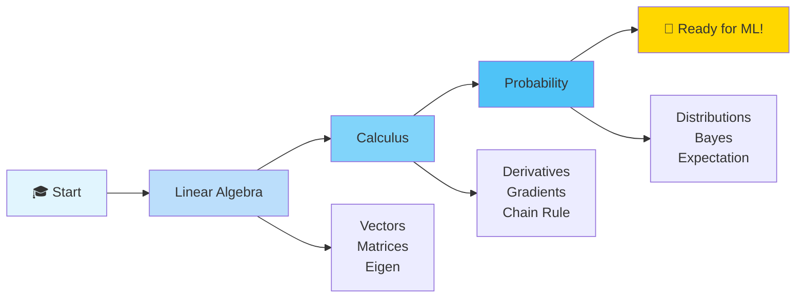
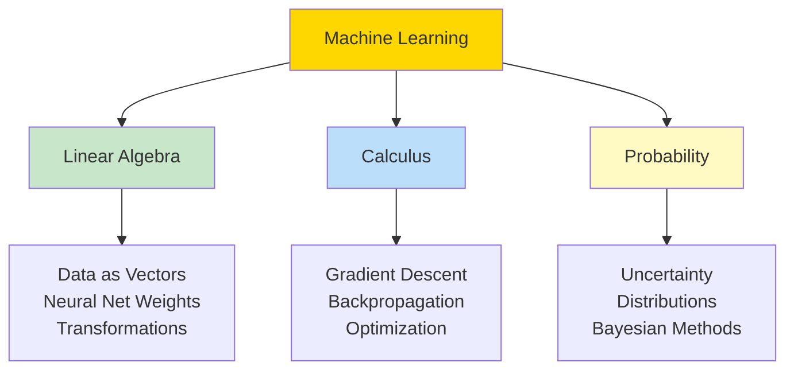
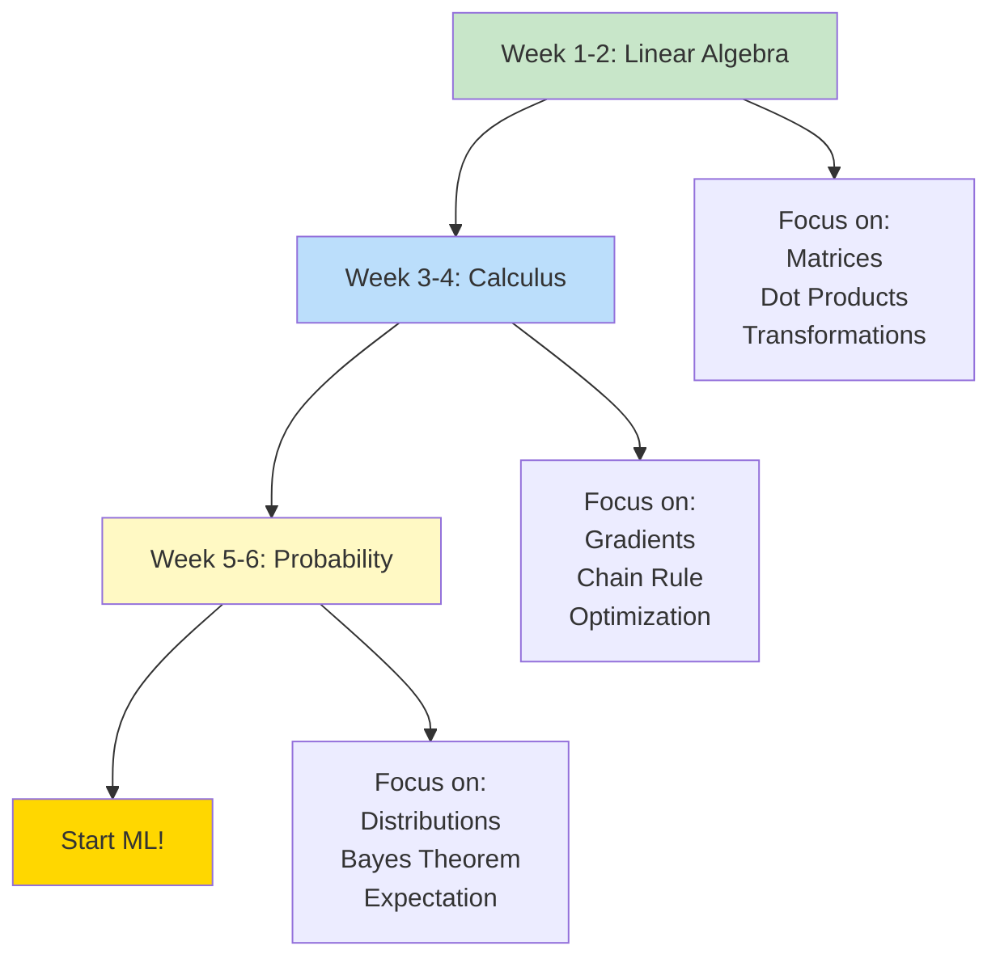

# ➗ MATHEMATICS FOR MACHINE LEARNING

> [!yellow] ⭐ **THE FOUNDATION OF AI/ML!**
> You CAN'T truly understand ML without the math! This is what separates good from great ML engineers.
> 
> **Time to Complete:** 4-6 weeks  
> **Difficulty:** ⭐⭐⭐ Medium-Hard  
> **Interview Weight:** ⭐⭐⭐ CRITICAL for serious ML roles!

---

## 🗺️ MATH LEARNING ROADMAP



---

## 📚 THE THREE PILLARS

> [!blue] 💙 **Why Math Matters in ML**



---

## 1️⃣ LINEAR ALGEBRA

> [!blue] 💙 **The Language of Data**
> Everything in ML is vectors and matrices!

### What You'll Learn

| Topic | Why It Matters | Link |
|-------|----------------|------|
| **Vectors** | Data points, features | [[Linear-Algebra/README#vectors\|Learn]] |
| **Matrices** | Datasets, transformations | [[Linear-Algebra/README#matrices\|Learn]] |
| **Dot Product** | Similarity, projections | [[Linear-Algebra/README#dot-product\|Learn]] |
| **Matrix Multiplication** | Neural network operations | [[Linear-Algebra/README#matrix-multiplication\|Learn]] |
| **Eigenvalues/Eigenvectors** | PCA, dimensionality reduction | [[Linear-Algebra/README#eigen\|Learn]] |
| **Singular Value Decomposition** | Matrix factorization, compression | [[Linear-Algebra/README#svd\|Learn]] |

> [!green] ✅ **Where You'll Use It**
> - 🧠 **Neural Networks**: Matrix multiplications everywhere!
> - 📊 **PCA**: Eigenvalues and eigenvectors
> - 🖼️ **Computer Vision**: Image transformations
> - 📝 **NLP**: Word embeddings are vectors
> - 🎯 **Recommendation Systems**: Matrix factorization

> [!yellow] ⭐ **Quick Example**
> ```python
> # Neural network layer = Matrix multiplication!
> import numpy as np
> 
> # Input: 1 sample, 3 features
> X = np.array([[1, 2, 3]])  # Shape: (1, 3)
> 
> # Weights: 3 inputs → 2 outputs
> W = np.array([[0.1, 0.5],
>               [0.2, 0.6],
>               [0.3, 0.7]])  # Shape: (3, 2)
> 
> # Forward pass = Matrix multiplication
> output = X @ W  # Shape: (1, 2)
> # [[1.4, 2.6]]
> 
> # This is linear algebra in action!
> ```

**→ [[Linear-Algebra/README|Start Linear Algebra]]**

---

## 2️⃣ CALCULUS

> [!blue] 💙 **How ML Learns**
> Calculus powers optimization and training!

### What You'll Learn

| Topic | Why It Matters | Link |
|-------|----------------|------|
| **Derivatives** | Rate of change, slopes | [[Calculus/README#derivatives\|Learn]] |
| **Partial Derivatives** | Gradients in multiple dimensions | [[Calculus/README#partial-derivatives\|Learn]] |
| **Gradient** | Direction of steepest ascent | [[Calculus/README#gradients\|Learn]] |
| **Chain Rule** | Backpropagation! | [[Calculus/README#chain-rule\|Learn]] |
| **Gradient Descent** | How models learn | [[Calculus/README#gradient-descent\|Learn]] |

> [!green] ✅ **Where You'll Use It**
> - 🎯 **Training**: Gradient descent optimization
> - 🔙 **Backpropagation**: Chain rule through layers
> - 📉 **Loss Functions**: Minimizing error
> - ⚙️ **Hyperparameter Tuning**: Understanding learning rates
> - 🧠 **Deep Learning**: All optimization algorithms

> [!yellow] ⭐ **Quick Example**
> ```python
> # Gradient Descent in action
> import numpy as np
> 
> # Loss function: L = (y - prediction)²
> # Goal: Minimize loss by adjusting weights
> 
> # Starting weight
> w = 0.0
> learning_rate = 0.1
> 
> # True value
> y = 10
> 
> # Training loop
> for epoch in range(100):
>     # Forward pass
>     prediction = w * 5  # Simple: y = w * x where x=5
>     
>     # Calculate loss
>     loss = (y - prediction) ** 2
>     
>     # Gradient (derivative of loss w.r.t. w)
>     # dL/dw = 2 * (y - prediction) * (-x)
>     gradient = 2 * (y - prediction) * (-5)
>     
>     # Update weight (move opposite to gradient)
>     w = w - learning_rate * gradient
>     
>     if epoch % 20 == 0:
>         print(f"Epoch {epoch}: w={w:.4f}, loss={loss:.4f}")
> 
> # This is calculus powering ML!
> ```

**→ [[Calculus/README|Start Calculus]]**

---

## 3️⃣ PROBABILITY & STATISTICS

> [!blue] 💙 **Dealing with Uncertainty**
> ML is all about probabilities!

### What You'll Learn

| Topic | Why It Matters | Link |
|-------|----------------|------|
| **Probability Basics** | Foundation of ML | [[Probability/README#basics\|Learn]] |
| **Bayes' Theorem** | Naive Bayes classifier | [[Probability/README#bayes\|Learn]] |
| **Distributions** | Data modeling | [[Probability/README#distributions\|Learn]] |
| **Expectation & Variance** | Understanding data | [[Probability/README#expectation\|Learn]] |
| **Maximum Likelihood** | Parameter estimation | [[Probability/README#mle\|Learn]] |

> [!green] ✅ **Where You'll Use It**
> - 🎲 **Predictions**: Output probabilities
> - 📊 **Naive Bayes**: Direct application
> - 🎯 **Logistic Regression**: Probability modeling
> - 🔮 **Bayesian ML**: Prior and posterior
> - 🎰 **Reinforcement Learning**: Probability distributions

> [!yellow] ⭐ **Quick Example**
> ```python
> # Bayes' Theorem for classification
> # P(Class|Features) = P(Features|Class) * P(Class) / P(Features)
> 
> # Email spam detection example
> # Given: Email contains word "FREE"
> # Find: Probability it's spam
> 
> # Known probabilities
> P_spam = 0.3  # 30% of emails are spam
> P_free_given_spam = 0.7  # 70% of spam contains "FREE"
> P_free_given_not_spam = 0.05  # 5% of legit emails contain "FREE"
> 
> # Calculate P(FREE)
> P_free = (P_free_given_spam * P_spam + 
>           P_free_given_not_spam * (1 - P_spam))
> 
> # Bayes' Theorem
> P_spam_given_free = (P_free_given_spam * P_spam) / P_free
> 
> print(f"Probability email is spam: {P_spam_given_free:.2%}")
> # Output: 87.50%
> 
> # This is probability in action!
> ```

**→ [[Probability/README|Start Probability]]**

---

## 🎯 LEARNING STRATEGY

> [!yellow] 💡 **How to Master Math for ML**

### Recommended Order



### Study Tips

> [!green] ✅ **Effective Learning**
> 
> **1. Theory + Code Together**
> ```
> ❌ DON'T: Just memorize formulas
> ✅ DO: Implement in Python/NumPy
> 
> Example: Learn matrix multiplication
> → Understand the math
> → Code it in NumPy
> → See it in neural network
> ```
> 
> **2. Visualize Everything**
> ```
> - Use matplotlib for plots
> - Draw vectors and matrices
> - Visualize gradients
> - Plot probability distributions
> ```
> 
> **3. Connect to ML**
> ```
> For each concept, ask:
> "Where is this used in ML?"
> 
> Example:
> Eigenvalues → PCA → Dimensionality Reduction
> Gradients → Backprop → Training Neural Nets
> Bayes → Naive Bayes → Text Classification
> ```

---

## 🔥 WHAT YOU NEED FOR DIFFERENT ML ROLES

> [!blue] 💙 **Math Requirements by Level**

### Entry Level Data Scientist

> [!green] ✅ **Must Know (80% focus)**
> - ✅ Basic linear algebra (vectors, matrices, dot product)
> - ✅ Descriptive statistics
> - ✅ Probability basics
> - ✅ Basic calculus (derivatives)
> 
> **Focus:** Understanding concepts > Proofs

### ML Engineer

> [!yellow] ⭐ **Must Know (100% focus)**
> - ✅ All linear algebra (including eigen, SVD)
> - ✅ Calculus (gradients, chain rule)
> - ✅ Probability (distributions, Bayes)
> - ✅ Optimization basics
> 
> **Focus:** Implementation > Theory

### Research / PhD Level

> [!purple] 🔮 **Advanced (150% focus)**
> - ✅ All above topics deeply
> - ✅ Convex optimization
> - ✅ Information theory
> - ✅ Measure theory
> - ✅ Functional analysis
> 
> **Focus:** Proofs + Theory + Novel Methods

---

## 💡 COMMON QUESTIONS

> [!yellow] 💎 **"Do I really need math for ML?"**
> 
> **Short answer: YES, but...**
> 
> **Level 1 (User):** Use pre-built models
> - Math needed: 20%
> - Just understand inputs/outputs
> 
> **Level 2 (Practitioner):** Tune and apply models
> - Math needed: 60%
> - Understand what's happening inside
> 
> **Level 3 (Expert):** Build custom solutions
> - Math needed: 90%
> - Debug, optimize, create new methods
> 
> **Level 4 (Researcher):** Invent new algorithms
> - Math needed: 100%
> - Read papers, prove theorems

> [!yellow] 💎 **"Can I learn ML without strong math?"**
> 
> **Yes, BUT:**
> ```
> Without math, you can:
> ✅ Use scikit-learn
> ✅ Fine-tune models
> ✅ Build basic applications
> 
> Without math, you CANNOT:
> ❌ Understand why models fail
> ❌ Debug complex issues
> ❌ Read research papers
> ❌ Create custom architectures
> ❌ Optimize effectively
> 
> Think of it like driving:
> - No math = Automatic car (limited control)
> - With math = Manual car (full control)
> ```

> [!yellow] 💎 **"What math is most important?"**
> 
> **Priority ranking:**
> ```
> 1. Linear Algebra (40% importance)
>    - Used EVERYWHERE in ML
>    - Neural nets, PCA, SVD
>    
> 2. Probability (30% importance)
>    - Understanding uncertainty
>    - All ML is probabilistic
>    
> 3. Calculus (25% importance)
>    - Training and optimization
>    - Gradient descent
>    
> 4. Statistics (5% importance)
>    - Covered separately
> ```

---

## 🎯 INTERVIEW MATH QUESTIONS

> [!red] ⚠️ **Common Math Interview Questions**

### Linear Algebra

> [!yellow] 💎 **Q1: Explain dot product and its ML use**
> ```
> Perfect Answer:
> "Dot product measures similarity between vectors.
> 
> Formula: a · b = |a| |b| cos(θ)
> 
> ML Applications:
> 1. Neural Networks: Computing layer outputs
> 2. Similarity: Cosine similarity in recommendations
> 3. Projections: PCA component computation
> 
> Example in code:
> similarity = np.dot(user_vector, item_vector)
> Higher dot product = More similar"
> ```

### Calculus

> [!yellow] 💎 **Q2: Explain gradient descent**
> ```
> Perfect Answer:
> "Gradient descent is an optimization algorithm that:
> 
> 1. Calculates gradient (direction of steepest ascent)
> 2. Moves opposite direction (descend)
> 3. Uses learning rate to control step size
> 
> Formula:
> w_new = w_old - learning_rate * gradient
> 
> It's how neural networks learn by minimizing loss.
> 
> Key insight: Gradient points uphill, we go downhill."
> ```

### Probability

> [!yellow] 💎 **Q3: Explain Bayes' Theorem in ML context**
> ```
> Perfect Answer:
> "Bayes' Theorem: P(A|B) = P(B|A) * P(A) / P(B)
> 
> In ML terms:
> P(Class|Data) = P(Data|Class) * P(Class) / P(Data)
> 
> Posterior = Likelihood * Prior / Evidence
> 
> Used in:
> 1. Naive Bayes classifier
> 2. Spam detection
> 3. Medical diagnosis
> 4. Bayesian networks
> 
> It lets us update beliefs given new evidence."
> ```

---

## 📚 LEARNING RESOURCES

> [!blue] 💙 **Recommended Resources**

### Books
- 📘 "Mathematics for Machine Learning" (Free PDF online)
- 📗 "Linear Algebra and Its Applications" - Gilbert Strang
- 📕 "Calculus" - Michael Spivak (if you want deep understanding)

### Online Courses
- 🎥 3Blue1Brown (YouTube) - Best visualizations!
- 🎥 Khan Academy - Comprehensive basics
- 🎥 MIT OpenCourseWare - Gilbert Strang's lectures

### Practice
- 📝 Do exercises in NumPy
- 📝 Implement ML algorithms from scratch
- 📝 Read ML papers and understand the math

---

## 🔗 START YOUR JOURNEY

> [!green] ✅ **Ready to Begin?**

**Choose your path:**

1. **Full Track (Recommended)**
   - Week 1-2: [[Linear-Algebra/README|Linear Algebra]]
   - Week 3-4: [[Calculus/README|Calculus]]
   - Week 5-6: [[Probability/README|Probability]]

2. **Quick Review**
   - Skim all three topics in 1 week
   - Focus on ML applications
   - Come back when needed

3. **Specific Need**
   - Working on Neural Nets? → Start with Linear Algebra
   - Working on Optimization? → Start with Calculus
   - Working on Bayesian ML? → Start with Probability

---

> [!yellow] 💡 **Remember**
> "You don't need to be a mathematician to do ML,
>  but you need to understand the math ML uses!"
> 
> 🚀 **Start here:** [[Linear-Algebra/README|Linear Algebra Basics]]

---

**Tags:** #math #linear-algebra #calculus #probability #ml-foundations  
**Difficulty:** ⭐⭐⭐ Medium-Hard  
**Time to Master:** 4-6 weeks  
**Last Updated:** 2026-11-11
