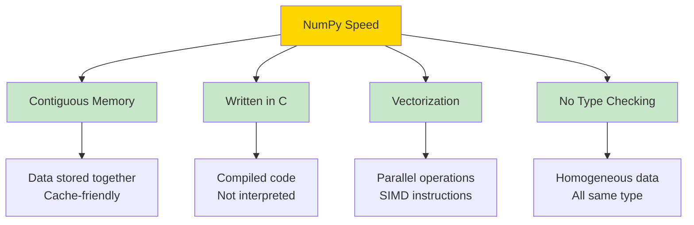
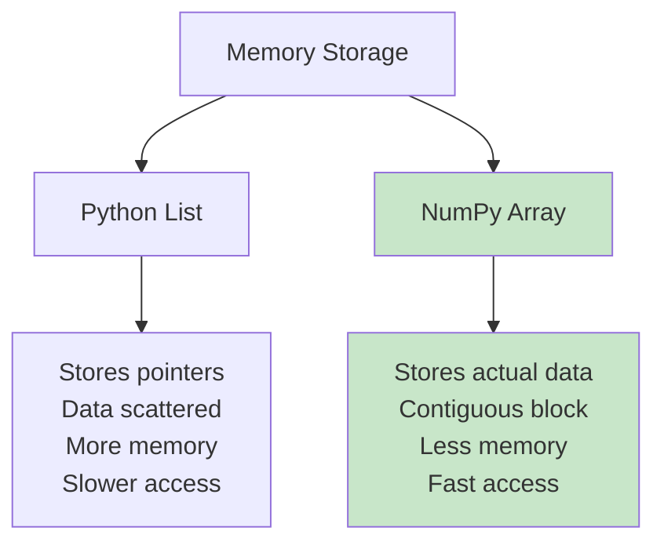
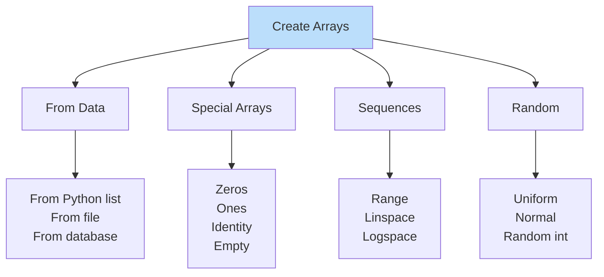
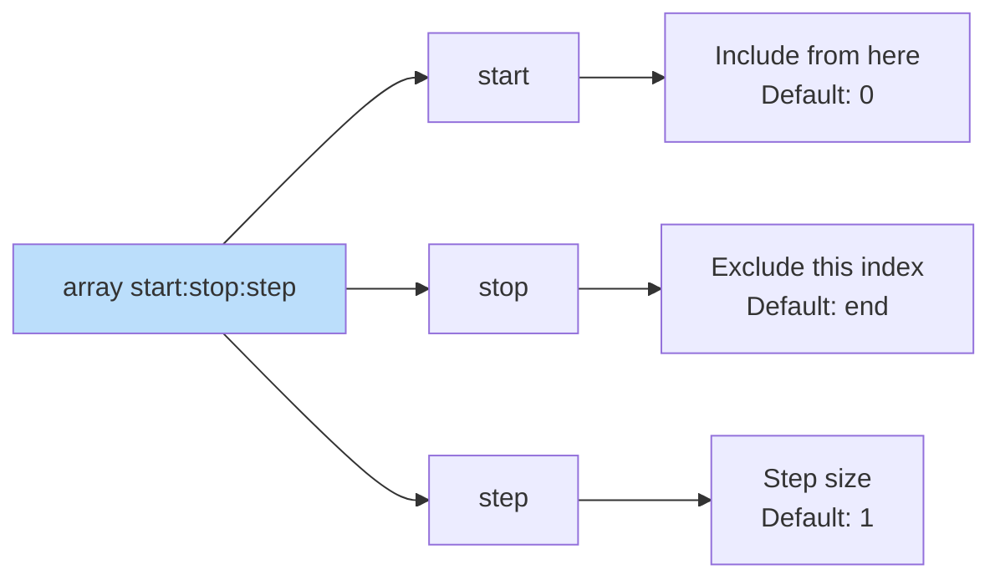
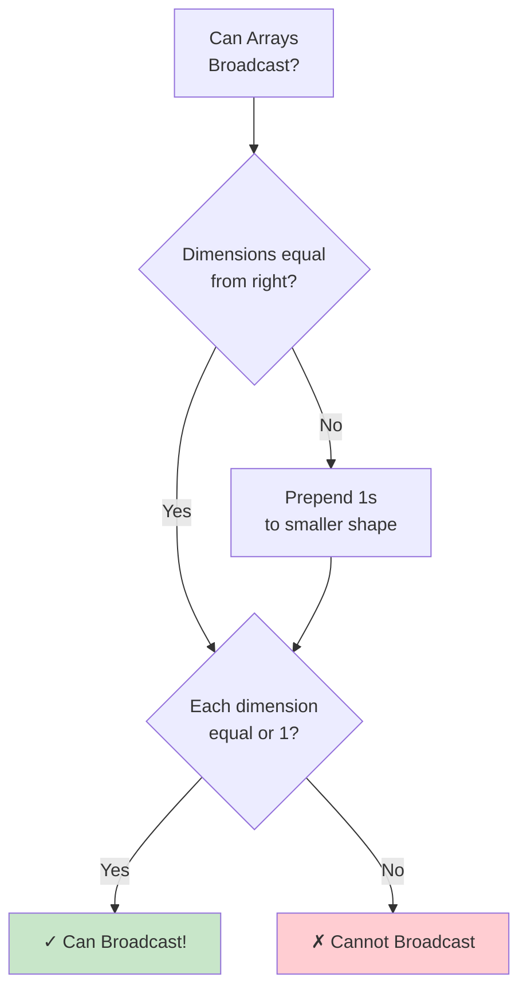
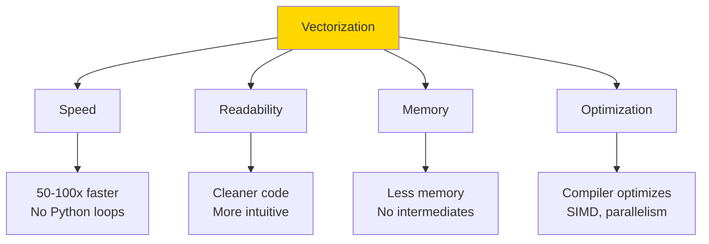
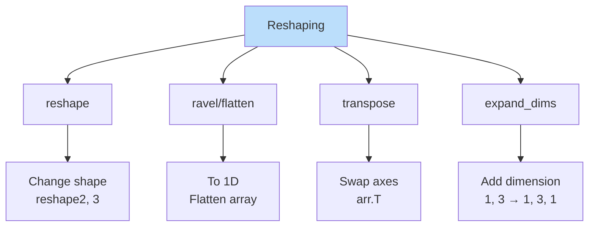
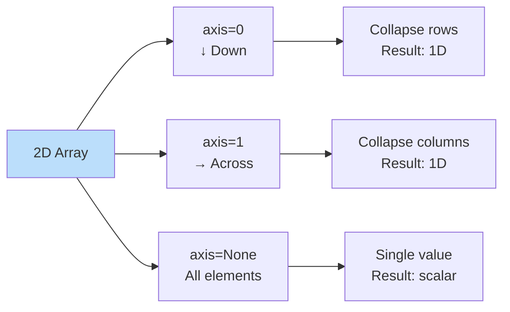
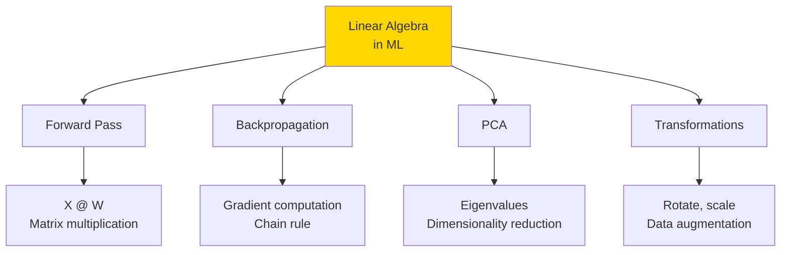

# 🔢 NUMPY - Numerical Computing Foundation

> [!yellow] ⭐ **THE BACKBONE OF DATA SCIENCE!**
> NumPy powers everything: Pandas, Scikit-learn, TensorFlow, PyTorch - they ALL use NumPy!
> 
> **Time to Complete:** 1-2 weeks  
> **Difficulty:** ⭐⭐ Beginner-Friendly  
> **Interview Weight:** ⭐⭐⭐⭐ VERY HIGH!

---

## 🗺️ NUMPY LEARNING ROADMAP


---

## 📚 TABLE OF CONTENTS

| # | Topic | Key Concept | Link |
|---|-------|-------------|------|
| 1 | **Why NumPy?** | Speed & efficiency | [[#1-why-numpy\|Jump]] |
| 2 | **Arrays vs Lists** | Fundamental difference | [[#2-arrays-vs-python-lists\|Jump]] |
| 3 | **Array Creation** | Building blocks | [[#3-creating-arrays\|Jump]] |
| 4 | **Indexing & Slicing** | Accessing data | [[#4-indexing-and-slicing\|Jump]] |
| 5 | **Broadcasting** | Auto-expansion magic | [[#5-broadcasting\|Jump]] |
| 6 | **Vectorization** | No loops needed | [[#6-vectorization\|Jump]] |
| 7 | **Reshaping** | Changing dimensions | [[#7-reshaping-arrays\|Jump]] |
| 8 | **Aggregations** | Summary statistics | [[#8-aggregations\|Jump]] |
| 9 | **Linear Algebra** | Matrix operations | [[#9-linear-algebra-for-ml\|Jump]] |

---

## 1. WHY NUMPY?

> [!blue] 💙 **What is NumPy?**
> NumPy (Numerical Python) is the fundamental package for scientific computing in Python.

### The Speed Advantage

```
Python List vs NumPy Array

Python List (SLOW):          NumPy Array (FAST):
[1, 2, 3, 4, 5]             array([1, 2, 3, 4, 5])
↓                            ↓
Loop through each            Vectorized operation
x = x * 2                    array * 2
One at a time                All at once!

Result:                      Result:
~0.08 seconds               ~0.001 seconds

NumPy is 50-100x FASTER!
```

### Why So Fast?



> [!yellow] 💡 **Real-World Impact**
> ```
> Task: Multiply 1 million numbers by 2
> 
> Python List:  ~80 milliseconds
> NumPy Array:  ~1 millisecond
> 
> For large datasets (millions of rows):
> - Python: Minutes to hours
> - NumPy: Seconds
> 
> This is why ALL data science libraries use NumPy!
> ```

---

## 2. ARRAYS VS PYTHON LISTS

> [!blue] 💙 **Fundamental Differences**

### Visual Comparison

```
Python List (Heterogeneous):
[1, "hello", 3.14, True, [1,2,3]]
↓  ↓       ↓     ↓     ↓
Different types, scattered in memory

NumPy Array (Homogeneous):
[1, 2, 3, 4, 5]
All same type, contiguous memory
Like a C array - FAST!
```

### Memory Layout



### Comparison Table

| Feature | Python List | NumPy Array |
|---------|-------------|-------------|
| **Data Types** | Mixed (heterogeneous) | Same (homogeneous) |
| **Memory** | More (pointers) | Less (compact) |
| **Speed** | Slow (Python loops) | Fast (C operations) |
| **Operations** | Limited | Rich (vectorized) |
| **Size** | Dynamic | Fixed (or reshapeable) |
| **Use Case** | General purpose | Numerical computing |
| **Dimensions** | 1D only | Multi-dimensional |

> [!red] ⚠️ **Common Misconception**
> ```
> ❌ WRONG: "Lists are more flexible, so better"
> ✅ RIGHT: "Arrays are specialized for numbers, MUCH faster"
> 
> Use Lists for: Mixed data, small datasets, general Python
> Use Arrays for: Numbers, large datasets, math operations
> ```

---

## 3. CREATING ARRAYS

> [!blue] 💙 **Array Dimensions**

```
1D Array (Vector):
[1, 2, 3, 4, 5]

2D Array (Matrix):
[[1, 2, 3],
 [4, 5, 6]]

3D Array (Tensor):
[[[1, 2],
  [3, 4]],
 [[5, 6],
  [7, 8]]]

Think: 1D = list, 2D = table, 3D = cube
```

### Array Creation Methods



### Common Array Types

> [!yellow] 💡 **Quick Reference**

```
Zeros Array:
zeros(5) → [0, 0, 0, 0, 0]
Use: Initialize arrays, placeholders

Ones Array:
ones(3) → [1, 1, 1]
Use: Masks, default values

Identity Matrix:
eye(3) → [[1, 0, 0],
          [0, 1, 0],
          [0, 0, 1]]
Use: Linear algebra, transformations

Range:
arange(0, 10, 2) → [0, 2, 4, 6, 8]
Use: Iteration indices, sequences

Linspace:
linspace(0, 1, 5) → [0, 0.25, 0.5, 0.75, 1]
Use: Plotting, even spacing needed
```

---

## 4. INDEXING AND SLICING

> [!blue] 💙 **Accessing Array Elements**

### 1D Array Indexing

```
Array: [10, 20, 30, 40, 50]
Index:  0   1   2   3   4

Forward indexing:
arr[0] → 10 (first)
arr[2] → 30 (third)

Backward indexing:
arr[-1] → 50 (last)
arr[-2] → 40 (second to last)
```

### 2D Array Indexing

```
Array:
[[1, 2, 3],
 [4, 5, 6],
 [7, 8, 9]]

Access:
arr[0, 0] → 1 (row 0, col 0)
arr[1, 2] → 6 (row 1, col 2)
arr[-1, -1] → 9 (last row, last col)

Think: arr[row, column]
```

### Slicing Syntax



### Slicing Examples

```
Array: [0, 1, 2, 3, 4, 5, 6, 7, 8, 9]

arr[2:7]    → [2, 3, 4, 5, 6]
arr[:5]     → [0, 1, 2, 3, 4]  (first 5)
arr[5:]     → [5, 6, 7, 8, 9]  (from 5 to end)
arr[::2]    → [0, 2, 4, 6, 8]  (every 2nd)
arr[::-1]   → [9, 8, 7, 6, 5, 4, 3, 2, 1, 0]  (reverse!)
```

### Boolean Indexing

```
Array: [10, 25, 30, 15, 40]

Condition: arr > 20

Boolean mask: [False, True, True, False, True]

Result: arr[arr > 20] → [25, 30, 40]

This is POWERFUL for filtering!
```

> [!yellow] ⭐ **Real-World Example**
> ```
> Student scores: [45, 78, 92, 55, 88, 61, 95]
> 
> Pass (≥60): scores[scores >= 60]
> Result: [78, 92, 88, 61, 95]
> 
> Excellent (≥90): scores[scores >= 90]
> Result: [92, 95]
> 
> This is how data filtering works in Pandas!
> ```

---

## 5. BROADCASTING

> [!red] ⚠️ **MOST IMPORTANT NUMPY CONCEPT FOR INTERVIEWS!**

> [!blue] 💙 **What is Broadcasting?**
> Broadcasting allows operations on arrays of different shapes WITHOUT explicit loops or copies.

### Simple Broadcasting

```
Scalar with Array:
5 + [1, 2, 3] = [6, 7, 8]

Visually:
    5           [5, 5, 5]
    +      →    +
[1, 2, 3]      [1, 2, 3]
    =              =
[6, 7, 8]      [6, 7, 8]

5 is "broadcast" to match array shape
```

### Broadcasting Rules



### Broadcasting Examples

```
Example 1: Vector + Scalar
(3,) + () → Compatible
[1, 2, 3] + 5 = [6, 7, 8]

Example 2: Matrix + Vector
(3, 3) + (3,) → Compatible
[[1, 2, 3],     [10, 20, 30]
 [4, 5, 6]]  +  [10, 20, 30]  (broadcast to 3 rows)
 [7, 8, 9]]     [10, 20, 30]
=
[[11, 22, 33],
 [14, 25, 36],
 [17, 28, 39]]

Example 3: Incompatible
(3, 3) + (2,) → ERROR!
Cannot broadcast (3,) and (2,)
```

### Broadcasting Visualization

```
(3, 1) + (1, 4) = (3, 4)

[[1],      [[10, 20, 30, 40]]
 [2],   +
 [3]]

Broadcast to:
[[1, 1, 1, 1],      [[10, 20, 30, 40],
 [2, 2, 2, 2],   +   [10, 20, 30, 40],
 [3, 3, 3, 3]]       [10, 20, 30, 40]]

Result:
[[11, 21, 31, 41],
 [12, 22, 32, 42],
 [13, 23, 33, 43]]
```

> [!yellow] 💡 **Real-World Use Case**
> ```
> Image Processing:
> 
> Image: (1920, 1080, 3)  # Height × Width × RGB
> Brightness: [1.2, 1.1, 1.0]  # Adjust each channel
> 
> Result: image * brightness
> Automatically broadcasts to all pixels!
> 
> Without broadcasting: Triple nested loops
> With broadcasting: Single operation (FAST!)
> ```

> [!red] ⚠️ **Common Broadcasting Mistakes**
> ```
> ❌ (3, 4) + (4, 3)  → ERROR (shapes don't align)
> ✅ (3, 4) + (1, 4)  → OK (broadcasts to 3×4)
> ✅ (3, 4) + (3, 1)  → OK (broadcasts to 3×4)
> 
> Remember: Dimensions must match from RIGHT to LEFT
> ```

---

## 6. VECTORIZATION

> [!blue] 💙 **No Loops Needed!**

### Loop vs Vectorization

```
Task: Add two arrays element-wise

Python Loop Way (SLOW):
result = []
for i in range(len(a)):
    result.append(a[i] + b[i])

NumPy Vectorized Way (FAST):
result = a + b

100x faster, 10x cleaner!
```

### Vectorization Benefits



### Common Vectorized Operations

> [!green] ✅ **Always Use Vectorization**

```
Element-wise operations:
a + b, a - b, a * b, a / b
a ** 2, np.sqrt(a), np.exp(a)

Comparisons:
a > 5, a == b, a != 0

Boolean operations:
(a > 5) & (b < 10)
(a == 0) | (b == 0)

Aggregations:
a.sum(), a.mean(), a.max(), a.min()
a.std(), a.var()
```

---

## 7. RESHAPING ARRAYS

> [!blue] 💙 **Changing Array Dimensions**

### Reshape Concept

```
Original: [1, 2, 3, 4, 5, 6]  (6,)

Reshape to 2×3:
[[1, 2, 3],
 [4, 5, 6]]  (2, 3)

Reshape to 3×2:
[[1, 2],
 [3, 4],
 [5, 6]]  (3, 2)

Key: Total elements must match!
6 = 2×3 = 3×2 = 1×6 = 6×1
```

### Common Reshaping Operations



### Transpose

```
Original Matrix:        Transposed:
[[1, 2, 3],            [[1, 4],
 [4, 5, 6]]             [2, 5],
 (2, 3)                 [3, 6]]
                        (3, 2)

Rows become columns!
Columns become rows!

Critical for: Matrix multiplication, ML models
```

> [!yellow] 💡 **ML Use Case**
> ```
> Features matrix: (1000, 50)
> 1000 samples, 50 features
> 
> Some algorithms need: (50, 1000)
> 50 features, 1000 samples
> 
> Solution: features.T (transpose)
> 
> This is VERY common in machine learning!
> ```

---

## 8. AGGREGATIONS

> [!blue] 💙 **Summary Statistics**

### Common Aggregations

```
Array: [10, 20, 30, 40, 50]

sum()    → 150  (total)
mean()   → 30   (average)
median() → 30   (middle value)
std()    → 14.14 (standard deviation)
var()    → 200  (variance)
min()    → 10   (smallest)
max()    → 50   (largest)
argmin() → 0    (index of min)
argmax() → 4    (index of max)
```

### Axis Parameter

```
2D Array:
[[1, 2, 3],
 [4, 5, 6]]

axis=0 (down columns):
sum(axis=0) → [5, 7, 9]
(1+4, 2+5, 3+6)

axis=1 (across rows):
sum(axis=1) → [6, 15]
(1+2+3, 4+5+6)

axis=None (all):
sum() → 21
```

### Axis Visualization



> [!yellow] ⭐ **Real-World Example**
> ```
> Sales data: (365 days, 10 products)
> 
> Daily total sales:
> sales.sum(axis=1) → (365,)
> 
> Product total sales:
> sales.sum(axis=0) → (10,)
> 
> Grand total:
> sales.sum() → single number
> ```

---

## 9. LINEAR ALGEBRA FOR ML

> [!blue] 💙 **Matrix Operations**

### Dot Product

```
Vector Dot Product:
[1, 2, 3] · [4, 5, 6]
= (1×4) + (2×5) + (3×6)
= 4 + 10 + 18
= 32

Measures: Similarity, projection
Use in ML: Neural networks, similarity scores
```

### Matrix Multiplication

```
Matrix A (2×3):        Matrix B (3×2):
[[1, 2, 3],           [[7, 8],
 [4, 5, 6]]            [9, 10],
                       [11, 12]]

A @ B = (2×2):
[[1×7+2×9+3×11   1×8+2×10+3×12],
 [4×7+5×9+6×11   4×8+5×10+6×12]]

= [[58, 64],
   [139, 154]]

Rule: (m, n) @ (n, p) = (m, p)
Inner dimensions must match!
```

### Matrix Operations for ML



### Key Linear Algebra Operations

```
Transpose: A.T
Swap rows ↔ columns

Inverse: np.linalg.inv(A)
A @ A_inv = Identity
Use: Solving equations

Determinant: np.linalg.det(A)
Measures: Volume scaling
Use: Check if invertible

Eigenvalues: np.linalg.eig(A)
Use: PCA, understanding transformations
```

> [!yellow] ⭐ **Neural Network Example**
> ```
> Input layer: (batch_size, 784)  # MNIST images
> Weights: (784, 128)              # Hidden layer
> 
> Forward pass:
> hidden = input @ weights          # Matrix multiplication!
> Result: (batch_size, 128)
> 
> This is NumPy in action!
> All deep learning frameworks use this.
> ```

---

## 💎 INTERVIEW QUESTIONS

> [!yellow] 💎 **Q: Explain NumPy broadcasting with example**
> 
> **Perfect Answer:**
> "Broadcasting allows operations on arrays of different shapes without explicit loops.
> 
> **How it works:**
> NumPy automatically expands smaller arrays to match larger ones.
> 
> **Rules:**
> 1. Compare dimensions from right to left
> 2. Dimensions must be equal OR one must be 1
> 3. Missing dimensions treated as 1
> 
> **Example:**
> Shape (3, 4) + Shape (4,)
> - Right dimension: 4 = 4 ✓
> - Left dimension: 3 vs missing → treat as (1, 4) → broadcast to (3, 4) ✓
> 
> **Why important:**
> - 100x faster than loops
> - Cleaner code
> - Used everywhere in ML (batch processing, normalization)
> 
> **Real use:**
> Normalizing data:
> data - mean  # mean is broadcast to all rows
> Used in standardization, batch normalization"

> [!yellow] 💎 **Q: NumPy vs Python lists - why is NumPy faster?**
> 
> **Perfect Answer:**
> "NumPy is 50-100x faster due to:
> 
> **1. Contiguous Memory:**
> - Lists: Store pointers, data scattered
> - NumPy: Actual data in continuous block
> - Result: Cache-friendly, faster access
> 
> **2. Written in C:**
> - Lists: Interpreted Python code
> - NumPy: Compiled C code
> - Result: No interpreter overhead
> 
> **3. Vectorization:**
> - Lists: One element at a time (loops)
> - NumPy: All elements at once (SIMD)
> - Result: Parallel processing
> 
> **4. Type Homogeneity:**
> - Lists: Mixed types, type checking each operation
> - NumPy: Same type, no checking needed
> - Result: Faster operations
> 
> **Tradeoff:**
> - Lists: Flexible, dynamic
> - NumPy: Fast, but fixed type
> 
> **Use NumPy for:** Numerical data, large datasets, math operations
> **Use Lists for:** Mixed types, small data, general purpose"

> [!yellow] 💎 **Q: What is vectorization and why does it matter?**
> 
> **Perfect Answer:**
> "Vectorization means operating on entire arrays at once instead of using loops.
> 
> **Without vectorization:**
> Loop through each element (slow, Python overhead)
> 
> **With vectorization:**
> Single operation on all elements (fast, compiled C)
> 
> **Why it matters:**
> 
> **1. Speed:**
> - 50-100x faster
> - Critical for large datasets
> 
> **2. Readability:**
> - a + b vs for loop
> - More intuitive
> 
> **3. Memory:**
> - No intermediate lists
> - More efficient
> 
> **4. Optimization:**
> - Compiler can parallelize
> - SIMD instructions
> 
> **Real example:**
> Normalizing 1 million values:
> - Loop: 100ms
> - Vectorized: 1ms
> 
> **In ML:**
> - All operations vectorized
> - Batch processing
> - GPU acceleration possible
> 
> **Rule:** Always vectorize in data science!"

---

**Tags:** #numpy #arrays #vectorization #broadcasting #numerical-computing  
**Difficulty:** ⭐⭐ Beginner-Friendly  
**Time to Master:** 1-2 weeks  
**Last Updated:** 2026-11-11
