# 🐼 PANDAS - Data Manipulation Made Easy

**⭐ THE #1 DATA SCIENCE TOOL!**
If you work with data, you MUST know Pandas. It's used in 95% of data science jobs!

**Time to Complete:** 2-3 weeks  
**Difficulty:** ⭐⭐⭐ Intermediate  
**Interview Weight:** ⭐⭐⭐⭐⭐ CRITICAL!

---

## 🗺️ PANDAS LEARNING ROADMAP


---

## 📚 TABLE OF CONTENTS

| # | Topic | Key Concept | Link |
|---|-------|-------------|------|
| 1 | **What is Pandas?** | Excel on steroids | [[#1-what-is-pandas\|Jump]] |
| 2 | **Data Structures** | Series vs DataFrame | [[#2-data-structures\|Jump]] |
| 3 | **Loading Data** | Read from anywhere | [[#3-loading-data\|Jump]] |
| 4 | **Selection** | Accessing data | [[#4-selection-and-indexing\|Jump]] |
| 5 | **Filtering** | Boolean indexing | [[#5-filtering-data\|Jump]] |
| 6 | **Data Cleaning** | Handle missing data | [[#6-data-cleaning\|Jump]] |
| 7 | **Transformations** | Apply functions | [[#7-transformations\|Jump]] |
| 8 | **Aggregations** | GroupBy magic | [[#8-aggregations-and-groupby\|Jump]] |
| 9 | **Merging & Joining** | Combine datasets | [[#9-merging-and-joining\|Jump]] |
| 10 | **Time Series** | Date handling | [[#10-time-series\|Jump]] |

---

## 1. WHAT IS PANDAS?

**💙 What is Pandas?**
Pandas is Python's data manipulation library - like Excel but with code, 1000x more powerful!

### Why Pandas?

```
Problem:
- Excel can't handle millions of rows
- CSV files are just text
- Need to automate repetitive tasks
- Complex transformations difficult

Solution: PANDAS!
- Handle millions of rows easily
- Read 50+ file formats
- Automate everything
- Rich operations library
```

### Pandas vs Alternatives

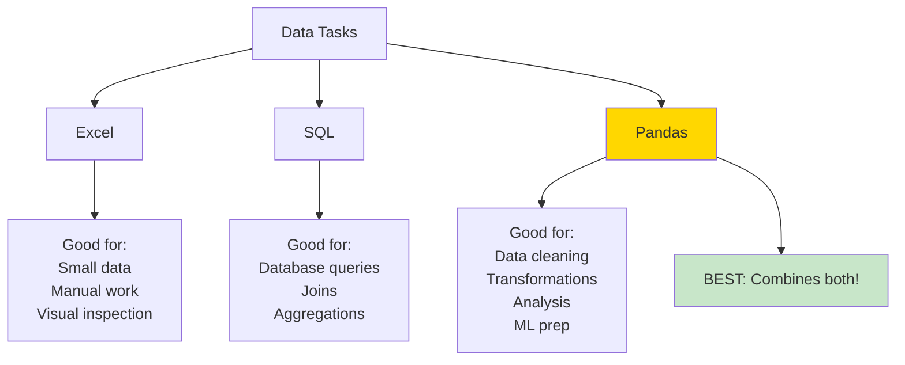

**💡 Real-World Power**
```
Task: Clean 1 million customer records

Excel: 
- Opens slowly (if at all)
- Manual clicks
- Crashes likely
- Hours of work

Pandas:
- Loads in seconds
- Automated pipeline
- Never crashes
- Minutes of work

This is why data scientists LOVE Pandas!
```

---

## 2. DATA STRUCTURES

**💙 Two Core Structures**

### Series (1D)

```
Series = One column of data

Example: Customer ages
0    25
1    30
2    28
3    35
4    22
Name: age, dtype: int64

Like a NumPy array + index labels
```

### DataFrame (2D)

```
DataFrame = Table of data (rows × columns)

Example: Customer data
   customer_id  age  city        purchase
0  C001         25   NYC         150.00
1  C002         30   SF          200.00
2  C003         28   Chicago     175.00
3  C004         35   Boston      225.00

Like Excel spreadsheet or SQL table
```

### Visual Comparison

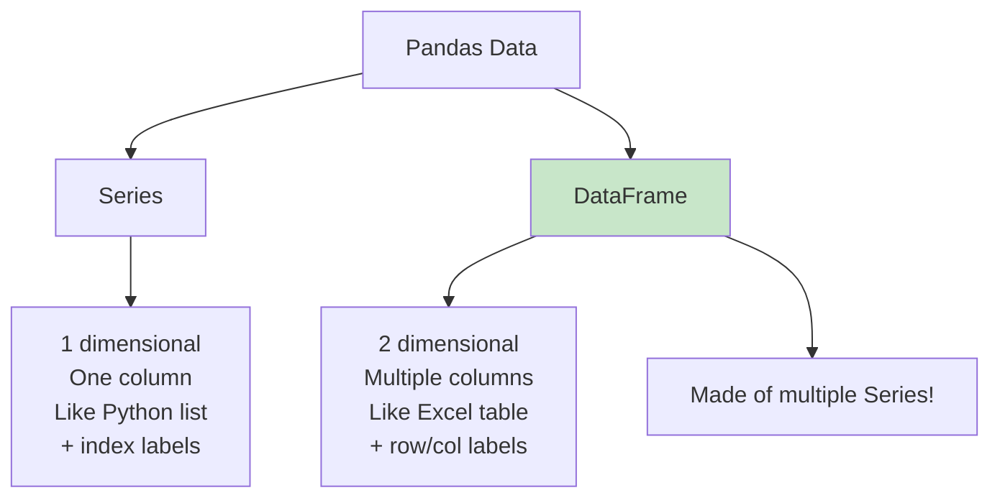

### DataFrame Anatomy

```
DataFrame Structure:

           Column 1    Column 2    Column 3
         ┌──────────┬──────────┬──────────┐
Index 0  │   Value  │   Value  │   Value  │
Index 1  │   Value  │   Value  │   Value  │
Index 2  │   Value  │   Value  │   Value  │
         └──────────┴──────────┴──────────┘

Components:
- Index: Row labels (left side)
- Columns: Column names (top)
- Values: Actual data (cells)
- dtypes: Data type for each column
```

**💡 Think of it as:**
```
Series = One Excel column
DataFrame = Entire Excel sheet

Each column in DataFrame is a Series!
```

---

## 3. LOADING DATA

**💙 Reading Data from Anywhere**

### Pandas Can Read 50+ Formats

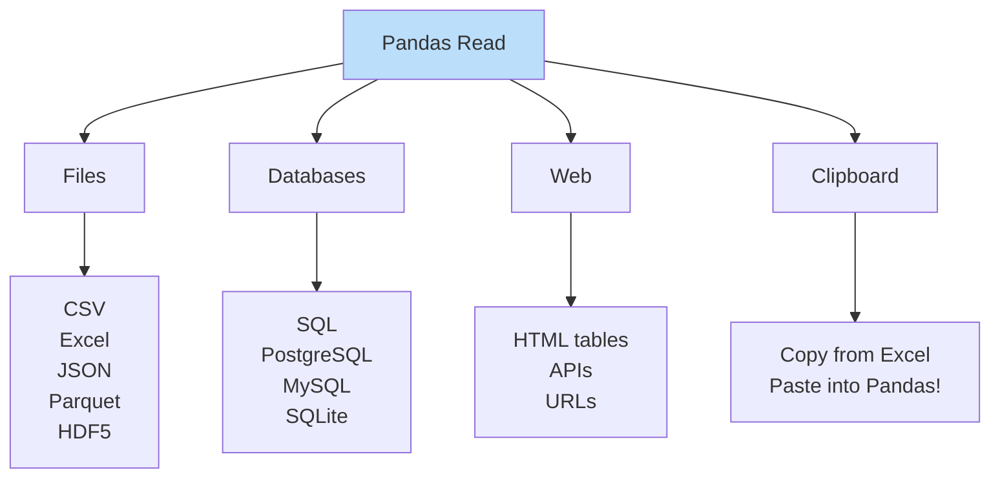

### Common Read Functions

**✅ Quick Reference**

```
Format          Function           Common Use
━━━━━━━━━━━━━━━━━━━━━━━━━━━━━━━━━━━━━━━━━━━━━━━━━━━━
CSV             read_csv()         90% of the time
Excel           read_excel()       Business data
JSON            read_json()        API responses
SQL             read_sql()         Database queries
HTML            read_html()        Web scraping
Parquet         read_parquet()     Big data (compressed)
Clipboard       read_clipboard()   Copy-paste from Excel
```

### Reading CSV (Most Common)

```
Basic:
pd.read_csv('data.csv')

With options:
- sep=';'              → Different delimiter
- header=0             → Row 0 is column names
- index_col=0          → Column 0 is index
- usecols=['A', 'B']   → Only read columns A, B
- nrows=1000           → Read first 1000 rows
- parse_dates=['date'] → Convert date column
- na_values=['NA', '?'] → Treat as missing
```

### Writing Data

```
Format          Function           Use Case
━━━━━━━━━━━━━━━━━━━━━━━━━━━━━━━━━━━━━━━━━━━━━━━━━━━━
CSV             to_csv()           Share with anyone
Excel           to_excel()         Share with business
JSON            to_json()          APIs, web apps
SQL             to_sql()           Database storage
Parquet         to_parquet()       Big data (10x smaller!)
HTML            to_html()          Reports, dashboards
```

**⚠️ Common Loading Mistakes**
```
❌ Not specifying encoding: read_csv('file.csv')
   Gets error on special characters
✅ Specify encoding: read_csv('file.csv', encoding='utf-8')

❌ Loading entire 10GB file into memory
✅ Use chunks: for chunk in read_csv(..., chunksize=10000)

❌ Wrong delimiter: File uses ';' but assumes ','
✅ Check first: read_csv('file.csv', sep=';')
```

---

## 4. SELECTION AND INDEXING

**💙 Three Ways to Select Data**

### Selection Methods Comparison

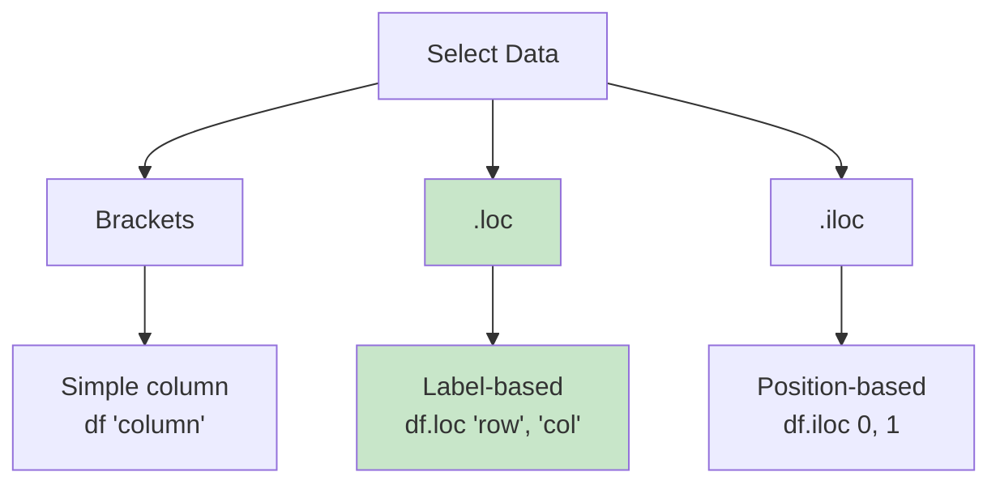

### Visual Guide

```
DataFrame:
       name  age  city
0      Alice  25   NYC
1      Bob    30   SF
2      Carol  28   LA

━━━━━━━━━━━━━━━━━━━━━━━━━━━━━━━━━━━━━━━

SELECT COLUMNS:
df['age'] → Series with ages
df[['name', 'age']] → DataFrame with 2 columns

━━━━━━━━━━━━━━━━━━━━━━━━━━━━━━━━━━━━━━━

SELECT ROWS BY LABEL (.loc):
df.loc[0] → First row (by index label)
df.loc[0:2] → Rows 0 to 2 (INCLUSIVE)
df.loc[0, 'age'] → Single value (row 0, age column)

━━━━━━━━━━━━━━━━━━━━━━━━━━━━━━━━━━━━━━━

SELECT ROWS BY POSITION (.iloc):
df.iloc[0] → First row (by position)
df.iloc[0:2] → Rows 0 to 1 (EXCLUSIVE like Python)
df.iloc[0, 1] → Single value (row 0, column 1)
```

### .loc vs .iloc Decision Tree

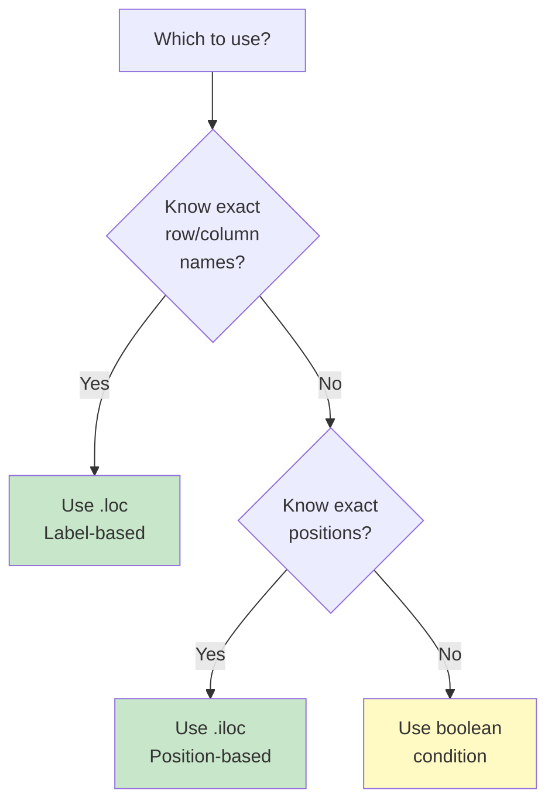

### Selection Patterns

**✅ Common Patterns**

```
Pattern 1: One column
df['age'] → Series

Pattern 2: Multiple columns
df[['name', 'age', 'city']] → DataFrame

Pattern 3: Rows by condition
df[df['age'] > 25] → Filtered DataFrame

Pattern 4: Specific rows and columns
df.loc[0:5, ['name', 'age']] → First 6 rows, 2 columns

Pattern 5: By position
df.iloc[0:5, 0:2] → First 5 rows, first 2 columns

Pattern 6: Single value
df.loc[0, 'age'] → One number (fastest)
df.at[0, 'age'] → Even faster for single value!
```

**⚠️ Critical Difference**
```
.loc[0:5] → Includes row 5 (INCLUSIVE)
.iloc[0:5] → Excludes row 5 (like Python slicing)

This confuses many beginners!

Rule: 
- .loc thinks like Excel (A1:C5 includes C5)
- .iloc thinks like Python (list[0:5] excludes 5)
```

---

## 5. FILTERING DATA

**💙 Boolean Indexing - Pandas Superpower**

### Filtering Concept

```
Start with DataFrame:
   name    age  salary
0  Alice   25   50000
1  Bob     30   60000
2  Carol   28   55000
3  David   35   70000

Create Boolean mask:
df['age'] > 28
0    False
1    True
2    False
3    True

Apply mask:
df[df['age'] > 28]
   name    age  salary
1  Bob     30   60000
3  David   35   70000

Only rows where condition is True!
```

### Filtering Operators

```mermaid
graph TD
    A[Comparison] --> B[Single Condition]
    A --> C[Multiple Conditions]
    A --> D[String Operations]
    A --> E[Membership]
    
    B --> F[> < >= <= ==<br/>!=]
    C --> G[& AND<br/>| OR<br/>~ NOT]
    D --> H[.str.contains<br/>.str.startswith<br/>.str.endswith]
    E --> I[.isin list<br/>.between a, b]
    
    style A fill:#bbdefb
```

### Common Filters

**✅ Essential Patterns**

```
Single condition:
df[df['age'] > 25]
df[df['city'] == 'NYC']
df[df['salary'] >= 50000]

Multiple conditions (AND):
df[(df['age'] > 25) & (df['salary'] > 50000)]
MUST use parentheses!

Multiple conditions (OR):
df[(df['city'] == 'NYC') | (df['city'] == 'SF')]

Negation (NOT):
df[~(df['age'] > 25)]  # age <= 25

String contains:
df[df['name'].str.contains('A')]  # Names with 'A'

Multiple values (isin):
df[df['city'].isin(['NYC', 'SF', 'LA'])]

Range (between):
df[df['age'].between(25, 35)]  # 25 <= age <= 35
```

### Complex Filtering

```
Real-world example:
Find customers who:
- Live in NYC or SF
- Age between 25 and 40
- Salary > 50000
- Name starts with 'A' or 'B'

df[
    (df['city'].isin(['NYC', 'SF'])) &
    (df['age'].between(25, 40)) &
    (df['salary'] > 50000) &
    (df['name'].str[0].isin(['A', 'B']))
]

Build complex filters step by step!
```

**💡 Pro Tip: Query Method**
```
Instead of brackets, use .query() for readable code:

Bracket way (hard to read):
df[(df['age'] > 25) & (df['salary'] > 50000)]

Query way (easier):
df.query('age > 25 and salary > 50000')

Query is cleaner for complex conditions!
```

**⚠️ Common Mistakes**
```
❌ Missing parentheses:
df[df['age'] > 25 & df['salary'] > 50000]  # ERROR!

✅ With parentheses:
df[(df['age'] > 25) & (df['salary'] > 50000)]

❌ Using 'and' instead of '&':
df[(df['age'] > 25) and (df['salary'] > 50000)]  # ERROR!

✅ Use & for Pandas:
df[(df['age'] > 25) & (df['salary'] > 50000)]
```

---

## 6. DATA CLEANING

**💙 Real Data is Messy - Cleaning is 80% of Work!**

### Missing Data Handling

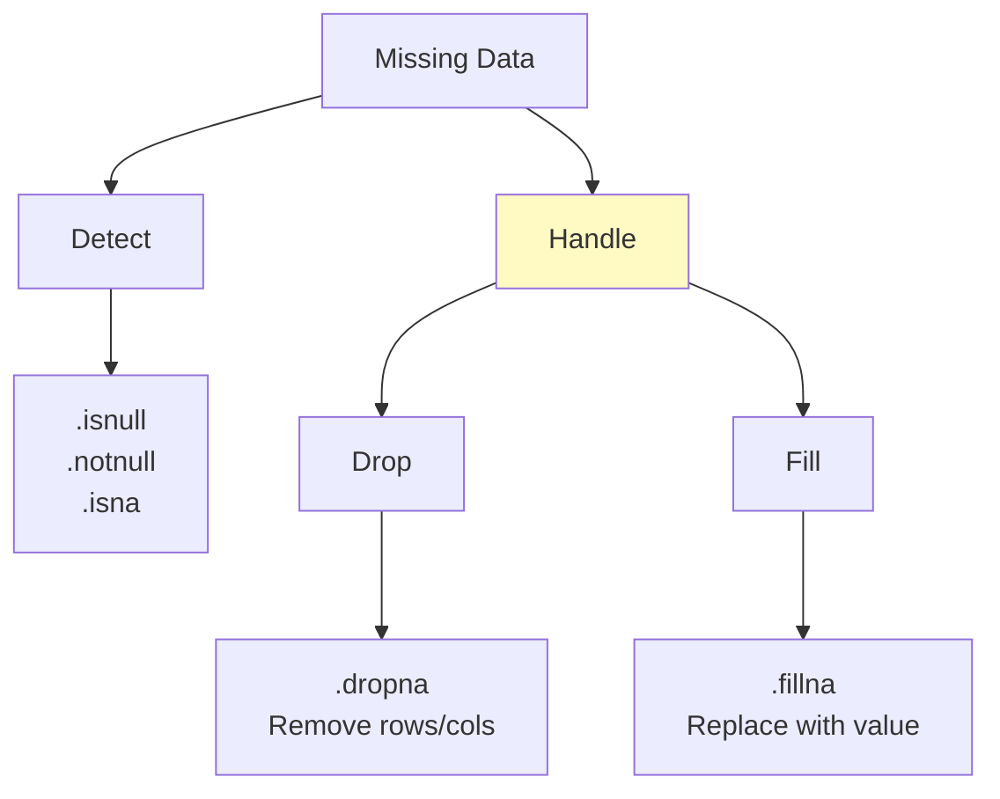

### Missing Data Strategies

**💡 When to Drop vs Fill**

```
DECISION TREE:

Missing data → How much is missing?

< 5% missing:
  → Safe to drop rows
  → df.dropna()

5-30% missing:
  → Depends on column importance
  → Fill with mean/median/mode
  → df.fillna(df.mean())

> 30% missing:
  → Column might be useless
  → Consider dropping entire column
  → df.drop(columns=['bad_column'])

100% missing:
  → Always drop!
  → df.dropna(axis=1, how='all')
```

### Fill Strategies by Data Type

```
Numerical columns:
- Mean: For normal distribution
- Median: For skewed data (better!)
- Mode: For discrete values
- Forward fill: Time series
- Interpolate: Smooth time series

Categorical columns:
- Mode: Most frequent value
- 'Unknown': Create new category
- Forward fill: Time series

Boolean columns:
- Mode: Most common
- False: Conservative default
```

### Duplicate Handling

```
Detect duplicates:
df.duplicated() → Boolean mask
df[df.duplicated()] → View duplicates

Remove duplicates:
df.drop_duplicates() → Keep first occurrence
df.drop_duplicates(keep='last') → Keep last
df.drop_duplicates(subset=['email']) → By column

Check for duplicates in specific column:
df['email'].duplicated().sum() → Count
```

### Data Type Cleaning

```
Common issues:

1. Numbers stored as strings:
   df['price'] = df['price'].astype(float)

2. Dates stored as strings:
   df['date'] = pd.to_datetime(df['date'])

3. Categories as objects:
   df['category'] = df['category'].astype('category')
   (Uses less memory!)

4. Remove whitespace:
   df['name'] = df['name'].str.strip()

5. Lowercase everything:
   df['email'] = df['email'].str.lower()
```

**⚠️ Cleaning Mistakes**
```
❌ Dropping all missing data blindly:
df.dropna()  # Might lose 90% of data!

✅ Check first:
df.isnull().sum()  # See how much is missing
Then decide strategy per column

❌ Filling numerical with 0:
df.fillna(0)  # 0 might be a real value!

✅ Use mean/median:
df.fillna(df.median())
```

---

## 7. TRANSFORMATIONS

**💙 Apply Functions to Transform Data**

### Transformation Methods

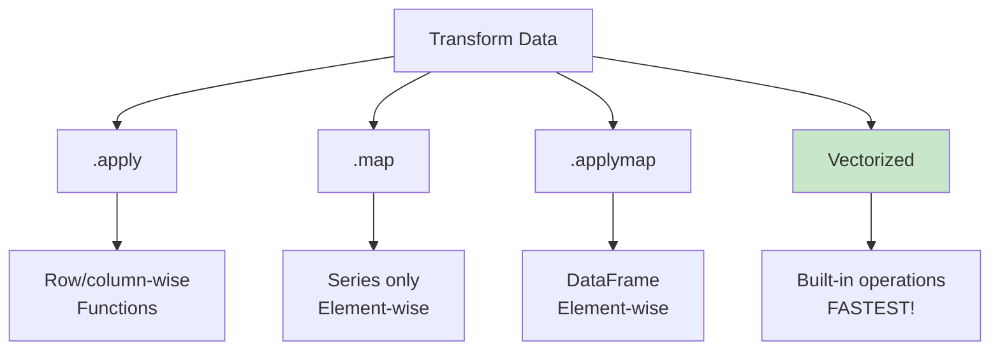

### Common Transformations

**✅ Everyday Operations**

```
1. Create new column:
   df['total'] = df['price'] * df['quantity']

2. Conditional column:
   df['category'] = 'High' if age > 30 else 'Low'
   (Use .apply for this)

3. String operations:
   df['name_upper'] = df['name'].str.upper()
   df['first_name'] = df['name'].str.split().str[0]

4. Mathematical:
   df['log_price'] = np.log(df['price'])
   df['price_squared'] = df['price'] ** 2

5. Date operations:
   df['year'] = df['date'].dt.year
   df['month'] = df['date'].dt.month
   df['day_of_week'] = df['date'].dt.dayofweek
```

### Apply vs Vectorized

```
Task: Convert temperatures from Celsius to Fahrenheit

❌ SLOW (Loop):
for i in range(len(df)):
    df.loc[i, 'temp_f'] = df.loc[i, 'temp_c'] * 9/5 + 32

🔶 MEDIUM (Apply):
df['temp_f'] = df['temp_c'].apply(lambda x: x * 9/5 + 32)

✅ FAST (Vectorized):
df['temp_f'] = df['temp_c'] * 9/5 + 32

Vectorized is 100x faster!
ALWAYS prefer vectorized when possible.
```

### Speed Comparison

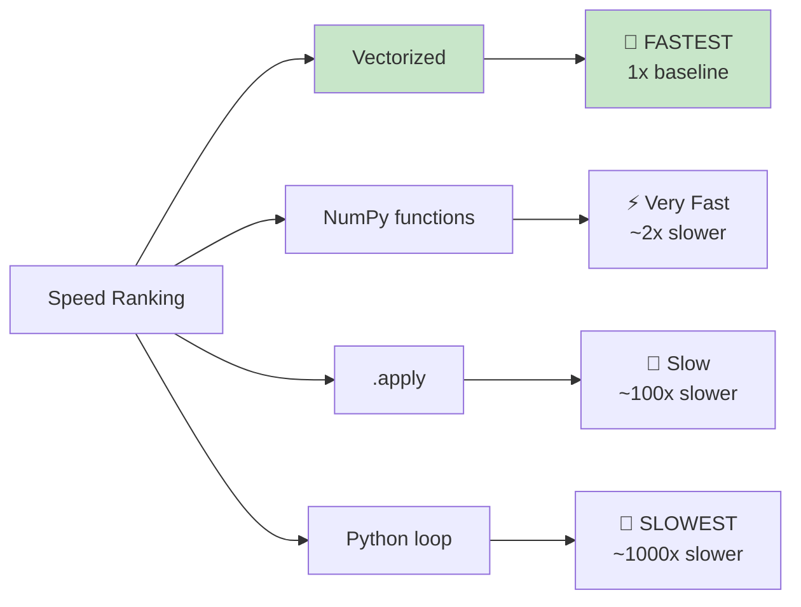

**⭐ When to Use Each**
```
Vectorized operations:
- Simple math: df['a'] + df['b']
- Comparisons: df['age'] > 25
- Built-in functions: df.mean(), df.sum()
USE ALWAYS when possible!

.apply():
- Custom logic: Complex if-else
- Functions not vectorizable
- Row-wise operations
USE when vectorization impossible

Python loops:
- NEVER use for data transformation!
- Only for non-Pandas logic
```

---

## 8. AGGREGATIONS AND GROUPBY

**💙 GroupBy: Split-Apply-Combine**

### GroupBy Concept

```
Original Data:
   name     department  salary
0  Alice    Sales       50000
1  Bob      Sales       60000
2  Carol    Marketing   55000
3  David    Marketing   70000

GroupBy department:
┌─────────────────────────────────┐
│ Sales Group                      │
│  Alice    50000                  │
│  Bob      60000                  │
└─────────────────────────────────┘
┌─────────────────────────────────┐
│ Marketing Group                  │
│  Carol    55000                  │
│  David    70000                  │
└─────────────────────────────────┘

Aggregate (mean salary):
   department  salary
0  Sales       55000
1  Marketing   62500

This is the POWER of GroupBy!
```

### GroupBy Workflow

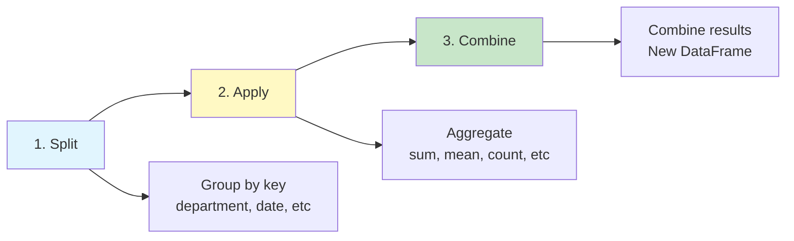

### Common Aggregations

**✅ Essential Aggregations**

```
Single aggregation:
df.groupby('department')['salary'].mean()
→ Average salary by department

Multiple aggregations:
df.groupby('department')['salary'].agg(['mean', 'sum', 'count'])
→ Multiple stats at once

All columns:
df.groupby('department').mean()
→ Mean of all numerical columns

Multiple columns:
df.groupby(['department', 'city'])['salary'].mean()
→ Nested grouping

Custom aggregation:
df.groupby('department')['salary'].agg(
    total='sum',
    average='mean',
    max_salary='max'
)
→ Named aggregations
```

### Aggregation Functions

```
Function          What it does           Use case
━━━━━━━━━━━━━━━━━━━━━━━━━━━━━━━━━━━━━━━━━━━━━━━━━━━━━━━━━
.count()          Count non-null         Data completeness
.sum()            Total                  Revenue, quantity
.mean()           Average                Typical value
.median()         Middle value           Robust average
.std()            Spread                 Variability
.min() / .max()   Range                  Bounds
.first() / .last() Edge values           Time series
.nunique()        Unique count           Distinct customers
.agg()            Custom combo           Multiple at once
```

### Real-World Example

**⭐ Sales Analysis**
```
Question: What is the total sales by region and product?

Data:
   region  product   sales
0  East    A         100
1  East    B         150
2  West    A         200
3  West    B         180

Solution:
df.groupby(['region', 'product'])['sales'].sum()

Result:
region  product  sales
East    A        100
        B        150
West    A        200
        B        180

Now you have a pivot-table-like view!
```

---

## 9. MERGING AND JOINING

**💙 Combining Multiple DataFrames**

### Join Types Visual

```
Left DataFrame (df1):     Right DataFrame (df2):
   id  name                  id  salary
0  1   Alice              0  1   50000
1  2   Bob                1  2   60000
2  3   Carol              2  4   70000

━━━━━━━━━━━━━━━━━━━━━━━━━━━━━━━━━━━━━━━━━━━━━━━━━━━━

INNER JOIN (only matching):
   id  name   salary
0  1   Alice  50000
1  2   Bob    60000

LEFT JOIN (all from left):
   id  name   salary
0  1   Alice  50000
1  2   Bob    60000
2  3   Carol  NaN

RIGHT JOIN (all from right):
   id  name   salary
0  1   Alice  50000
1  2   Bob    60000
2  4   NaN    70000

OUTER JOIN (all from both):
   id  name   salary
0  1   Alice  50000
1  2   Bob    60000
2  3   Carol  NaN
3  4   NaN    70000
```

### Join Types Decision Tree

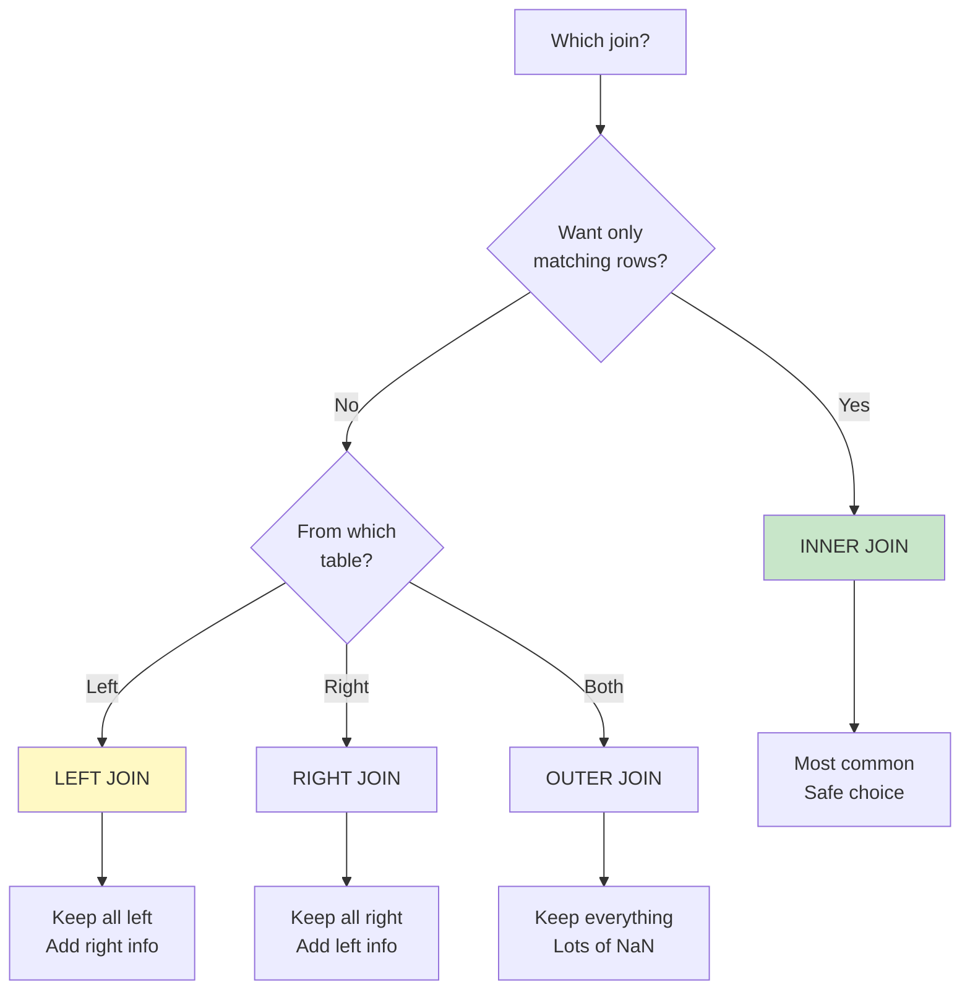

### Merge vs Join vs Concat

```
merge():
- SQL-style joins
- Join on columns
- Most flexible
Use: Combining tables with shared keys

join():
- Join on index
- Simpler syntax
- Less flexible
Use: DataFrames with meaningful index

concat():
- Stack DataFrames
- Vertically (rows) or horizontally (columns)
- No matching needed
Use: Combining similar DataFrames
```

### Common Merge Patterns

**✅ Real-World Scenarios**

```
Pattern 1: Add customer info to orders
orders = [order_id, customer_id, amount]
customers = [customer_id, name, email]

pd.merge(orders, customers, on='customer_id', how='left')
→ Orders with customer details

Pattern 2: Multiple join keys
pd.merge(df1, df2, on=['date', 'product_id'])
→ Match on both date AND product

Pattern 3: Different column names
pd.merge(df1, df2, left_on='cust_id', right_on='customer_id')
→ Join when columns have different names

Pattern 4: Stack same structure
pd.concat([jan_data, feb_data, mar_data])
→ Combine monthly data
```

**⚠️ Merge Mistakes**
```
❌ Duplicate keys:
Multiple rows with same id in both tables
Result: Cartesian product (explosion!)

✅ Check first:
df1['id'].duplicated().any()
df2['id'].duplicated().any()

❌ Wrong join type:
Using inner when you need left
Result: Losing data

✅ Default to LEFT:
Keep all from main table
```

**💡 SQL to Pandas Translation**
```
SQL:
SELECT *
FROM orders o
INNER JOIN customers c
  ON o.customer_id = c.customer_id

Pandas:
pd.merge(orders, customers, 
         on='customer_id', how='inner')

They're identical!
```

---

## 10. TIME SERIES

**💙 Working with Dates and Times**

### Date Operations

```
Convert to datetime:
df['date'] = pd.to_datetime(df['date'])

Extract components:
df['year'] = df['date'].dt.year
df['month'] = df['date'].dt.month
df['day'] = df['date'].dt.day
df['day_of_week'] = df['date'].dt.dayofweek
df['quarter'] = df['date'].dt.quarter

Date arithmetic:
df['days_since'] = (today - df['date']).dt.days
df['next_week'] = df['date'] + pd.Timedelta(days=7)
```

### Resampling Time Series

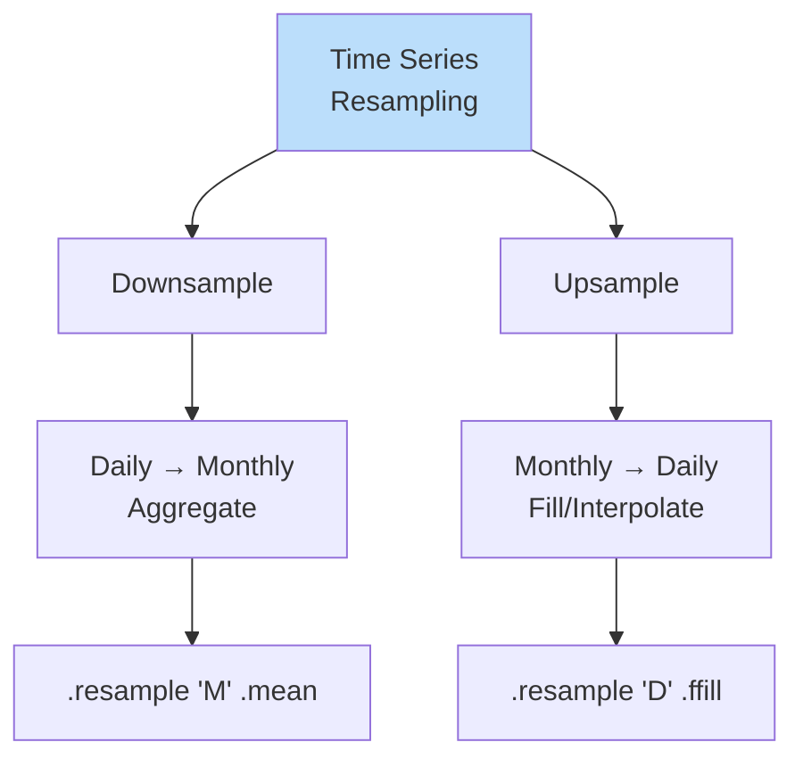

### Common Time Operations

**✅ Time Series Recipes**

```
1. Set date as index:
   df = df.set_index('date')
   → Now can use time-based slicing

2. Select date range:
   df['2023-01-01':'2023-12-31']
   → All data in 2023

3. Resample to monthly:
   df.resample('M').sum()
   → Monthly totals

4. Rolling window (moving average):
   df['price'].rolling(window=7).mean()
   → 7-day moving average

5. Shift for lag features:
   df['prev_day'] = df['sales'].shift(1)
   → Yesterday's sales

6. Time difference:
   df['days_between'] = (df['end_date'] - df['start_date']).dt.days
```

---

## 💎 INTERVIEW QUESTIONS

**💎 Q: Explain GroupBy split-apply-combine**

**Perfect Answer:**
"GroupBy follows a 3-step pattern:

**1. Split:**
Break DataFrame into groups based on key(s)
Like: Split sales by region

**2. Apply:**
Apply aggregation to each group independently
Like: Calculate mean sales for each region

**3. Combine:**
Combine results into new DataFrame
Like: Final table with region and avg_sales

**Example:**
Sales data (1000 rows, 5 regions)
→ GroupBy region
→ Calculate total sales per region
→ Get 5-row result (one per region)

**Why powerful:**
- Automates data summarization
- Like SQL GROUP BY but more flexible
- Essential for exploratory analysis

**Common uses:**
- Summary statistics by category
- Time-based aggregations
- Customer/product analytics"

**💎 Q: .loc vs .iloc - when to use each?**

**Perfect Answer:**
".loc and .iloc both select data but use different indexing:

**.loc (label-based):**
- Uses row/column labels
- Inclusive slicing
- df.loc[0:5] includes row 5
- Example: df.loc['2023-01-01', 'price']

**.iloc (position-based):**
- Uses integer positions
- Exclusive slicing (like Python)
- df.iloc[0:5] excludes row 5
- Example: df.iloc[0, 2]

**When to use:**

Use .loc when:
- Working with meaningful index (dates, IDs)
- Column names known
- Most common in production code

Use .iloc when:
- Position matters (first 10 rows)
- Dynamic column selection
- Index not meaningful

**Key difference:**
.loc[0:5] → 6 rows (includes 5)
.iloc[0:5] → 5 rows (excludes 5)

This confuses beginners but critical to know!"

**💎 Q: How do you handle missing data?**

**Perfect Answer:**
"Missing data strategy depends on amount and context:

**1. Detect:**
- df.isnull().sum() → Count missing per column
- df.isnull().sum() / len(df) → Percentage missing

**2. Decide strategy:**

**< 5% missing:**
- Safe to drop rows: df.dropna()
- Minimal data loss

**5-30% missing:**
- Numerical: Fill with mean/median
  df.fillna(df.median())
- Categorical: Fill with mode
  df.fillna(df.mode()[0])
- Time series: Forward fill
  df.fillna(method='ffill')

**> 30% missing:**
- Consider dropping column
- Or create 'missing' indicator
  df['was_missing'] = df['col'].isnull()

**3. Best practices:**
- Check WHY data is missing (MCAR, MAR, MNAR)
- Never fill with 0 blindly (0 might be real value)
- For ML: Median > Mean (robust to outliers)
- Document your decision

**Interview tip:** Always explain your reasoning, not just the code!"

---

**Tags:** #pandas #dataframes #data-manipulation #data-cleaning #groupby  
**Difficulty:** ⭐⭐⭐ Intermediate  
**Time to Master:** 2-3 weeks  
**Last Updated:** 2026-11-11
