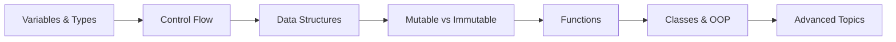

# 🐍 Python Foundation

Complete Python notes for Data Science & AI + Interview Prep

> [!blue] 💙 **Python in One Line**
> General-purpose interpreted language, perfect for data science with easy syntax and powerful libraries (NumPy, pandas, scikit-learn)

---

## 📑 Topics

### 🔵 Fundamentals
1. [[variables-and-types]] - Variables, int, float, str, bool
2. [[operators]] - Arithmetic, comparison, logical
3. [[control-flow]] - if/else, loops, comprehensions
4. [[functions]] - Why use them, parameters, lambda

### 🟢 Data Structures  
5. [[lists]] - Ordered, mutable `[1,2,3]`
6. [[tuples]] - Immutable `(1,2,3)`
7. [[dictionaries]] - Key-value `{"a":1}`
8. [[sets]] - Unique items `{1,2,3}`

### 🔴 Critical Concepts (Must Master!)
9. [[mutable-vs-immutable]] ⭐ **MOST IMPORTANT!**
10. [[memory-and-references]] - How Python stores objects

### 🟡 Advanced
11. [[classes-and-oop]] - When to use classes, 4 pillars
12. [[decorators]] - Function wrappers
13. [[generators]] - Lazy evaluation with `yield`
14. [[context-managers]] - `with` statements
15. [[error-handling]] - try/except patterns

---

## 🎯 Learning Path



1. **Week 1:** Variables, types, control flow
2. **Week 2:** Data structures (lists, dicts)
3. **Week 3:** ==Mutable vs Immutable== (CRITICAL!)<!--red-->
4. **Week 4:** Functions and Classes
5. **Week 5:** Advanced (decorators, generators)

---

## 🚨 Most Common Bugs

> [!red] 🐛 #1: Mutable Default Arguments (90% of Python bugs!)
> ```python
> # ❌ WRONG - Creates shared list!
> def add_item(item, items=[]):
>     items.append(item)
>     return items
> 
> # ✅ CORRECT
> def add_item(item, items=None):
>     if items is None:
>         items = []
>     items.append(item)
>     return items
> ```
> See: [[mutable-vs-immutable#The-Famous-Bug]]

> [!red] 🐛 #2: Float Precision for Money
> ```python
> # ❌ WRONG
> total = 0.1 + 0.2  # 0.30000000000000004
> 
> # ✅ CORRECT
> total = round(0.1 + 0.2, 2)  # 0.3
> ```

> [!red] 🐛 #3: Shallow Copy of Nested Lists
> ```python
> # ❌ WRONG
> list1 = [[1,2], [3,4]]
> list2 = list1.copy()
> list2[0].append(99)
> print(list1)  # [[1,2,99], [3,4]] - Changed!
> 
> # ✅ CORRECT
> import copy
> list2 = copy.deepcopy(list1)
> ```

---

## 💡 Quick Reference

### Data Types Cheatsheet

| Type | Mutable? | Example | Use When |
|------|----------|---------|----------|
| `int` | ❌ | `42` | Counting, IDs |
| `float` | ❌ | `3.14` | Money, measurements |
| `str` | ❌ | `"hello"` | Text |
| `bool` | ❌ | `True` | Flags |
| `list` | ✅ | `[1,2,3]` | Changing collections |
| `tuple` | ❌ | `(1,2,3)` | Fixed data |
| `dict` | ✅ | `{"a":1}` | Key-value lookup |
| `set` | ✅ | `{1,2,3}` | Unique items |

### Common Patterns

> [!green] Safe List Copy
> ```python
> original = [1, 2, 3]
> copy = original.copy()  # or original[:] or list(original)
> ```

> [!green] Function vs Class Decision
> ```python
> # Use FUNCTION for stateless operations
> def calculate_gst(amount):
>     return amount * 0.18
> 
> # Use CLASS for state management
> class ShoppingCart:
>     def __init__(self):
>         self.items = []
>         self.total = 0
> ```

---

## 🎓 Interview Prep

### Must-Know for Interviews
- [ ] Explain mutable vs immutable with examples
- [ ] When to use list vs tuple vs dict vs set?
- [ ] What are decorators? Write a simple one
- [ ] Explain `*args` and `**kwargs`
- [ ] What is list comprehension? Give example
- [ ] Explain GIL (Global Interpreter Lock)
- [ ] Difference between `==` and `is`
- [ ] What are generators? Why use them?

See: [[../../09-Interview-Prep/Python-Questions/README|Python Interview Questions]]

---

## ✅ Progress Tracker

### Basics
- [x] Variables and types
- [x] Control flow
- [x] Lists and dictionaries

### Critical
- [x] Mutable vs Immutable ⭐
- [ ] Memory model deep dive

### Advanced
- [ ] Decorators
- [ ] Generators
- [ ] Context managers
- [ ] Metaclasses

---

## 🔗 Related Topics

- [[../NumPy/README|NumPy]] - Next after Python
- [[../Pandas/README|Pandas]] - Data manipulation
- [[../../03-Machine-Learning/README|Machine Learning]] - Apply Python
- [[../../09-Interview-Prep/Coding/README|Coding Interview]] - Practice

---

## 📚 Resources

### Official
- [Python.org Tutorial](https://docs.python.org/3/tutorial/)
- [PEP 8 Style Guide](https://peps.python.org/pep-0008/)

### Learning
- [Real Python](https://realpython.com/)
- [Python for Data Science Handbook](https://jakevdp.github.io/PythonDataScienceHandbook/)

### Practice
- [LeetCode Python](https://leetcode.com/problemset/all/?difficulty=EASY&page=1&topicSlugs=array&languageTags=python3)
- [HackerRank Python](https://www.hackerrank.com/domains/python)

---

**Tags:** #python #foundations #programming  
**Status:** 🟢 In Progress  
**Last Updated:** 2026-11-11
