# 🐍 PYTHON - Foundation for Data Science

> [!yellow] ⭐ **THE ESSENTIAL STARTING POINT!**
> Everything in data science starts with Python. Master these fundamentals first!
> 
> **Time to Complete:** 2-4 weeks  
> **Difficulty:** ⭐ Beginner-Friendly  
> **Interview Weight:** ⭐⭐⭐⭐⭐ CRITICAL!

---

## 🗺️ PYTHON LEARNING ROADMAP


---

## 📚 TABLE OF CONTENTS

| # | Topic | Key Concept | Link |
|---|-------|-------------|------|
| 1 | **Data Types** | int, float, str, bool | [[#1-data-types\|Jump]] |
| 2 | **Variables** | Assignment & naming | [[#2-variables\|Jump]] |
| 3 | **Operators** | Math, comparison, logical | [[#3-operators\|Jump]] |
| 4 | **Lists** | Ordered collections | [[#4-lists\|Jump]] |
| 5 | **Dictionaries** | Key-value pairs | [[#5-dictionaries\|Jump]] |
| 6 | **Sets & Tuples** | Unique & immutable | [[#6-sets-and-tuples\|Jump]] |
| 7 | **Control Flow** | if/elif/else | [[#7-control-flow\|Jump]] |
| 8 | **Loops** | for and while | [[#8-loops\|Jump]] |
| 9 | **Functions** | Reusable code | [[#9-functions\|Jump]] |
| 10 | **Comprehensions** | Elegant one-liners | [[#10-comprehensions\|Jump]] |
| 11 | **Error Handling** | try/except | [[#11-error-handling\|Jump]] |

---

## 1. DATA TYPES

> [!blue] 💙 **Four Core Types**

### The Big Four

```mermaid
graph TD
    A[Python Types] --> B[int<br/>Integers]
    A --> C[float<br/>Decimals]
    A --> D[str<br/>Text]
    A --> E[bool<br/>True/False]
    
    B --> F[42, -10, 0<br/>Whole numbers]
    C --> G[3.14, -0.5, 2.0<br/>Numbers with decimals]
    D --> H['hello', "data"<br/>Text in quotes]
    E --> I[True, False<br/>Only 2 values]
    
    style A fill:#bbdefb
```

### Visual Examples

```
Integer (int):
42, -17, 0, 1000000
→ Whole numbers only
→ No decimal point
→ Can be positive, negative, or zero

Float:
3.14, -0.5, 2.0, 1.23e5
→ Numbers with decimal points
→ Can use scientific notation (1e5 = 100000)

String (str):
"Hello", 'Data Science', """Multi-line text"""
→ Text in quotes (single or double)
→ Can contain letters, numbers, symbols
→ Immutable (can't change individual characters)

Boolean (bool):
True, False
→ Only two values
→ Result of comparisons
→ Used in conditions
```

### Type Checking

```
Check type:
type(42) → <class 'int'>
type(3.14) → <class 'float'>
type("hello") → <class 'str'>
type(True) → <class 'bool'>

Check if specific type:
isinstance(42, int) → True
isinstance(3.14, int) → False
```

### Type Conversion

```mermaid
graph LR
    A[int 42] -->|float| B[float 42.0]
    B -->|str| C[str "42.0"]
    C -->|float| B
    A -->|str| D[str "42"]
    D -->|int| A
    
    style A fill:#c8e6c9
    style B fill:#fff9c4
    style C fill:#e1f5fe
```

> [!red] ⚠️ **Common Type Mistakes**
> ```
> ❌ Adding string to number:
> "5" + 3 → ERROR!
> 
> ✅ Convert first:
> int("5") + 3 → 8
> "5" + str(3) → "53"
> 
> ❌ Float to int loses precision:
> int(3.9) → 3 (not 4!)
> 
> ✅ Use round first if needed:
> round(3.9) → 4
> ```

---

## 2. VARIABLES

> [!blue] 💙 **Containers for Data**

### Variable Concept

```
Variable = Named box that stores a value

age = 25

   age
┌─────────┐
│   25    │
└─────────┘

name = "Alice"

   name
┌─────────┐
│ "Alice" │
└─────────┘

Variables are labels, not boxes!
Python stores the value, variable points to it.
```

### Naming Rules

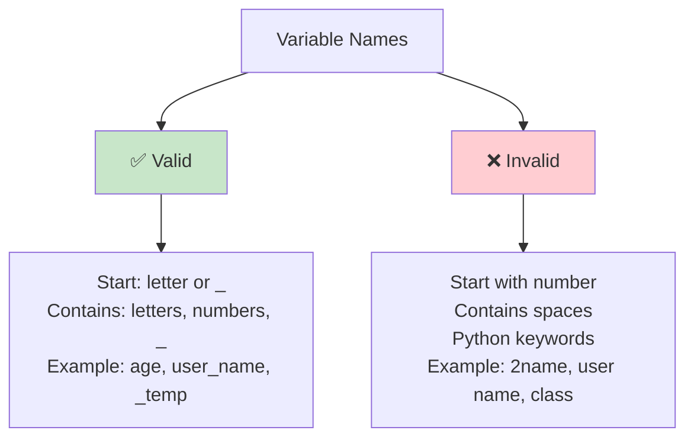

### Naming Conventions

> [!yellow] 💡 **Best Practices**

```
✅ GOOD names:
age → Clear, short
user_name → Snake_case (Python standard)
total_price → Descriptive
MAX_SIZE → ALL_CAPS for constants
is_valid → Boolean variables start with is/has/can

❌ BAD names:
x → Too vague
userName → camelCase (not Pythonic)
t → Single letter (unclear)
data123 → Meaningless numbers
```

### Assignment

```
Single assignment:
x = 10

Multiple assignment:
x, y, z = 1, 2, 3

Same value to multiple:
a = b = c = 0

Swap values (Python magic!):
a, b = b, a  # No temp variable needed!
```

---

## 3. OPERATORS

> [!blue] 💙 **Operating on Data**

### Operator Categories

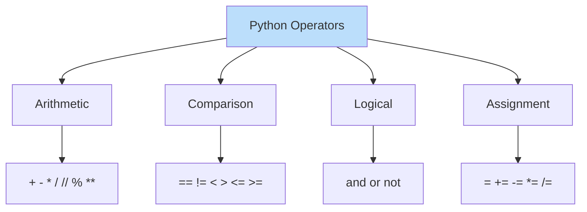

### Arithmetic Operators

```
Operator  Name              Example    Result
━━━━━━━━━━━━━━━━━━━━━━━━━━━━━━━━━━━━━━━━━━━━━━━━
+         Addition          10 + 3     13
-         Subtraction       10 - 3     7
*         Multiplication    10 * 3     30
/         Division          10 / 3     3.333...
//        Floor Division    10 // 3    3
%         Modulus           10 % 3     1
**        Exponent          10 ** 3    1000
```

### Visual Division Examples

```
Division types:

Regular division (/):
10 / 3 = 3.333...
→ Always returns float
→ Exact division

Floor division (//):
10 // 3 = 3
→ Rounds DOWN to integer
→ "How many times does 3 fit in 10?"

Modulus (%):
10 % 3 = 1
→ Returns remainder
→ "What's left over?"

10 ÷ 3 = 3 remainder 1
        ↓          ↓
        //         %
```

### Comparison Operators

```
Operator  Meaning              Example       Result
━━━━━━━━━━━━━━━━━━━━━━━━━━━━━━━━━━━━━━━━━━━━━━━━━━━
==        Equal                5 == 5        True
!=        Not equal            5 != 3        True
>         Greater than         5 > 3         True
<         Less than            5 < 3         False
>=        Greater or equal     5 >= 5        True
<=        Less or equal        3 <= 5        True
```

### Logical Operators

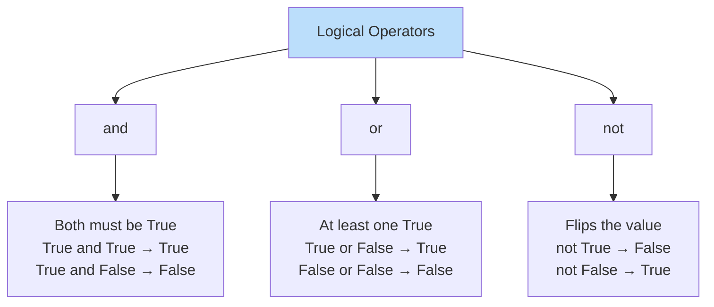

> [!yellow] 💡 **Real-World Logic**
> ```
> age = 25
> has_license = True
> 
> Can drive?
> age >= 18 and has_license → True
> (Both conditions must be True)
> 
> Gets discount?
> age < 18 or age > 65 → False
> (At least one condition must be True)
> 
> Not eligible?
> not (age >= 18) → False
> (Flips the result)
> ```

---

## 4. LISTS

> [!blue] 💙 **Ordered Collections**

### List Concept

```
List = Ordered collection of items

numbers = [1, 2, 3, 4, 5]

Index:     0  1  2  3  4
         ┌──┬──┬──┬──┬──┐
numbers: │1 │2 │3 │4 │5 │
         └──┴──┴──┴──┴──┘
Negative: -5 -4 -3 -2 -1

Lists:
✅ Ordered (maintains position)
✅ Indexed (access by position)
✅ Mutable (can change)
✅ Allow duplicates
```

### List Operations

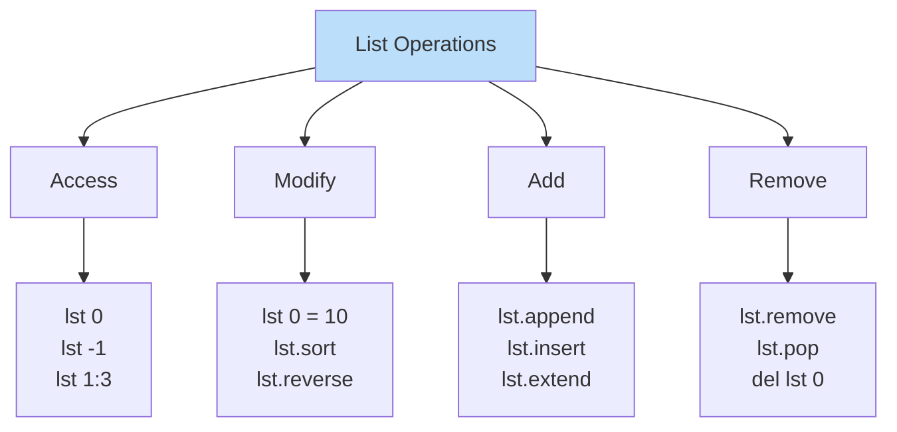

### Common List Operations

> [!green] ✅ **Essential Methods**

```
Create:
numbers = [1, 2, 3, 4, 5]
mixed = [1, "hello", 3.14, True]

Access:
numbers[0] → 1 (first)
numbers[-1] → 5 (last)
numbers[1:3] → [2, 3] (slice)

Add:
numbers.append(6) → [1, 2, 3, 4, 5, 6]
numbers.insert(0, 0) → [0, 1, 2, 3, 4, 5]
numbers.extend([7, 8]) → [1, 2, 3, 4, 5, 7, 8]

Remove:
numbers.remove(3) → Remove first 3
numbers.pop() → Remove and return last
numbers.pop(0) → Remove and return first
del numbers[0] → Delete by index

Check:
3 in numbers → True
len(numbers) → Count items

Modify:
numbers[0] = 10 → Change first item
numbers.sort() → Sort in place
numbers.reverse() → Reverse in place
```

### List Methods Cheat Sheet

```
Method          What it does                Example
━━━━━━━━━━━━━━━━━━━━━━━━━━━━━━━━━━━━━━━━━━━━━━━━━━━━━━━━━━━
.append(x)      Add x to end               lst.append(5)
.insert(i, x)   Add x at position i        lst.insert(0, 5)
.extend(lst2)   Add all from lst2          lst.extend([4,5])
.remove(x)      Remove first x             lst.remove(3)
.pop()          Remove & return last       last = lst.pop()
.pop(i)         Remove & return i          first = lst.pop(0)
.index(x)       Find position of x         lst.index(3)
.count(x)       Count occurrences          lst.count(3)
.sort()         Sort in place              lst.sort()
.reverse()      Reverse in place           lst.reverse()
.clear()        Remove all items           lst.clear()
```

> [!red] ⚠️ **Common List Mistakes**
> ```
> ❌ Out of bounds:
> numbers = [1, 2, 3]
> numbers[3] → ERROR! (Index 0, 1, 2 only)
> 
> ✅ Check length first:
> if len(numbers) > 3:
>     value = numbers[3]
> 
> ❌ Modifying while iterating:
> for item in numbers:
>     numbers.remove(item)  # BAD!
> 
> ✅ Create new list:
> numbers = [x for x in numbers if x > 5]
> ```

---

## 5. DICTIONARIES

> [!blue] 💙 **Key-Value Pairs**

### Dictionary Concept

```
Dictionary = Unordered collection of key-value pairs

person = {
    "name": "Alice",
    "age": 25,
    "city": "NYC"
}

Structure:
   Key    →   Value
┌─────────┬──────────┐
│ "name"  │ "Alice"  │
│ "age"   │  25      │
│ "city"  │ "NYC"    │
└─────────┴──────────┘

Like a real dictionary:
Word (key) → Definition (value)
```

### Dictionary vs List

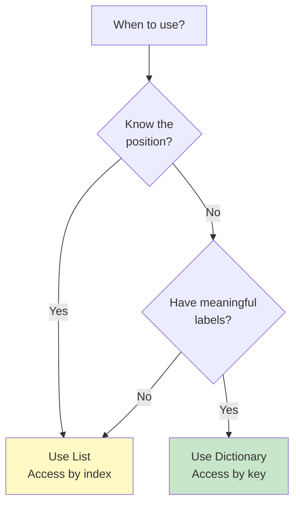

### Dictionary Operations

> [!green] ✅ **Common Patterns**

```
Create:
person = {"name": "Alice", "age": 25}
person = dict(name="Alice", age=25)

Access:
person["name"] → "Alice"
person.get("name") → "Alice"
person.get("email", "N/A") → "N/A" (default if missing)

Add/Update:
person["email"] = "alice@example.com"
person.update({"city": "NYC", "age": 26})

Remove:
del person["age"]
person.pop("age")
person.clear() → Remove all

Check:
"name" in person → True
"email" in person → False
len(person) → Count items

Iterate:
for key in person:
    print(key, person[key])

for key, value in person.items():
    print(key, value)
```

### Dictionary Methods

```
Method           What it does              Example
━━━━━━━━━━━━━━━━━━━━━━━━━━━━━━━━━━━━━━━━━━━━━━━━━━━━━━━━━━━━
.keys()          Get all keys              person.keys()
.values()        Get all values            person.values()
.items()         Get key-value pairs       person.items()
.get(key, default) Get value safely        person.get("age", 0)
.pop(key)        Remove and return         age = person.pop("age")
.update(dict2)   Merge dict2 into dict     person.update(new_data)
.clear()         Remove all items          person.clear()
```

> [!yellow] ⭐ **Real-World Use Case**
> ```
> Student database:
> 
> With List (BAD):
> alice = ["Alice", 25, "CS", 3.8]
> → What is alice[2]? Need to remember positions!
> 
> With Dictionary (GOOD):
> alice = {
>     "name": "Alice",
>     "age": 25,
>     "major": "CS",
>     "gpa": 3.8
> }
> → alice["major"] → "CS" (Clear and readable!)
> 
> Dictionaries are self-documenting!
> ```

---

## 6. SETS AND TUPLES

> [!blue] 💙 **Special Collections**

### Set - Unique Items Only

```
Set = Unordered collection of UNIQUE items

numbers = {1, 2, 3, 3, 4, 5, 5}
Result: {1, 2, 3, 4, 5}  # Duplicates removed!

Characteristics:
❌ No duplicates
❌ No order (can't index)
✅ Very fast membership testing
✅ Mathematical set operations
```

### Tuple - Immutable List

```
Tuple = Ordered, IMMUTABLE collection

point = (3, 4)
rgb = (255, 128, 0)

Characteristics:
✅ Ordered (maintains position)
✅ Indexed (can access by position)
❌ Immutable (can't change after creation)
✅ Faster than lists
```

### Collection Comparison

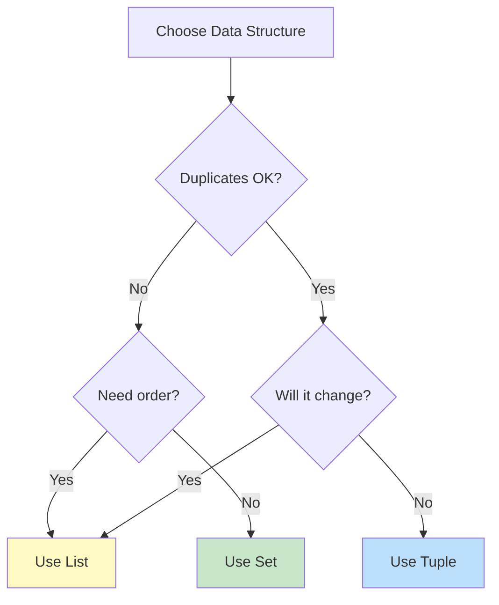

### Comparison Table

| Feature | List | Set | Tuple | Dict |
|---------|------|-----|-------|------|
| **Ordered** | ✅ | ❌ | ✅ | ❌* |
| **Mutable** | ✅ | ✅ | ❌ | ✅ |
| **Duplicates** | ✅ | ❌ | ✅ | ❌ keys |
| **Indexed** | ✅ | ❌ | ✅ | By key |
| **Speed** | Medium | Fast | Fast | Fast |
| **Use Case** | General | Unique items | Fixed data | Key-value |

*Dict maintains insertion order in Python 3.7+

### Set Operations

> [!green] ✅ **Mathematical Set Operations**

```
a = {1, 2, 3, 4}
b = {3, 4, 5, 6}

Union (all items):
a | b → {1, 2, 3, 4, 5, 6}

Intersection (common items):
a & b → {3, 4}

Difference (in a, not in b):
a - b → {1, 2}

Symmetric Difference (not in both):
a ^ b → {1, 2, 5, 6}
```

---

## 7. CONTROL FLOW

> [!blue] 💙 **Making Decisions**

### If-Elif-Else Structure

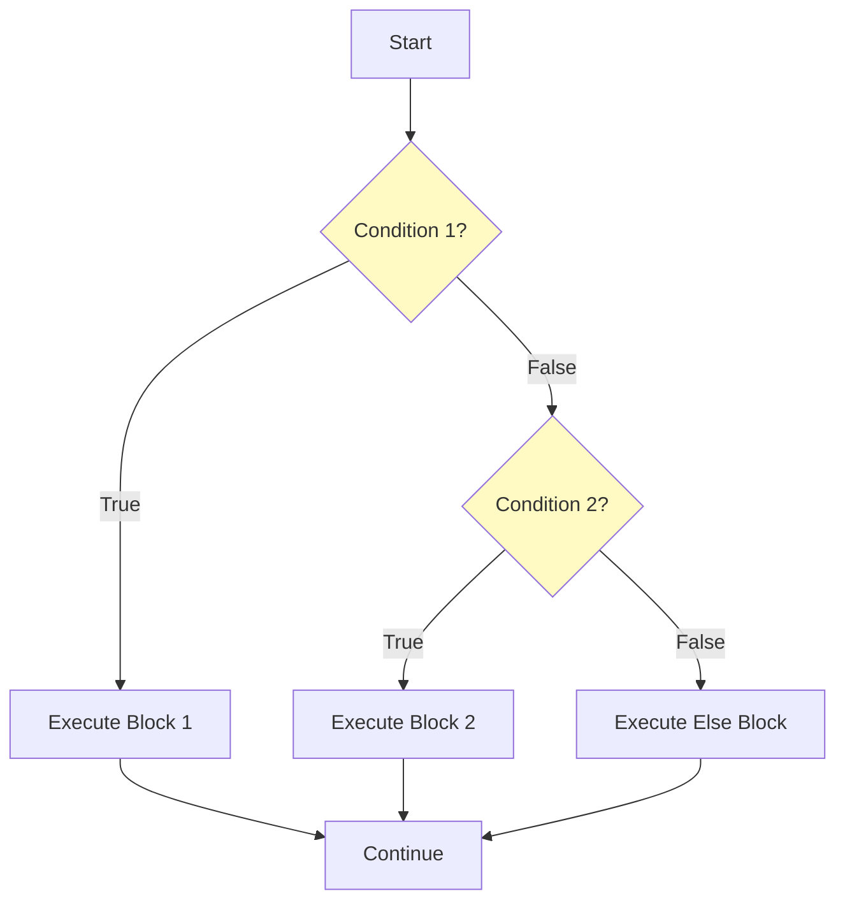

### Conditional Patterns

> [!green] ✅ **Common Patterns**

```
Simple if:
if age >= 18:
    print("Adult")

If-else:
if age >= 18:
    print("Adult")
else:
    print("Minor")

If-elif-else (multiple conditions):
if score >= 90:
    grade = "A"
elif score >= 80:
    grade = "B"
elif score >= 70:
    grade = "C"
else:
    grade = "F"

Nested conditions:
if age >= 18:
    if has_license:
        print("Can drive")
    else:
        print("Need license")
else:
    print("Too young")

Ternary (one-liner):
status = "Adult" if age >= 18 else "Minor"
```

### Truthiness in Python

```
Values that are False:
- False
- 0, 0.0
- "", [], {}, ()
- None

Everything else is True!

Examples:
if []:          # False (empty list)
if [1, 2]:      # True (non-empty)
if "":          # False (empty string)
if "hello":     # True (non-empty)
if 0:           # False
if 42:          # True
```

---

## 8. LOOPS

> [!blue] 💙 **Repeating Actions**

### For vs While

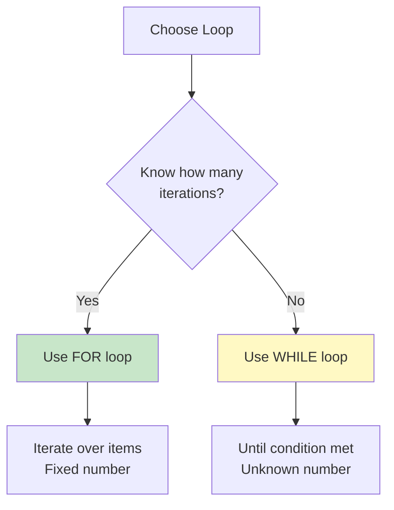

### For Loop Patterns

> [!green] ✅ **Common Patterns**

```
Iterate over list:
for item in [1, 2, 3, 4, 5]:
    print(item)

Iterate with index:
for i, item in enumerate([1, 2, 3]):
    print(f"Index {i}: {item}")

Range of numbers:
for i in range(5):        # 0, 1, 2, 3, 4
for i in range(1, 6):     # 1, 2, 3, 4, 5
for i in range(0, 10, 2): # 0, 2, 4, 6, 8

Iterate dictionary:
for key, value in person.items():
    print(f"{key}: {value}")

Nested loops:
for i in range(3):
    for j in range(3):
        print(f"({i}, {j})")
```

### While Loop

```
While loop = Repeat until condition is False

count = 0
while count < 5:
    print(count)
    count += 1

Infinite loop (careful!):
while True:
    answer = input("Continue? (y/n): ")
    if answer == 'n':
        break
```

### Loop Control

```
break = Exit loop immediately
continue = Skip to next iteration

for i in range(10):
    if i == 5:
        break  # Stop at 5
    print(i)
# Output: 0, 1, 2, 3, 4

for i in range(10):
    if i % 2 == 0:
        continue  # Skip even numbers
    print(i)
# Output: 1, 3, 5, 7, 9
```

---

## 9. FUNCTIONS

> [!blue] 💙 **Reusable Code Blocks**

### Function Concept

```
Function = Named block of reusable code

def greet(name):
    return f"Hello, {name}!"

Input (parameter) → Function → Output (return value)
     name        →  greet   → "Hello, name!"
```

### Function Structure

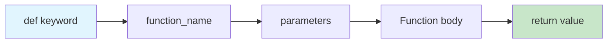

### Function Patterns

> [!green] ✅ **Common Patterns**

```
No parameters, no return:
def say_hello():
    print("Hello!")

With parameters:
def greet(name):
    print(f"Hello, {name}!")

With return value:
def add(a, b):
    return a + b

Default parameters:
def greet(name="Guest"):
    return f"Hello, {name}!"

Multiple return values:
def min_max(numbers):
    return min(numbers), max(numbers)

Variable number of arguments:
def sum_all(*args):
    return sum(args)

Keyword arguments:
def person_info(**kwargs):
    for key, value in kwargs.items():
        print(f"{key}: {value}")
```

### Function Benefits

```
Benefits of Functions:

1. Reusability:
   Write once, use many times

2. Organization:
   Break complex code into smaller pieces

3. Abstraction:
   Hide implementation details

4. Testing:
   Easy to test individual functions

5. Readability:
   Good names make code self-documenting
```

> [!yellow] 💡 **When to Create a Function**
> ```
> Create a function when:
> 
> 1. Code repeats 3+ times
>    → DRY (Don't Repeat Yourself)
> 
> 2. Logical unit of work
>    → "Calculate tax", "Validate email"
> 
> 3. Makes code more readable
>    → process_data() vs 50 lines inline
> 
> 4. Will change in future
>    → One place to update
> ```

---

## 10. COMPREHENSIONS

> [!blue] 💙 **Elegant One-Liners**

### List Comprehension

```
Traditional way:
squares = []
for i in range(10):
    squares.append(i ** 2)

Comprehension way:
squares = [i ** 2 for i in range(10)]

Same result, cleaner code!
```

### Comprehension Syntax

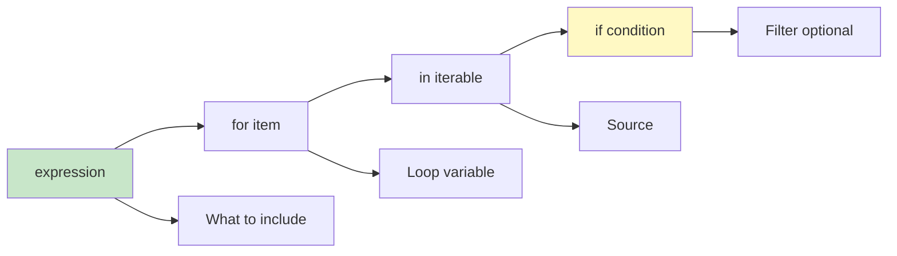

### Comprehension Types

> [!green] ✅ **All Types**

```
List Comprehension:
[x ** 2 for x in range(10)]
→ [0, 1, 4, 9, 16, 25, 36, 49, 64, 81]

With condition:
[x for x in range(20) if x % 2 == 0]
→ [0, 2, 4, 6, 8, 10, 12, 14, 16, 18]

Dictionary Comprehension:
{x: x ** 2 for x in range(5)}
→ {0: 0, 1: 1, 2: 4, 3: 9, 4: 16}

Set Comprehension:
{x % 3 for x in range(10)}
→ {0, 1, 2}

Nested:
[(x, y) for x in range(3) for y in range(3)]
→ [(0,0), (0,1), (0,2), (1,0), (1,1), (1,2), (2,0), (2,1), (2,2)]
```

### When to Use Comprehensions

```
✅ Use comprehensions when:
- Simple transformation
- Single line readable
- Creating new collection

❌ Don't use when:
- Complex logic (use loop)
- Multiple statements
- Hard to read

Example - Too complex:
[x.strip().lower().split() for x in data if x and len(x) > 5 and not x.startswith('#')]

Better as loop:
result = []
for x in data:
    if x and len(x) > 5 and not x.startswith('#'):
        result.append(x.strip().lower().split())
```

---

## 11. ERROR HANDLING

> [!blue] 💙 **Graceful Failure**

### Try-Except Structure

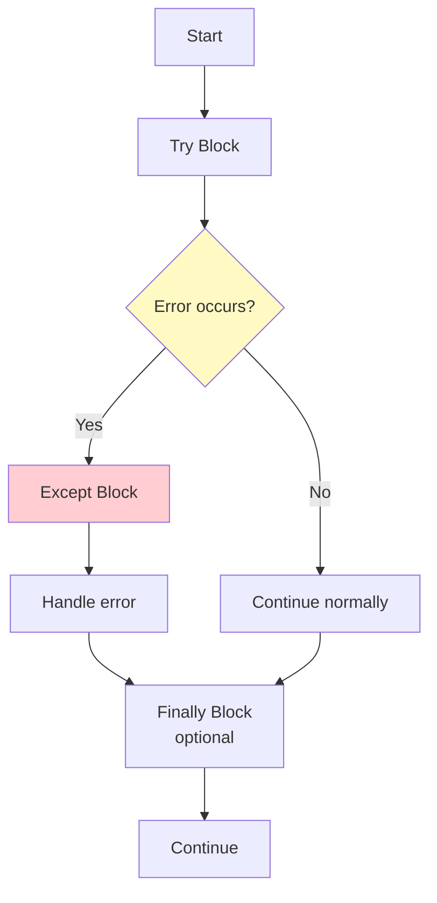

### Common Error Types

```
Error Type         When it happens              Example
━━━━━━━━━━━━━━━━━━━━━━━━━━━━━━━━━━━━━━━━━━━━━━━━━━━━━━━━━━━━━━━━━
ValueError         Invalid value                int("abc")
TypeError          Wrong type                   "5" + 3
IndexError         List index out of range      lst[100]
KeyError           Dict key doesn't exist       dict["missing"]
FileNotFoundError  File doesn't exist           open("missing.txt")
ZeroDivisionError  Division by zero             10 / 0
AttributeError     Attribute doesn't exist      "text".nonexistent()
```

### Error Handling Patterns

> [!green] ✅ **Common Patterns**

```
Basic try-except:
try:
    result = 10 / 0
except ZeroDivisionError:
    print("Can't divide by zero!")

Multiple exceptions:
try:
    number = int(input("Enter number: "))
    result = 10 / number
except ValueError:
    print("Not a valid number!")
except ZeroDivisionError:
    print("Can't divide by zero!")

Catch all (use sparingly):
try:
    risky_operation()
except Exception as e:
    print(f"Error occurred: {e}")

Finally (always runs):
try:
    file = open("data.txt")
    process_file(file)
except FileNotFoundError:
    print("File not found!")
finally:
    file.close()  # Always closes, even if error

Else (runs if no error):
try:
    result = int(input("Number: "))
except ValueError:
    print("Invalid!")
else:
    print(f"You entered: {result}")
```

> [!yellow] 💡 **Error Handling Best Practices**
> ```
> ✅ Be specific:
> catch ValueError, not Exception
> 
> ✅ Handle expected errors:
> User input, file operations, network calls
> 
> ❌ Don't hide errors:
> except: pass  # BAD! Silently fails
> 
> ✅ Log or report:
> except Exception as e:
>     log_error(e)
>     raise  # Re-raise after logging
> ```

---

## 💎 INTERVIEW QUESTIONS

> [!yellow] 💎 **Q: What is the difference between list and tuple?**
> 
> **Perfect Answer:**
> "Lists and tuples are both ordered collections, but have key differences:
> 
> **List:**
> - Mutable (can change after creation)
> - Slower (needs more memory)
> - Use when data will change
> - Syntax: [1, 2, 3]
> 
> **Tuple:**
> - Immutable (cannot change)
> - Faster (less memory overhead)
> - Use for fixed data
> - Syntax: (1, 2, 3)
> 
> **When to use:**
> 
> List for:
> - Shopping cart (add/remove items)
> - User activity log (append new events)
> - Any data that changes
> 
> Tuple for:
> - Coordinates (x, y) - never change
> - RGB colors (255, 128, 0) - fixed
> - Function returns multiple values
> - Dictionary keys (must be immutable)
> 
> **Key point for interviews:**
> Tuples are hashable → can be dict keys
> Lists are not hashable → cannot be dict keys"

> [!yellow] 💎 **Q: Explain list comprehension with example**
> 
> **Perfect Answer:**
> "List comprehension is a concise way to create lists in Python.
> 
> **Syntax:**
> [expression for item in iterable if condition]
> 
> **Example:**
> Traditional way:
> ```
> squares = []
> for i in range(10):
>     if i % 2 == 0:
>         squares.append(i ** 2)
> ```
> 
> Comprehension way:
> ```
> squares = [i ** 2 for i in range(10) if i % 2 == 0]
> ```
> 
> **Benefits:**
> 1. More concise (one line vs four)
> 2. Faster (optimized internally)
> 3. More Pythonic (idiomatic)
> 
> **When NOT to use:**
> - Complex logic (reduces readability)
> - Multiple statements needed
> - Nested comprehensions (hard to read)
> 
> **Real-world example:**
> Filter valid emails:
> ```
> valid_emails = [
>     email.lower() 
>     for email in user_emails 
>     if '@' in email and '.' in email
> ]
> ```
> 
> **Interview tip:** Mention that comprehensions work for lists, dicts, and sets!"

> [!yellow] 💎 **Q: What is the difference between == and is?**
> 
> **Perfect Answer:**
> "Both compare values, but in different ways:
> 
> **== (equality):**
> - Compares VALUES
> - Checks if contents are equal
> - Most common use
> 
> **is (identity):**
> - Compares IDENTITY (memory location)
> - Checks if same object
> - Used for None, True, False
> 
> **Example:**
> ```
> a = [1, 2, 3]
> b = [1, 2, 3]
> c = a
> 
> a == b  → True (same values)
> a is b  → False (different objects)
> a is c  → True (same object)
> ```
> 
> **Visual:**
> ```
> a → [1,2,3] at memory 0x001
> b → [1,2,3] at memory 0x002
> c → [1,2,3] at memory 0x001 (points to same as a)
> 
> a == b: Compare contents ✓ same
> a is b: Compare addresses ✗ different
> a is c: Compare addresses ✓ same
> ```
> 
> **Best practice:**
> ```
> ✅ Use == for values:
> if name == 'Alice'
> if score == 100
> 
> ✅ Use is for None:
> if value is None
> if result is not None
> 
> ❌ Don't use is for numbers/strings:
> if x is 5  # Wrong!
> if name is 'Alice'  # Wrong!
> ```"

---

**Tags:** #python #fundamentals #data-types #control-flow #functions  
**Difficulty:** ⭐ Beginner-Friendly  
**Time to Master:** 2-4 weeks  
**Last Updated:** 2026-11-11
