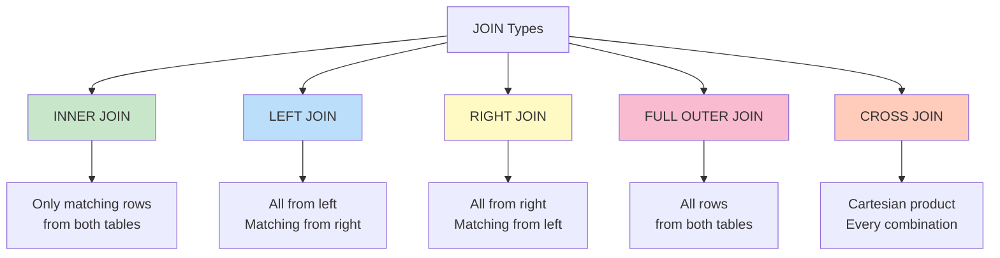
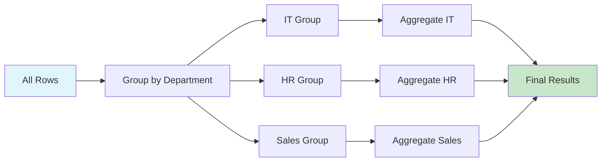
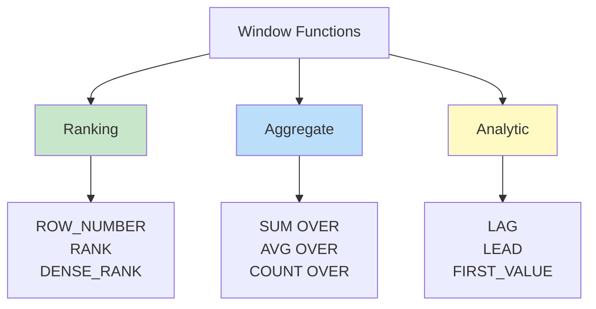

# 🗃️ SQL - Database Query Language

> [!yellow] ⭐ **EVERY DATA JOB NEEDS SQL!**
> SQL is THE language for working with databases. 90%+ of data jobs require SQL skills!
> 
> **Time to Complete:** 2-3 weeks  
> **Difficulty:** ⭐⭐ Beginner-Friendly  
> **Interview Weight:** ⭐⭐⭐ CRITICAL - Asked in 95%+ of interviews!

---

## 🗺️ SQL LEARNING ROADMAP


---

## 📚 TABLE OF CONTENTS

| # | Topic | Priority | Interview % | Link |
|---|-------|----------|-------------|------|
| 1 | **SELECT Basics** | 🔥 Critical | 100% | [[#1-select-basics\|Jump]] |
| 2 | **WHERE Clause** | 🔥 Critical | 100% | [[#2-where-clause-filtering\|Jump]] |
| 3 | **JOINs** | ⭐ Most Important! | 100% | [[#3-joins\|Jump]] |
| 4 | **Aggregations** | 🔥 Critical | 95% | [[#4-aggregations\|Jump]] |
| 5 | **GROUP BY** | ⭐ Critical | 100% | [[#5-group-by\|Jump]] |
| 6 | **ORDER BY & LIMIT** | 🔥 Essential | 90% | [[#6-order-by--limit\|Jump]] |
| 7 | **Subqueries** | 💡 Important | 85% | [[#7-subqueries\|Jump]] |
| 8 | **CASE Statements** | 💡 Important | 80% | [[#8-case-statements\|Jump]] |
| 9 | **Window Functions** | ⭐ Advanced | 75% | [[#9-window-functions\|Jump]] |
| 10 | **CTEs** | 💡 Important | 70% | [[#10-ctes-common-table-expressions\|Jump]] |
| 11 | **Date Functions** | 🔥 Essential | 85% | [[#11-date-functions\|Jump]] |
| 12 | **String Functions** | 💡 Important | 75% | [[#12-string-functions\|Jump]] |

---

## 📊 SAMPLE DATABASE

> [!blue] 💙 **We'll use this example throughout**

```sql
-- EMPLOYEES Table
+--------+-----------+------------+--------+-------------+
| emp_id | name      | department | salary | hire_date   |
+--------+-----------+------------+--------+-------------+
| 1      | Raj       | IT         | 50000  | 2020-01-15  |
| 2      | Priya     | HR         | 60000  | 2019-03-20  |
| 3      | Amit      | IT         | 55000  | 2021-06-10  |
| 4      | Neha      | Sales      | 52000  | 2020-08-05  |
| 5      | Vikram    | IT         | 58000  | 2018-11-30  |
+--------+-----------+------------+--------+-------------+

-- DEPARTMENTS Table
+--------+------------+----------+
| dept_id| dept_name  | location |
+--------+------------+----------+
| 1      | IT         | Mumbai   |
| 2      | HR         | Delhi    |
| 3      | Sales      | Bangalore|
+--------+------------+----------+

-- SALES Table
+--------+--------+------------+--------+
| sale_id| emp_id | sale_date  | amount |
+--------+--------+------------+--------+
| 1      | 4      | 2024-01-10 | 1000   |
| 2      | 4      | 2024-01-15 | 1500   |
| 3      | 3      | 2024-01-12 | 2000   |
+--------+--------+------------+--------+
```

---

## 1. SELECT BASICS

> [!blue] 💙 **SELECT - The Foundation of SQL**
> Every SQL query starts with SELECT. It retrieves data from tables.

> [!green] ✅ **Basic SELECT Queries**
> ```sql
> -- Select all columns
> SELECT * 
> FROM employees;
> 
> -- Select specific columns
> SELECT name, salary 
> FROM employees;
> 
> -- Select with alias (rename columns)
> SELECT 
>     name AS employee_name,
>     salary AS annual_salary
> FROM employees;
> 
> -- Select distinct values (remove duplicates)
> SELECT DISTINCT department 
> FROM employees;
> -- Result: IT, HR, Sales (no duplicates)
> 
> -- Select with calculations
> SELECT 
>     name,
>     salary,
>     salary * 12 AS yearly_salary,
>     salary * 0.1 AS bonus
> FROM employees;
> ```

> [!yellow] 💡 **Best Practices**
> ```sql
> -- ❌ DON'T: Select everything if you don't need it
> SELECT * FROM employees;  -- Wastes resources
> 
> -- ✅ DO: Select only needed columns
> SELECT name, salary FROM employees;  -- Faster and clearer
> 
> -- ✅ DO: Use meaningful aliases
> SELECT salary * 12 AS annual_income  -- Clear meaning
> ```

---

## 2. WHERE CLAUSE (FILTERING)

> [!blue] 💙 **WHERE - Filter Your Data**
> WHERE lets you filter rows based on conditions.

> [!green] ✅ **Basic WHERE Conditions**
> ```sql
> -- Equal to
> SELECT * FROM employees 
> WHERE department = 'IT';
> 
> -- Greater than
> SELECT * FROM employees 
> WHERE salary > 55000;
> 
> -- Between range
> SELECT * FROM employees 
> WHERE salary BETWEEN 50000 AND 60000;
> 
> -- IN list
> SELECT * FROM employees 
> WHERE department IN ('IT', 'Sales');
> 
> -- NOT IN
> SELECT * FROM employees 
> WHERE department NOT IN ('HR');
> 
> -- LIKE pattern matching
> SELECT * FROM employees 
> WHERE name LIKE 'A%';  -- Starts with 'A'
> 
> SELECT * FROM employees 
> WHERE name LIKE '%a%';  -- Contains 'a'
> 
> -- NULL checks
> SELECT * FROM employees 
> WHERE department IS NULL;
> 
> SELECT * FROM employees 
> WHERE department IS NOT NULL;
> ```

> [!green] ✅ **Combining Conditions (AND, OR, NOT)**
> ```sql
> -- AND: Both conditions must be true
> SELECT * FROM employees 
> WHERE department = 'IT' 
>   AND salary > 52000;
> 
> -- OR: At least one condition must be true
> SELECT * FROM employees 
> WHERE department = 'IT' 
>    OR department = 'Sales';
> 
> -- NOT: Negates condition
> SELECT * FROM employees 
> WHERE NOT department = 'HR';
> 
> -- Complex combinations (use parentheses!)
> SELECT * FROM employees 
> WHERE (department = 'IT' OR department = 'Sales')
>   AND salary > 52000;
> ```

> [!red] ⚠️ **Common Mistakes**
> ```sql
> -- ❌ WRONG: Using = with NULL
> SELECT * FROM employees WHERE department = NULL;  -- Returns nothing!
> 
> -- ✅ CORRECT: Use IS NULL
> SELECT * FROM employees WHERE department IS NULL;
> 
> -- ❌ WRONG: String comparison without quotes
> SELECT * FROM employees WHERE department = IT;  -- Error!
> 
> -- ✅ CORRECT: Strings need quotes
> SELECT * FROM employees WHERE department = 'IT';
> ```

---

## 3. JOINs

> [!red] ⚠️ **MOST IMPORTANT SQL TOPIC FOR INTERVIEWS!**

> [!blue] 💙 **What are JOINs?**
> JOINs combine rows from two or more tables based on a related column.



### INNER JOIN

> [!green] ✅ **INNER JOIN - Most Common!**
> ```sql
> -- Returns only matching rows from both tables
> SELECT 
>     e.name,
>     e.department,
>     e.salary,
>     d.location
> FROM employees e
> INNER JOIN departments d ON e.department = d.dept_name;
> 
> -- Result:
> +--------+------------+--------+-----------+
> | name   | department | salary | location  |
> +--------+------------+--------+-----------+
> | Raj    | IT         | 50000  | Mumbai    |
> | Priya  | HR         | 60000  | Delhi     |
> | Amit   | IT         | 55000  | Mumbai    |
> | Neha   | Sales      | 52000  | Bangalore |
> | Vikram | IT         | 58000  | Mumbai    |
> +--------+------------+--------+-----------+
> ```

> [!blue] 💙 **Visual Representation**
> ```
> INNER JOIN
> 
> Table A          Table B
>   ●●●              ●●●
>   ●●●    ───►      ●●●
>   ●●●              ●●●
>   
>   Only the overlapping part (●●)
> ```

### LEFT JOIN

> [!green] ✅ **LEFT JOIN - Keep all from left table**
> ```sql
> -- Returns all rows from left table + matching from right
> SELECT 
>     e.name,
>     e.department,
>     s.amount
> FROM employees e
> LEFT JOIN sales s ON e.emp_id = s.emp_id;
> 
> -- Result: All employees, even those without sales
> +--------+------------+--------+
> | name   | department | amount |
> +--------+------------+--------+
> | Raj    | IT         | NULL   |  -- No sales
> | Priya  | HR         | NULL   |  -- No sales
> | Amit   | IT         | 2000   |
> | Neha   | Sales      | 1000   |
> | Neha   | Sales      | 1500   |
> | Vikram | IT         | NULL   |  -- No sales
> +--------+------------+--------+
> ```

> [!blue] 💙 **Visual Representation**
> ```
> LEFT JOIN
> 
> Table A (LEFT)   Table B (RIGHT)
>   ●●●              ●●●
>   ●●●    ───►      ●●●
>   ●●●              ●●●
>   
>   All of A + matching from B
> ```

### RIGHT JOIN

> [!green] ✅ **RIGHT JOIN - Keep all from right table**
> ```sql
> -- Returns all rows from right table + matching from left
> SELECT 
>     e.name,
>     e.department,
>     s.amount
> FROM employees e
> RIGHT JOIN sales s ON e.emp_id = s.emp_id;
> 
> -- Result: All sales, even if employee doesn't exist
> -- (In our example, all sales have employees)
> ```

### FULL OUTER JOIN

> [!green] ✅ **FULL OUTER JOIN - Keep all from both**
> ```sql
> -- Returns all rows from both tables
> SELECT 
>     e.name,
>     e.department,
>     s.amount
> FROM employees e
> FULL OUTER JOIN sales s ON e.emp_id = s.emp_id;
> 
> -- Result: All employees + all sales
> -- Note: Not supported in MySQL (use UNION of LEFT and RIGHT)
> ```

### Multiple JOINs

> [!green] ✅ **Joining Multiple Tables**
> ```sql
> -- Join 3 tables
> SELECT 
>     e.name,
>     e.salary,
>     d.location,
>     s.amount
> FROM employees e
> INNER JOIN departments d ON e.department = d.dept_name
> LEFT JOIN sales s ON e.emp_id = s.emp_id;
> ```

> [!yellow] 💎 **Interview Question: JOINs**
> 
> **Q: What's the difference between INNER JOIN and LEFT JOIN?**
> 
> **Perfect Answer:**
> "INNER JOIN returns only rows that have matching values in BOTH tables. LEFT JOIN returns ALL rows from the left table, plus matching rows from the right table - if there's no match, NULL values are returned for right table columns.
> 
> Example:
> - Employees table: 5 employees
> - Sales table: 3 sales (only from 2 employees)
> 
> INNER JOIN: Returns 3 rows (only employees with sales)
> LEFT JOIN: Returns 5 rows (all employees, with NULL for those without sales)
> 
> Use INNER JOIN when you only want matching records.
> Use LEFT JOIN when you want to keep all records from the main table even if there's no match."

---

## 4. AGGREGATIONS

> [!blue] 💙 **Aggregate Functions**
> Calculate summary statistics across rows.

> [!green] ✅ **Common Aggregate Functions**
> ```sql
> -- COUNT: Number of rows
> SELECT COUNT(*) AS total_employees 
> FROM employees;
> -- Result: 5
> 
> SELECT COUNT(DISTINCT department) AS num_departments
> FROM employees;
> -- Result: 3
> 
> -- SUM: Total of numeric column
> SELECT SUM(salary) AS total_payroll 
> FROM employees;
> -- Result: 275000
> 
> -- AVG: Average
> SELECT AVG(salary) AS average_salary 
> FROM employees;
> -- Result: 55000
> 
> -- MIN: Minimum value
> SELECT MIN(salary) AS lowest_salary 
> FROM employees;
> -- Result: 50000
> 
> -- MAX: Maximum value
> SELECT MAX(salary) AS highest_salary 
> FROM employees;
> -- Result: 60000
> 
> -- Multiple aggregations
> SELECT 
>     COUNT(*) AS num_employees,
>     AVG(salary) AS avg_salary,
>     MIN(salary) AS min_salary,
>     MAX(salary) AS max_salary,
>     SUM(salary) AS total_salary
> FROM employees;
> ```

> [!yellow] 💡 **COUNT(*) vs COUNT(column)**
> ```sql
> -- COUNT(*): Counts all rows
> SELECT COUNT(*) FROM employees;  -- 5
> 
> -- COUNT(column): Counts non-NULL values in column
> SELECT COUNT(department) FROM employees;  -- Ignores NULLs
> 
> -- COUNT(DISTINCT column): Counts unique non-NULL values
> SELECT COUNT(DISTINCT department) FROM employees;  -- 3
> ```

---

## 5. GROUP BY

> [!red] ⚠️ **SUPER IMPORTANT - Asked in EVERY SQL interview!**

> [!blue] 💙 **What is GROUP BY?**
> GROUP BY groups rows with same values and lets you aggregate each group.



> [!green] ✅ **Basic GROUP BY**
> ```sql
> -- Average salary by department
> SELECT 
>     department,
>     AVG(salary) AS avg_salary
> FROM employees
> GROUP BY department;
> 
> -- Result:
> +------------+------------+
> | department | avg_salary |
> +------------+------------+
> | IT         | 54333.33   |
> | HR         | 60000.00   |
> | Sales      | 52000.00   |
> +------------+------------+
> 
> -- Count employees per department
> SELECT 
>     department,
>     COUNT(*) AS num_employees
> FROM employees
> GROUP BY department;
> 
> -- Result:
> +------------+---------------+
> | department | num_employees |
> +------------+---------------+
> | IT         | 3             |
> | HR         | 1             |
> | Sales      | 1             |
> +------------+---------------+
> ```

> [!green] ✅ **GROUP BY with Multiple Columns**
> ```sql
> -- Average salary by department and year
> SELECT 
>     department,
>     YEAR(hire_date) AS hire_year,
>     COUNT(*) AS employees,
>     AVG(salary) AS avg_salary
> FROM employees
> GROUP BY department, YEAR(hire_date)
> ORDER BY department, hire_year;
> ```

### HAVING Clause

> [!yellow] ⭐ **HAVING - Filter AFTER grouping**
> ```sql
> -- WHERE filters BEFORE grouping
> -- HAVING filters AFTER grouping
> 
> -- Departments with average salary > 53000
> SELECT 
>     department,
>     AVG(salary) AS avg_salary
> FROM employees
> GROUP BY department
> HAVING AVG(salary) > 53000;
> 
> -- Result:
> +------------+------------+
> | department | avg_salary |
> +------------+------------+
> | IT         | 54333.33   |
> | HR         | 60000.00   |
> +------------+------------+
> 
> -- Departments with more than 1 employee
> SELECT 
>     department,
>     COUNT(*) AS num_employees
> FROM employees
> GROUP BY department
> HAVING COUNT(*) > 1;
> 
> -- Result:
> +------------+---------------+
> | department | num_employees |
> +------------+---------------+
> | IT         | 3             |
> +------------+---------------+
> ```

> [!red] ⚠️ **WHERE vs HAVING**
> ```sql
> -- ❌ WRONG: Can't use aggregate in WHERE
> SELECT department, AVG(salary)
> FROM employees
> WHERE AVG(salary) > 53000  -- ERROR!
> GROUP BY department;
> 
> -- ✅ CORRECT: Use HAVING for aggregates
> SELECT department, AVG(salary)
> FROM employees
> GROUP BY department
> HAVING AVG(salary) > 53000;  -- ✓
> 
> -- Use BOTH:
> -- WHERE filters rows before grouping
> -- HAVING filters groups after aggregation
> SELECT 
>     department,
>     AVG(salary) AS avg_salary
> FROM employees
> WHERE hire_date >= '2020-01-01'  -- Filter rows first
> GROUP BY department
> HAVING AVG(salary) > 50000;      -- Filter groups after
> ```

> [!yellow] 💎 **Interview Question: WHERE vs HAVING**
> 
> **Q: What's the difference between WHERE and HAVING?**
> 
> **Perfect Answer:**
> "WHERE filters individual rows BEFORE grouping, while HAVING filters groups AFTER aggregation.
> 
> Key differences:
> 1. **Timing**: WHERE happens first, HAVING happens after GROUP BY
> 2. **What they filter**: WHERE filters rows, HAVING filters groups
> 3. **Aggregates**: WHERE can't use aggregate functions, HAVING can
> 
> Example:
> ```sql
> SELECT department, AVG(salary)
> FROM employees
> WHERE salary > 50000      -- Filter: only high earners
> GROUP BY department
> HAVING COUNT(*) > 1;      -- Filter: departments with >1 employee
> ```
> 
> Execution order: WHERE → GROUP BY → HAVING → SELECT"

---

## 6. ORDER BY & LIMIT

> [!blue] 💙 **Sorting and Limiting Results**

> [!green] ✅ **ORDER BY**
> ```sql
> -- Sort ascending (default)
> SELECT name, salary 
> FROM employees
> ORDER BY salary;
> 
> -- Sort descending
> SELECT name, salary 
> FROM employees
> ORDER BY salary DESC;
> 
> -- Sort by multiple columns
> SELECT name, department, salary 
> FROM employees
> ORDER BY department, salary DESC;
> -- First by department (A-Z), then by salary (high to low)
> 
> -- Sort by column position (not recommended)
> SELECT name, salary 
> FROM employees
> ORDER BY 2 DESC;  -- Sort by 2nd column (salary)
> ```

> [!green] ✅ **LIMIT**
> ```sql
> -- Top 3 highest salaries
> SELECT name, salary 
> FROM employees
> ORDER BY salary DESC
> LIMIT 3;
> 
> -- Skip first 2, get next 3 (pagination)
> SELECT name, salary 
> FROM employees
> ORDER BY salary DESC
> LIMIT 3 OFFSET 2;
> 
> -- Alternative syntax (MySQL)
> SELECT name, salary 
> FROM employees
> ORDER BY salary DESC
> LIMIT 2, 3;  -- Skip 2, get 3
> ```

---

## 7. SUBQUERIES

> [!blue] 💙 **Queries Within Queries**

> [!green] ✅ **Subqueries in WHERE**
> ```sql
> -- Employees earning more than average
> SELECT name, salary
> FROM employees
> WHERE salary > (
>     SELECT AVG(salary) 
>     FROM employees
> );
> 
> -- Employees in departments with >1 employee
> SELECT name, department
> FROM employees
> WHERE department IN (
>     SELECT department
>     FROM employees
>     GROUP BY department
>     HAVING COUNT(*) > 1
> );
> ```

> [!green] ✅ **Subqueries in FROM (Derived Tables)**
> ```sql
> -- Average of department averages
> SELECT AVG(dept_avg) AS overall_avg
> FROM (
>     SELECT AVG(salary) AS dept_avg
>     FROM employees
>     GROUP BY department
> ) AS dept_averages;
> ```

> [!green] ✅ **Correlated Subqueries**
> ```sql
> -- Employees earning more than their department average
> SELECT name, department, salary
> FROM employees e1
> WHERE salary > (
>     SELECT AVG(salary)
>     FROM employees e2
>     WHERE e2.department = e1.department
> );
> ```

---

## 8. CASE STATEMENTS

> [!blue] 💙 **IF-THEN Logic in SQL**

> [!green] ✅ **CASE Statements**
> ```sql
> -- Salary categories
> SELECT 
>     name,
>     salary,
>     CASE 
>         WHEN salary < 52000 THEN 'Low'
>         WHEN salary BETWEEN 52000 AND 56000 THEN 'Medium'
>         ELSE 'High'
>     END AS salary_category
> FROM employees;
> 
> -- Result:
> +--------+--------+------------------+
> | name   | salary | salary_category  |
> +--------+--------+------------------+
> | Raj    | 50000  | Low              |
> | Priya  | 60000  | High             |
> | Amit   | 55000  | Medium           |
> | Neha   | 52000  | Medium           |
> | Vikram | 58000  | High             |
> +--------+--------+------------------+
> 
> -- CASE with aggregation
> SELECT 
>     department,
>     SUM(CASE WHEN salary > 55000 THEN 1 ELSE 0 END) AS high_earners,
>     SUM(CASE WHEN salary <= 55000 THEN 1 ELSE 0 END) AS low_earners
> FROM employees
> GROUP BY department;
> ```

---

## 9. WINDOW FUNCTIONS

> [!red] ⚠️ **ADVANCED - But asked in senior interviews!**

> [!blue] 💙 **What are Window Functions?**
> Perform calculations across rows related to the current row, WITHOUT grouping.



> [!green] ✅ **Ranking Functions**
> ```sql
> -- ROW_NUMBER: Unique sequential number
> SELECT 
>     name,
>     department,
>     salary,
>     ROW_NUMBER() OVER (ORDER BY salary DESC) AS row_num
> FROM employees;
> 
> -- RANK: Same rank for ties, skips numbers
> SELECT 
>     name,
>     salary,
>     RANK() OVER (ORDER BY salary DESC) AS rank
> FROM employees;
> 
> -- DENSE_RANK: Same rank for ties, no gaps
> SELECT 
>     name,
>     salary,
>     DENSE_RANK() OVER (ORDER BY salary DESC) AS dense_rank
> FROM employees;
> 
> -- Rank within partition
> SELECT 
>     name,
>     department,
>     salary,
>     ROW_NUMBER() OVER (
>         PARTITION BY department 
>         ORDER BY salary DESC
>     ) AS dept_rank
> FROM employees;
> -- Ranks employees within each department
> ```

> [!green] ✅ **Aggregate Window Functions**
> ```sql
> -- Running total
> SELECT 
>     name,
>     salary,
>     SUM(salary) OVER (ORDER BY hire_date) AS running_total
> FROM employees;
> 
> -- Compare to department average
> SELECT 
>     name,
>     department,
>     salary,
>     AVG(salary) OVER (PARTITION BY department) AS dept_avg,
>     salary - AVG(salary) OVER (PARTITION BY department) AS diff_from_avg
> FROM employees;
> ```

> [!green] ✅ **LAG and LEAD**
> ```sql
> -- Compare with previous row
> SELECT 
>     name,
>     salary,
>     LAG(salary) OVER (ORDER BY hire_date) AS prev_salary,
>     salary - LAG(salary) OVER (ORDER BY hire_date) AS salary_diff
> FROM employees;
> 
> -- Compare with next row
> SELECT 
>     name,
>     salary,
>     LEAD(salary) OVER (ORDER BY hire_date) AS next_salary
> FROM employees;
> ```

---

## 10. CTEs (Common Table Expressions)

> [!blue] 💙 **WITH Clause - Named Subqueries**
> CTEs make complex queries more readable!

> [!green] ✅ **Basic CTE**
> ```sql
> -- Calculate department stats, then filter
> WITH dept_stats AS (
>     SELECT 
>         department,
>         AVG(salary) AS avg_salary,
>         COUNT(*) AS num_employees
>     FROM employees
>     GROUP BY department
> )
> SELECT *
> FROM dept_stats
> WHERE avg_salary > 53000;
> ```

> [!green] ✅ **Multiple CTEs**
> ```sql
> -- Multiple CTEs separated by commas
> WITH 
> dept_avg AS (
>     SELECT department, AVG(salary) AS avg_sal
>     FROM employees
>     GROUP BY department
> ),
> high_earners AS (
>     SELECT *
>     FROM employees
>     WHERE salary > 55000
> )
> SELECT 
>     h.name,
>     h.department,
>     h.salary,
>     d.avg_sal
> FROM high_earners h
> JOIN dept_avg d ON h.department = d.department;
> ```

> [!yellow] 💡 **CTE vs Subquery**
> ```sql
> -- ❌ Subquery (hard to read)
> SELECT *
> FROM (
>     SELECT department, AVG(salary) AS avg_salary
>     FROM employees
>     GROUP BY department
> ) AS dept_stats
> WHERE avg_salary > 53000;
> 
> -- ✅ CTE (much clearer!)
> WITH dept_stats AS (
>     SELECT department, AVG(salary) AS avg_salary
>     FROM employees
>     GROUP BY department
> )
> SELECT *
> FROM dept_stats
> WHERE avg_salary > 53000;
> ```

---

## 11. DATE FUNCTIONS

> [!blue] 💙 **Working with Dates**

> [!green] ✅ **Common Date Functions**
> ```sql
> -- Current date/time
> SELECT CURRENT_DATE;        -- 2024-01-15
> SELECT CURRENT_TIMESTAMP;   -- 2024-01-15 14:30:00
> SELECT NOW();               -- 2024-01-15 14:30:00
> 
> -- Extract parts
> SELECT 
>     hire_date,
>     YEAR(hire_date) AS year,
>     MONTH(hire_date) AS month,
>     DAY(hire_date) AS day,
>     DAYOFWEEK(hire_date) AS day_of_week
> FROM employees;
> 
> -- Date arithmetic
> SELECT 
>     hire_date,
>     DATE_ADD(hire_date, INTERVAL 1 YEAR) AS anniversary,
>     DATEDIFF(CURRENT_DATE, hire_date) AS days_employed
> FROM employees;
> 
> -- Format dates
> SELECT 
>     hire_date,
>     DATE_FORMAT(hire_date, '%Y-%m-%d') AS iso_format,
>     DATE_FORMAT(hire_date, '%d/%m/%Y') AS dd_mm_yyyy
> FROM employees;
> ```

---

## 12. STRING FUNCTIONS

> [!blue] 💙 **Text Manipulation**

> [!green] ✅ **Common String Functions**
> ```sql
> -- Concatenation
> SELECT 
>     CONCAT(name, ' - ', department) AS employee_info
> FROM employees;
> 
> -- Case conversion
> SELECT 
>     UPPER(name) AS uppercase,
>     LOWER(name) AS lowercase
> FROM employees;
> 
> -- Substring
> SELECT 
>     name,
>     SUBSTRING(name, 1, 3) AS first_3_chars,
>     LEFT(name, 3) AS left_3,
>     RIGHT(name, 3) AS right_3
> FROM employees;
> 
> -- Length
> SELECT 
>     name,
>     LENGTH(name) AS name_length
> FROM employees;
> 
> -- Trim whitespace
> SELECT 
>     TRIM('  Hello  ') AS trimmed,
>     LTRIM('  Hello') AS left_trim,
>     RTRIM('Hello  ') AS right_trim;
> 
> -- Replace
> SELECT 
>     REPLACE(name, 'a', 'X') AS replaced
> FROM employees;
> ```

---

## 🎯 SQL INTERVIEW CHECKLIST

> [!red] ⚠️ **MUST KNOW for Interviews**

### Core Concepts:
- [ ] SELECT, WHERE basics
- [ ] JOINs (INNER, LEFT especially)
- [ ] GROUP BY with HAVING
- [ ] Aggregations (COUNT, SUM, AVG)
- [ ] Subqueries
- [ ] CASE statements
- [ ] Window functions (ROW_NUMBER, RANK)
- [ ] CTEs

### Common Interview Questions:
- [ ] "Write a query to find 2nd highest salary"
- [ ] "Difference between INNER JOIN and LEFT JOIN"
- [ ] "WHERE vs HAVING - explain with example"
- [ ] "Find employees earning more than department average"
- [ ] "Write a query for running total"
- [ ] "Delete duplicate rows keeping one"
- [ ] "Find gaps in sequential IDs"

### Practice Questions:

> [!yellow] 💎 **Top Interview Questions**
> 
> **Q1: Find 2nd highest salary**
> ```sql
> -- Method 1: Using LIMIT
> SELECT DISTINCT salary
> FROM employees
> ORDER BY salary DESC
> LIMIT 1 OFFSET 1;
> 
> -- Method 2: Using subquery
> SELECT MAX(salary)
> FROM employees
> WHERE salary < (SELECT MAX(salary) FROM employees);
> 
> -- Method 3: Using window function
> WITH ranked AS (
>     SELECT 
>         salary,
>         DENSE_RANK() OVER (ORDER BY salary DESC) AS rank
>     FROM employees
> )
> SELECT DISTINCT salary
> FROM ranked
> WHERE rank = 2;
> ```

> [!yellow] 💎 **Q2: Find duplicate records**
> ```sql
> -- Find duplicates
> SELECT name, COUNT(*) as count
> FROM employees
> GROUP BY name
> HAVING COUNT(*) > 1;
> 
> -- Delete duplicates (keep one)
> DELETE FROM employees
> WHERE id NOT IN (
>     SELECT MIN(id)
>     FROM employees
>     GROUP BY name
> );
> ```

> [!yellow] 💎 **Q3: Employees earning more than manager**
> ```sql
> -- Assuming manager_id column exists
> SELECT e.name AS employee
> FROM employees e
> JOIN employees m ON e.manager_id = m.emp_id
> WHERE e.salary > m.salary;
> ```

---

## 🔗 NEXT STEPS

> [!yellow] 💡 **After Mastering SQL**

**Next Topic:** [[../Math/README|Mathematics for ML]]

**Practice:**
- [[../../09-Interview-Prep/Coding/sql-exercises|SQL Practice Problems]]
- LeetCode SQL problems
- HackerRank SQL track

---

**Tags:** #sql #database #queries #critical #interview  
**Difficulty:** ⭐⭐ Beginner-Friendly  
**Time to Master:** 2-3 weeks  
**Last Updated:** 2026-11-11
