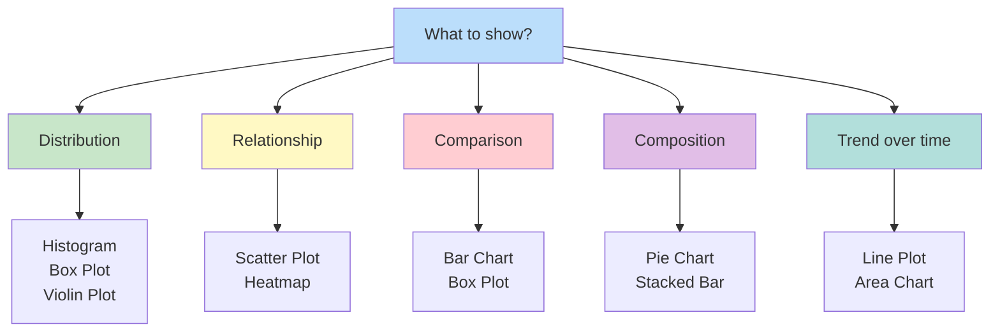
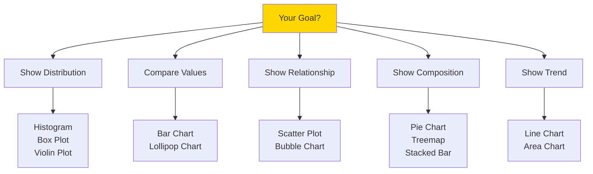

# 📊 DATA VISUALIZATION

> [!yellow] ⭐ **A PICTURE IS WORTH A THOUSAND DATA POINTS!**
> "The greatest value of a picture is when it forces us to notice what we never expected to see." - John Tukey
> 
> **Time to Complete:** 1-2 weeks  
> **Difficulty:** ⭐⭐ Easy-Medium  
> **Interview Weight:** ⭐⭐⭐⭐ Very Important!

---

## 🗺️ VISUALIZATION LEARNING ROADMAP


---

## 📚 TABLE OF CONTENTS

| # | Topic | Use Case | Link |
|---|-------|----------|------|
| 1 | **Matplotlib Basics** | Foundation | [[#1-matplotlib-basics\|Jump]] |
| 2 | **Chart Types** | When to use what | [[#2-chart-types\|Jump]] |
| 3 | **Seaborn** | Statistical plots | [[#3-seaborn\|Jump]] |
| 4 | **Plotly** | Interactive viz | [[#4-plotly-interactive\|Jump]] |
| 5 | **Best Practices** | Design principles | [[#5-best-practices\|Jump]] |
| 6 | **Dashboard** | Complete examples | [[#6-dashboard-creation\|Jump]] |

---

## 1. MATPLOTLIB BASICS

> [!blue] 💙 **What is Matplotlib?**
> The foundational plotting library in Python. All other libraries are built on top of it!

### Basic Structure

```python
import matplotlib.pyplot as plt
import numpy as np

# The pattern:
plt.figure()      # Create figure
plt.plot(x, y)    # Add plot
plt.xlabel('X')   # Label x-axis
plt.ylabel('Y')   # Label y-axis
plt.title('Title') # Add title
plt.show()        # Display
```

> [!green] ✅ **Your First Plot**
> ```python
> import matplotlib.pyplot as plt
> import numpy as np
> 
> # Data
> x = np.linspace(0, 10, 100)
> y = np.sin(x)
> 
> # Create plot
> plt.figure(figsize=(10, 6))  # Size in inches
> plt.plot(x, y, color='blue', linewidth=2, label='sin(x)')
> plt.xlabel('X axis', fontsize=12)
> plt.ylabel('Y axis', fontsize=12)
> plt.title('My First Plot', fontsize=14, fontweight='bold')
> plt.grid(True, alpha=0.3)
> plt.legend()
> plt.show()
> ```

### Customization Options

> [!green] ✅ **Styling Your Plots**
> ```python
> # Line styles
> plt.plot(x, y, linestyle='-')   # solid
> plt.plot(x, y, linestyle='--')  # dashed
> plt.plot(x, y, linestyle='-.')  # dash-dot
> plt.plot(x, y, linestyle=':')   # dotted
> 
> # Colors
> plt.plot(x, y, color='red')
> plt.plot(x, y, color='#FF5733')  # Hex code
> plt.plot(x, y, color=(0.1, 0.2, 0.5))  # RGB tuple
> plt.plot(x, y, c='r')  # Short form
> 
> # Markers
> plt.plot(x, y, marker='o')   # circle
> plt.plot(x, y, marker='s')   # square
> plt.plot(x, y, marker='^')   # triangle
> plt.plot(x, y, marker='*')   # star
> 
> # Combined
> plt.plot(x, y, 'r--o', linewidth=2, markersize=8, label='Data')
> #           └─┴─└─ color, line, marker
> ```

### Subplots

> [!green] ✅ **Multiple Plots in One Figure**
> ```python
> # Method 1: Simple grid
> fig, axes = plt.subplots(2, 2, figsize=(12, 10))
> 
> axes[0, 0].plot(x, np.sin(x))
> axes[0, 0].set_title('Sin')
> 
> axes[0, 1].plot(x, np.cos(x))
> axes[0, 1].set_title('Cos')
> 
> axes[1, 0].plot(x, np.tan(x))
> axes[1, 0].set_title('Tan')
> 
> axes[1, 1].plot(x, x**2)
> axes[1, 1].set_title('Quadratic')
> 
> plt.tight_layout()  # Adjust spacing
> plt.show()
> 
> # Method 2: Flexible layout
> fig = plt.figure(figsize=(12, 8))
> 
> ax1 = plt.subplot(2, 2, 1)  # 2 rows, 2 cols, position 1
> ax2 = plt.subplot(2, 2, 2)
> ax3 = plt.subplot(2, 1, 2)  # Takes bottom half
> 
> ax1.plot(x, y1)
> ax2.plot(x, y2)
> ax3.plot(x, y3)
> 
> plt.show()
> ```

---

## 2. CHART TYPES

> [!blue] 💙 **Choosing the Right Chart**



### Line Plot

> [!blue] 💙 **When to Use:** Time series, trends, continuous data

> [!green] ✅ **Line Plot**
> ```python
> import matplotlib.pyplot as plt
> import numpy as np
> 
> # Time series data
> dates = pd.date_range('2024-01-01', periods=100)
> values = np.cumsum(np.random.randn(100)) + 100
> 
> plt.figure(figsize=(12, 6))
> plt.plot(dates, values, linewidth=2, color='#2E86AB')
> plt.fill_between(dates, values, alpha=0.3, color='#2E86AB')
> plt.xlabel('Date', fontsize=12)
> plt.ylabel('Value', fontsize=12)
> plt.title('Time Series with Confidence Band', fontsize=14, fontweight='bold')
> plt.grid(True, alpha=0.3)
> plt.xticks(rotation=45)
> plt.tight_layout()
> plt.show()
> 
> # Multiple lines
> plt.figure(figsize=(12, 6))
> plt.plot(dates, values, label='Series 1', linewidth=2)
> plt.plot(dates, values * 1.1, label='Series 2', linewidth=2)
> plt.plot(dates, values * 0.9, label='Series 3', linewidth=2)
> plt.legend(loc='best')
> plt.title('Multiple Time Series')
> plt.show()
> ```

### Scatter Plot

> [!blue] 💙 **When to Use:** Correlation, relationships between variables

> [!green] ✅ **Scatter Plot**
> ```python
> # Simple scatter
> x = np.random.randn(100)
> y = 2*x + np.random.randn(100)
> 
> plt.figure(figsize=(10, 6))
> plt.scatter(x, y, alpha=0.6, s=100, c='blue', edgecolors='black')
> plt.xlabel('X Variable')
> plt.ylabel('Y Variable')
> plt.title('Scatter Plot')
> plt.grid(True, alpha=0.3)
> plt.show()
> 
> # With color mapping (3rd dimension)
> colors = x + y  # Color based on sum
> plt.figure(figsize=(10, 6))
> scatter = plt.scatter(x, y, c=colors, s=100, cmap='viridis', 
>                       alpha=0.6, edgecolors='black')
> plt.colorbar(scatter, label='X + Y')
> plt.xlabel('X Variable')
> plt.ylabel('Y Variable')
> plt.title('Scatter Plot with Color Mapping')
> plt.show()
> 
> # With size mapping (4th dimension!)
> sizes = (x**2 + y**2) * 50  # Size based on distance from origin
> plt.figure(figsize=(10, 6))
> plt.scatter(x, y, c=colors, s=sizes, cmap='plasma', 
>             alpha=0.5, edgecolors='black')
> plt.xlabel('X Variable')
> plt.ylabel('Y Variable')
> plt.title('Scatter: Color & Size Encoding')
> plt.show()
> ```

### Bar Chart

> [!blue] 💙 **When to Use:** Comparing categories, discrete data

> [!green] ✅ **Bar Chart**
> ```python
> # Simple bar chart
> categories = ['A', 'B', 'C', 'D', 'E']
> values = [23, 45, 56, 78, 32]
> 
> plt.figure(figsize=(10, 6))
> bars = plt.bar(categories, values, color='skyblue', edgecolor='black')
> 
> # Highlight maximum
> max_idx = values.index(max(values))
> bars[max_idx].set_color('orange')
> 
> plt.xlabel('Category')
> plt.ylabel('Value')
> plt.title('Bar Chart')
> plt.show()
> 
> # Horizontal bar (better for long labels)
> plt.figure(figsize=(10, 6))
> plt.barh(categories, values, color='lightgreen', edgecolor='black')
> plt.xlabel('Value')
> plt.ylabel('Category')
> plt.title('Horizontal Bar Chart')
> plt.show()
> 
> # Grouped bar chart
> categories = ['Q1', 'Q2', 'Q3', 'Q4']
> product_a = [23, 34, 45, 56]
> product_b = [35, 45, 32, 48]
> 
> x = np.arange(len(categories))
> width = 0.35
> 
> plt.figure(figsize=(10, 6))
> plt.bar(x - width/2, product_a, width, label='Product A', color='#2E86AB')
> plt.bar(x + width/2, product_b, width, label='Product B', color='#A23B72')
> 
> plt.xlabel('Quarter')
> plt.ylabel('Sales')
> plt.title('Sales Comparison')
> plt.xticks(x, categories)
> plt.legend()
> plt.show()
> 
> # Stacked bar
> plt.figure(figsize=(10, 6))
> plt.bar(categories, product_a, label='Product A', color='#2E86AB')
> plt.bar(categories, product_b, bottom=product_a, 
>         label='Product B', color='#A23B72')
> plt.xlabel('Quarter')
> plt.ylabel('Total Sales')
> plt.title('Stacked Bar Chart')
> plt.legend()
> plt.show()
> ```

### Histogram

> [!blue] 💙 **When to Use:** Distribution of continuous data

> [!green] ✅ **Histogram**
> ```python
> # Generate data
> data = np.random.normal(100, 15, 1000)
> 
> # Basic histogram
> plt.figure(figsize=(10, 6))
> plt.hist(data, bins=30, color='skyblue', edgecolor='black', alpha=0.7)
> plt.xlabel('Value')
> plt.ylabel('Frequency')
> plt.title('Histogram')
> plt.axvline(data.mean(), color='red', linestyle='--', 
>             linewidth=2, label=f'Mean: {data.mean():.2f}')
> plt.legend()
> plt.show()
> 
> # Multiple histograms
> data1 = np.random.normal(100, 15, 1000)
> data2 = np.random.normal(110, 20, 1000)
> 
> plt.figure(figsize=(10, 6))
> plt.hist(data1, bins=30, alpha=0.5, label='Group 1', color='blue')
> plt.hist(data2, bins=30, alpha=0.5, label='Group 2', color='orange')
> plt.xlabel('Value')
> plt.ylabel('Frequency')
> plt.title('Overlapping Histograms')
> plt.legend()
> plt.show()
> ```

### Box Plot

> [!blue] 💙 **When to Use:** Compare distributions, show outliers

> [!green] ✅ **Box Plot**
> ```python
> # Generate data
> data1 = np.random.normal(100, 10, 100)
> data2 = np.random.normal(110, 15, 100)
> data3 = np.random.normal(105, 12, 100)
> 
> plt.figure(figsize=(10, 6))
> plt.boxplot([data1, data2, data3], 
>             labels=['Group A', 'Group B', 'Group C'],
>             patch_artist=True,
>             boxprops=dict(facecolor='lightblue', color='black'),
>             medianprops=dict(color='red', linewidth=2),
>             whiskerprops=dict(color='black'),
>             capprops=dict(color='black'))
> plt.ylabel('Value')
> plt.title('Box Plot Comparison')
> plt.grid(True, alpha=0.3, axis='y')
> plt.show()
> ```

### Heatmap

> [!blue] 💙 **When to Use:** Matrix data, correlation, patterns

> [!green] ✅ **Heatmap**
> ```python
> # Correlation matrix
> data = np.random.rand(10, 10)
> 
> plt.figure(figsize=(10, 8))
> im = plt.imshow(data, cmap='YlOrRd', aspect='auto')
> plt.colorbar(im, label='Value')
> plt.xlabel('X Variable')
> plt.ylabel('Y Variable')
> plt.title('Heatmap')
> 
> # Add values in cells
> for i in range(10):
>     for j in range(10):
>         plt.text(j, i, f'{data[i, j]:.2f}', 
>                  ha='center', va='center', color='black', fontsize=8)
> 
> plt.tight_layout()
> plt.show()
> ```

---

## 3. SEABORN

> [!blue] 💙 **What is Seaborn?**
> High-level interface to Matplotlib. Makes beautiful statistical plots with less code!

```python
import seaborn as sns
sns.set_style('whitegrid')  # Set style globally
```

### Distribution Plots

> [!green] ✅ **Seaborn Distribution Plots**
> ```python
> import seaborn as sns
> import matplotlib.pyplot as plt
> 
> # Sample data
> tips = sns.load_dataset('tips')
> 
> # 1. HISTOGRAM with KDE
> plt.figure(figsize=(10, 6))
> sns.histplot(data=tips, x='total_bill', bins=30, kde=True, color='skyblue')
> plt.title('Total Bill Distribution')
> plt.show()
> 
> # 2. KDE PLOT (smooth histogram)
> plt.figure(figsize=(10, 6))
> sns.kdeplot(data=tips, x='total_bill', fill=True, color='purple')
> plt.title('Kernel Density Estimation')
> plt.show()
> 
> # 3. VIOLIN PLOT
> plt.figure(figsize=(10, 6))
> sns.violinplot(data=tips, x='day', y='total_bill', palette='Set2')
> plt.title('Total Bill by Day')
> plt.show()
> 
> # 4. BOX PLOT (Seaborn style)
> plt.figure(figsize=(10, 6))
> sns.boxplot(data=tips, x='day', y='total_bill', palette='Set3')
> plt.title('Box Plot - Total Bill by Day')
> plt.show()
> 
> # 5. STRIP PLOT (individual points)
> plt.figure(figsize=(10, 6))
> sns.stripplot(data=tips, x='day', y='total_bill', alpha=0.6)
> plt.title('Strip Plot')
> plt.show()
> 
> # 6. SWARM PLOT (non-overlapping points)
> plt.figure(figsize=(10, 6))
> sns.swarmplot(data=tips, x='day', y='total_bill', palette='husl')
> plt.title('Swarm Plot')
> plt.show()
> ```

### Relationship Plots

> [!green] ✅ **Seaborn Relationship Plots**
> ```python
> # 1. SCATTER PLOT with regression line
> plt.figure(figsize=(10, 6))
> sns.regplot(data=tips, x='total_bill', y='tip', 
>             scatter_kws={'alpha':0.5}, color='blue')
> plt.title('Total Bill vs Tip')
> plt.show()
> 
> # 2. SCATTER with HUE (color by category)
> plt.figure(figsize=(10, 6))
> sns.scatterplot(data=tips, x='total_bill', y='tip', 
>                 hue='time', style='smoker', s=100)
> plt.title('Scatter with Multiple Dimensions')
> plt.legend(bbox_to_anchor=(1.05, 1), loc='upper left')
> plt.show()
> 
> # 3. JOINT PLOT (scatter + histograms)
> sns.jointplot(data=tips, x='total_bill', y='tip', 
>               kind='reg', height=8)
> plt.show()
> 
> # 4. PAIR PLOT (all vs all)
> sns.pairplot(tips, hue='time', diag_kind='kde', height=2.5)
> plt.show()
> 
> # 5. HEATMAP (correlation matrix)
> numeric_cols = tips.select_dtypes(include=['float64', 'int64']).columns
> corr_matrix = tips[numeric_cols].corr()
> 
> plt.figure(figsize=(8, 6))
> sns.heatmap(corr_matrix, annot=True, fmt='.2f', cmap='coolwarm', 
>             center=0, square=True, linewidths=1)
> plt.title('Correlation Matrix')
> plt.show()
> ```

### Categorical Plots

> [!green] ✅ **Seaborn Categorical Plots**
> ```python
> # 1. BAR PLOT (with error bars)
> plt.figure(figsize=(10, 6))
> sns.barplot(data=tips, x='day', y='total_bill', 
>             estimator=np.mean, ci=95, palette='muted')
> plt.title('Average Total Bill by Day')
> plt.show()
> 
> # 2. COUNT PLOT (frequency)
> plt.figure(figsize=(10, 6))
> sns.countplot(data=tips, x='day', hue='sex', palette='Set2')
> plt.title('Count of Visits')
> plt.show()
> 
> # 3. CAT PLOT (categorical plot - flexible)
> sns.catplot(data=tips, x='day', y='total_bill', hue='sex',
>             kind='violin', height=6, aspect=1.5)
> plt.show()
> 
> # Different kinds: 'strip', 'swarm', 'box', 'violin', 'boxen', 'point', 'bar', 'count'
> ```

---

## 4. PLOTLY INTERACTIVE

> [!blue] 💙 **What is Plotly?**
> Create interactive plots that you can zoom, pan, and hover over!

> [!green] ✅ **Basic Plotly Plots**
> ```python
> import plotly.express as px
> import plotly.graph_objects as go
> 
> # Sample data
> tips = px.data.tips()
> 
> # 1. INTERACTIVE SCATTER
> fig = px.scatter(tips, x='total_bill', y='tip', 
>                  color='day', size='size',
>                  hover_data=['sex', 'smoker', 'time'],
>                  title='Interactive Scatter Plot')
> fig.show()
> 
> # 2. INTERACTIVE LINE
> fig = px.line(tips.groupby('day')['total_bill'].mean().reset_index(),
>               x='day', y='total_bill',
>               title='Average Bill by Day')
> fig.show()
> 
> # 3. INTERACTIVE BAR
> fig = px.bar(tips, x='day', y='total_bill', color='sex',
>              title='Total Bill by Day and Gender')
> fig.show()
> 
> # 4. INTERACTIVE BOX
> fig = px.box(tips, x='day', y='total_bill', color='smoker',
>              title='Box Plot - Interactive')
> fig.show()
> 
> # 5. INTERACTIVE HISTOGRAM
> fig = px.histogram(tips, x='total_bill', nbins=30,
>                    title='Distribution of Total Bill')
> fig.show()
> 
> # 6. 3D SCATTER
> fig = px.scatter_3d(tips, x='total_bill', y='tip', z='size',
>                     color='day', size='tip',
>                     title='3D Scatter Plot')
> fig.show()
> 
> # 7. ANIMATED SCATTER (with time dimension)
> # gapminder = px.data.gapminder()
> # fig = px.scatter(gapminder, x='gdpPercap', y='lifeExp', 
> #                  animation_frame='year', animation_group='country',
> #                  size='pop', color='continent', hover_name='country',
> #                  log_x=True, size_max=60)
> # fig.show()
> ```

---

## 5. BEST PRACTICES

> [!yellow] ⭐ **VISUALIZATION DESIGN PRINCIPLES**

### Choose Right Chart Type



> [!red] ⚠️ **Common Mistakes to AVOID**
> ```python
> # ❌ DON'T: Truncated Y-axis (misleading)
> plt.ylim(95, 105)  # Makes small differences look huge
> 
> # ✅ DO: Start from 0 for bar charts
> plt.ylim(0, 110)
> 
> # ❌ DON'T: Too many colors
> colors = ['red', 'blue', 'green', 'yellow', 'purple', 'orange', ...]
> 
> # ✅ DO: Use color palette
> colors = sns.color_palette('Set2', n_colors=5)
> 
> # ❌ DON'T: 3D pie charts (impossible to read)
> # Just don't. Ever.
> 
> # ✅ DO: Simple bar chart or treemap instead
> 
> # ❌ DON'T: Too much information
> for i in range(50):  # 50 lines on one plot!
>     plt.plot(x, data[i])
> 
> # ✅ DO: Show trends or key lines only
> plt.plot(x, data.mean(axis=0), linewidth=2, label='Average')
> plt.fill_between(x, data.min(axis=0), data.max(axis=0), 
>                  alpha=0.2, label='Range')
> ```

> [!yellow] 💡 **Good Visualization Checklist**
> ```
> ✅ Clear title describing what's shown
> ✅ Labeled axes with units
> ✅ Legend if multiple series
> ✅ Readable font sizes
> ✅ Appropriate colors (colorblind-friendly)
> ✅ Grid for easier reading
> ✅ Annotations for key points
> ✅ Correct chart type for data
> ✅ No chart junk (unnecessary decorations)
> ✅ Tells a clear story
> ```

### Professional Styling

> [!green] ✅ **Publication-Ready Plots**
> ```python
> import matplotlib.pyplot as plt
> import numpy as np
> 
> # Set style
> plt.style.use('seaborn-v0_8-darkgrid')
> 
> # Custom colors (colorblind-friendly)
> COLORS = {
>     'blue': '#0173B2',
>     'orange': '#DE8F05',
>     'green': '#029E73',
>     'red': '#CC78BC',
>     'gray': '#949494'
> }
> 
> # Create professional plot
> fig, ax = plt.subplots(figsize=(10, 6), dpi=300)  # High DPI for publications
> 
> x = np.linspace(0, 10, 100)
> 
> # Plot with custom styling
> ax.plot(x, np.sin(x), color=COLORS['blue'], linewidth=2.5, 
>         label='sin(x)', zorder=3)
> ax.plot(x, np.cos(x), color=COLORS['orange'], linewidth=2.5,
>         label='cos(x)', zorder=3)
> 
> # Styling
> ax.set_xlabel('X Values', fontsize=14, fontweight='bold')
> ax.set_ylabel('Y Values', fontsize=14, fontweight='bold')
> ax.set_title('Professional Plot Example', fontsize=16, 
>              fontweight='bold', pad=20)
> 
> # Grid
> ax.grid(True, alpha=0.3, linestyle='--', linewidth=0.5)
> ax.set_axisbelow(True)  # Grid behind data
> 
> # Legend
> ax.legend(frameon=True, fancybox=True, shadow=True, 
>           loc='best', fontsize=12)
> 
> # Spine styling
> ax.spines['top'].set_visible(False)
> ax.spines['right'].set_visible(False)
> 
> # Tick styling
> ax.tick_params(labelsize=11)
> 
> plt.tight_layout()
> plt.savefig('professional_plot.png', dpi=300, bbox_inches='tight')
> plt.show()
> ```

---

## 6. DASHBOARD CREATION

> [!blue] 💙 **Create Complete Dashboards**

> [!green] ✅ **Multi-Panel Dashboard**
> ```python
> import matplotlib.pyplot as plt
> import numpy as np
> import seaborn as sns
> 
> # Generate sample data
> np.random.seed(42)
> dates = pd.date_range('2024-01-01', periods=100)
> revenue = np.cumsum(np.random.randn(100)) + 1000
> customers = np.random.poisson(50, 100)
> categories = ['A', 'B', 'C', 'D']
> category_values = [450, 380, 520, 290]
> 
> # Create dashboard
> fig = plt.figure(figsize=(16, 10))
> fig.suptitle('Sales Dashboard - Q1 2024', fontsize=20, fontweight='bold', y=0.995)
> 
> # Define grid
> gs = fig.add_gridspec(3, 3, hspace=0.3, wspace=0.3)
> 
> # 1. Revenue over time (spanning 2 columns)
> ax1 = fig.add_subplot(gs[0, :2])
> ax1.plot(dates, revenue, linewidth=2.5, color='#2E86AB')
> ax1.fill_between(dates, revenue, alpha=0.3, color='#2E86AB')
> ax1.set_title('Revenue Trend', fontsize=14, fontweight='bold')
> ax1.set_ylabel('Revenue ($)')
> ax1.grid(True, alpha=0.3)
> 
> # 2. KPI box
> ax2 = fig.add_subplot(gs[0, 2])
> ax2.axis('off')
> total_revenue = revenue.sum()
> avg_revenue = revenue.mean()
> growth = ((revenue[-1] - revenue[0]) / revenue[0] * 100)
> 
> kpi_text = f"""
> METRICS
> {'='*20}
> 
> Total Revenue
> ${total_revenue:,.0f}
> 
> Average
> ${avg_revenue:,.0f}
> 
> Growth
> {growth:+.1f}%
> """
> ax2.text(0.1, 0.5, kpi_text, fontsize=12, family='monospace',
>          verticalalignment='center')
> 
> # 3. Customer count
> ax3 = fig.add_subplot(gs[1, :])
> ax3.bar(dates[::10], customers[::10], width=2, color='#A23B72', alpha=0.7)
> ax3.set_title('Customer Count', fontsize=14, fontweight='bold')
> ax3.set_ylabel('Customers')
> ax3.grid(True, alpha=0.3, axis='y')
> 
> # 4. Category breakdown (pie)
> ax4 = fig.add_subplot(gs[2, 0])
> colors_pie = ['#2E86AB', '#A23B72', '#F18F01', '#C73E1D']
> ax4.pie(category_values, labels=categories, autopct='%1.1f%%',
>         colors=colors_pie, startangle=90)
> ax4.set_title('Sales by Category', fontsize=14, fontweight='bold')
> 
> # 5. Category comparison (bar)
> ax5 = fig.add_subplot(gs[2, 1:])
> bars = ax5.barh(categories, category_values, color=colors_pie, 
>                 edgecolor='black', linewidth=1.5)
> ax5.set_title('Category Performance', fontsize=14, fontweight='bold')
> ax5.set_xlabel('Sales ($)')
> ax5.grid(True, alpha=0.3, axis='x')
> 
> # Add value labels on bars
> for i, (cat, val) in enumerate(zip(categories, category_values)):
>     ax5.text(val, i, f'  ${val}', va='center', fontsize=10, fontweight='bold')
> 
> plt.savefig('dashboard.png', dpi=300, bbox_inches='tight')
> plt.show()
> ```

---

## 💎 INTERVIEW QUESTIONS

> [!yellow] 💎 **Q: How do you choose the right visualization?**
> 
> **Perfect Answer:**
> "I follow a decision framework:
> 
> **1. Understand the goal:**
> - Show distribution? → Histogram, box plot
> - Compare categories? → Bar chart
> - Show correlation? → Scatter plot
> - Show trend over time? → Line chart
> - Show composition? → Pie chart, treemap
> 
> **2. Consider the data:**
> - Continuous numeric: Histogram, scatter, line
> - Categorical: Bar, pie, count plot
> - Time series: Line, area chart
> - Multiple variables: Pair plot, heatmap
> 
> **3. Know the audience:**
> - Technical audience: Complex plots OK
> - Executive audience: Simple, clear message
> - Public: Interactive, self-explanatory
> 
> **4. Best practices:**
> - Keep it simple
> - Use appropriate colors
> - Label everything
> - Tell a story
> 
> Example: For showing model performance across algorithms, I'd use a grouped bar chart comparing metrics (accuracy, precision, recall) with error bars showing variance."

> [!yellow] 💎 **Q: What makes a good data visualization?**
> 
> **Perfect Answer:**
> "A good visualization should:
> 
> **1. Be Accurate:**
> - No misleading scales
> - Appropriate chart type
> - Honest representation
> 
> **2. Be Clear:**
> - Simple, not cluttered
> - Clear labels and title
> - Legend when needed
> - Readable fonts
> 
> **3. Be Efficient:**
> - Shows data-to-ink ratio
> - No chart junk
> - Highlight what matters
> 
> **4. Tell a Story:**
> - Has a message
> - Guides viewer's attention
> - Answers a question
> 
> **5. Be Accessible:**
> - Colorblind-friendly
> - Works in grayscale
> - Proper contrast
> 
> Bad example: 3D pie chart with 10 slices
> Good example: Simple bar chart with top 5 categories, 'Other' for rest"

---

**Tags:** #visualization #matplotlib #seaborn #plotly #data-viz #charts  
**Difficulty:** ⭐⭐ Easy-Medium  
**Time to Master:** 1-2 weeks  
**Last Updated:** 2026-11-11
