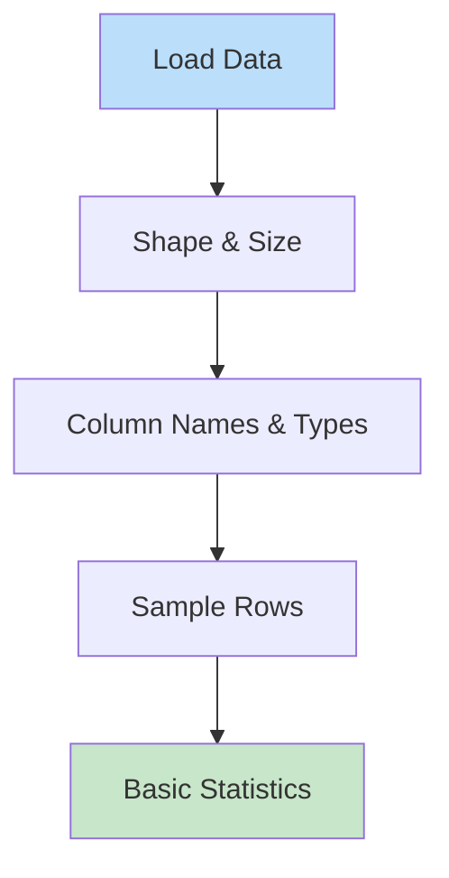
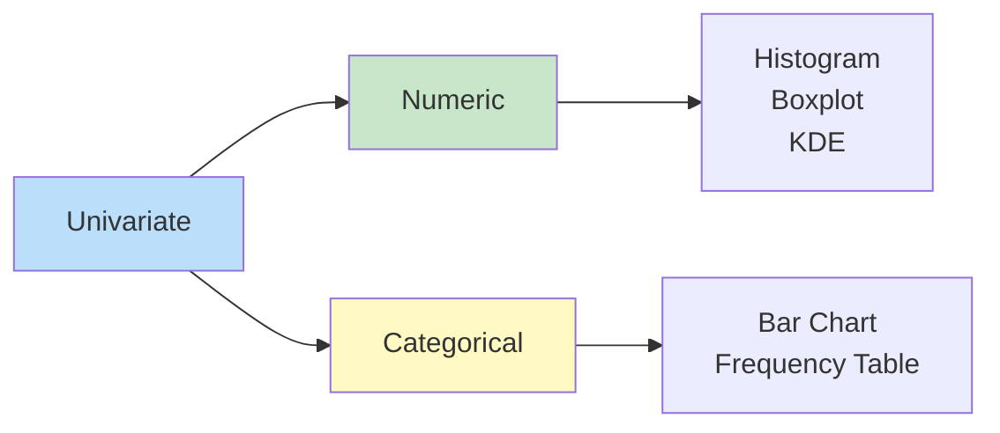
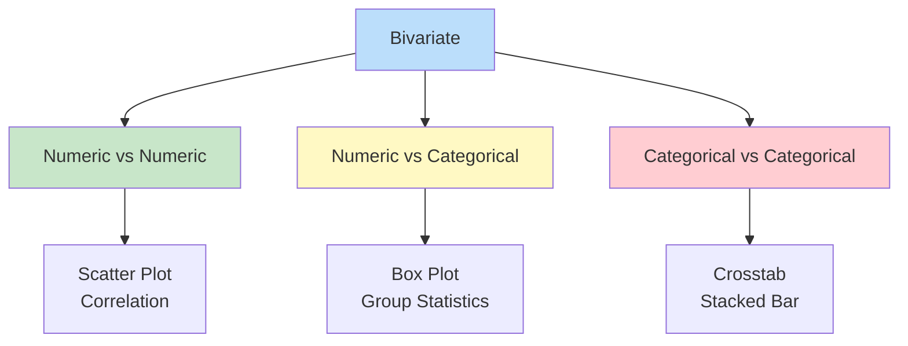

# 🔍 EXPLORATORY DATA ANALYSIS (EDA)

**⭐ THE FIRST STEP IN EVERY DATA PROJECT!**
"Torture the data, and it will confess to anything." - Ronald Coase

EDA is about understanding your data BEFORE building models!

**Time to Complete:** 1-2 weeks  
**Difficulty:** ⭐⭐ Easy-Medium  
**Interview Weight:** ⭐⭐⭐⭐ VERY HIGH! Always asked!

---

## 🗺️ EDA LEARNING ROADMAP


---

## 📚 TABLE OF CONTENTS

| # | Topic | Why Important | Link |
|---|-------|---------------|------|
| 1 | **First Look** | Initial understanding | [[#1-first-look-at-data\|Jump]] |
| 2 | **Data Quality** | Find issues early | [[#2-data-quality-check\|Jump]] |
| 3 | **Univariate Analysis** | Single variable patterns | [[#3-univariate-analysis\|Jump]] |
| 4 | **Bivariate Analysis** | Relationships | [[#4-bivariate-analysis\|Jump]] |
| 5 | **Multivariate Analysis** | Complex patterns | [[#5-multivariate-analysis\|Jump]] |
| 6 | **Outlier Detection** | Anomalies | [[#6-outlier-detection\|Jump]] |
| 7 | **Feature Engineering** | Create new features | [[#7-feature-engineering\|Jump]] |

---

## 1. FIRST LOOK AT DATA

**💙 What is First Look?**
Quick inspection to understand data structure, size, and types.



**✅ Essential First Commands**
```python
import pandas as pd
import numpy as np
import matplotlib.pyplot as plt
import seaborn as sns

# Load data
df = pd.read_csv('data.csv')

# 1. SHAPE - How much data?
print(f"Rows: {df.shape[0]:,}")
print(f"Columns: {df.shape[1]}")

# 2. INFO - Data types and memory
print("\n" + "="*50)
print("DATA TYPES & MEMORY")
print("="*50)
df.info()

# 3. COLUMNS - What features do we have?
print("\n" + "="*50)
print("COLUMN NAMES")
print("="*50)
print(df.columns.tolist())

# 4. HEAD - First few rows
print("\n" + "="*50)
print("FIRST 5 ROWS")
print("="*50)
print(df.head())

# 5. TAIL - Last few rows
print("\n" + "="*50)
print("LAST 5 ROWS")
print("="*50)
print(df.tail())

# 6. SAMPLE - Random rows
print("\n" + "="*50)
print("RANDOM SAMPLE")
print("="*50)
print(df.sample(5))

# 7. DESCRIBE - Statistical summary
print("\n" + "="*50)
print("STATISTICAL SUMMARY")
print("="*50)
print(df.describe())

# For categorical columns
print("\n" + "="*50)
print("CATEGORICAL SUMMARY")
print("="*50)
print(df.describe(include='object'))
```

**💡 Quick Data Understanding**
```python
# Create comprehensive overview function
def quick_overview(df):
    """Quick EDA overview"""
    print("="*60)
    print("DATASET OVERVIEW")
    print("="*60)
    
    # Basic info
    print(f"\n📊 Shape: {df.shape[0]:,} rows × {df.shape[1]} columns")
    print(f"💾 Memory: {df.memory_usage(deep=True).sum() / 1024**2:.2f} MB")
    
    # Data types
    print(f"\n📋 Data Types:")
    print(df.dtypes.value_counts())
    
    # Missing values
    missing = df.isnull().sum()
    if missing.sum() > 0:
        print(f"\n❌ Missing Values:")
        print(missing[missing > 0].sort_values(ascending=False))
    else:
        print("\n✅ No missing values!")
    
    # Duplicates
    dupes = df.duplicated().sum()
    print(f"\n🔄 Duplicate Rows: {dupes:,}")
    
    # Numeric columns
    numeric_cols = df.select_dtypes(include=[np.number]).columns
    print(f"\n🔢 Numeric Columns: {len(numeric_cols)}")
    print(f"   {list(numeric_cols)}")
    
    # Categorical columns
    cat_cols = df.select_dtypes(include=['object', 'category']).columns
    print(f"\n📝 Categorical Columns: {len(cat_cols)}")
    print(f"   {list(cat_cols)}")
    
    # Cardinality for categorical
    if len(cat_cols) > 0:
        print(f"\n🎯 Categorical Cardinality:")
        for col in cat_cols:
            n_unique = df[col].nunique()
            print(f"   {col}: {n_unique} unique values")
    
    print("\n" + "="*60)

# Use it
quick_overview(df)
```

---

## 2. DATA QUALITY CHECK

**⚠️ CRITICAL! BAD DATA = BAD MODELS!**

**💙 What to Check**
Missing values, duplicates, data types, inconsistencies, outliers

### Missing Values

**✅ Comprehensive Missing Value Analysis**
```python
def missing_value_analysis(df):
    """Detailed missing value report"""
    
    # Calculate missing stats
    missing_count = df.isnull().sum()
    missing_percent = (missing_count / len(df)) * 100
    
    # Create summary
    missing_df = pd.DataFrame({
        'Column': df.columns,
        'Missing_Count': missing_count.values,
        'Missing_Percent': missing_percent.values,
        'Dtype': df.dtypes.values
    })
    
    # Filter columns with missing values
    missing_df = missing_df[missing_df['Missing_Count'] > 0]
    missing_df = missing_df.sort_values('Missing_Percent', ascending=False)
    
    if len(missing_df) == 0:
        print("✅ No missing values found!")
        return None
    
    print("❌ MISSING VALUES REPORT")
    print("="*60)
    print(missing_df.to_string(index=False))
    print("="*60)
    
    # Visualize
    plt.figure(figsize=(10, 6))
    plt.barh(missing_df['Column'], missing_df['Missing_Percent'])
    plt.xlabel('Missing Percentage (%)')
    plt.title('Missing Values by Column')
    plt.tight_layout()
    plt.show()
    
    return missing_df

# Use it
missing_report = missing_value_analysis(df)
```

**💡 Handling Missing Values - Decision Tree**
```python
# Decision tree for handling missing values

def handle_missing(df, column):
    """Strategy for handling missing values"""
    
    missing_pct = (df[column].isnull().sum() / len(df)) * 100
    
    print(f"\n🔍 Analyzing: {column}")
    print(f"Missing: {missing_pct:.2f}%")
    
    # Strategy based on percentage
    if missing_pct > 50:
        print("❌ DROP COLUMN - Too many missing (>50%)")
        return 'drop_column'
    
    elif missing_pct == 0:
        print("✅ No action needed")
        return 'none'
    
    else:
        if df[column].dtype in ['float64', 'int64']:
            # Numeric column
            print("🔢 Numeric column strategies:")
            print("  1. Mean imputation (normal distribution)")
            print("  2. Median imputation (skewed or outliers)")
            print("  3. Forward fill (time series)")
            print("  4. Interpolation (time series)")
            print("  5. Model-based imputation (KNN, etc)")
            return 'numeric_impute'
        else:
            # Categorical column
            print("📝 Categorical column strategies:")
            print("  1. Mode imputation (most frequent)")
            print("  2. 'Missing' as category")
            print("  3. Forward fill (time series)")
            return 'categorical_impute'

# Example: Imputation strategies
# Numeric - Mean
df['age_filled'] = df['age'].fillna(df['age'].mean())

# Numeric - Median (better for skewed data)
df['salary_filled'] = df['salary'].fillna(df['salary'].median())

# Categorical - Mode
df['city_filled'] = df['city'].fillna(df['city'].mode()[0])

# Categorical - New category
df['category_filled'] = df['category'].fillna('Unknown')

# Forward fill (time series)
df['value_filled'] = df['value'].fillna(method='ffill')

# Backward fill
df['value_filled'] = df['value'].fillna(method='bfill')
```

### Duplicates

**✅ Finding and Handling Duplicates**
```python
# Check duplicates
print(f"Total rows: {len(df):,}")
print(f"Duplicate rows: {df.duplicated().sum():,}")

# Show duplicates
duplicates = df[df.duplicated(keep=False)]
print(f"\nDuplicate samples:")
print(duplicates.head(10))

# Check duplicates on specific columns
key_columns = ['user_id', 'date']
dupes_on_key = df.duplicated(subset=key_columns).sum()
print(f"\nDuplicates on {key_columns}: {dupes_on_key:,}")

# Remove duplicates
df_clean = df.drop_duplicates()
print(f"\nAfter removal: {len(df_clean):,} rows")

# Keep first occurrence
df_clean = df.drop_duplicates(keep='first')

# Keep last occurrence
df_clean = df.drop_duplicates(keep='last')

# Keep none (remove all duplicates)
df_clean = df.drop_duplicates(keep=False)
```

---

## 3. UNIVARIATE ANALYSIS

**💙 What is Univariate Analysis?**
Analyzing one variable at a time to understand its distribution, central tendency, and spread.



### Numeric Variables

**✅ Analyzing Numeric Columns**
```python
import pandas as pd
import numpy as np
import matplotlib.pyplot as plt
import seaborn as sns

def analyze_numeric(df, column):
    """Comprehensive numeric column analysis"""
    
    print("="*60)
    print(f"ANALYZING: {column}")
    print("="*60)
    
    # 1. Basic statistics
    print("\n📊 STATISTICS")
    print(f"Count: {df[column].count():,}")
    print(f"Mean: {df[column].mean():.2f}")
    print(f"Median: {df[column].median():.2f}")
    print(f"Std Dev: {df[column].std():.2f}")
    print(f"Min: {df[column].min():.2f}")
    print(f"25%: {df[column].quantile(0.25):.2f}")
    print(f"50%: {df[column].quantile(0.50):.2f}")
    print(f"75%: {df[column].quantile(0.75):.2f}")
    print(f"Max: {df[column].max():.2f}")
    
    # 2. Distribution shape
    print("\n📐 DISTRIBUTION")
    skewness = df[column].skew()
    kurtosis = df[column].kurtosis()
    print(f"Skewness: {skewness:.2f}")
    if abs(skewness) < 0.5:
        print("  → Fairly symmetric")
    elif skewness > 0:
        print("  → Right-skewed (long tail on right)")
    else:
        print("  → Left-skewed (long tail on left)")
    
    print(f"Kurtosis: {kurtosis:.2f}")
    if abs(kurtosis) < 3:
        print("  → Normal-like tails")
    elif kurtosis > 3:
        print("  → Heavy tails (outliers likely)")
    else:
        print("  → Light tails")
    
    # 3. Visualizations
    fig, axes = plt.subplots(2, 2, figsize=(12, 10))
    
    # Histogram
    axes[0, 0].hist(df[column].dropna(), bins=30, edgecolor='black', alpha=0.7)
    axes[0, 0].axvline(df[column].mean(), color='r', linestyle='--', label='Mean')
    axes[0, 0].axvline(df[column].median(), color='g', linestyle='--', label='Median')
    axes[0, 0].set_title(f'{column} - Histogram')
    axes[0, 0].set_xlabel(column)
    axes[0, 0].set_ylabel('Frequency')
    axes[0, 0].legend()
    
    # Boxplot
    axes[0, 1].boxplot(df[column].dropna())
    axes[0, 1].set_title(f'{column} - Boxplot')
    axes[0, 1].set_ylabel(column)
    
    # KDE (Kernel Density Estimation)
    df[column].dropna().plot(kind='kde', ax=axes[1, 0])
    axes[1, 0].set_title(f'{column} - KDE')
    axes[1, 0].set_xlabel(column)
    
    # Q-Q Plot (Normal distribution check)
    from scipy import stats as scipy_stats
    scipy_stats.probplot(df[column].dropna(), dist="norm", plot=axes[1, 1])
    axes[1, 1].set_title(f'{column} - Q-Q Plot')
    
    plt.tight_layout()
    plt.show()

# Example usage
analyze_numeric(df, 'price')
```

### Categorical Variables

**✅ Analyzing Categorical Columns**
```python
def analyze_categorical(df, column, top_n=10):
    """Comprehensive categorical column analysis"""
    
    print("="*60)
    print(f"ANALYZING: {column}")
    print("="*60)
    
    # 1. Basic info
    print("\n📊 STATISTICS")
    print(f"Total values: {df[column].count():,}")
    print(f"Unique values: {df[column].nunique():,}")
    print(f"Most common: {df[column].mode()[0]}")
    print(f"Missing: {df[column].isnull().sum():,}")
    
    # 2. Frequency table
    print(f"\n📋 TOP {top_n} VALUES")
    value_counts = df[column].value_counts()
    top_values = value_counts.head(top_n)
    
    freq_df = pd.DataFrame({
        'Value': top_values.index,
        'Count': top_values.values,
        'Percentage': (top_values.values / len(df) * 100).round(2)
    })
    print(freq_df.to_string(index=False))
    
    # 3. Visualizations
    fig, axes = plt.subplots(1, 2, figsize=(14, 5))
    
    # Bar chart
    top_values.plot(kind='bar', ax=axes[0], color='skyblue', edgecolor='black')
    axes[0].set_title(f'{column} - Top {top_n} Values')
    axes[0].set_xlabel(column)
    axes[0].set_ylabel('Count')
    axes[0].tick_params(axis='x', rotation=45)
    
    # Pie chart (top 5)
    top_5 = value_counts.head(5)
    axes[1].pie(top_5, labels=top_5.index, autopct='%1.1f%%', startangle=90)
    axes[1].set_title(f'{column} - Top 5 Distribution')
    
    plt.tight_layout()
    plt.show()
    
    # 4. Check for high cardinality
    cardinality_ratio = df[column].nunique() / len(df)
    print(f"\n🎯 CARDINALITY")
    print(f"Ratio: {cardinality_ratio:.4f}")
    if cardinality_ratio > 0.5:
        print("⚠️  High cardinality! Consider:")
        print("   - Grouping rare categories")
        print("   - Target encoding")
        print("   - Dropping if too unique")
    elif cardinality_ratio < 0.01:
        print("✅ Low cardinality - good for modeling")
    else:
        print("✅ Moderate cardinality")

# Example usage
analyze_categorical(df, 'category')
```

---

## 4. BIVARIATE ANALYSIS

**💙 What is Bivariate Analysis?**
Analyzing relationships between two variables.



### Numeric vs Numeric

**✅ Analyzing Two Numeric Variables**
```python
def analyze_numeric_pair(df, col1, col2):
    """Analyze relationship between two numeric columns"""
    
    print("="*60)
    print(f"ANALYZING: {col1} vs {col2}")
    print("="*60)
    
    # 1. Correlation
    correlation = df[[col1, col2]].corr().iloc[0, 1]
    print(f"\n📊 CORRELATION: {correlation:.4f}")
    
    if abs(correlation) > 0.7:
        print("  → Strong relationship")
    elif abs(correlation) > 0.4:
        print("  → Moderate relationship")
    else:
        print("  → Weak relationship")
    
    if correlation > 0:
        print("  → Positive (both increase together)")
    elif correlation < 0:
        print("  → Negative (one increases, other decreases)")
    
    # 2. Visualizations
    fig, axes = plt.subplots(1, 2, figsize=(14, 5))
    
    # Scatter plot
    axes[0].scatter(df[col1], df[col2], alpha=0.5)
    axes[0].set_xlabel(col1)
    axes[0].set_ylabel(col2)
    axes[0].set_title(f'{col1} vs {col2}')
    
    # Add regression line
    from scipy.stats import linregress
    slope, intercept, r_value, p_value, std_err = linregress(
        df[col1].dropna(), df[col2].dropna()
    )
    line = slope * df[col1] + intercept
    axes[0].plot(df[col1], line, 'r--', label=f'R² = {r_value**2:.4f}')
    axes[0].legend()
    
    # Hexbin plot (for large datasets)
    axes[1].hexbin(df[col1], df[col2], gridsize=30, cmap='Blues')
    axes[1].set_xlabel(col1)
    axes[1].set_ylabel(col2)
    axes[1].set_title(f'{col1} vs {col2} - Density')
    plt.colorbar(axes[1].collections[0], ax=axes[1], label='Count')
    
    plt.tight_layout()
    plt.show()

# Example
analyze_numeric_pair(df, 'price', 'square_feet')
```

**⭐ Correlation Matrix - See All Relationships**
```python
# Calculate correlation matrix
numeric_cols = df.select_dtypes(include=[np.number]).columns
corr_matrix = df[numeric_cols].corr()

# Visualize with heatmap
plt.figure(figsize=(12, 10))
sns.heatmap(corr_matrix, annot=True, fmt='.2f', cmap='coolwarm', 
            center=0, square=True, linewidths=1)
plt.title('Correlation Matrix')
plt.tight_layout()
plt.show()

# Find strong correlations
def find_strong_correlations(corr_matrix, threshold=0.7):
    """Find pairs with high correlation"""
    strong_pairs = []
    
    for i in range(len(corr_matrix.columns)):
        for j in range(i+1, len(corr_matrix.columns)):
            if abs(corr_matrix.iloc[i, j]) > threshold:
                strong_pairs.append({
                    'var1': corr_matrix.columns[i],
                    'var2': corr_matrix.columns[j],
                    'correlation': corr_matrix.iloc[i, j]
                })
    
    return pd.DataFrame(strong_pairs).sort_values('correlation', 
                                                   ascending=False,
                                                   key=abs)

print("Strong Correlations (|r| > 0.7):")
print(find_strong_correlations(corr_matrix))
```

### Numeric vs Categorical

**✅ Numeric by Category**
```python
def analyze_numeric_by_category(df, numeric_col, category_col):
    """Analyze numeric variable across categories"""
    
    print("="*60)
    print(f"ANALYZING: {numeric_col} by {category_col}")
    print("="*60)
    
    # 1. Group statistics
    print("\n📊 STATISTICS BY GROUP")
    stats = df.groupby(category_col)[numeric_col].agg([
        'count', 'mean', 'median', 'std', 'min', 'max'
    ]).round(2)
    print(stats)
    
    # 2. Visualizations
    fig, axes = plt.subplots(2, 2, figsize=(14, 10))
    
    # Box plot
    df.boxplot(column=numeric_col, by=category_col, ax=axes[0, 0])
    axes[0, 0].set_title(f'{numeric_col} by {category_col}')
    axes[0, 0].set_xlabel(category_col)
    axes[0, 0].set_ylabel(numeric_col)
    plt.sca(axes[0, 0])
    plt.xticks(rotation=45)
    
    # Violin plot
    top_categories = df[category_col].value_counts().head(10).index
    df_filtered = df[df[category_col].isin(top_categories)]
    sns.violinplot(data=df_filtered, x=category_col, y=numeric_col, 
                   ax=axes[0, 1])
    axes[0, 1].set_title(f'{numeric_col} by {category_col} - Violin')
    axes[0, 1].tick_params(axis='x', rotation=45)
    
    # Bar plot (mean)
    means = df.groupby(category_col)[numeric_col].mean().sort_values(ascending=False)
    means.head(10).plot(kind='bar', ax=axes[1, 0], color='skyblue', 
                        edgecolor='black')
    axes[1, 0].set_title(f'Average {numeric_col} by {category_col}')
    axes[1, 0].set_ylabel(f'Mean {numeric_col}')
    axes[1, 0].tick_params(axis='x', rotation=45)
    
    # Histogram by category (stacked)
    for category in top_categories[:5]:  # Top 5 categories
        subset = df[df[category_col] == category][numeric_col]
        axes[1, 1].hist(subset, bins=20, alpha=0.5, label=category)
    axes[1, 1].set_title(f'{numeric_col} Distribution by {category_col}')
    axes[1, 1].set_xlabel(numeric_col)
    axes[1, 1].legend()
    
    plt.tight_layout()
    plt.show()

# Example
analyze_numeric_by_category(df, 'salary', 'department')
```

---

## 5. MULTIVARIATE ANALYSIS

**💙 What is Multivariate Analysis?**
Analyzing three or more variables simultaneously.

**✅ Pair Plot - See Everything**
```python
# Pair plot for all numeric variables
numeric_cols = df.select_dtypes(include=[np.number]).columns[:5]  # First 5

sns.pairplot(df[numeric_cols], diag_kind='kde', plot_kws={'alpha':0.5})
plt.suptitle('Pair Plot - Multivariate Analysis', y=1.02)
plt.show()

# With categorical hue
sns.pairplot(df, vars=numeric_cols, hue='category', diag_kind='kde')
plt.show()
```

**✅ 3D Scatter Plot**
```python
from mpl_toolkits.mplot3d import Axes3D

fig = plt.figure(figsize=(10, 8))
ax = fig.add_subplot(111, projection='3d')

scatter = ax.scatter(df['x'], df['y'], df['z'], 
                     c=df['target'], cmap='viridis', alpha=0.6)
ax.set_xlabel('X Variable')
ax.set_ylabel('Y Variable')
ax.set_zlabel('Z Variable')
ax.set_title('3D Scatter Plot')
plt.colorbar(scatter, label='Target')
plt.show()
```

---

## 6. OUTLIER DETECTION

**⚠️ OUTLIERS CAN BREAK YOUR MODEL!**

**💙 Methods to Detect Outliers**

```
1. IQR Method (Interquartile Range)
2. Z-score Method
3. Visualization (Box plots)
4. Isolation Forest (ML-based)
```

**✅ IQR Method**
```python
def detect_outliers_iqr(df, column):
    """Detect outliers using IQR method"""
    
    Q1 = df[column].quantile(0.25)
    Q3 = df[column].quantile(0.75)
    IQR = Q3 - Q1
    
    # Outlier boundaries
    lower_bound = Q1 - 1.5 * IQR
    upper_bound = Q3 + 1.5 * IQR
    
    # Find outliers
    outliers = df[(df[column] < lower_bound) | (df[column] > upper_bound)]
    
    print(f"Column: {column}")
    print(f"Q1: {Q1:.2f}")
    print(f"Q3: {Q3:.2f}")
    print(f"IQR: {IQR:.2f}")
    print(f"Lower Bound: {lower_bound:.2f}")
    print(f"Upper Bound: {upper_bound:.2f}")
    print(f"Outliers: {len(outliers)} ({len(outliers)/len(df)*100:.2f}%)")
    
    # Visualize
    plt.figure(figsize=(12, 5))
    
    plt.subplot(1, 2, 1)
    plt.boxplot(df[column].dropna())
    plt.title(f'{column} - Boxplot')
    plt.ylabel(column)
    
    plt.subplot(1, 2, 2)
    plt.hist(df[column].dropna(), bins=50, edgecolor='black', alpha=0.7)
    plt.axvline(lower_bound, color='r', linestyle='--', label='Lower Bound')
    plt.axvline(upper_bound, color='r', linestyle='--', label='Upper Bound')
    plt.title(f'{column} - Histogram with Outlier Bounds')
    plt.legend()
    
    plt.tight_layout()
    plt.show()
    
    return outliers

# Example
outliers = detect_outliers_iqr(df, 'price')
```

**✅ Z-Score Method**
```python
from scipy import stats

def detect_outliers_zscore(df, column, threshold=3):
    """Detect outliers using Z-score"""
    
    z_scores = np.abs(stats.zscore(df[column].dropna()))
    outliers = df[z_scores > threshold]
    
    print(f"Column: {column}")
    print(f"Threshold: {threshold} standard deviations")
    print(f"Outliers: {len(outliers)} ({len(outliers)/len(df)*100:.2f}%)")
    
    return outliers

# Example
outliers = detect_outliers_zscore(df, 'price', threshold=3)
```

---

## 7. FEATURE ENGINEERING

**💙 What is Feature Engineering?**
Creating new features from existing data to improve model performance.

**✅ Common Techniques**
```python
# 1. BINNING - Convert continuous to categorical
df['age_group'] = pd.cut(df['age'], 
                         bins=[0, 18, 35, 50, 100],
                         labels=['Teen', 'Young', 'Middle', 'Senior'])

# 2. LOG TRANSFORMATION - Handle skewed data
df['price_log'] = np.log1p(df['price'])  # log(1+x) to handle zeros

# 3. POLYNOMIAL FEATURES - Capture non-linear relationships
df['area_squared'] = df['area'] ** 2
df['area_cubed'] = df['area'] ** 3

# 4. INTERACTION FEATURES - Combine features
df['price_per_sqft'] = df['price'] / df['square_feet']
df['bedroom_bathroom_ratio'] = df['bedrooms'] / df['bathrooms']

# 5. DATE FEATURES - Extract from datetime
df['date'] = pd.to_datetime(df['date'])
df['year'] = df['date'].dt.year
df['month'] = df['date'].dt.month
df['day_of_week'] = df['date'].dt.dayofweek
df['is_weekend'] = df['day_of_week'].isin([5, 6]).astype(int)
df['quarter'] = df['date'].dt.quarter

# 6. AGGREGATION FEATURES - Group statistics
df['avg_price_by_category'] = df.groupby('category')['price'].transform('mean')
df['count_by_user'] = df.groupby('user_id')['user_id'].transform('count')

# 7. TEXT FEATURES - From text columns
df['text_length'] = df['description'].str.len()
df['word_count'] = df['description'].str.split().str.len()
df['has_special_char'] = df['description'].str.contains('[!@#$]').astype(int)

# 8. ENCODING CATEGORICAL - One-hot encoding
df_encoded = pd.get_dummies(df, columns=['category'], prefix='cat')

# 9. TARGET ENCODING - Mean of target by category
category_means = df.groupby('category')['target'].mean()
df['category_target_enc'] = df['category'].map(category_means)

# 10. SCALING - Normalize numeric features
from sklearn.preprocessing import StandardScaler, MinMaxScaler

scaler = StandardScaler()
df[['price_scaled', 'area_scaled']] = scaler.fit_transform(df[['price', 'area']])

# Min-Max scaling (0-1)
minmax = MinMaxScaler()
df['price_normalized'] = minmax.fit_transform(df[['price']])
```

---

## 🎯 COMPLETE EDA PIPELINE

**⭐ End-to-End EDA Function**
```python
def complete_eda(df):
    """Complete EDA pipeline"""
    
    print("="*70)
    print(" " * 20 + "COMPLETE EDA REPORT")
    print("="*70)
    
    # 1. Dataset Overview
    print("\n1️⃣ DATASET OVERVIEW")
    print("-" * 70)
    quick_overview(df)
    
    # 2. Missing Values
    print("\n2️⃣ MISSING VALUES")
    print("-" * 70)
    missing_value_analysis(df)
    
    # 3. Duplicates
    print("\n3️⃣ DUPLICATE CHECK")
    print("-" * 70)
    dupes = df.duplicated().sum()
    print(f"Duplicate rows: {dupes:,} ({dupes/len(df)*100:.2f}%)")
    
    # 4. Numeric Analysis
    print("\n4️⃣ NUMERIC VARIABLES")
    print("-" * 70)
    numeric_cols = df.select_dtypes(include=[np.number]).columns
    for col in numeric_cols:
        analyze_numeric(df, col)
    
    # 5. Categorical Analysis
    print("\n5️⃣ CATEGORICAL VARIABLES")
    print("-" * 70)
    cat_cols = df.select_dtypes(include=['object', 'category']).columns
    for col in cat_cols:
        analyze_categorical(df, col)
    
    # 6. Correlation
    print("\n6️⃣ CORRELATION ANALYSIS")
    print("-" * 70)
    if len(numeric_cols) > 1:
        corr_matrix = df[numeric_cols].corr()
        plt.figure(figsize=(10, 8))
        sns.heatmap(corr_matrix, annot=True, fmt='.2f', cmap='coolwarm', center=0)
        plt.title('Correlation Matrix')
        plt.show()
    
    # 7. Outliers
    print("\n7️⃣ OUTLIER DETECTION")
    print("-" * 70)
    for col in numeric_cols:
        detect_outliers_iqr(df, col)
    
    print("\n" + "="*70)
    print(" " * 25 + "EDA COMPLETE!")
    print("="*70)

# Run complete EDA
complete_eda(df)
```

---

## 💎 INTERVIEW QUESTIONS

**💎 Q: Walk me through your EDA process**

**Perfect Answer:**
"My EDA follows a structured approach:

**1. First Look** (5 min):
- Load data, check shape and dtypes
- df.info(), df.head(), df.describe()
- Get overall sense of data

**2. Data Quality** (15 min):
- Missing values: How many? Pattern? Can impute?
- Duplicates: Check and remove
- Data types: Correct? Need conversion?

**3. Univariate Analysis** (20 min):
- Each variable individually
- Numeric: Distribution, outliers, skewness
- Categorical: Cardinality, frequency

**4. Bivariate Analysis** (20 min):
- Relationships with target
- Correlation matrix
- Group statistics

**5. Insights & Feature Engineering** (20 min):
- Document findings
- Create new features
- Prepare for modeling

Key: Look for patterns, anomalies, and relationships that inform modeling decisions!"

---

**Tags:** #eda #data-analysis #exploratory #data-quality #feature-engineering  
**Difficulty:** ⭐⭐ Easy-Medium  
**Time to Master:** 1-2 weeks  
**Last Updated:** 2026-11-11
