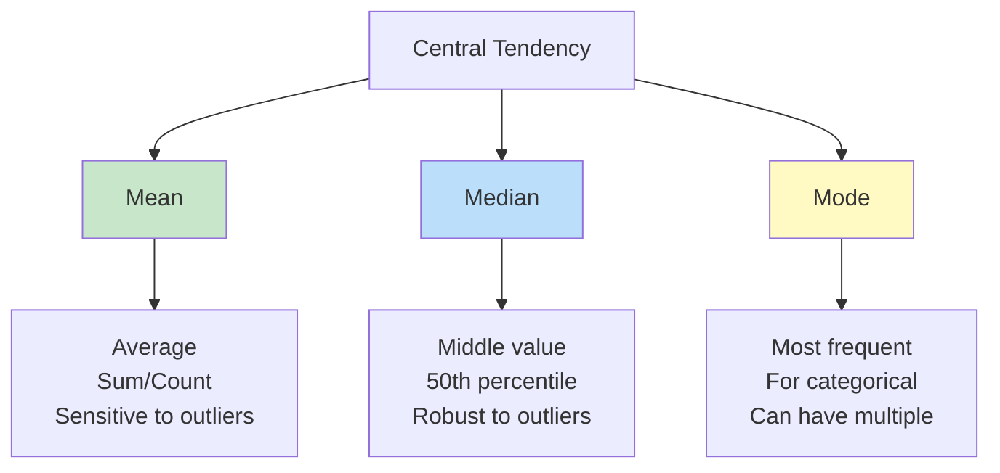
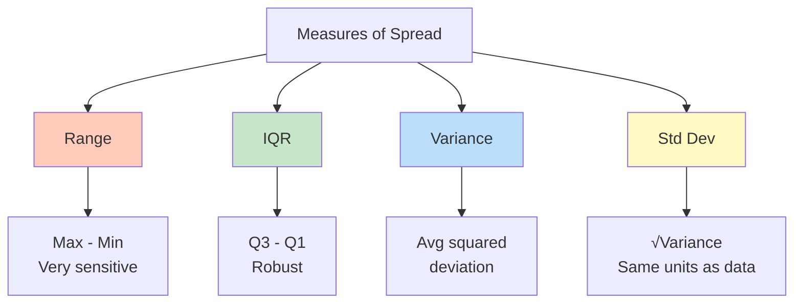
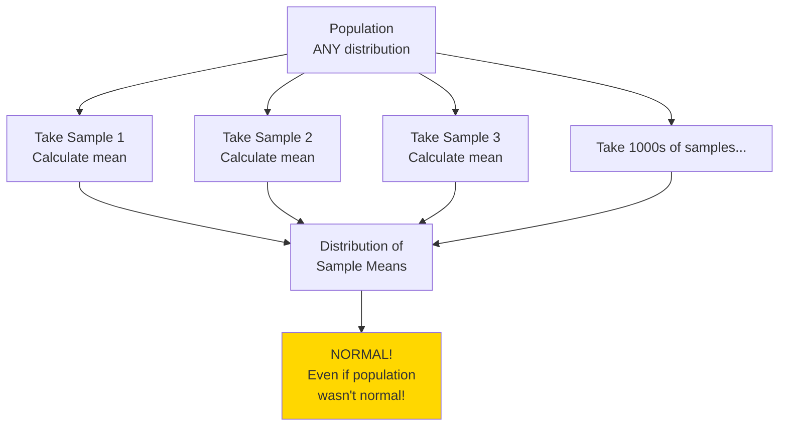
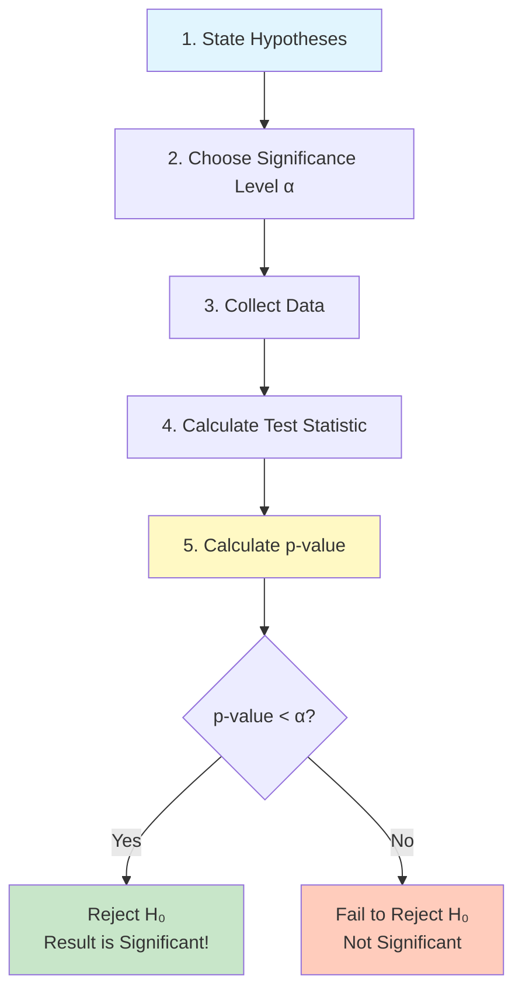
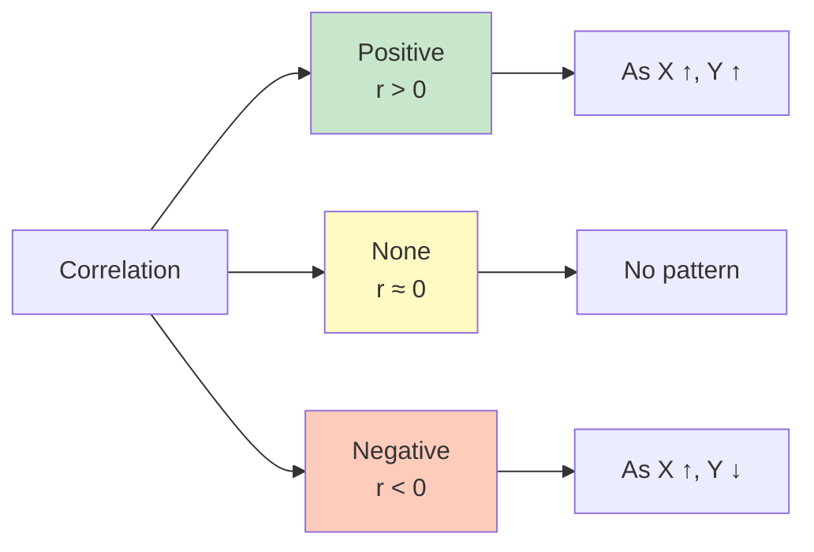
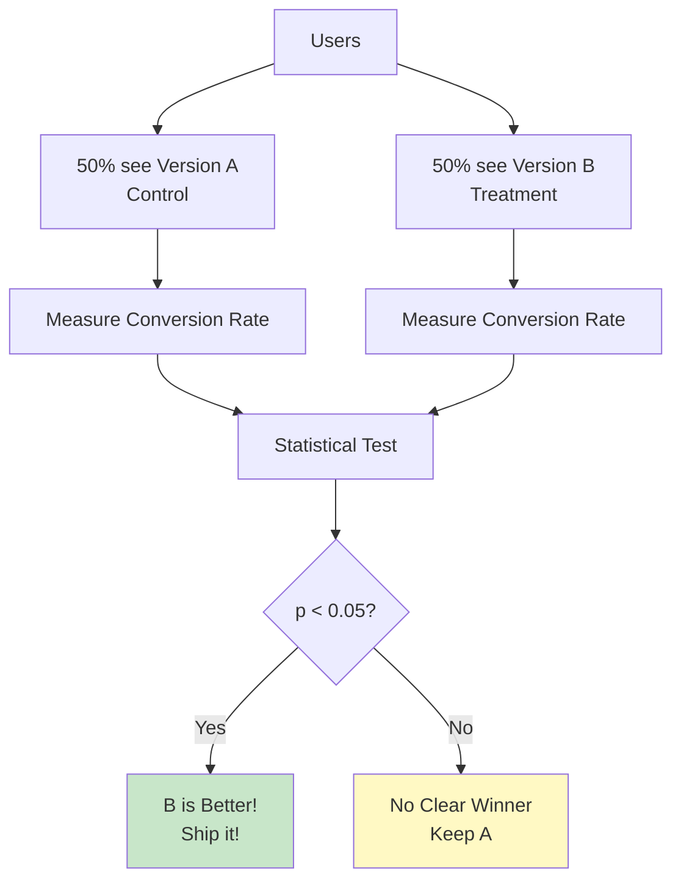

# 📊 STATISTICS - The Language of Data Science

**⭐ FOUNDATION OF ALL DATA SCIENCE!**
You CANNOT do ML/AI without understanding statistics! This is where data science truly begins.

**Time to Complete:** 3-4 weeks  
**Difficulty:** ⭐⭐⭐ Medium  
**Interview Weight:** ⭐⭐⭐ CRITICAL - Asked in 100% of interviews!

---

## 🗺️ STATISTICS LEARNING ROADMAP


---

## 📚 TABLE OF CONTENTS

| # | Topic | Priority | Interview % | Link |
|---|-------|----------|-------------|------|
| 1 | **Descriptive Statistics** | 🔥 Critical | 100% | [[#1-descriptive-statistics\|Jump]] |
| 2 | **Probability Distributions** | 🔥 Critical | 95% | [[#2-probability-distributions\|Jump]] |
| 3 | **Central Limit Theorem** | ⭐ Very Important | 90% | [[#3-central-limit-theorem\|Jump]] |
| 4 | **Hypothesis Testing** | 🔥 Critical | 100% | [[#4-hypothesis-testing\|Jump]] |
| 5 | **p-values** | 🔥 Critical | 95% | [[#5-p-values\|Jump]] |
| 6 | **Confidence Intervals** | ⭐ Important | 80% | [[#6-confidence-intervals\|Jump]] |
| 7 | **Correlation** | 🔥 Critical | 90% | [[#7-correlation\|Jump]] |
| 8 | **A/B Testing** | ⭐ Important | 85% | [[#8-ab-testing\|Jump]] |
| 9 | **Outlier Detection** | 🔥 Critical | 95% | [[#9-outlier-detection\|Jump]] |
| 10 | **Common Mistakes** | 💡 Important | 100% | [[#10-common-statistical-mistakes\|Jump]] |

---

## 1. DESCRIPTIVE STATISTICS

**💙 What is Descriptive Statistics?**
Descriptive statistics **summarize** and **describe** your data. The first step in ANY data analysis!

### Measures of Central Tendency

**✅ Where is the "center" of your data?**



**✅ Mean (Average)**
```python
import numpy as np
import pandas as pd

data = [10, 20, 30, 40, 50]

# Calculate mean
mean = np.mean(data)  # 30
mean = pd.Series(data).mean()  # 30

# Formula: Sum / Count
mean = sum(data) / len(data)  # 30
```

**✅ Median (Middle Value)**
```python
data = [10, 20, 30, 40, 50]

# Calculate median
median = np.median(data)  # 30 (middle value)
median = pd.Series(data).median()  # 30

# For even number of values, average of middle two
data_even = [10, 20, 30, 40]
median = np.median(data_even)  # 25 (average of 20 and 30)
```

**✅ Mode (Most Frequent)**
```python
from scipy import stats

data = [1, 2, 2, 3, 3, 3, 4]

# Calculate mode
mode = stats.mode(data)  # 3 (appears most often)
mode = pd.Series(data).mode()[0]  # 3
```

**💡 When to Use Which?**

**Use MEAN when:**
- ✅ Data is roughly symmetric (bell-shaped)
- ✅ No extreme outliers
- ✅ Example: Heights, test scores

**Use MEDIAN when:**
- ✅ Data is skewed (not symmetric)
- ✅ Has outliers
- ✅ Example: Income (billionaires skew mean), house prices

**Use MODE when:**
- ✅ Categorical data
- ✅ Want most common value
- ✅ Example: Most popular product, common shoe size

**⚠️ The Outlier Problem**
```python
# Salaries: 4 employees + 1 CEO
salaries = [50000, 55000, 52000, 58000, 10000000]

mean_salary = np.mean(salaries)      # $2,043,000 😱
median_salary = np.median(salaries)  # $55,000 ✓

# Mean is MISLEADING due to CEO's salary!
# Median gives better "typical" salary
```

### Measures of Spread (Variability)

**💙 How "spread out" is your data?**



**✅ Range**
```python
data = [10, 20, 30, 40, 50]

data_range = max(data) - min(data)  # 50 - 10 = 40
data_range = np.ptp(data)  # 40 (peak-to-peak)
```

**✅ Variance**
```python
data = [10, 20, 30, 40, 50]

# Variance: Average of squared differences from mean
variance = np.var(data)  # 200
variance = pd.Series(data).var()  # 250 (sample variance)

# Formula:
# 1. Calculate mean: 30
# 2. Subtract mean from each: [-20, -10, 0, 10, 20]
# 3. Square each: [400, 100, 0, 100, 400]
# 4. Average: 200
```

**✅ Standard Deviation (Most Important!)**
```python
data = [10, 20, 30, 40, 50]

# Standard deviation: Square root of variance
std = np.std(data)  # 14.14
std = pd.Series(data).std()  # 15.81 (sample std)

# Interpretation: 
# "On average, values are 14.14 units away from the mean"
```

**💡 The 68-95-99.7 Rule (Normal Distribution)**
```
For normal distributions:

68% of data within 1 standard deviation of mean
95% within 2 standard deviations
99.7% within 3 standard deviations

Example: Mean = 100, Std = 15
68% of data between 85-115
95% between 70-130
99.7% between 55-145
```

**✅ Interquartile Range (IQR)**
```python
data = [1, 2, 3, 4, 5, 6, 7, 8, 9, 10]

# Quartiles divide data into 4 equal parts
Q1 = np.percentile(data, 25)  # 3.25 (25th percentile)
Q2 = np.percentile(data, 50)  # 5.5 (median)
Q3 = np.percentile(data, 75)  # 7.75 (75th percentile)

# IQR = Q3 - Q1
IQR = Q3 - Q1  # 7.75 - 3.25 = 4.5

# IQR is robust to outliers!
```

**💎 Interview Question: Variance vs Standard Deviation**

**Q: Why use standard deviation instead of variance?**

**Perfect Answer:**
"Standard deviation is preferred because it's in the **same units** as the original data, making it easier to interpret.

For example:
- Heights: Mean = 170 cm, Variance = 100 cm², Std = 10 cm
- Std (10 cm) is interpretable: 'heights vary by about 10 cm'
- Variance (100 cm²) is harder to understand

However, variance is useful in:
- Mathematical formulas (easier to work with)
- Sum of variances (can add them)
- Theoretical statistics"

---

## 2. PROBABILITY DISTRIBUTIONS

**💙 What is a Distribution?**
A distribution shows how likely different values are to occur. The **shape** of your data!

### Normal Distribution (Gaussian)

**⭐ THE MOST IMPORTANT DISTRIBUTION!**

```
        The Bell Curve
        
          /\
         /  \
        /    \
       /      \
      /        \
     /          \
    /            \
   /______________\
  
  μ-3σ  μ-2σ  μ-σ  μ  μ+σ  μ+2σ  μ+3σ
  
  68% within μ ± 1σ
  95% within μ ± 2σ
  99.7% within μ ± 3σ
```

**✅ Normal Distribution Properties**
```python
import scipy.stats as stats
import matplotlib.pyplot as plt

# Create normal distribution
# Mean (μ) = 0, Standard Deviation (σ) = 1
x = np.linspace(-4, 4, 100)
y = stats.norm.pdf(x, loc=0, scale=1)

# Plot
plt.plot(x, y)
plt.title('Standard Normal Distribution (μ=0, σ=1)')
plt.xlabel('Value')
plt.ylabel('Probability Density')
plt.show()

# Generate random normal data
data = np.random.normal(loc=100, scale=15, size=1000)
# Mean = 100, Std = 15, 1000 samples

# Check if data is normally distributed
stats.shapiro(data)  # Shapiro-Wilk test
```

**💡 Properties of Normal Distribution:**
- ✅ Symmetric around mean
- ✅ Mean = Median = Mode (all at center)
- ✅ 68-95-99.7 rule applies
- ✅ Shape defined by mean (μ) and std (σ)
- ✅ Many natural phenomena follow this (heights, test scores)

### Other Important Distributions

**✅ Binomial Distribution**
```python
# Coin flip example: 10 flips, probability of heads = 0.5
# "How many heads in 10 flips?"

n = 10  # number of trials
p = 0.5  # probability of success

# Probability of exactly 5 heads
prob = stats.binom.pmf(5, n, p)  # 0.246

# Generate random data
data = np.random.binomial(n=10, p=0.5, size=1000)
```

> [!blue] 💙 **Use Case:** Count of successes (pass/fail, yes/no)
> - Example: Number of heads in 10 coin flips
> - Example: Number of customers who buy (out of 100)

**✅ Poisson Distribution**
```python
# Number of events in a fixed time period
# Example: "How many customers arrive per hour?"

lambda_param = 5  # average events per period

# Probability of exactly 3 customers
prob = stats.poisson.pmf(3, lambda_param)

# Generate random data
data = np.random.poisson(lam=5, size=1000)
```

> [!blue] 💙 **Use Case:** Count of rare events
> - Example: Number of calls to support per hour
> - Example: Number of website crashes per day
> - Example: Number of typos per page

**✅ Uniform Distribution**
```python
# All values equally likely
data = np.random.uniform(low=0, high=10, size=1000)

# Every number between 0-10 has same probability
```

> [!blue] 💙 **Use Case:** Random selection
> - Example: Random number generator
> - Example: Shuffling deck of cards

---

## 3. CENTRAL LIMIT THEOREM

**⚠️ THE MOST IMPORTANT THEOREM IN STATISTICS!**

**💙 What is CLT?**
"If you take many samples from ANY distribution and calculate their means, those means will follow a NORMAL distribution!"



**⭐ Why CLT is MAGICAL:**
1. Works for **ANY** population distribution (doesn't have to be normal!)
2. Sample means become normal as sample size increases
3. Allows us to make inferences about population from samples
4. Foundation of hypothesis testing!

**✅ CLT in Action**
```python
# Population: VERY SKEWED (not normal at all!)
population = np.concatenate([
    np.random.exponential(2, 10000),  # Exponential distribution
    [100] * 100  # Some outliers
])

# Take 1000 samples, each of size 30
sample_means = []
for i in range(1000):
    sample = np.random.choice(population, size=30)
    sample_means.append(sample.mean())

# Plot distribution of sample means
plt.hist(sample_means, bins=50)
plt.title('Distribution of Sample Means (NORMAL!)')

# Even though population was skewed,
# sample means are normally distributed!
```

**💎 Interview Question: CLT**

**Q: Explain the Central Limit Theorem in simple terms**

**Perfect Answer:**
"The Central Limit Theorem states that when you take multiple random samples from a population and calculate their means, those sample means will be normally distributed, REGARDLESS of the original population's distribution.

The practical importance is:
1. We can use normal distribution tools even when our data isn't normal
2. Larger samples give better approximations (n ≥ 30 is common rule)
3. This is why we can calculate confidence intervals and do hypothesis testing

Real example: Individual incomes are highly skewed (few billionaires), but if we take samples of 100 people and calculate average income per sample, those averages will be normally distributed!"

---

## 4. HYPOTHESIS TESTING

**⭐ THE CORE OF STATISTICAL INFERENCE!**

**💙 What is Hypothesis Testing?**
A formal way to use data to test a claim. Is an observed effect real or just random chance?

### The Process



**✅ Step 1: State Hypotheses**
```
H₀ (Null Hypothesis): "Nothing interesting happening"
H₁ (Alternative): "Something is happening!"

Example: Testing a new drug
H₀: Drug has NO effect (mean change = 0)
H₁: Drug HAS an effect (mean change ≠ 0)

Example: A/B Testing a website
H₀: No difference between versions A and B
H₁: Version B is better than A
```

**⭐ Types of Tests:**
- **Two-tailed**: H₁: μ ≠ value (different in either direction)
- **Right-tailed**: H₁: μ > value (greater than)
- **Left-tailed**: H₁: μ < value (less than)

**✅ Step 2: Choose Significance Level (α)**
```
α = 0.05 (most common) → 5% chance of false positive
α = 0.01 (more strict) → 1% chance of false positive
α = 0.10 (less strict) → 10% chance of false positive

Interpretation of α = 0.05:
"If null hypothesis is true, we'll incorrectly reject it 5% of the time"
```

**✅ Common Statistical Tests**
```python
from scipy import stats

# 1. One-sample t-test
# "Is this sample's mean different from a known value?"
data = [23, 25, 27, 22, 24, 26, 28]
known_mean = 20

t_stat, p_value = stats.ttest_1samp(data, known_mean)
print(f"p-value: {p_value}")

if p_value < 0.05:
    print("Significantly different from 20!")
else:
    print("Not significantly different")

# 2. Two-sample t-test (Independent)
# "Are these two groups different?"
group_a = [23, 25, 27, 22, 24]
group_b = [30, 32, 35, 33, 31]

t_stat, p_value = stats.ttest_ind(group_a, group_b)
print(f"p-value: {p_value}")

# 3. Paired t-test
# "Before vs After comparison"
before = [120, 135, 128, 140, 132]
after = [110, 125, 118, 130, 125]

t_stat, p_value = stats.ttest_rel(before, after)
print(f"p-value: {p_value}")

# 4. Chi-square test
# "Are these categorical variables related?"
# Example: Gender vs Product Preference
observed = [[30, 10],  # Men: Product A, Product B
            [25, 35]]  # Women: Product A, Product B

chi2, p_value, dof, expected = stats.chi2_contingency(observed)
print(f"p-value: {p_value}")
```

**⚠️ Type I and Type II Errors**

```
                    Reality
               H₀ True    H₀ False
Decision   
Reject H₀   Type I Error   ✓ Correct
            (False Positive)
            
Fail to     ✓ Correct    Type II Error
Reject H₀                (False Negative)

Type I Error (α): Rejecting true null hypothesis
    - "False Alarm" - Said there's an effect when there isn't
    - Example: "Drug works!" but it doesn't

Type II Error (β): Failing to reject false null hypothesis
    - "Miss" - Said no effect when there really is one
    - Example: "Drug doesn't work" but it does
```

---

## 5. P-VALUES

**⚠️ MOST MISUNDERSTOOD CONCEPT IN STATISTICS!**

**💙 What is a p-value?**
"The probability of seeing data this extreme (or more) IF the null hypothesis is true"

**💡 Simple Explanation:**
```
p-value = 0.03

❌ WRONG: "97% chance hypothesis is true"
❌ WRONG: "3% chance result is due to chance"

✅ CORRECT: "If null hypothesis is true, we'd see data 
             this extreme 3% of the time by random chance"

Decision: Since 3% < 5% (our α), we reject the null hypothesis
```

**✅ Interpreting p-values**
```python
p_value = 0.001  # Very strong evidence against H₀
p_value = 0.04   # Weak evidence against H₀ (barely significant)
p_value = 0.06   # Not significant (cannot reject H₀)
p_value = 0.50   # No evidence against H₀
```

**💎 Interview Question: p-value**

**Q: Explain p-value in simple terms**

**Perfect Answer:**
"A p-value is the probability of observing results as extreme as we did, assuming the null hypothesis is true.

Think of it as: 'How surprising is our data if nothing interesting is happening?'

- Small p-value (< 0.05): Data is very surprising under H₀ → Reject H₀
- Large p-value (≥ 0.05): Data is not that surprising → Can't reject H₀

Common misconception: p-value is NOT the probability that the null hypothesis is true. It's the probability of seeing this data IF the null is true.

Example: p = 0.03 means 'If the drug has no effect (H₀), we'd only see results this good 3% of the time by chance.' Since that's unlikely, we conclude the drug probably does work."

**⚠️ p-value Pitfalls**
```
❌ DON'T:
- Treat p = 0.049 as "significant" but p = 0.051 as "not significant"
- Use p-value as measure of effect size
- "p-hack" by testing until you get p < 0.05
- Equate "not significant" with "no effect"

✅ DO:
- Report exact p-value, not just "< 0.05"
- Consider effect size along with p-value
- Pre-specify your analysis plan
- Remember: Lack of evidence ≠ Evidence of lack
```

---

## 6. CONFIDENCE INTERVALS

**💙 What is a Confidence Interval?**
A range of values that likely contains the true population parameter.

**✅ Calculating Confidence Intervals**
```python
import scipy.stats as stats

data = [23, 25, 27, 22, 24, 26, 28, 25, 23, 24]

# Calculate 95% confidence interval for mean
confidence_level = 0.95
mean = np.mean(data)
std_error = stats.sem(data)  # Standard error of mean

margin_of_error = std_error * stats.t.ppf((1 + confidence_level) / 2, len(data) - 1)

ci_lower = mean - margin_of_error
ci_upper = mean + margin_of_error

print(f"Mean: {mean:.2f}")
print(f"95% CI: [{ci_lower:.2f}, {ci_upper:.2f}]")
# Output: Mean: 24.70, 95% CI: [23.58, 25.82]

# Interpretation:
# "We are 95% confident that the true population mean 
#  lies between 23.58 and 25.82"
```

**⚠️ Common Misinterpretation**
```
Given 95% CI: [23.58, 25.82]

❌ WRONG: "95% chance true mean is in this interval"

✅ CORRECT: "If we repeated this experiment 100 times,
             95 of the intervals would contain the true mean"

The true mean either IS or ISN'T in this specific interval.
The 95% refers to the process, not this particular interval!
```

---

## 7. CORRELATION

**💙 What is Correlation?**
Measures the **linear relationship** between two variables. Does X move with Y?



**✅ Correlation Coefficient (r)**
```python
x = [1, 2, 3, 4, 5]
y = [2, 4, 5, 4, 5]

# Pearson correlation
correlation, p_value = stats.pearsonr(x, y)
print(f"Correlation: {correlation:.3f}")  # 0.775
print(f"p-value: {p_value:.3f}")

# Interpretation:
# r = +1: Perfect positive correlation
# r = 0: No correlation
# r = -1: Perfect negative correlation
```

**💡 Correlation Strength:**
```
|r| = 0.0 - 0.3  →  Weak correlation
|r| = 0.3 - 0.7  →  Moderate correlation
|r| = 0.7 - 1.0  →  Strong correlation
```

**⚠️ CORRELATION ≠ CAUSATION!**
```
Classic Example:

Ice cream sales ↑  ⟷  Shark attacks ↑
r = 0.95 (strong correlation!)

Does ice cream cause shark attacks? NO!

Hidden variable: TEMPERATURE
- Hot weather → More ice cream sales
- Hot weather → More beach visitors → More shark attacks

⚠️ Correlation tells you variables move together,
   NOT that one causes the other!
```

**💎 Interview Question: Correlation**

**Q: What's the difference between correlation and causation?**

**Perfect Answer:**
"Correlation means two variables move together. Causation means one variable CAUSES changes in the other.

Key points:
1. Correlation does NOT imply causation
2. To establish causation, you need:
   - Temporal order (cause before effect)
   - Controlled experiments (randomized trials)
   - Eliminate confounding variables
   - Theoretical mechanism

Example: Height and vocabulary are correlated in children, but height doesn't cause better vocabulary. The confounding variable is AGE - older kids are both taller and have larger vocabularies.

In data science, we often only have correlation (observational data). For causation, we need experiments like A/B tests."

---

## 8. A/B TESTING

**⭐ THE MOST COMMON STATS APPLICATION IN TECH!**

**💙 What is A/B Testing?**
Comparing two versions (A vs B) to see which performs better. Used everywhere in tech!



**✅ A/B Test Example**
```python
# Website button color test: Blue vs Green

# Version A (Blue button): 1000 visitors, 100 clicks
n_a = 1000
conversions_a = 100
rate_a = conversions_a / n_a  # 10%

# Version B (Green button): 1000 visitors, 120 clicks
n_b = 1000
conversions_b = 120
rate_b = conversions_b / n_b  # 12%

# Is 12% significantly better than 10%?
from statsmodels.stats.proportion import proportions_ztest

counts = np.array([conversions_a, conversions_b])
nobs = np.array([n_a, n_b])

z_stat, p_value = proportions_ztest(counts, nobs)

print(f"Version A: {rate_a:.1%}")
print(f"Version B: {rate_b:.1%}")
print(f"Improvement: {(rate_b - rate_a) / rate_a:.1%}")
print(f"p-value: {p_value:.4f}")

if p_value < 0.05:
    print("✓ Green button is significantly better!")
else:
    print("✗ No significant difference")
```

**💡 A/B Test Best Practices:**
```
1. Sample Size
   - Calculate BEFORE running test
   - Use power analysis
   - Don't stop early if p < 0.05 (peeking problem!)

2. Duration
   - Run for full weeks (capture weekday/weekend patterns)
   - Run long enough for stable results
   - Typical: 1-4 weeks

3. Statistical Power
   - Power = 0.80 (standard)
   - 80% chance of detecting real effect

4. Multiple Testing
   - Testing 20 things? Adjust α (Bonferroni correction)
   - α_adjusted = 0.05 / 20 = 0.0025
```

---

## 9. OUTLIER DETECTION

**💙 What is an Outlier?**
A data point that is **significantly different** from other observations. Could be an error or genuine extreme value!

### Methods to Detect Outliers

**✅ Method 1: IQR Method (Most Common!)**
```python
data = [10, 12, 13, 14, 15, 16, 17, 18, 19, 100]

# Calculate quartiles
Q1 = np.percentile(data, 25)  # 13.25
Q3 = np.percentile(data, 75)  # 17.75
IQR = Q3 - Q1  # 4.5

# Define outlier boundaries
lower_bound = Q1 - 1.5 * IQR  # 13.25 - 6.75 = 6.5
upper_bound = Q3 + 1.5 * IQR  # 17.75 + 6.75 = 24.5

# Find outliers
outliers = [x for x in data if x < lower_bound or x > upper_bound]
print(outliers)  # [100]

# Visualize with boxplot
import matplotlib.pyplot as plt
plt.boxplot(data)
plt.title('Boxplot showing outlier at 100')
plt.show()
```

**✅ Method 2: Z-Score Method**
```python
from scipy import stats

data = [10, 12, 13, 14, 15, 16, 17, 18, 19, 100]

# Calculate z-scores
z_scores = np.abs(stats.zscore(data))

# Points with |z| > 3 are outliers
outliers = data[z_scores > 3]
print(outliers)  # [100]

# Interpretation: 
# 100 is more than 3 standard deviations from mean
```

**💡 What to Do with Outliers?**
```
1. Investigate First!
   - Is it a data entry error? → Fix it
   - Is it a valid extreme value? → Keep it
   - Is it from wrong population? → Remove it

2. Options:
   ✅ Remove (if data error)
   ✅ Cap/Winsorize (replace with percentile values)
   ✅ Transform (log transform reduces outlier impact)
   ✅ Use robust methods (median instead of mean)
   ✅ Keep but flag (add indicator variable)
   ❌ Never remove just to get "better" results!
```

---

## 10. COMMON STATISTICAL MISTAKES

**⚠️ DON'T MAKE THESE MISTAKES IN INTERVIEWS!**

### Mistake 1: Correlation = Causation

**❌ WRONG**
"Ice cream sales and drowning deaths are correlated, so ice cream causes drowning!"

**✅ CORRECT**
"They're correlated due to a confounding variable (summer temperature)"

### Mistake 2: Confusing p-value

**❌ WRONG**
"p = 0.03 means there's 3% chance the null hypothesis is true"

**✅ CORRECT**
"p = 0.03 means if H₀ is true, we'd see data this extreme 3% of the time"

### Mistake 3: Using Mean for Skewed Data

**❌ WRONG**
"Average income is $2M" (when 99% earn $50K and 1% earn $200M)

**✅ CORRECT**
"Median income is $52K" (robust to outliers)

### Mistake 4: Cherry-Picking Data

**❌ WRONG**
Test 20 things, only report the 1 that's significant (p-hacking!)

**✅ CORRECT**
Pre-specify tests, adjust α for multiple testing

### Mistake 5: Ignoring Sample Size

**❌ WRONG**
"Treatment A: 5/5 success (100%), Treatment B: 95/100 success (95%)"
"A is better!"

**✅ CORRECT**
"Sample sizes too different. Need proper statistical test."

---

## 🎯 STATISTICS INTERVIEW CHECKLIST

**⚠️ MUST KNOW**

### Core Concepts:
- [ ] Mean vs Median vs Mode
- [ ] Standard Deviation
- [ ] Normal Distribution & 68-95-99.7 rule
- [ ] Central Limit Theorem
- [ ] Hypothesis Testing process
- [ ] p-values (proper interpretation!)
- [ ] Type I vs Type II errors
- [ ] Confidence Intervals
- [ ] Correlation vs Causation
- [ ] A/B Testing

### Common Interview Questions:
- [ ] "Explain p-value in simple terms"
- [ ] "How do you detect outliers?"
- [ ] "Correlation vs Causation - give example"
- [ ] "Explain Central Limit Theorem"
- [ ] "How to handle skewed data?"
- [ ] "Design an A/B test"
- [ ] "Type I vs Type II error - which is worse?"

---

## 🔗 NEXT STEPS

**💡 After Mastering Statistics**

**Next Topic:** [[../EDA/README|Exploratory Data Analysis]]

**Practice:**
- [[../../09-Interview-Prep/ML-Theory/statistics-questions|Statistics Interview Questions]]
- Work with real datasets

---

**Tags:** #statistics #probability #hypothesis-testing #critical  
**Difficulty:** ⭐⭐⭐ Medium  
**Time to Master:** 3-4 weeks  
**Last Updated:** 2026-11-11
