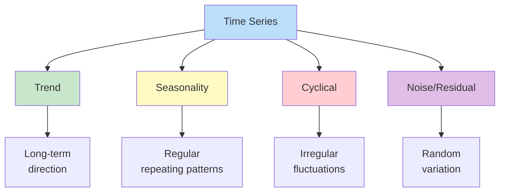

# ⏰ TIME SERIES ANALYSIS

> [!yellow] ⭐ **PREDICT THE FUTURE WITH DATA!**
> "The best way to predict the future is to create it." - Peter Drucker
> 
> **Time to Complete:** 2-3 weeks  
> **Difficulty:** ⭐⭐⭐ Medium  
> **Interview Weight:** ⭐⭐⭐⭐ VERY HIGH for many DS roles!

---

## 🗺️ TIME SERIES LEARNING ROADMAP


---

## 📚 TABLE OF CONTENTS

| # | Topic | Concept | Link |
|---|-------|---------|------|
| 1 | **Time Series Basics** | What & why | [[#1-time-series-basics\|Jump]] |
| 2 | **Components** | Trend, seasonality | [[#2-time-series-components\|Jump]] |
| 3 | **Stationarity** | Key requirement | [[#3-stationarity\|Jump]] |
| 4 | **Moving Averages** | Smoothing | [[#4-moving-averages\|Jump]] |
| 5 | **ARIMA** | Classic model | [[#5-arima-models\|Jump]] |
| 6 | **Seasonal Models** | SARIMA | [[#6-seasonal-models\|Jump]] |
| 7 | **Prophet & Modern** | Facebook Prophet | [[#7-prophet-and-modern-methods\|Jump]] |

---

## 1. TIME SERIES BASICS

> [!blue] 💙 **What is Time Series?**
> Data points indexed in time order. Each observation is associated with a specific timestamp.

```
Examples:
- Stock prices over days
- Temperature readings hourly
- Sales figures monthly
- Website traffic per minute
- COVID cases daily
```

### Key Characteristics

> [!yellow] 💡 **What Makes Time Series Special?**
> ```
> 1. TEMPORAL ORDERING
>    - Order matters! Can't shuffle data
>    - Past influences future
> 
> 2. TEMPORAL DEPENDENCE
>    - Today's value depends on yesterday
>    - Autocorrelation
> 
> 3. TIME-BASED PATTERNS
>    - Trends (long-term direction)
>    - Seasonality (repeating patterns)
>    - Cycles (irregular fluctuations)
> ```

> [!green] ✅ **Loading and Exploring Time Series**
> ```python
> import pandas as pd
> import numpy as np
> import matplotlib.pyplot as plt
> from datetime import datetime, timedelta
> 
> # Create sample time series
> dates = pd.date_range(start='2020-01-01', end='2024-12-31', freq='D')
> np.random.seed(42)
> 
> # Trend + Seasonality + Noise
> trend = np.linspace(100, 200, len(dates))
> seasonality = 20 * np.sin(2 * np.pi * np.arange(len(dates)) / 365)
> noise = np.random.normal(0, 5, len(dates))
> values = trend + seasonality + noise
> 
> # Create DataFrame
> df = pd.DataFrame({
>     'date': dates,
>     'value': values
> })
> df.set_index('date', inplace=True)
> 
> # 1. BASIC INFO
> print("="*60)
> print("TIME SERIES INFO")
> print("="*60)
> print(f"Start Date: {df.index.min()}")
> print(f"End Date: {df.index.max()}")
> print(f"Total Days: {len(df)}")
> print(f"Frequency: {df.index.freq}")
> print(f"\n{df.head()}")
> 
> # 2. PLOT
> plt.figure(figsize=(14, 6))
> plt.plot(df.index, df['value'], linewidth=1, alpha=0.8)
> plt.xlabel('Date')
> plt.ylabel('Value')
> plt.title('Time Series Data')
> plt.grid(True, alpha=0.3)
> plt.show()
> 
> # 3. SUMMARY STATISTICS
> print("\n" + "="*60)
> print("STATISTICS")
> print("="*60)
> print(df.describe())
> 
> # 4. RESAMPLING (change frequency)
> # Daily to monthly
> monthly = df.resample('M').mean()
> print("\n" + "="*60)
> print("MONTHLY AVERAGE")
> print("="*60)
> print(monthly.head())
> 
> # Daily to weekly
> weekly = df.resample('W').sum()
> print("\n" + "="*60)
> print("WEEKLY SUM")
> print("="*60)
> print(weekly.head())
> ```

---

## 2. TIME SERIES COMPONENTS

> [!blue] 💙 **Four Main Components**



### Decomposition

> [!green] ✅ **Decompose Time Series**
> ```python
> from statsmodels.tsa.seasonal import seasonal_decompose
> import matplotlib.pyplot as plt
> 
> # Decompose time series
> # Model: Additive (value = trend + seasonal + residual)
> # Or: Multiplicative (value = trend × seasonal × residual)
> 
> decomposition = seasonal_decompose(df['value'], 
>                                    model='additive', 
>                                    period=365)  # Annual seasonality
> 
> # Plot components
> fig, axes = plt.subplots(4, 1, figsize=(14, 10))
> 
> # Original
> axes[0].plot(df.index, df['value'])
> axes[0].set_ylabel('Original')
> axes[0].set_title('Time Series Decomposition')
> 
> # Trend
> axes[1].plot(df.index, decomposition.trend)
> axes[1].set_ylabel('Trend')
> 
> # Seasonality
> axes[2].plot(df.index, decomposition.seasonal)
> axes[2].set_ylabel('Seasonal')
> 
> # Residual/Noise
> axes[3].plot(df.index, decomposition.resid)
> axes[3].set_ylabel('Residual')
> axes[3].set_xlabel('Date')
> 
> plt.tight_layout()
> plt.show()
> 
> # Extract components
> trend = decomposition.trend
> seasonal = decomposition.seasonal
> residual = decomposition.resid
> 
> print("Component Statistics:")
> print(f"Trend strength: {1 - (residual.var() / (trend + residual).var()):.4f}")
> print(f"Seasonal strength: {1 - (residual.var() / (seasonal + residual).var()):.4f}")
> ```

> [!yellow] 💡 **Additive vs Multiplicative**
> ```python
> # ADDITIVE MODEL: Y = Trend + Seasonal + Residual
> # Use when seasonal variation is constant
> # Example: Temperature (seasonal swing is always ±10°C)
> 
> # MULTIPLICATIVE MODEL: Y = Trend × Seasonal × Residual
> # Use when seasonal variation increases with level
> # Example: Sales (holiday boost is 50% of base, not fixed amount)
> 
> # Visual check:
> plt.figure(figsize=(14, 6))
> 
> # Additive (constant seasonal amplitude)
> plt.subplot(1, 2, 1)
> t = np.arange(100)
> additive = 10 + 0.5*t + 5*np.sin(2*np.pi*t/12)
> plt.plot(t, additive)
> plt.title('Additive: Constant Seasonal Swing')
> plt.ylabel('Value')
> 
> # Multiplicative (growing seasonal amplitude)
> plt.subplot(1, 2, 2)
> multiplicative = (10 + 0.5*t) * (1 + 0.3*np.sin(2*np.pi*t/12))
> plt.plot(t, multiplicative)
> plt.title('Multiplicative: Growing Seasonal Swing')
> plt.ylabel('Value')
> 
> plt.tight_layout()
> plt.show()
> ```

---

## 3. STATIONARITY

> [!red] ⚠️ **CRITICAL CONCEPT FOR TIME SERIES MODELING!**

> [!blue] 💙 **What is Stationarity?**
> A time series is stationary if its statistical properties don't change over time.

```
Stationary means:
1. Constant mean over time
2. Constant variance over time
3. Constant autocorrelation structure

Why it matters:
Most time series models assume stationarity!
```

> [!green] ✅ **Testing for Stationarity**
> ```python
> from statsmodels.tsa.stattools import adfuller
> import matplotlib.pyplot as plt
> 
> def test_stationarity(timeseries, title=''):
>     """
>     Test stationarity using:
>     1. Visual inspection (rolling statistics)
>     2. Augmented Dickey-Fuller test
>     """
>     
>     print("="*60)
>     print(f"STATIONARITY TEST: {title}")
>     print("="*60)
>     
>     # Rolling statistics
>     rolling_mean = timeseries.rolling(window=12).mean()
>     rolling_std = timeseries.rolling(window=12).std()
>     
>     # Plot
>     fig, ax = plt.subplots(figsize=(14, 6))
>     ax.plot(timeseries, label='Original', linewidth=1, alpha=0.7)
>     ax.plot(rolling_mean, label='Rolling Mean', linewidth=2, color='red')
>     ax.plot(rolling_std, label='Rolling Std', linewidth=2, color='black')
>     ax.set_xlabel('Date')
>     ax.set_ylabel('Value')
>     ax.set_title(f'Rolling Mean & Standard Deviation - {title}')
>     ax.legend()
>     ax.grid(True, alpha=0.3)
>     plt.show()
>     
>     # Augmented Dickey-Fuller test
>     print("\nAugmented Dickey-Fuller Test:")
>     result = adfuller(timeseries.dropna())
>     
>     print(f"ADF Statistic: {result[0]:.6f}")
>     print(f"p-value: {result[1]:.6f}")
>     print(f"Critical Values:")
>     for key, value in result[4].items():
>         print(f"  {key}: {value:.3f}")
>     
>     # Interpretation
>     if result[1] <= 0.05:
>         print("\n✅ STATIONARY (reject null hypothesis)")
>         print("   Series has NO unit root (good for modeling)")
>     else:
>         print("\n❌ NON-STATIONARY (fail to reject null hypothesis)")
>         print("   Series has unit root (needs transformation)")
>     
>     return result
> 
> # Test original series
> test_stationarity(df['value'], 'Original Series')
> ```

### Making Series Stationary

> [!green] ✅ **Methods to Achieve Stationarity**
> ```python
> import numpy as np
> import pandas as pd
> from statsmodels.tsa.stattools import adfuller
> 
> # 1. DIFFERENCING - Remove trend
> # First difference: y_t - y_{t-1}
> df['diff_1'] = df['value'].diff()
> 
> # Second difference if needed
> df['diff_2'] = df['diff_1'].diff()
> 
> # Seasonal differencing (period=12 for monthly with yearly seasonality)
> df['seasonal_diff'] = df['value'].diff(periods=12)
> 
> # Test differenced series
> print("First Difference:")
> result = adfuller(df['diff_1'].dropna())
> print(f"p-value: {result[1]:.6f}")
> 
> # 2. LOG TRANSFORMATION - Stabilize variance
> df['log_value'] = np.log(df['value'])
> df['log_diff'] = df['log_value'].diff()
> 
> # 3. DETRENDING - Remove trend
> from scipy import signal
> detrended = signal.detrend(df['value'])
> df['detrended'] = detrended
> 
> # 4. MOVING AVERAGE - Smooth out fluctuations
> df['ma_7'] = df['value'].rolling(window=7).mean()
> df['ma_diff'] = df['value'] - df['ma_7']
> 
> # Visualize transformations
> fig, axes = plt.subplots(3, 2, figsize=(14, 12))
> 
> # Original
> axes[0, 0].plot(df.index, df['value'])
> axes[0, 0].set_title('Original')
> axes[0, 0].grid(True, alpha=0.3)
> 
> # First difference
> axes[0, 1].plot(df.index, df['diff_1'])
> axes[0, 1].set_title('First Difference')
> axes[0, 1].grid(True, alpha=0.3)
> 
> # Log transform
> axes[1, 0].plot(df.index, df['log_value'])
> axes[1, 0].set_title('Log Transform')
> axes[1, 0].grid(True, alpha=0.3)
> 
> # Log difference
> axes[1, 1].plot(df.index, df['log_diff'])
> axes[1, 1].set_title('Log Difference')
> axes[1, 1].grid(True, alpha=0.3)
> 
> # Detrended
> axes[2, 0].plot(df.index, df['detrended'])
> axes[2, 0].set_title('Detrended')
> axes[2, 0].grid(True, alpha=0.3)
> 
> # MA subtraction
> axes[2, 1].plot(df.index, df['ma_diff'])
> axes[2, 1].set_title('MA Subtraction')
> axes[2, 1].grid(True, alpha=0.3)
> 
> plt.tight_layout()
> plt.show()
> ```

---

## 4. MOVING AVERAGES

> [!blue] 💙 **What are Moving Averages?**
> Smooth out short-term fluctuations to reveal longer-term trends.

> [!green] ✅ **Types of Moving Averages**
> ```python
> # 1. SIMPLE MOVING AVERAGE (SMA)
> df['sma_7'] = df['value'].rolling(window=7).mean()
> df['sma_30'] = df['value'].rolling(window=30).mean()
> 
> # 2. EXPONENTIAL MOVING AVERAGE (EMA)
> # Recent values have more weight
> df['ema_7'] = df['value'].ewm(span=7, adjust=False).mean()
> df['ema_30'] = df['value'].ewm(span=30, adjust=False).mean()
> 
> # 3. WEIGHTED MOVING AVERAGE (WMA)
> def weighted_moving_average(series, weights):
>     return series.rolling(len(weights)).apply(
>         lambda x: np.sum(weights * x) / np.sum(weights), raw=True
>     )
> 
> weights = np.array([1, 2, 3, 4, 5, 6, 7])  # More weight to recent
> df['wma_7'] = weighted_moving_average(df['value'], weights)
> 
> # Plot comparison
> plt.figure(figsize=(14, 8))
> 
> plt.plot(df.index, df['value'], label='Original', alpha=0.5, linewidth=1)
> plt.plot(df.index, df['sma_7'], label='SMA 7', linewidth=2)
> plt.plot(df.index, df['sma_30'], label='SMA 30', linewidth=2)
> plt.plot(df.index, df['ema_7'], label='EMA 7', linewidth=2, linestyle='--')
> plt.plot(df.index, df['ema_30'], label='EMA 30', linewidth=2, linestyle='--')
> 
> plt.xlabel('Date')
> plt.ylabel('Value')
> plt.title('Moving Averages Comparison')
> plt.legend()
> plt.grid(True, alpha=0.3)
> plt.show()
> ```

---

## 5. ARIMA MODELS

> [!red] ⚠️ **MOST IMPORTANT CLASSICAL TIME SERIES MODEL!**

> [!blue] 💙 **What is ARIMA?**
> AutoRegressive Integrated Moving Average
> 
> **ARIMA(p, d, q)**
> - **p**: AutoRegressive order (how many past values to use)
> - **d**: Differencing order (how many times to difference)
> - **q**: Moving Average order (how many past errors to use)

```
AR (AutoRegressive): y_t = c + φ₁y_{t-1} + φ₂y_{t-2} + ... + ε_t
  "Today's value depends on past values"

I (Integrated): Differencing to make series stationary
  "Remove trend by subtracting previous value"

MA (Moving Average): y_t = c + ε_t + θ₁ε_{t-1} + θ₂ε_{t-2} + ...
  "Today's value depends on past errors"
```

> [!green] ✅ **Building ARIMA Model**
> ```python
> from statsmodels.tsa.arima.model import ARIMA
> from statsmodels.graphics.tsaplots import plot_acf, plot_pacf
> import matplotlib.pyplot as plt
> 
> # Step 1: Check if data is stationary
> # (Already covered in Section 3)
> 
> # Step 2: Determine parameters using ACF and PACF plots
> fig, axes = plt.subplots(1, 2, figsize=(14, 5))
> 
> # ACF (AutoCorrelation Function) - helps determine q
> plot_acf(df['value'].dropna(), lags=40, ax=axes[0])
> axes[0].set_title('ACF Plot')
> 
> # PACF (Partial AutoCorrelation Function) - helps determine p
> plot_pacf(df['value'].dropna(), lags=40, ax=axes[1])
> axes[1].set_title('PACF Plot')
> 
> plt.tight_layout()
> plt.show()
> 
> # Step 3: Fit ARIMA model
> # Let's try ARIMA(1, 1, 1)
> model = ARIMA(df['value'], order=(1, 1, 1))
> fitted_model = model.fit()
> 
> # Model summary
> print(fitted_model.summary())
> 
> # Step 4: Diagnose model
> fig = fitted_model.plot_diagnostics(figsize=(14, 10))
> plt.show()
> 
> # Step 5: Forecast
> forecast_steps = 30
> forecast = fitted_model.forecast(steps=forecast_steps)
> forecast_index = pd.date_range(start=df.index[-1] + timedelta(days=1), 
>                                 periods=forecast_steps, freq='D')
> 
> # Plot forecast
> plt.figure(figsize=(14, 6))
> plt.plot(df.index[-100:], df['value'][-100:], label='Historical', linewidth=2)
> plt.plot(forecast_index, forecast, label='Forecast', 
>          linewidth=2, color='red', linestyle='--')
> plt.fill_between(forecast_index, 
>                  forecast - 1.96*fitted_model.resid.std(),
>                  forecast + 1.96*fitted_model.resid.std(),
>                  alpha=0.3, color='red', label='95% CI')
> plt.xlabel('Date')
> plt.ylabel('Value')
> plt.title('ARIMA Forecast')
> plt.legend()
> plt.grid(True, alpha=0.3)
> plt.show()
> ```

> [!yellow] 💡 **Auto ARIMA - Automatic Parameter Selection**
> ```python
> from pmdarima import auto_arima
> 
> # Automatically find best (p, d, q)
> auto_model = auto_arima(df['value'],
>                         start_p=0, start_q=0,
>                         max_p=5, max_q=5,
>                         seasonal=False,
>                         stepwise=True,
>                         suppress_warnings=True,
>                         error_action='ignore')
> 
> print(auto_model.summary())
> print(f"\nBest model: ARIMA{auto_model.order}")
> 
> # Forecast
> forecast, conf_int = auto_model.predict(n_periods=30, return_conf_int=True)
> ```

---

## 6. SEASONAL MODELS

> [!blue] 💙 **SARIMA - Seasonal ARIMA**
> Extension of ARIMA for seasonal data

**SARIMA(p, d, q)(P, D, Q)m**
- **(p, d, q)**: Non-seasonal parameters
- **(P, D, Q)**: Seasonal parameters
- **m**: Number of periods in season (12 for monthly with yearly seasonality)

> [!green] ✅ **SARIMA Model**
> ```python
> from statsmodels.tsa.statespace.sarimax import SARIMAX
> 
> # SARIMA(1,1,1)(1,1,1,12) for monthly data with yearly seasonality
> sarima_model = SARIMAX(df['value'],
>                        order=(1, 1, 1),
>                        seasonal_order=(1, 1, 1, 12))
> 
> fitted_sarima = sarima_model.fit(disp=False)
> print(fitted_sarima.summary())
> 
> # Forecast
> forecast = fitted_sarima.forecast(steps=30)
> 
> plt.figure(figsize=(14, 6))
> plt.plot(df.index[-100:], df['value'][-100:], label='Historical')
> plt.plot(forecast_index, forecast, label='SARIMA Forecast', 
>          color='red', linestyle='--')
> plt.xlabel('Date')
> plt.ylabel('Value')
> plt.title('SARIMA Forecast')
> plt.legend()
> plt.grid(True, alpha=0.3)
> plt.show()
> ```

---

## 7. PROPHET AND MODERN METHODS

> [!blue] 💙 **Facebook Prophet**
> Modern time series forecasting tool designed for business use cases.

```
Advantages:
✅ Handles missing data
✅ Handles outliers
✅ Easy to use
✅ Works with daily/weekly/yearly seasonality
✅ Holiday effects
✅ Handles changepoints (trend changes)
```

> [!green] ✅ **Using Prophet**
> ```python
> from prophet import Prophet
> import pandas as pd
> 
> # Prepare data (Prophet needs 'ds' and 'y' columns)
> prophet_df = pd.DataFrame({
>     'ds': df.index,
>     'y': df['value'].values
> })
> 
> # Create and fit model
> model = Prophet(
>     yearly_seasonality=True,
>     weekly_seasonality=True,
>     daily_seasonality=False,
>     changepoint_prior_scale=0.05  # Controls trend flexibility
> )
> 
> model.fit(prophet_df)
> 
> # Make future dataframe
> future = model.make_future_dataframe(periods=90, freq='D')
> 
> # Forecast
> forecast = model.predict(future)
> 
> # Plot
> fig1 = model.plot(forecast)
> plt.title('Prophet Forecast')
> plt.show()
> 
> # Plot components
> fig2 = model.plot_components(forecast)
> plt.show()
> 
> # Access forecast details
> print(forecast[['ds', 'yhat', 'yhat_lower', 'yhat_upper']].tail())
> ```

> [!yellow] ⭐ **Advanced Prophet Features**
> ```python
> # 1. ADD HOLIDAYS
> holidays = pd.DataFrame({
>     'holiday': 'christmas',
>     'ds': pd.to_datetime(['2020-12-25', '2021-12-25', 
>                           '2022-12-25', '2023-12-25']),
>     'lower_window': 0,
>     'upper_window': 1,
> })
> 
> model = Prophet(holidays=holidays)
> model.fit(prophet_df)
> 
> # 2. ADD CUSTOM SEASONALITY
> model = Prophet()
> model.add_seasonality(name='monthly', period=30.5, fourier_order=5)
> model.fit(prophet_df)
> 
> # 3. ADD REGRESSORS (external variables)
> prophet_df['extra_regressor'] = external_data
> model = Prophet()
> model.add_regressor('extra_regressor')
> model.fit(prophet_df)
> 
> # 4. CHANGEPOINT DETECTION
> from prophet.plot import add_changepoints_to_plot
> fig = model.plot(forecast)
> add_changepoints_to_plot(fig.gca(), model, forecast)
> plt.show()
> ```

### LSTM for Time Series

> [!purple] 🔮 **Deep Learning Approach**
> ```python
> from tensorflow.keras.models import Sequential
> from tensorflow.keras.layers import LSTM, Dense
> import numpy as np
> 
> # Prepare data for LSTM
> def create_sequences(data, seq_length):
>     X, y = [], []
>     for i in range(len(data) - seq_length):
>         X.append(data[i:i+seq_length])
>         y.append(data[i+seq_length])
>     return np.array(X), np.array(y)
> 
> # Normalize data
> from sklearn.preprocessing import MinMaxScaler
> scaler = MinMaxScaler()
> scaled_data = scaler.fit_transform(df[['value']])
> 
> # Create sequences
> seq_length = 30
> X, y = create_sequences(scaled_data, seq_length)
> 
> # Reshape for LSTM [samples, time steps, features]
> X = X.reshape((X.shape[0], X.shape[1], 1))
> 
> # Split train/test
> train_size = int(len(X) * 0.8)
> X_train, X_test = X[:train_size], X[train_size:]
> y_train, y_test = y[:train_size], y[train_size:]
> 
> # Build LSTM model
> model = Sequential([
>     LSTM(50, activation='relu', return_sequences=True, 
>          input_shape=(seq_length, 1)),
>     LSTM(50, activation='relu'),
>     Dense(1)
> ])
> 
> model.compile(optimizer='adam', loss='mse')
> 
> # Train
> history = model.fit(X_train, y_train, 
>                     epochs=50, 
>                     validation_data=(X_test, y_test),
>                     batch_size=32,
>                     verbose=0)
> 
> # Forecast
> predictions = model.predict(X_test)
> predictions = scaler.inverse_transform(predictions)
> 
> # Plot
> plt.figure(figsize=(14, 6))
> plt.plot(y_test[:100], label='Actual')
> plt.plot(predictions[:100], label='LSTM Forecast')
> plt.xlabel('Time')
> plt.ylabel('Value')
> plt.title('LSTM Time Series Forecast')
> plt.legend()
> plt.show()
> ```

---

## 💎 INTERVIEW QUESTIONS

> [!yellow] 💎 **Q: Explain the difference between AR and MA in ARIMA**
> 
> **Perfect Answer:**
> "AR and MA are two components of ARIMA:
> 
> **AutoRegressive (AR):**
> - Models value as function of past VALUES
> - y_t = c + φ₁y_{t-1} + φ₂y_{t-2} + ... + ε_t
> - Example: Today's stock price depends on yesterday's price
> - Identified using PACF plot
> 
> **Moving Average (MA):**
> - Models value as function of past ERRORS
> - y_t = c + ε_t + θ₁ε_{t-1} + θ₂ε_{t-2} + ...
> - Example: Today's value corrects past prediction errors
> - Identified using ACF plot
> 
> **Key Difference:**
> - AR looks at actual past values
> - MA looks at past forecast errors
> 
> **In Practice:**
> - AR captures persistence (momentum)
> - MA captures shock effects (corrections)
> 
> ARIMA combines both for more flexible modeling."

> [!yellow] 💎 **Q: How do you evaluate time series forecast accuracy?**
> 
> **Perfect Answer:**
> "Several metrics for time series evaluation:
> 
> **1. MAE (Mean Absolute Error):**
> ```python
> MAE = mean(|actual - predicted|)
> ```
> - Easy to interpret (same units as data)
> - Not sensitive to outliers
> 
> **2. RMSE (Root Mean Squared Error):**
> ```python
> RMSE = sqrt(mean((actual - predicted)²))
> ```
> - Penalizes large errors more
> - Same units as data
> 
> **3. MAPE (Mean Absolute Percentage Error):**
> ```python
> MAPE = mean(|actual - predicted| / |actual|) × 100
> ```
> - Scale-independent (good for comparing series)
> - Problems when actual values near zero
> 
> **4. AIC/BIC (Model Selection):**
> - Lower is better
> - Penalizes model complexity
> - Used to compare different models
> 
> **Best Practice:**
> - Use multiple metrics
> - Always use walk-forward validation (not random split!)
> - Check if errors are random (white noise)
> - Visualize forecasts vs actuals"

> [!yellow] 💎 **Q: When would you use Prophet vs ARIMA?**
> 
> **Perfect Answer:**
> 
> **Use ARIMA when:**
> - Data is stationary (or can be made stationary)
> - Need interpretable model
> - Small to medium datasets
> - Want statistical rigor
> - No missing values or outliers
> 
> **Use Prophet when:**
> - Strong seasonal patterns (daily/weekly/yearly)
> - Holiday effects matter
> - Missing data or outliers present
> - Multiple seasonality periods
> - Need quick production deployment
> - Non-technical stakeholders
> - Trend changes (changepoints)
> 
> **Example:**
> - Website traffic: Prophet (daily/weekly patterns, holidays)
> - Stock prices: ARIMA (more random walk, need stationarity)
> - Retail sales: Prophet (strong seasonality, promotions)
> - Economic indicators: ARIMA (statistical properties matter)"

---

## 🎯 COMPLETE TIME SERIES WORKFLOW

> [!green] ✅ **End-to-End Pipeline**
> ```python
> # 1. LOAD & EXPLORE
> df = pd.read_csv('data.csv', parse_dates=['date'], index_col='date')
> df.plot(figsize=(14, 6))
> 
> # 2. CHECK STATIONARITY
> test_stationarity(df['value'])
> 
> # 3. DECOMPOSE
> decomposition = seasonal_decompose(df['value'], model='additive', period=12)
> decomposition.plot()
> 
> # 4. MAKE STATIONARY (if needed)
> df['stationary'] = df['value'].diff().dropna()
> 
> # 5. SPLIT TRAIN/TEST (temporal split!)
> train_size = int(len(df) * 0.8)
> train = df.iloc[:train_size]
> test = df.iloc[train_size:]
> 
> # 6. FIT MODEL
> model = Prophet()
> model.fit(train.reset_index().rename(columns={'date': 'ds', 'value': 'y'}))
> 
> # 7. FORECAST
> future = model.make_future_dataframe(periods=len(test), freq='D')
> forecast = model.predict(future)
> 
> # 8. EVALUATE
> predictions = forecast.iloc[-len(test):]['yhat'].values
> actual = test['value'].values
> 
> mae = np.mean(np.abs(actual - predictions))
> rmse = np.sqrt(np.mean((actual - predictions)**2))
> mape = np.mean(np.abs((actual - predictions) / actual)) * 100
> 
> print(f"MAE: {mae:.2f}")
> print(f"RMSE: {rmse:.2f}")
> print(f"MAPE: {mape:.2f}%")
> 
> # 9. VISUALIZE
> plt.figure(figsize=(14, 6))
> plt.plot(train.index, train['value'], label='Train')
> plt.plot(test.index, test['value'], label='Actual')
> plt.plot(test.index, predictions, label='Forecast', linestyle='--')
> plt.legend()
> plt.show()
> ```

---

**Tags:** #time-series #forecasting #arima #prophet #lstm #seasonality  
**Difficulty:** ⭐⭐⭐ Medium  
**Time to Master:** 2-3 weeks  
**Last Updated:** 2026-11-11
