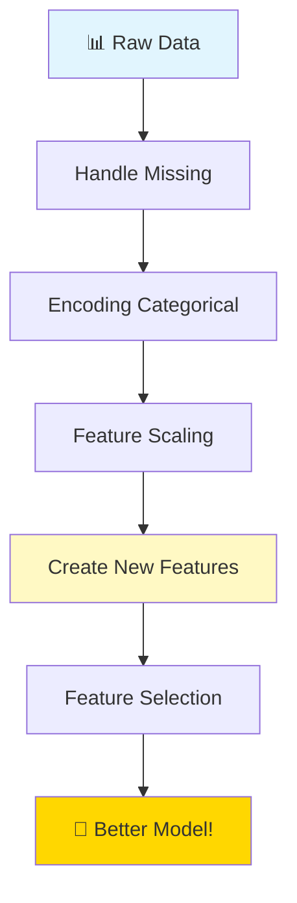
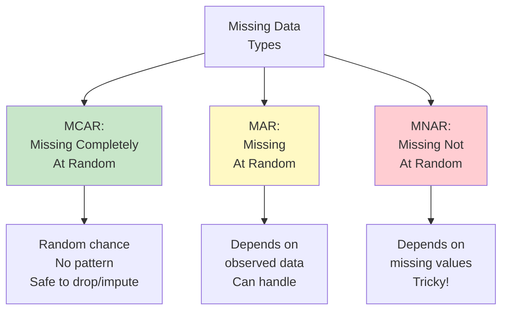
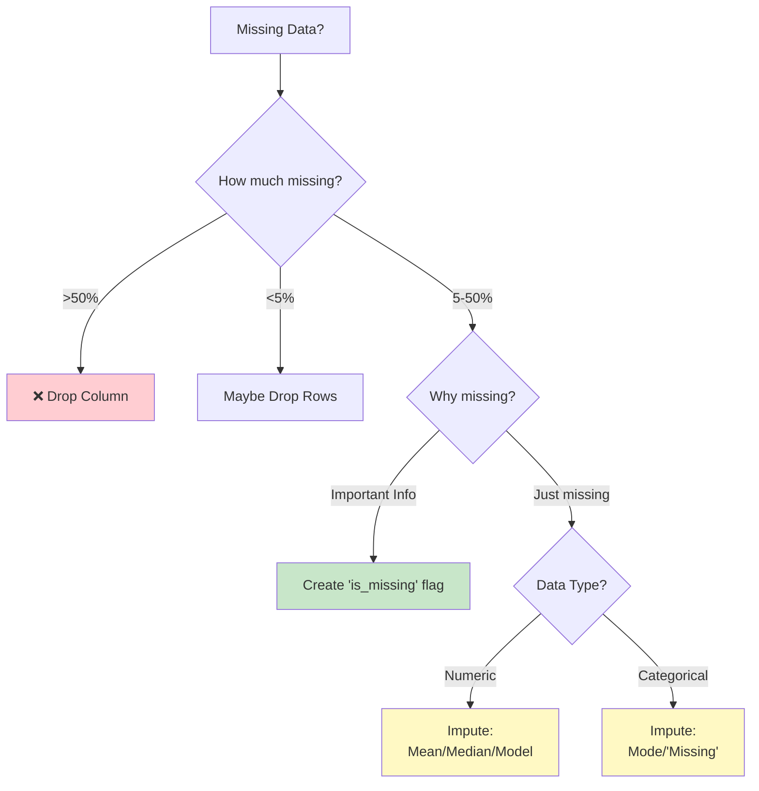
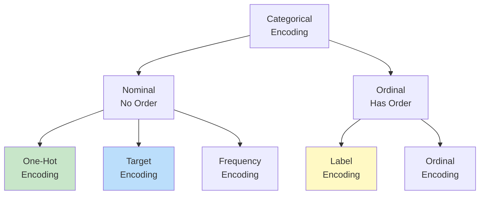
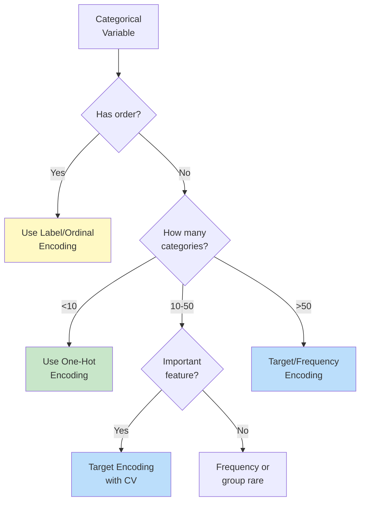
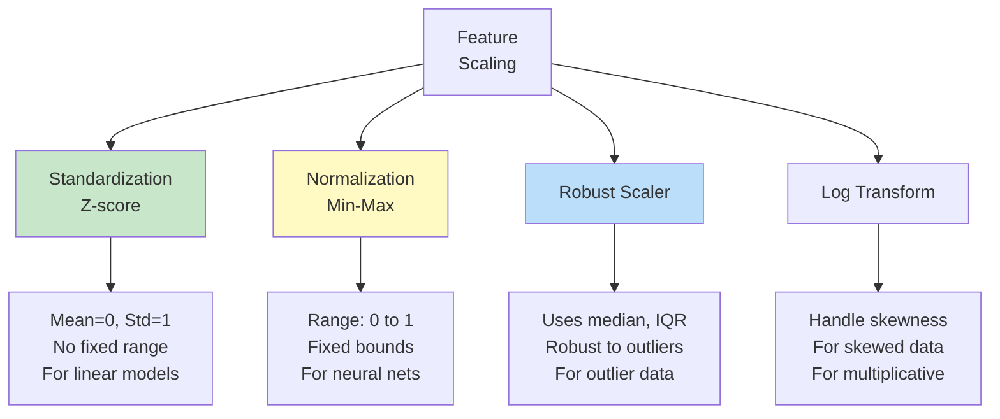
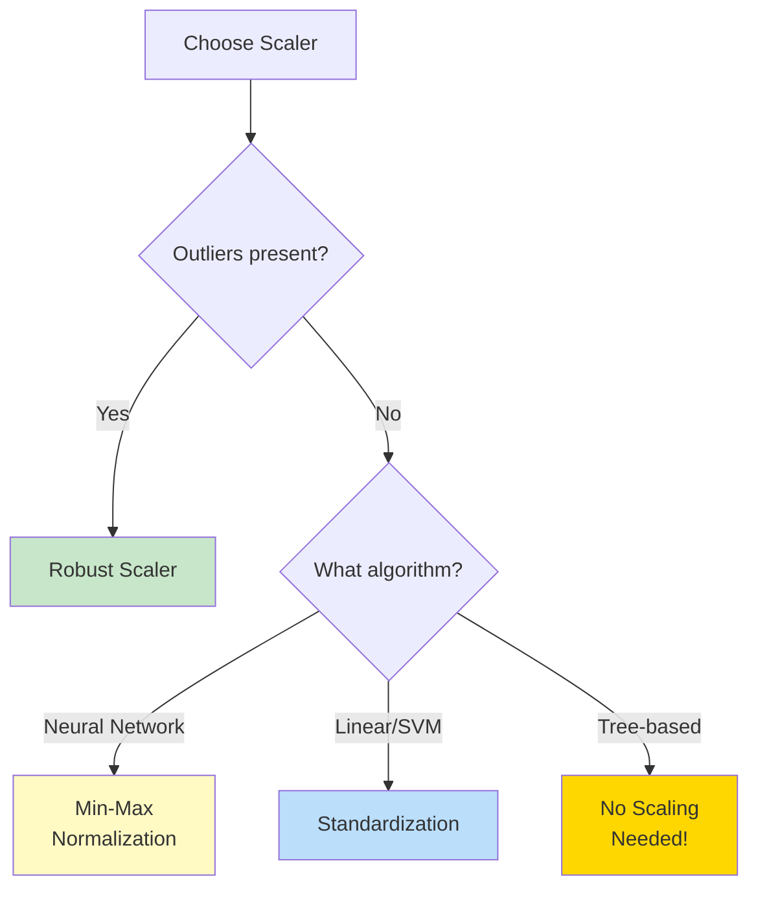
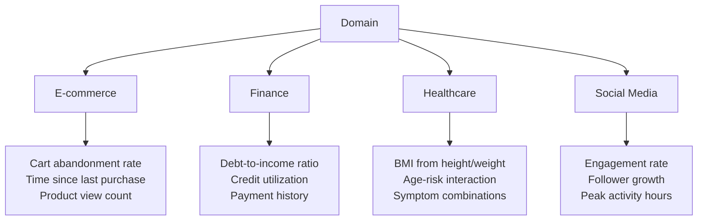
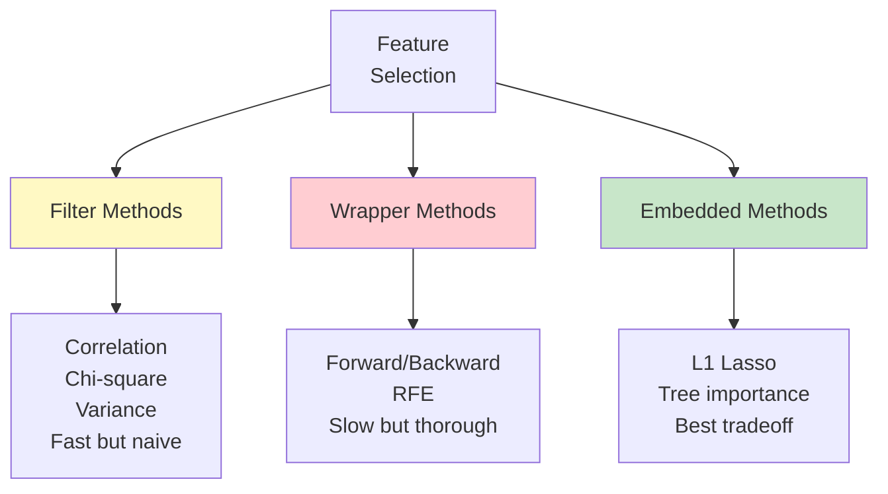
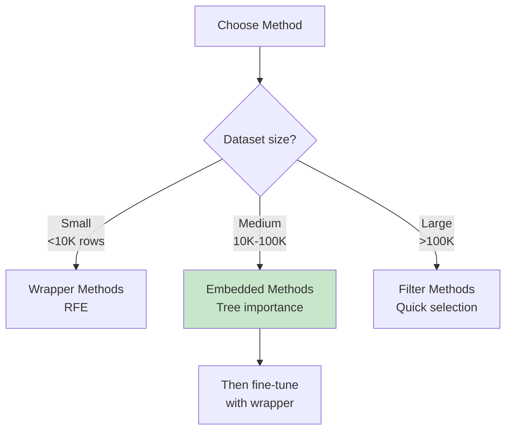

# 🔧 FEATURE ENGINEERING

**⭐ THE SECRET SAUCE OF ML!**
"Coming up with features is difficult, time-consuming, requires expert knowledge. 'Applied machine learning' is basically feature engineering." - Andrew Ng

**Time to Complete:** 2-3 weeks  
**Difficulty:** ⭐⭐⭐⭐ Medium-Hard  
**Interview Weight:** ⭐⭐⭐⭐⭐ EXTREMELY HIGH!

---

## 🗺️ FEATURE ENGINEERING ROADMAP



---

## 📚 TABLE OF CONTENTS

| # | Technique | Purpose | Link |
|---|-----------|---------|------|
| 1 | **Missing Data** | Handle gaps | [[#1-handling-missing-data\|Jump]] |
| 2 | **Encoding** | Convert categories | [[#2-encoding-categorical-features\|Jump]] |
| 3 | **Scaling** | Normalize ranges | [[#3-feature-scaling\|Jump]] |
| 4 | **Creating Features** | Extract information | [[#4-feature-creation\|Jump]] |
| 5 | **Feature Selection** | Remove noise | [[#5-feature-selection\|Jump]] |
| 6 | **Advanced Techniques** | Domain-specific | [[#6-advanced-techniques\|Jump]] |

---

## 1. HANDLING MISSING DATA

**💙 Types of Missing Data**



### Decision Framework



### Imputation Strategies

**💡 Choosing Imputation Method**

| Method | When to Use | Pros | Cons |
|--------|-------------|------|------|
| **Drop Rows** | <5% missing, plenty of data | Simple, no bias | Loses information |
| **Drop Column** | >50% missing | Remove noise | May lose important feature |
| **Mean** | Normal distribution | Simple | Ignores relationships |
| **Median** | Skewed or outliers | Robust | Ignores relationships |
| **Mode** | Categorical | Simple | May not be best |
| **Forward Fill** | Time series | Logical | Propagates errors |
| **KNN Imputation** | Pattern exists | Uses relationships | Slow, needs scaling |
| **Iterative** | MCAR/MAR | Best accuracy | Complex, slow |

### The Missing Indicator

**✅ Missing as Information**
```
Sometimes "missing" IS the signal!

Example: Income in job application
- Present: Maybe honest or high income
- Missing: Maybe hiding low income or privacy concern

Solution: Create binary indicator
Feature: 'income_missing' = 1 if missing, 0 otherwise

Now model can learn:
- Income amount (when present)
- Missing pattern (always)
```

---

## 2. ENCODING CATEGORICAL FEATURES

**💙 Why Encode?**
Models need numbers, not text!
"Male/Female" → 0/1
"Red/Green/Blue" → ?

### Encoding Methods Comparison



### 1. Label Encoding

```
For ORDINAL data only!

Education:
Low → 0
Medium → 1
High → 2

✅ Good: Preserves order
❌ Bad: Assumes equal spacing
❌ Bad: Don't use for nominal data!

Example BAD usage:
Color: Red→0, Green→1, Blue→2
Model thinks Blue > Green > Red (wrong!)
```

### 2. One-Hot Encoding

```
For NOMINAL data (no order)

Color:        Red  Green  Blue
Red       →   1    0      0
Green     →   0    1      0
Blue      →   0    0      1

✅ Good: No false ordering
✅ Good: Works with all models
❌ Bad: High dimensionality (k features for k categories)
❌ Bad: Sparse matrix
❌ Bad: Multicollinearity
```

**⚠️ One-Hot Encoding Trap!**
```
High Cardinality Problem:

Country: 195 countries
One-hot → 195 new features!

Zip Code: 43,000 zip codes
One-hot → 43,000 new features! ← Disaster!

Solutions:
1. Group rare categories → "Other"
2. Use Target Encoding
3. Use Embedding (deep learning)
4. Use Frequency Encoding
```

### 3. Target Encoding

```
Encode based on target mean

City        Average_Price
New York    $500,000    → Encode as 500000
Chicago     $300,000    → Encode as 300000
Houston     $250,000    → Encode as 250000

✅ Good: Handles high cardinality
✅ Good: Captures relationship with target
❌ Bad: Can cause overfitting
❌ Bad: Needs cross-validation encoding
```

### 4. Frequency Encoding

```
Encode by occurrence frequency

Color       Count    Frequency
Red         50       0.50
Blue        30       0.30
Green       20       0.20

Red   → 0.50
Blue  → 0.30
Green → 0.20

✅ Good: Single column
✅ Good: Handles high cardinality
❌ Bad: Different categories can have same frequency
```

### Encoding Decision Tree



---

## 3. FEATURE SCALING

**💙 Why Scale Features?**
Different scales = unfair influence!

```
Without Scaling:
Age: 20-80       (range: 60)
Income: 20K-200K (range: 180,000)

Model thinks: Income is 3000x more important!
But actually: Both might be equally important
```

### Scaling Methods



### 1. Standardization (Z-Score)

```
Formula: z = (x - mean) / std

Before:  [10, 20, 30, 40, 50]
Mean: 30, Std: 14.14

After:   [-1.41, -0.71, 0, 0.71, 1.41]
Mean: 0, Std: 1

✅ Good: No fixed range (handles outliers better)
✅ Good: For normal-ish distributions
❌ Bad: Affected by outliers
```

### 2. Min-Max Normalization

```
Formula: x_norm = (x - min) / (max - min)

Before:  [10, 20, 30, 40, 50]
Min: 10, Max: 50

After:   [0, 0.25, 0.50, 0.75, 1.0]
Range: [0, 1]

✅ Good: Fixed range [0,1]
✅ Good: For neural networks
❌ Bad: Very sensitive to outliers!
```

### 3. Robust Scaler

```
Formula: x_scaled = (x - median) / IQR

Uses median and IQR instead of mean and std

✅ Good: Robust to outliers
✅ Good: For data with many outliers
❌ Bad: Doesn't bound range
```

### Which Scaler to Use?



**⚠️ Important Rules**
```
1. FIT on training data, TRANSFORM on train AND test
   ❌ scaler.fit(test_data)  # Wrong! Causes data leakage
   ✅ scaler.fit(train_data)
      scaler.transform(train_data)
      scaler.transform(test_data)

2. Tree-based models DON'T need scaling
   - Decision Trees
   - Random Forest
   - XGBoost
   - LightGBM

3. Distance-based models NEED scaling
   - KNN
   - SVM
   - Neural Networks
   - Linear/Logistic Regression
   - K-Means
```

---

## 4. FEATURE CREATION

**💙 The Art of Feature Engineering**

### Domain-Specific Features



### Common Feature Engineering Techniques

**⭐ 1. Mathematical Transformations**
```
Original Features: X, Y

Polynomial:
- X², X³
- Y², Y³
- X×Y (interaction)

Ratios:
- X/Y
- (X-Y)/(X+Y)

Aggregations:
- X + Y
- max(X, Y)
- √(X² + Y²)  # Distance

Example: House price
- sqft_living × sqft_lot = total_space_potential
- price / sqft_living = price_per_sqft
- bedrooms / bathrooms = bed_bath_ratio
```

**⭐ 2. Datetime Features**
```
From: '2024-03-15 14:30:00'

Extract:
✅ Year: 2024
✅ Month: 3 (or 'March')
✅ Day: 15
✅ Day of week: 4 (Friday)
✅ Hour: 14
✅ Minute: 30
✅ Is weekend: 0
✅ Is business hours: 1
✅ Quarter: 1
✅ Week of year: 11
✅ Days since event: calculated
✅ Season: Spring

Cyclical encoding:
Hour 23 and Hour 0 are close!
Use: sin(2π × hour/24), cos(2π × hour/24)
```

**⭐ 3. Text Features**
```
From text: "Machine Learning is Amazing!!!"

Simple:
✅ Character count: 31
✅ Word count: 4
✅ Avg word length: 6.5
✅ Uppercase count: 3
✅ Punctuation count: 3
✅ Has numbers: 0
✅ Special char ratio: 0.097

Advanced:
✅ Sentiment score: 0.8 (positive)
✅ Readability score
✅ TF-IDF vectors
✅ Word embeddings
✅ Named entity count
```

**⭐ 4. Aggregation Features**
```
Group by user, calculate:

Count features:
- Total purchases
- Total logins
- Total clicks

Statistical features:
- Avg purchase amount
- Max transaction
- Std dev of amounts
- Median session time

Time features:
- Days since first purchase
- Days since last activity
- Purchase frequency

Ratio features:
- Conversion rate
- Click-through rate
- Cancellation rate
```

### Feature Interaction Example

```
Linear model thinks:
Effect of X + Effect of Y = Total Effect

But often:
Effect depends on BOTH X and Y together!

Example: Plant Growth
X = Sunlight hours
Y = Water amount

Wrong: growth = 2×sunlight + 3×water

Right: growth = sunlight × water (interaction!)
- Much sun + much water = Great!
- Much sun + no water = Dead!
- No sun + much water = Dead!
```

---

## 5. FEATURE SELECTION

**💙 Why Remove Features?**

```
More features ≠ Better model!

Problems with too many features:
❌ Overfitting
❌ Slow training
❌ Curse of dimensionality
❌ Noisy predictions
❌ Hard to interpret

Goal: Keep signal, remove noise
```

### Feature Selection Methods



### 1. Filter Methods (Fast)

**✅ Remove Before Training**
```
Low Variance Filter:
Feature hardly changes → Not useful
Example: [1, 1, 1, 1, 1, 2, 1, 1]
Variance ≈ 0 → Remove!

Correlation Filter:
Two features highly correlated → Keep one
Feature A: [1, 2, 3, 4, 5]
Feature B: [2, 4, 6, 8, 10]  # B = 2×A
Correlation = 1.0 → Remove B!

Chi-Square Test:
Feature independent of target → Remove
Use for categorical features

Mutual Information:
Measures dependency with target
Keep high MI features
```

### 2. Wrapper Methods (Slow but Good)

**💡 Search Through Combinations**
```
Forward Selection:
1. Start with 0 features
2. Add feature that improves model most
3. Repeat until no improvement

Backward Elimination:
1. Start with all features
2. Remove feature that hurts model least
3. Repeat until performance drops

Recursive Feature Elimination (RFE):
1. Train model with all features
2. Remove least important feature
3. Repeat until desired number

⚠️ Warning: Computationally expensive!
1000 features → 2^1000 combinations!
```

### 3. Embedded Methods (Best)

**✅ Selection During Training**
```
L1 Regularization (Lasso):
Penalty forces some coefficients to exactly 0
Non-zero features = selected features
Fast and effective!

Tree-Based Importance:
Random Forest, XGBoost compute feature importance
Keep top N most important features

Example importance:
Feature A: 0.35  ← Very important
Feature B: 0.28  ← Important
Feature C: 0.18
Feature D: 0.12
Feature E: 0.05  ← Remove these
Feature F: 0.02  ← Remove these
```

### Feature Selection Decision Guide



---

## 6. ADVANCED TECHNIQUES

**🔮 Advanced Feature Engineering**

### 1. Polynomial Features

```
Create combinations and powers

Original: [x1, x2]

Degree 2: [x1, x2, x1², x1×x2, x2²]

Degree 3: [x1, x2, x1², x1×x2, x2², x1³, x1²×x2, x1×x2², x2³]

✅ Captures non-linear relationships
❌ Exponential feature growth!
```

### 2. Binning (Discretization)

```
Convert continuous → categorical

Age: 25 → "Young Adult" (18-35)
Income: $75K → "Middle" ($50K-$100K)

Why?
✅ Handle outliers
✅ Make non-linear relationships linear
✅ Reduce noise
✅ Sometimes better for tree models

Methods:
- Equal width bins
- Equal frequency bins  
- Custom domain bins
```

### 3. Feature Crosses

```
Combine categorical features

Location: [Downtown, Suburb, Rural]
Time: [Morning, Afternoon, Evening]

Cross: Location × Time
- Downtown_Morning
- Downtown_Afternoon
- Downtown_Evening
- Suburb_Morning
- ...

Captures interaction patterns!
"Downtown during evening" different from parts
```

### 4. Target Statistics

```
For each category, calculate:
- Mean of target
- Std of target
- Count of samples
- Percentiles

Example: City → Average house price
City_mean_price
City_std_price
City_count

⚠️ Use cross-validation to avoid overfitting!
```

---

## 💎 INTERVIEW QUESTIONS

**💎 Q: How to handle high cardinality categorical features?**

**Perfect Answer:**
"High cardinality (100+ categories) makes one-hot encoding impractical.

**Solutions:**

1. **Grouping** (Best if possible)
   - Combine rare categories into 'Other'
   - Keep top 10-20, group rest
   - Example: 50 cities → Keep top 10 + 'Other'

2. **Target Encoding**
   - Replace with mean of target
   - Use CV to prevent overfitting
   - Works with any cardinality

3. **Frequency Encoding**
   - Replace with occurrence count
   - Simple, single column

4. **Embeddings** (Deep Learning)
   - Learn low-dimensional representation
   - Best for very high cardinality (>1000)

5. **Hash Encoding**
   - Hash to fixed number of bins
   - Collisions possible but controlled

**Example:**
Zip codes (40,000 unique)
- Group by region: 40,000 → 50 regions
- Or target encode: 40,000 → 1 feature
- Or embedding: 40,000 → 10 dimensions"

**💎 Q: Explain feature scaling and when it's needed**

**Perfect Answer:**
"Feature scaling normalizes features to similar ranges.

**Why needed:**
Distance-based algorithms treat large-scale features as more important.

Example:
- Age: 20-80 (range 60)
- Income: 20K-200K (range 180K)

Without scaling: Income dominates distance calculations!

**Models that NEED scaling:**
- KNN (distance-based)
- SVM (distance to hyperplane)
- Neural Networks (gradient descent)
- Linear/Logistic Regression (coefficient interpretation)
- K-Means (distance-based)
- PCA (variance-based)

**Models that DON'T need scaling:**
- Decision Trees (split-based)
- Random Forest
- XGBoost/LightGBM
- Naive Bayes

**Methods:**
1. **Standardization** (z-score)
   - Mean=0, Std=1
   - For normally distributed data
   - Not bounded

2. **Min-Max Normalization**
   - Range [0,1]
   - For neural networks
   - Sensitive to outliers

3. **Robust Scaler**
   - Uses median and IQR
   - For data with outliers

**Critical:** Fit on train, transform train AND test!"

**💎 Q: What are the best practices for feature engineering?**

**Perfect Answer:**

**1. Understand the Data**
- Domain knowledge is key
- Talk to domain experts
- Understand business context

**2. Start Simple**
- Baseline with raw features
- Add features incrementally
- Measure impact of each

**3. Create Features Systematically**
- Mathematical: polynomials, ratios, logs
- Aggregations: group-by statistics
- Datetime: extract components
- Text: counts, sentiment
- Domain-specific: business rules

**4. Avoid Data Leakage**
- No future information
- No target information
- Fit on train only

**5. Handle Missing Smartly**
- Understand why missing
- Create missing indicators
- Don't always impute

**6. Remove Redundancy**
- Check correlation
- Remove duplicates
- Use feature selection

**7. Validate Everything**
- Use cross-validation
- Check on holdout set
- A/B test in production

**8. Document Features**
- Why created
- How computed
- When to update

**Example workflow:**
1. EDA → Understand patterns
2. Create features → Try ideas
3. Select features → Keep best
4. Validate → Cross-validation
5. Iterate → Improve incrementally"

---

**Tags:** #feature-engineering #feature-selection #encoding #scaling #ml-preprocessing  
**Difficulty:** ⭐⭐⭐⭐ Medium-Hard  
**Time to Master:** 2-3 weeks  
**Last Updated:** 2026-11-11
