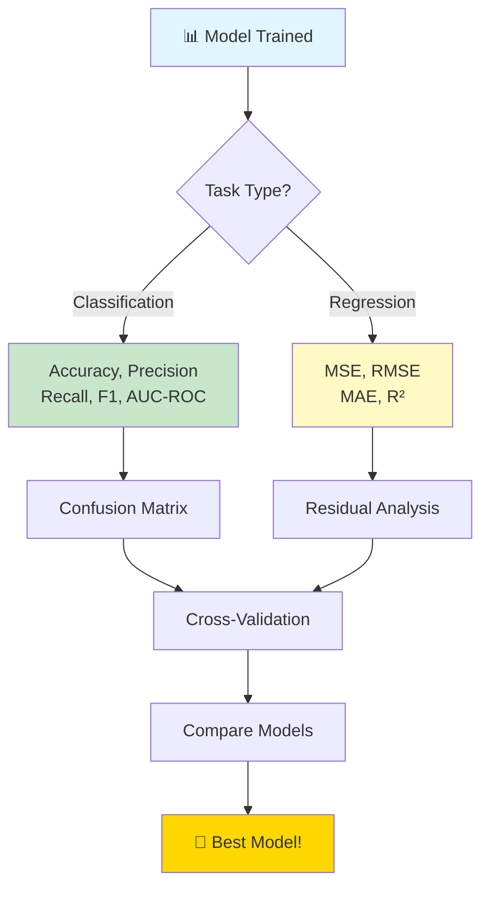
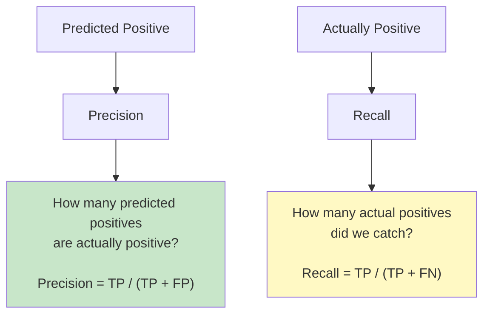
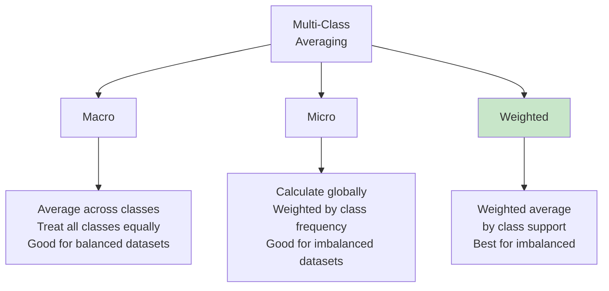
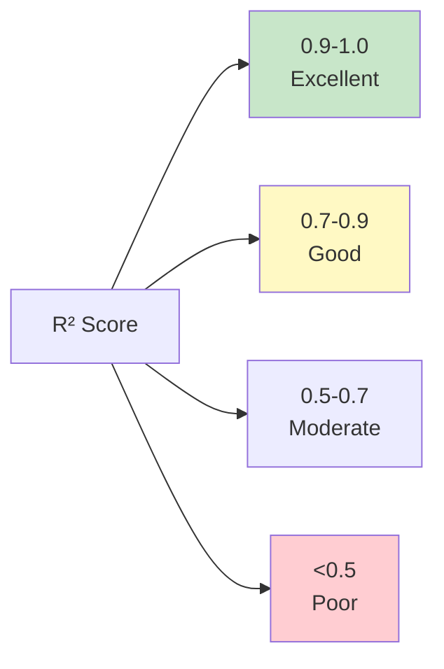
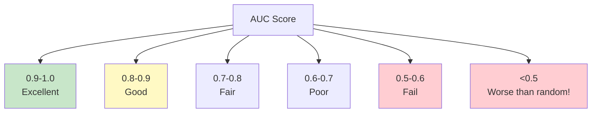
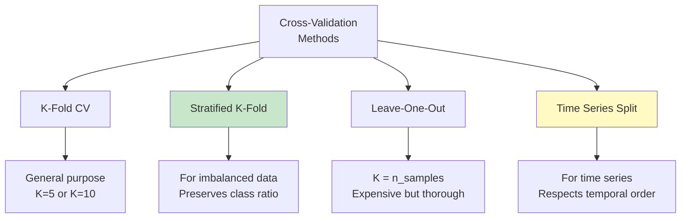
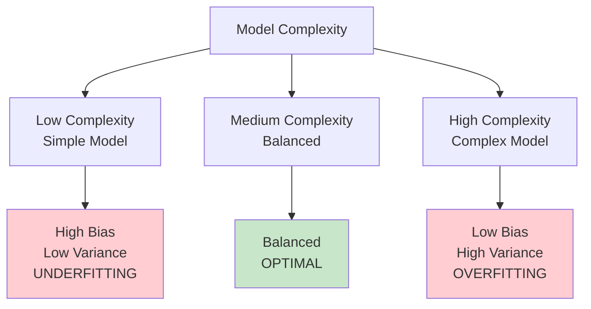

# 📊 MODEL EVALUATION & METRICS

**⭐ HOW GOOD IS YOUR MODEL?**
"What gets measured gets improved." - Peter Drucker

Learn to properly evaluate and compare ML models!

**Time to Complete:** 1-2 weeks  
**Difficulty:** ⭐⭐⭐ Medium  
**Interview Weight:** ⭐⭐⭐⭐⭐ EXTREMELY HIGH!

---

## 🗺️ MODEL EVALUATION ROADMAP



---

## 📚 TABLE OF CONTENTS

| # | Topic | For | Link |
|---|-------|-----|------|
| 1 | **Classification Metrics** | Classes | [[#1-classification-metrics\|Jump]] |
| 2 | **Regression Metrics** | Numbers | [[#2-regression-metrics\|Jump]] |
| 3 | **Confusion Matrix** | Visual evaluation | [[#3-confusion-matrix\|Jump]] |
| 4 | **ROC & AUC** | Threshold selection | [[#4-roc-curve-and-auc\|Jump]] |
| 5 | **Cross-Validation** | Robust evaluation | [[#5-cross-validation\|Jump]] |
| 6 | **Bias-Variance** | Model complexity | [[#6-bias-variance-tradeoff\|Jump]] |

---

## 1. CLASSIFICATION METRICS

**💙 The Big Four Metrics**

### Accuracy

```
Accuracy = (Correct Predictions) / (Total Predictions)
         = (TP + TN) / (TP + TN + FP + FN)

Where:
TP = True Positives  (Predicted YES, Actually YES)
TN = True Negatives  (Predicted NO, Actually NO)
FP = False Positives (Predicted YES, Actually NO) ← Type I Error
FN = False Negatives (Predicted NO, Actually YES) ← Type II Error
```

**⚠️ ACCURACY PARADOX - When Accuracy Lies!**

```
Example: Fraud Detection
Dataset: 1000 transactions
- 990 legitimate (99%)
- 10 fraudulent (1%)

Model A: Always predicts "Legitimate"
Accuracy = 990/1000 = 99%  ← Looks great!
But catches 0 frauds!  ← Useless!

This is why we need other metrics!
```

### Precision vs Recall



### The Precision-Recall Tradeoff

```
Fishing Analogy:
🎣 Precision: Of fish you caught, how many are the right species?
🎣 Recall: Of all right species in lake, how many did you catch?

High Precision, Low Recall:
"I only catch salmon, but miss most of them"
- Few false positives
- Many false negatives

Low Precision, High Recall:
"I catch all salmon, but also catch many other fish"
- Few false negatives
- Many false positives

Balance:
"I catch most salmon, and few other fish"
- This is what we want!
```

**💡 When to Optimize What?**

| Scenario | Optimize | Why |
|----------|----------|-----|
| **Email Spam** | Precision | Don't want good emails in spam |
| **Cancer Detection** | Recall | Don't want to miss any cancer cases |
| **Search Engine** | Recall | Show all relevant results |
| **Recommendation** | Precision | Only recommend what user will like |
| **Fraud Detection** | F1-Score | Balance both |

### F1-Score

```
F1-Score = Harmonic Mean of Precision and Recall
         = 2 × (Precision × Recall) / (Precision + Recall)

Why harmonic mean?
- Punishes extreme values
- Both metrics must be high for high F1

Example:
Precision = 0.9, Recall = 0.1
Arithmetic Mean = 0.5  (misleading!)
F1-Score = 0.18        (more realistic!)
```

### Macro vs Micro vs Weighted



```
Example: 3 classes

Class A: 100 samples, F1=0.9
Class B: 10 samples,  F1=0.5
Class C: 10 samples,  F1=0.3

Macro F1 = (0.9 + 0.5 + 0.3) / 3 = 0.567
  → Treats all classes equally

Weighted F1 = (0.9×100 + 0.5×10 + 0.3×10) / 120 = 0.792
  → Accounts for class imbalance
```

---

## 2. REGRESSION METRICS

**💙 Measuring Prediction Error**

### Mean Squared Error (MSE)

```
MSE = (1/n) × Σ(actual - predicted)²

Characteristics:
✅ Smooth, differentiable (good for optimization)
✅ Penalizes large errors more
❌ Not in same units as target
❌ Sensitive to outliers
```

### Root Mean Squared Error (RMSE)

```
RMSE = √MSE = √[(1/n) × Σ(actual - predicted)²]

Characteristics:
✅ Same units as target (interpretable!)
✅ Penalizes large errors
❌ Still sensitive to outliers

Example:
Predicting house prices in dollars
RMSE = $50,000
→ "Model is off by $50k on average"
```

### Mean Absolute Error (MAE)

```
MAE = (1/n) × Σ|actual - predicted|

Characteristics:
✅ Same units as target
✅ Less sensitive to outliers
✅ Easier to interpret
❌ Not differentiable at zero
❌ Treats all errors equally
```

### Comparing MSE vs MAE

```
Errors: [-2, -1, 0, 1, 10]  ← One outlier!

MAE = (2 + 1 + 0 + 1 + 10) / 5 = 2.8
MSE = (4 + 1 + 0 + 1 + 100) / 5 = 21.2
RMSE = √21.2 = 4.6

Outlier impact:
MAE: Moderate (linear)
RMSE: High (quadratic)

Choose based on problem:
- Stock prices: RMSE (large errors matter more)
- Temperature: MAE (all errors matter equally)
```

### R² (R-Squared) Score

```
R² = 1 - (SS_residual / SS_total)
   = 1 - (Σ(y - ŷ)² / Σ(y - ȳ)²)

Range: -∞ to 1
  1.0  = Perfect predictions
  0.0  = Model no better than mean
  <0.0 = Model worse than mean!

Interpretation:
R² = 0.85 → "Model explains 85% of variance in data"
```



**⚠️ R² Can Be Misleading!**
```
Problems with R²:
❌ Always increases with more features (even random ones!)
❌ Doesn't tell if predictions are biased
❌ Can't compare across different datasets

Solution: Use Adjusted R²
Adj R² = 1 - [(1-R²)(n-1) / (n-p-1)]

where n = samples, p = features
→ Penalizes adding useless features
```

---

## 3. CONFUSION MATRIX

**💙 The Foundation of Classification Evaluation**

### Binary Classification

```
                PREDICTED
              NO        YES
         ┌──────────┬──────────┐
    NO   │   TN     │    FP    │  Actual Negative
A        │          │          │
C        │ (Correct │(Type I   │
T   YES  │  Reject) │ Error)   │
U        ├──────────┼──────────┤
A        │   FN     │    TP    │  Actual Positive
L        │          │          │
         │(Type II  │ (Correct │
         │ Error)   │  Accept) │
         └──────────┴──────────┘
```

### Visual Example: Disease Detection

```
Tested 1000 patients for disease:

                PREDICTED
              Healthy  Sick
         ┌──────────┬──────────┐
Healthy  │   900    │    50    │  950 Actually Healthy
         │    TN    │    FP    │
         ├──────────┼──────────┤
  Sick   │    10    │    40    │   50 Actually Sick
         │    FN    │    TP    │
         └──────────┴──────────┘

Accuracy  = (900+40)/1000 = 94%
Precision = 40/(40+50)    = 44%  ← Of predicted sick, only 44% actually sick
Recall    = 40/(40+10)    = 80%  ← Caught 80% of sick patients
F1-Score  = 2×(0.44×0.80)/(0.44+0.80) = 0.57

False Positives (50): Healthy people told they're sick
False Negatives (10): Sick people told they're healthy ← Dangerous!
```

### Multi-Class Confusion Matrix

```
3 classes: Cat, Dog, Bird

                PREDICTED
           Cat   Dog  Bird
       ┌─────┬─────┬─────┐
   Cat │ 85  │  10 │   5 │  100 Cats
       ├─────┼─────┼─────┤
A  Dog │  8  │  88 │   4 │  100 Dogs
C      ├─────┼─────┼─────┤
T Bird │  12 │   8 │  80 │  100 Birds
U      └─────┴─────┴─────┘
A
L

Per-Class Metrics:
Cat:  Precision=85/(85+8+12)=81%, Recall=85/100=85%
Dog:  Precision=88/(10+88+8)=83%, Recall=88/100=88%
Bird: Precision=80/(5+4+80)=90%,  Recall=80/100=80%

Common Mistakes:
- Cats misclassified as Dogs (10)
- Birds misclassified as Cats (12)
```

---

## 4. ROC CURVE AND AUC

**💙 Receiver Operating Characteristic Curve**

### What is ROC?

```
ROC Curve plots:
X-axis: False Positive Rate (FPR) = FP / (FP + TN)
Y-axis: True Positive Rate (TPR) = TP / (TP + FN) = Recall

For different classification thresholds!
```

### Visual Understanding

```
     TPR
(Recall)
   1.0 ●────────────●  Perfect Classifier
      /|          ,'│  AUC = 1.0
     / |       ,,'  │
    /  |    ,,'     │
   /   | ,,'        │
  /  ,'●'           │  Good Classifier
 / ,'  |            │  AUC = 0.85
●'     |            │
│      |            │  Random Classifier
│      |            ●  AUC = 0.5
│      |         ,' │
│      |      ,,'   │
│      |   ,,'      │
│      |,,'         │
│   ,,'|            │
│,,'   |            │
●──────┴────────────┴───► FPR
0.0                  1.0
```

### Interpreting AUC



**💡 AUC Interpretation**
```
AUC = Probability that model ranks
      random positive example higher
      than random negative example

AUC = 0.85 means:
"If I pick one positive and one negative example,
 there's 85% chance model assigns higher
 probability to the positive one"

Perfect model: AUC = 1.0
Random guess:   AUC = 0.5
Worst model:    AUC = 0.0 (invert predictions!)
```

### Precision-Recall Curve

```
For Imbalanced Datasets, use PR Curve instead!

     Precision
       1.0 │
           │   ●
           │    \
           │     \
           │      ●
           │       \
           │        \
           │         ●
           │          \
           │           \
           └────────────●───► Recall
          0.0              1.0

AUC-PR = Area under PR curve
Better for imbalanced datasets than ROC-AUC
```

**⚠️ ROC vs PR Curve**
```
Use ROC-AUC when:
✅ Balanced dataset
✅ Care about both classes equally
✅ Want to compare models

Use PR Curve when:
✅ Imbalanced dataset (fraud, disease, etc.)
✅ Positive class is rare but important
✅ Care more about precision

Example: Fraud (1% of data)
- ROC-AUC might look good (high TN dominates)
- PR curve reveals true performance on rare class
```

---

## 5. CROSS-VALIDATION

**💙 The Gold Standard for Model Evaluation**

### Why Cross-Validation?

```
Problem with Train/Test Split:
❌ Model performance depends on lucky/unlucky split
❌ Small test set → unreliable estimate
❌ Wastes data (test set not used for training)

Solution: Cross-Validation
✅ Uses all data for both training and testing
✅ More reliable performance estimate
✅ Reduces variance in evaluation
```

### K-Fold Cross-Validation

```mermaid
graph TD
    A[K-Fold CV<br/>K=5 example] --> B[Fold 1: Train on 2,3,4,5 | Test on 1]
    A --> C[Fold 2: Train on 1,3,4,5 | Test on 2]
    A --> D[Fold 3: Train on 1,2,4,5 | Test on 3]
    A --> E[Fold 4: Train on 1,2,3,5 | Test on 4]
    A --> F[Fold 5: Train on 1,2,3,4 | Test on 5]
    
    B --> G[Average scores]
    C --> G
    D --> G
    E --> G
    F --> G
    
    G --> H[Final Score ± Std Dev]
    
    style H fill:#ffd700
```

### Visual Representation

```
Dataset split into 5 folds:

Iteration 1: [Test][Train][Train][Train][Train]
Iteration 2: [Train][Test][Train][Train][Train]
Iteration 3: [Train][Train][Test][Train][Train]
Iteration 4: [Train][Train][Train][Test][Train]
Iteration 5: [Train][Train][Train][Train][Test]

Each data point used:
- 1 time for testing
- 4 times for training
- No data wasted!

Final Score = Average of 5 scores
Std Dev = Variability across folds
```

### Types of Cross-Validation



**⭐ Choosing K Value**
```
K = 5:
✅ Fast
✅ Good for large datasets
❌ Higher variance

K = 10:
✅ Standard choice
✅ Good bias-variance tradeoff
✅ Most common in research

K = n (Leave-One-Out):
✅ Maximum data usage
✅ Lowest bias
❌ Very slow
❌ High variance

Rule of thumb: Use K=5 or K=10
```

### Stratified K-Fold

```
Regular K-Fold (Imbalanced data):
Fold 1: [●●●●●○○○○○]  50% positive
Fold 2: [●●●●●●●●○○]  80% positive  ← Unbalanced!
Fold 3: [●●○○○○○○○○]  20% positive  ← Unbalanced!

Stratified K-Fold:
Fold 1: [●●●●○○○○○○]  40% positive
Fold 2: [●●●●○○○○○○]  40% positive  ← Consistent!
Fold 3: [●●●●○○○○○○]  40% positive  ← Consistent!

Maintains same class distribution in each fold!
```

### Time Series Cross-Validation

```
❌ DON'T use regular CV for time series!
(Would train on future, test on past)

✅ Use Time Series Split:

Data: [Jan|Feb|Mar|Apr|May|Jun|Jul|Aug|Sep|Oct]

Split 1: Train[Jan,Feb,Mar]     Test[Apr]
Split 2: Train[Jan,Feb,Mar,Apr] Test[May]
Split 3: Train[Jan,...,May]     Test[Jun]
Split 4: Train[Jan,...,Jun]     Test[Jul]

Always: Train on past, test on future!
```

---

## 6. BIAS-VARIANCE TRADEOFF

**💙 The Fundamental ML Tradeoff**

### The Core Concept

```
Total Error = Bias² + Variance + Irreducible Error

Bias:     Error from wrong assumptions
Variance: Error from sensitivity to training data
```



### Visual Understanding

```
Target:      ●

High Bias, Low Variance:    Low Bias, High Variance:
(Consistently off target)   (Scattered around target)
    
    × × ×                       ×    ×
    × × ×                    ×    ●    ×
    × × ×                       ×    ×
    
UNDERFITTING                OVERFITTING

Low Bias, Low Variance:
(Sweet spot!)
    
    × × ×
    × ● ×
    × × ×
    
JUST RIGHT
```

### The Learning Curve

```
Error
  │
  │  Training Error ──────────────
  │                    ╲
  │                     ╲________
  │                              ╲____
  │
  │  Validation Error
  │         ╱────────────╲
  │       ╱               ╲_____
  │     ╱                       ╲___
  │   ╱
  │ ╱
  └────────────────────────────────────► Model Complexity
  Simple                          Complex
  
  Underfit    Optimal    Overfit
```

**💡 Detecting and Fixing**

| Problem | Symptoms | Solutions |
|---------|----------|-----------|
| **Underfitting** | High train error<br/>High validation error<br/>Simple model | ✅ More complex model<br/>✅ More features<br/>✅ Less regularization<br/>✅ Train longer |
| **Overfitting** | Low train error<br/>High validation error<br/>Large gap | ✅ More data<br/>✅ Simpler model<br/>✅ Regularization<br/>✅ Dropout<br/>✅ Early stopping<br/>✅ Cross-validation |
| **Good Fit** | Low train error<br/>Low validation error<br/>Small gap | ✅ You're done!<br/>✅ Deploy model |

---

## 💎 INTERVIEW QUESTIONS

**💎 Q: Precision vs Recall - explain with example**

**Perfect Answer:**
"Let me explain with a cancer detection example:

**Scenario:** Screening 1000 patients
- 50 actually have cancer
- Model predicts 60 have cancer

**Results:**
- 40 correct cancer predictions (TP)
- 20 false cancer predictions (FP)
- 10 missed cancers (FN)

**Precision = TP/(TP+FP) = 40/60 = 67%**
- Of people we told have cancer, 67% actually do
- 33% healthy people unnecessarily worried

**Recall = TP/(TP+FN) = 40/50 = 80%**
- We caught 80% of actual cancer cases
- Missed 20% (10 people) - very dangerous!

**Tradeoff:**
- Relax threshold → More predictions → Higher recall, lower precision
- Stricter threshold → Fewer predictions → Higher precision, lower recall

**For cancer:** Optimize Recall! (Can't afford to miss cases)
**For spam:** Optimize Precision! (Don't want good emails in spam)"

**💎 Q: When is accuracy not a good metric?**

**Perfect Answer:**
"Accuracy fails in imbalanced datasets. Example:

**Fraud Detection:**
- 99% legitimate transactions
- 1% fraudulent

**Dumb Model:** Always predict 'legitimate'
- Accuracy = 99% ✓ (looks great!)
- But catches 0% fraud ✗ (useless!)

**Why it fails:**
- Accuracy treats all classes equally
- Dominated by majority class
- Hides poor performance on minority class

**Better metrics for imbalanced data:**
1. **F1-Score** - Balances precision & recall
2. **AUC-ROC** - Threshold-independent
3. **Precision-Recall Curve** - Focus on positive class
4. **Matthews Correlation Coefficient** - Considers all confusion matrix values

**General Rule:**
If class imbalance >10:1, don't trust accuracy alone!"

**💎 Q: Explain overfitting and how to detect it**

**Perfect Answer:**
"Overfitting = Model memorizes training data instead of learning patterns

**Detection:**
1. **Train vs Validation Performance**
   - Train accuracy: 99%
   - Validation accuracy: 65%
   - Large gap → Overfitting!

2. **Learning Curves**
   - Train error keeps decreasing
   - Validation error increases
   - Curves diverge → Overfitting!

3. **Model Complexity**
   - Too many parameters relative to data
   - Deep tree (depth > 10)
   - High-degree polynomials

**Prevention:**
1. **More data** - Best solution!
2. **Regularization** - L1/L2 penalties
3. **Simpler model** - Fewer features/layers
4. **Cross-validation** - K-fold validation
5. **Early stopping** - Stop before overfitting
6. **Dropout** - Random neuron dropout (neural nets)
7. **Data augmentation** - Synthetic examples

**Real example:**
Decision tree with max_depth=None overfits.
Solution: max_depth=5, min_samples_leaf=10"

---

**Tags:** #model-evaluation #metrics #cross-validation #classification #regression  
**Difficulty:** ⭐⭐⭐ Medium  
**Time to Master:** 1-2 weeks  
**Last Updated:** 2026-11-11
