# 🎯 SUPERVISED LEARNING

> [!yellow] ⭐ **THE FOUNDATION OF MACHINE LEARNING!**
> "In God we trust. All others must bring data." - W. Edwards Deming
> 
> Learn from labeled data to make predictions!
> 
> **Time to Complete:** 3-4 weeks  
> **Difficulty:** ⭐⭐⭐ Medium  
> **Interview Weight:** ⭐⭐⭐⭐⭐ EXTREMELY HIGH!

---

## 🗺️ SUPERVISED LEARNING ROADMAP


---

## 📚 TABLE OF CONTENTS

| # | Algorithm | Type | Best For | Link |
|---|-----------|------|----------|------|
| 1 | **Linear Regression** | Regression | Continuous predictions | [[#1-linear-regression\|Jump]] |
| 2 | **Logistic Regression** | Classification | Binary/Multi-class | [[#2-logistic-regression\|Jump]] |
| 3 | **Decision Trees** | Both | Interpretability | [[#3-decision-trees\|Jump]] |
| 4 | **Random Forest** | Both | Robust predictions | [[#4-random-forest\|Jump]] |
| 5 | **Gradient Boosting** | Both | High accuracy | [[#5-gradient-boosting\|Jump]] |
| 6 | **Support Vector Machines** | Both | Complex boundaries | [[#6-support-vector-machines\|Jump]] |
| 7 | **K-Nearest Neighbors** | Both | Simple baseline | [[#7-k-nearest-neighbors\|Jump]] |
| 8 | **Naive Bayes** | Classification | Text classification | [[#8-naive-bayes\|Jump]] |

---

## 1. LINEAR REGRESSION

> [!blue] 💙 **Linear Regression - The Foundation of Supervised Learning**
> Models the relationship between input features and continuous output as a linear combination. Despite its simplicity, it's incredibly powerful and forms the basis for understanding more complex models.

**Mathematical Definition:**
Linear regression assumes the target variable y can be approximated as a linear function of input features X.

### The Mathematical Framework

**Simple Linear Regression (1 feature):**
```
Hypothesis function:
ŷ = wx + b

Where:
ŷ (y-hat) = predicted value
w = weight (slope, coefficient)
x = input feature
b = bias (intercept)

Geometric interpretation:
- w controls steepness (how much y changes per unit of x)
- b shifts line up/down (value when x=0)
```

**Multiple Linear Regression (n features):**
```
Vector notation:
ŷ = w₁x₁ + w₂x₂ + ... + wₙxₙ + b
  = w^T x + b
  
Matrix notation (for m samples):
Ŷ = X W + b

Where:
X ∈ ℝ^(m×n) = feature matrix (m samples, n features)
W ∈ ℝ^(n×1) = weight vector
b ∈ ℝ = bias (scalar)
Ŷ ∈ ℝ^(m×1) = predictions

Example with 3 features:
ŷ = w₁(square_feet) + w₂(bedrooms) + w₃(age) + b
  = 150(2000) + 50000(3) + (-2000)(10) + 100000
  = 300000 + 150000 - 20000 + 100000
  = $530,000
```

### Loss Function - Mean Squared Error (MSE)

**Definition:**
The cost function measures how wrong our predictions are.

```
MSE Loss Function:
L(w, b) = (1/m) Σᵢ₌₁ᵐ (yᵢ - ŷᵢ)²
        = (1/m) Σᵢ₌₁ᵐ (yᵢ - (w^T xᵢ + b))²

Components:
- yᵢ = actual value for sample i
- ŷᵢ = predicted value for sample i
- (yᵢ - ŷᵢ) = error (residual)
- (yᵢ - ŷᵢ)² = squared error
- (1/m) Σ = average over all samples

Why squared error?
1. Makes errors positive (avoid cancellation)
2. Penalizes large errors more (quadratic)
3. Differentiable (enables gradient descent)
4. Has nice statistical properties (MLE under Gaussian noise)

Geometric meaning:
MSE = Average of squared vertical distances from points to line
```

**Visual Understanding:**
```
Actual vs Predicted:

   y
   │     ●  ← actual (y=5)
   │    /|
   │   / | error = 2
   │  /  ●  ← prediction (ŷ=3)
   │ /  
   │/__________  x

Squared Error = (5-3)² = 4

Total MSE = (1/m) × sum of all squared errors
Goal: Find w and b that minimize MSE
```

### Visual Understanding

```
Price ($)
    │
500K│        ●
    │      ● ●
400K│    ●   ●
    │  ●     ●
300K│●       ●    Best Fit Line
    │      ●     ╱
200K│    ●     ╱
    │  ●     ╱
100K│●     ╱
    └────────────────── Size (sqft)
    1000  2000  3000

Prediction: Price = 150 × Size + 50,000
```

### Optimization Algorithms

**Method 1: Normal Equation (Closed-Form Solution)**

```
Analytical solution - finds optimal weights directly:

w = (X^T X)^(-1) X^T y

Derivation:
1. Start with loss: L = ||Xw - y||²
2. Take derivative: ∂L/∂w = 2X^T(Xw - y)
3. Set to zero: 2X^T(Xw - y) = 0
4. Solve: X^TXw = X^Ty
5. Result: w = (X^TX)^(-1)X^Ty

Advantages:
✓ Exact solution (one computation)
✓ No hyperparameters (no learning rate)
✓ No iterations needed

Disadvantages:
✗ Requires matrix inversion: O(n³) complexity
✗ Needs X^TX to be invertible
✗ Impractical for n > 10,000 features
✗ Doesn't work for large datasets (memory)

When to use:
- Small datasets (m < 10,000)
- Few features (n < 10,000)
- Need exact solution
```

**Method 2: Gradient Descent (Iterative Optimization)**

```
Algorithm:
1. Initialize: w ← random values, b ← 0
2. Repeat until convergence:
   a. Compute predictions: ŷ = Xw + b
   b. Compute gradients:
      ∂L/∂w = (1/m) X^T (ŷ - y)
      ∂L/∂b = (1/m) Σ(ŷᵢ - yᵢ)
   c. Update parameters:
      w ← w - α(∂L/∂w)
      b ← b - α(∂L/∂b)
3. Return w, b

Where α = learning rate (step size)

Gradient Intuition:
- Gradient points in direction of steepest ascent
- Negative gradient points toward minimum
- Update: move in opposite direction of gradient
- Learning rate controls step size

Visual representation of one update:
       Loss
        │
        │    ╱
        │   ╱  Current position
        │  ●
        │   ╲
        │    ╲_
        │      ╲   ← Gradient direction
        │       ╲
        └────────●─── Next position
                w
```

**Gradient Descent Variants:**

```
1. Batch Gradient Descent (BGD):
   - Uses ALL training samples per update
   - Gradient: (1/m) Σᵢ₌₁ᵐ ∇Lᵢ
   - Pros: Stable, converges to minimum
   - Cons: Slow for large datasets
   - Update frequency: Once per epoch

2. Stochastic Gradient Descent (SGD):
   - Uses ONE random sample per update
   - Gradient: ∇Lᵢ (for random i)
   - Pros: Fast, works for large data
   - Cons: Noisy updates, oscillates
   - Update frequency: m times per epoch

3. Mini-Batch Gradient Descent:
   - Uses small batch (32-256 samples)
   - Gradient: (1/b) Σᵢ∈batch ∇Lᵢ
   - Pros: Balance of speed and stability
   - Cons: Hyperparameter (batch size)
   - Update frequency: m/b times per epoch
   - **Most commonly used in practice**

Comparison:
┌────────────────────────────────────────┐
│           ●                            │ BGD: Smooth path
│          /                             │
│         /   ◌ ◌                        │ SGD: Noisy
│        /   ◌   ◌                       │
│       /  ◌       ●                     │ Mini-batch: 
│      / ◌           ●                   │ Middle ground
│     ●               ●                  │
│   Start           Minimum              │
└────────────────────────────────────────┘
```

**Learning Rate Selection:**

```
Effect of learning rate α:

α too small (0.001):
Iteration│Loss
1        │ ●
2        │  ●
3        │   ●
4        │    ●
100      │         ● ← Very slow convergence

α optimal (0.01):
Iteration│Loss
1        │ ●
2        │   ●
3        │     ●
4        │       ●
10       │          ● ← Good convergence

α too large (0.5):
Iteration│Loss
1        │   ●
2        │ ●   ●
3        │       ●
4        │ ●         ● ← Diverges/oscillates
Never converges!

Adaptive learning rates:
- Start large, decay over time
- α(t) = α₀ / (1 + decay_rate × t)
- Learning rate scheduling
- Adam optimizer (adaptive per parameter)
```

**Convergence Analysis:**

```
Stopping criteria:
1. Maximum iterations reached
2. Loss change < threshold: |L(t) - L(t-1)| < ε
3. Gradient norm small: ||∇L|| < ε
4. Parameter change small: ||w(t) - w(t-1)|| < ε

Typical convergence curve:
Loss
 │
 │●
 │ ●●
 │   ●●●
 │      ●●●●●
 │          ●●●●●●________
 │                        (plateau)
 └──────────────────────────── Iterations
 0  10   50   100   500

Phases:
1. Rapid descent (0-100 iter)
2. Slower improvement (100-500)
3. Plateau (500+) - stop here

Typical iterations needed:
- Simple data: 100-1000
- Complex data: 1000-10000
- Deep learning: 10000-100000+
```

### Algorithm Workflow

```mermaid
graph TD
    A[Initialize: w=random, b=0] --> B[Forward Pass<br/>ŷ = Xw + b]
    B --> C[Compute Loss<br/>MSE = mean((y-ŷ)²)]
    C --> D[Backward Pass<br/>∂L/∂w, ∂L/∂b]
    D --> E[Update Parameters<br/>w -= α·∂L/∂w<br/>b -= α·∂L/∂b]
    E --> F{Converged?<br/>Loss < ε or<br/>max_iter reached}
    F -->|No| B
    F -->|Yes| G[Return w, b]
    
    style A fill:#e1f5fe
    style G fill:#c8e6c9
```

### Linear Regression Assumptions (Critical!)

> [!red] ⚠️ **The Gauss-Markov Assumptions**
> Linear regression is BLUE (Best Linear Unbiased Estimator) only when these assumptions hold!

**1. Linearity - Relationship is Linear**
```
Assumption: E[y|X] = Xw + b

Check: Residual plot
Residuals vs Fitted Values

Residuals
    │ ● ●  ●  ● ●     GOOD: Random scatter
    │●   ●● ● ●  ●    No pattern
  0 ├─────────────────────
    │ ●  ● ●●  ● ●
    │  ● ●   ●  ●
    └──────────────── Fitted Values

Residuals
    │     ●●●●●●       BAD: Curved pattern
    │   ●        ●     Non-linear relationship
  0 ├●─────────────●──
    │ ●          ●
    │   ●●●●●●●
    └──────────────── Fitted Values

Violation fixes:
- Add polynomial features: x, x², x³
- Transform target: log(y), √y
- Use non-linear model (trees, neural nets)
```

**2. Independence - Observations are Independent**
```
Assumption: Errors εᵢ and εⱼ are uncorrelated for i ≠ j
            Cov(εᵢ, εⱼ) = 0

Check: 
- Durbin-Watson test (time series)
- Correlation of residuals
- Domain knowledge (is data sequential?)

Violations occur in:
- Time series data (autocorrelation)
- Clustered data (observations within same group)
- Spatial data (nearby observations)

Residual ACF (Autocorrelation):
Lag │
1   │ ●●●●●         BAD: High autocorrelation
2   │ ●●●●
3   │ ●●
    └─────────

Lag │
1   │ ●             GOOD: No pattern
2   │  ●
3   │●
    └─────────

Violation fixes:
- Use time series models (ARIMA, VAR)
- Add lagged features
- Use mixed-effects models for clustered data
```

**3. Homoscedasticity - Constant Variance**
```
Assumption: Var(ε|X) = σ² (constant)

Check: Scale-Location plot
√|Residuals| vs Fitted

√|Residuals|
    │ ● ●●  ●  ●      GOOD: Horizontal band
    │●   ● ●● ●  ●    Constant spread
    ├─────────────────────
    │ ●  ● ●●  ● ●
    └──────────────── Fitted Values

√|Residuals|
    │           ●●●●  BAD: Funnel shape
    │        ●●●      Variance increases
    ├──●●●──────────────
    │●●
    └──────────────── Fitted Values

Violation (Heteroscedasticity) causes:
- Inefficient estimates (not minimal variance)
- Biased standard errors → invalid confidence intervals
- Unreliable hypothesis tests

Fixes:
- Log transform target: log(y)
- Weighted Least Squares (WLS)
- Robust standard errors
- Use Huber regression
```

**4. Normality of Residuals**
```
Assumption: ε ~ N(0, σ²) 
           Errors follow normal distribution

Check: Q-Q plot (Quantile-Quantile)
Sample Quantiles
    │          ●●●    GOOD: Points on line
    │       ●●●
    │    ●●●
    │ ●●●
    └──────────────── Theoretical Quantiles

Sample Quantiles
    │          ●      BAD: Heavy tails
    │         ●●●     Not normal
    │  ●●●●●●
    │ ●
    └──────────────── Theoretical Quantiles

Tests:
- Shapiro-Wilk test (small samples)
- Kolmogorov-Smirnov test
- Anderson-Darling test

Why it matters:
- Needed for confidence intervals
- Needed for hypothesis tests
- Not needed for point predictions!

Violation fixes:
- Transform target (Box-Cox, log)
- Use robust regression
- Bootstrap confidence intervals
- Generalized Linear Models (GLM)
```

**5. No Multicollinearity**
```
Assumption: Features are not highly correlated
            No perfect linear dependence

Check: 
- Correlation matrix heatmap
- Variance Inflation Factor (VIF)

VIF = 1 / (1 - R²ⱼ)
Where R²ⱼ = R² from regressing feature j on all others

VIF Interpretation:
VIF < 5  : No concern
VIF 5-10 : Moderate correlation
VIF > 10 : High multicollinearity (problem!)

Example correlation matrix:
        x₁   x₂   x₃
    x₁  1.0  0.9  0.2    ← x₁ and x₂ highly correlated!
    x₂  0.9  1.0  0.3
    x₃  0.2  0.3  1.0

Problems caused:
- Unstable coefficients (high variance)
- Coefficients change drastically with small data changes
- Difficult to interpret individual effects
- Reduced statistical power

Fixes:
- Remove one of correlated features
- Combine correlated features (PCA)
- Ridge regression (L2 penalty)
- Collect more data
```

### Diagnostic Plots - Visual Model Checking

```
Four Essential Plots:

1. Residuals vs Fitted
   Purpose: Check linearity and homoscedasticity
   Look for: Random scatter around zero

2. Q-Q Plot
   Purpose: Check normality of residuals
   Look for: Points on diagonal line

3. Scale-Location Plot  
   Purpose: Check homoscedasticity
   Look for: Horizontal line

4. Residuals vs Leverage
   Purpose: Identify influential points
   Look for: Points outside Cook's distance contours

Cook's Distance Interpretation:
D > 1: Influential point (investigate!)
D > 4/n: Potentially influential
```

### Real-World Applications

> [!green] ✅ **Where Linear Regression Excels**

**1. Price Prediction**
```
Real Estate:
Price = 150(sqft) + 50000(bedrooms) - 2000(age) + 100000

Example house:
- 2000 sq ft
- 3 bedrooms  
- 10 years old
→ Price = 150(2000) + 50000(3) - 2000(10) + 100000
        = 300000 + 150000 - 20000 + 100000
        = $530,000

Interpretation:
- Each sq ft adds $150
- Each bedroom adds $50,000
- Each year reduces price by $2,000
- Base price (intercept) is $100,000
```

**2. Sales Forecasting**
```
Business: Predict quarterly sales
Sales = w₁(marketing) + w₂(season) + w₃(prev_sales) + b

Use cases:
- Inventory planning
- Resource allocation
- Budget forecasting
- Trend analysis
```

**3. Risk Assessment**
```
Finance: Credit risk scoring
Risk = w₁(income) + w₂(debt) + w₃(credit_history) + b

Medical: Disease progression
Progression = w₁(age) + w₂(biomarker1) + w₃(biomarker2) + b
```

**4. A/B Testing Analysis**
```
Measure treatment effect:
Outcome = w₁(treatment) + w₂(baseline) + controls + b

w₁ = causal effect of treatment
Confidence interval tells if effect is significant
```

### Model Evaluation Metrics

**Regression Metrics:**
```
1. R² (R-squared) - Coefficient of Determination
   R² = 1 - (SS_res / SS_tot)
   
   Range: [0, 1] (can be negative for bad models)
   Interpretation:
   - 0.0: Model explains 0% of variance
   - 0.5: Model explains 50% of variance  
   - 1.0: Perfect predictions
   
   Typical values:
   - Social sciences: R² > 0.3 is good
   - Physical sciences: R² > 0.9 expected
   - Finance/Economics: R² > 0.5 is good

2. Adjusted R²
   R²_adj = 1 - (1-R²)(n-1)/(n-p-1)
   
   Penalizes adding features
   Use for comparing models with different # of features

3. Mean Absolute Error (MAE)
   MAE = (1/n) Σ|yᵢ - ŷᵢ|
   
   Same units as target
   Less sensitive to outliers than MSE
   Example: MAE = $5,000 means average error of $5K

4. Root Mean Squared Error (RMSE)  
   RMSE = √(MSE) = √((1/n) Σ(yᵢ - ŷᵢ)²)
   
   Same units as target
   Penalizes large errors more
   Most commonly used

5. Mean Absolute Percentage Error (MAPE)
   MAPE = (100/n) Σ|(yᵢ - ŷᵢ)/yᵢ|
   
   Unitless (percentage)
   Good for comparing across different scales
   Example: MAPE = 5% means 5% average error
   ⚠️ Undefined when yᵢ = 0
```

### Feature Engineering for Linear Models

```
Transform non-linear → linear:

1. Polynomial Features
   Original: y = w₁x + b
   Add x²: y = w₁x + w₂x² + b
   
   Captures curved relationships
   Degree 2-3 usually sufficient
   Higher degrees → overfitting

2. Interaction Terms
   y = w₁x₁ + w₂x₂ + w₃(x₁×x₂) + b
   
   Captures combined effects
   Example: income × age

3. Log Transform
   log(y) = w₁x + b
   
   For exponential relationships
   For skewed distributions
   For multiplicative effects

4. Binning (Discretization)
   Convert continuous → categorical
   age → [0-18], [19-35], [36-50], [51+]
   
   Captures non-linear patterns
   Loss of information
   Creates steps in predictions
```

### Common Problems & Solutions

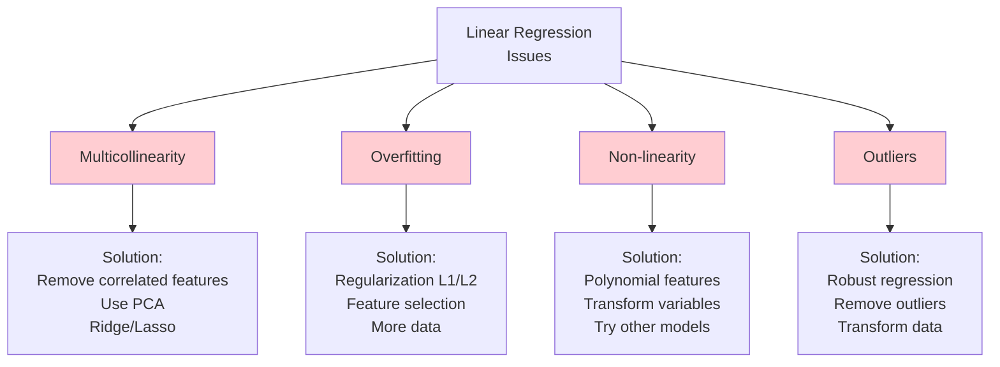

### Regularization - Preventing Overfitting

> [!blue] 💙 **Regularization Adds Penalty for Model Complexity**
> Constrains model weights to prevent overfitting, especially with many features or small datasets.

**Why Regularization?**
```
Problem: Overfitting with many features

Without regularization:
Train error: 0.01 (very low)
Test error: 0.50 (high)
→ Model memorized training data

With regularization:
Train error: 0.10 (slightly higher)
Test error: 0.12 (much better!)
→ Model generalizes well
```

**1. Ridge Regression (L2 Regularization)**

```
Loss function:
L_ridge = MSE + λ Σⱼ₌₁ⁿ wⱼ²
        = (1/m) Σᵢ(yᵢ - ŷᵢ)² + λ Σⱼ wⱼ²

Components:
- MSE: Data fitting term (accuracy)
- λ Σwⱼ²: Regularization term (simplicity)
- λ: Hyperparameter controlling trade-off

Effect on weights:
- Shrinks ALL weights toward zero
- Weights never become exactly zero
- Larger λ → more shrinkage
- λ = 0 → regular linear regression

Geometric interpretation:
Minimize MSE subject to: Σwⱼ² ≤ t

    w₂
    │
    │    ●  ← Optimal without constraint
    │   /|
    │  / │
    │ /  ●  ← Ridge solution
    │/  (on circle boundary)
  ──●────────── w₁
    │   
    └─ Circle: w₁² + w₂² = t

Closed-form solution:
w_ridge = (X^T X + λI)^(-1) X^T y

Where I = identity matrix
→ Always invertible (even if X^T X is singular!)

When to use Ridge:
✓ Many correlated features
✓ All features potentially useful
✓ Multicollinearity present
✓ Want smooth weight distribution

Choosing λ (cross-validation):
λ = 0.001: Minimal regularization
λ = 0.1: Moderate
λ = 1.0: Strong
λ = 10.0: Very strong (underfitting risk)
```

**2. Lasso Regression (L1 Regularization)**

```
Loss function:
L_lasso = MSE + λ Σⱼ₌₁ⁿ |wⱼ|
        = (1/m) Σᵢ(yᵢ - ŷᵢ)² + λ Σⱼ |wⱼ|

Key difference from Ridge: |wⱼ| instead of wⱼ²

Effect on weights:
- Shrinks weights AND sets some exactly to zero
- Performs automatic feature selection
- Sparse solution (many zeros)
- Larger λ → more zeros

Geometric interpretation:
Minimize MSE subject to: Σ|wⱼ| ≤ t

    w₂
    │
    │   ╱●╲ ← Optimal without constraint
    │  ╱ │ ╲
    │ ╱  ●  ╲ ← Lasso solution
    │╱  (diamond corner)
  ──●────────── w₁
    │   
    └─ Diamond: |w₁| + |w₂| = t

Why zeros at corners:
MSE contours likely hit diamond at corners
→ One coordinate becomes exactly zero

No closed-form solution:
Must use iterative optimization:
- Coordinate descent
- LARS (Least Angle Regression)
- Proximal gradient descent

When to use Lasso:
✓ Many features, few important
✓ Want interpretable model (few features)
✓ Feature selection needed
✓ Sparse representation desired

Feature selection example:
Original: 1000 features
After Lasso: 50 non-zero features
→ 95% reduction, easier interpretation
```

**3. Elastic Net (L1 + L2)**

```
Loss function:
L_elastic = MSE + λ₁ Σⱼ|wⱼ| + λ₂ Σⱼwⱼ²
          = MSE + α λ Σⱼ|wⱼ| + (1-α) λ/2 Σⱼwⱼ²

Parameters:
- λ: Overall regularization strength
- α ∈ [0,1]: Mix ratio
  α = 0: Pure Ridge
  α = 1: Pure Lasso
  α = 0.5: Equal mix

Advantages:
✓ Combines benefits of both
✓ Can select groups of correlated features
✓ More stable than Lasso
✓ Works well in practice

When to use Elastic Net:
✓ Many correlated features (Ridge helps)
✓ Also need feature selection (Lasso helps)
✓ Default choice when unsure
✓ p > n (more features than samples)

Typical values:
α = 0.5, λ = 0.1 (try this first)
Then tune with cross-validation
```

**Comparison Table:**

```
Property          | Ridge (L2) | Lasso (L1) | Elastic Net
──────────────────|────────────|────────────|─────────────
Penalty           | Σw²        | Σ|w|       | Σ|w| + Σw²
Feature selection | No         | Yes        | Yes
Weights          | Shrink all | Some zero  | Some zero
Correlated vars  | Keeps all  | Picks one  | Keeps group
Computation      | Closed-form| Iterative  | Iterative
Sparsity         | No         | Yes        | Yes
Stability        | High       | Medium     | High
Interpretability | Medium     | High       | High

Visualization of weight distributions:

No Regularization:
|w₁| |w₂| |w₃| |w₄| |w₅|
 ███  ██  ████  ██   █

Ridge (L2):
|w₁| |w₂| |w₃| |w₄| |w₅|
 ██   █   ███   █    ▓  (all shrunk)

Lasso (L1):
|w₁| |w₂| |w₃| |w₄| |w₅|
 ███  ░   ████  ░    ░  (some zero)

Elastic Net:
|w₁| |w₂| |w₃| |w₄| |w₅|
 ███  ░   ███   █    ░  (mixed)
```

**Choosing Regularization Strength (λ)**

```
Cross-Validation Curve:

Error
 │
 │ ╲                    ← Training error
 │  ╲╲                 (decreases with less reg)
 │   ╲╲___
 │        ╲___
 │            ╲___      ← Validation error
 │   ____        ╲     (U-shape)
 │ ╱     ╲____    ╲
 │╱           ╲____╲___
 └────────────────────── log(λ)
 High reg  ← Optimal → Low reg
(Underfit)            (Overfit)

Optimal λ: Minimum validation error

Algorithm:
1. Try range: λ ∈ [0.0001, 0.001, 0.01, 0.1, 1, 10]
2. For each λ:
   - Train on training set
   - Evaluate on validation set
3. Pick λ with lowest validation error
4. Retrain on training + validation
5. Test on hold-out test set
```

> [!red] ⚠️ **Common Mistakes**
> ```
> ❌ Not checking linearity assumption
> ❌ Ignoring outliers
> ❌ Using without scaling (when comparing coefficients)
> ❌ Interpreting correlation as causation
> ❌ Not checking residuals
> ```

---

## 2. LOGISTIC REGRESSION

> [!blue] 💙 **Logistic Regression - The Classification Workhorse**
> Despite its name, Logistic Regression is a CLASSIFICATION algorithm, not regression! It models the probability that an instance belongs to a particular class using the logistic (sigmoid) function.

**Why Not Linear Regression for Classification?**
```
Problem with Linear Regression for binary classification:

Predictions can be < 0 or > 1 (invalid probabilities!)

   y
1.5│     ●       ← Prediction > 1 (nonsense!)
   │    /●
1.0│   /  ●  ← Class 1
   │  /
0.5│ /
   │/   ○○ ← Class 0
0.0├──────────
   │ ○  ← Prediction < 0 (nonsense!)
-0.5│
   └───────────── x

Solution: Map linear combination to [0, 1] using sigmoid!
```

### The Sigmoid (Logistic) Function

**Mathematical Definition:**
```
σ(z) = 1 / (1 + e^(-z))

Properties:
1. Domain: z ∈ (-∞, +∞) (any real number)
2. Range: σ(z) ∈ (0, 1) (valid probability)
3. Monotonic: Always increasing
4. Smooth and differentiable everywhere
5. Symmetric: σ(-z) = 1 - σ(z)

Key values:
σ(0) = 0.5
σ(+∞) = 1
σ(-∞) = 0
σ(5) ≈ 0.993 (very confident Class 1)
σ(-5) ≈ 0.007 (very confident Class 0)

Visual shape:
Probability
    │
1.0 │           _______________
    │          /
0.9 │         /
    │        /
0.5 │      /     ← Decision boundary (z=0)
    │     /
0.1 │    /
    │   /
0.0 │__/
    └────────────────────── z
    -6  -3   0   3   6

Interpretation as probability:
- z large & positive → σ(z) ≈ 1 → Strong confidence Class 1
- z ≈ 0 → σ(z) ≈ 0.5 → Uncertain
- z large & negative → σ(z) ≈ 0 → Strong confidence Class 0
```

**Derivative (Needed for Gradient Descent):**
```
∂σ/∂z = σ(z)(1 - σ(z))

Beautiful property: Derivative in terms of function itself!

Proof:
σ(z) = 1/(1 + e^(-z))
∂σ/∂z = -1/(1 + e^(-z))² × (-e^(-z))
      = e^(-z)/(1 + e^(-z))²
      = 1/(1 + e^(-z)) × e^(-z)/(1 + e^(-z))
      = σ(z) × (1 - σ(z))

Maximum derivative at z=0:
∂σ/∂z|_{z=0} = 0.5 × 0.5 = 0.25

Gradient vanishes at extremes:
∂σ/∂z|_{z=±∞} ≈ 0 (saturation problem)
```

### Logistic Regression Model

**Full Model Definition:**
```
1. Linear combination (logit):
   z = w^T x + b = w₁x₁ + w₂x₂ + ... + wₙxₙ + b

2. Apply sigmoid:
   P(y=1|x) = σ(z) = 1/(1 + e^(-z))

3. Prediction rule:
   ŷ = { 1  if P(y=1|x) ≥ threshold
       { 0  otherwise
   
   Default threshold = 0.5

Example with 2 features:
Features: x₁=income ($50K), x₂=age (30)
Weights: w₁=0.001, w₂=0.02, b=-2

Step 1: z = 0.001(50000) + 0.02(30) - 2
          = 50 + 0.6 - 2  
          = 48.6

Step 2: P(y=1) = 1/(1 + e^(-48.6))
               ≈ 1 (essentially 100%)

Step 3: Since 1 > 0.5, predict Class 1
```

**Interpreting as Odds and Log-Odds:**
```
Odds = P(y=1) / P(y=0) = P(y=1) / (1-P(y=1))

Log-odds (logit):
log(P(y=1)/(1-P(y=1))) = z = w^T x + b

This is LINEAR in features!
→ Called "logit" or "log-odds"

Example:
P(y=1) = 0.8
Odds = 0.8/0.2 = 4:1 (4 times more likely Class 1)
Log-odds = log(4) ≈ 1.39

Interpretation of weights:
- wⱼ > 0: Feature j increases log-odds (increases P(y=1))
- wⱼ < 0: Feature j decreases log-odds (decreases P(y=1))
- |wⱼ| large: Feature j has strong effect

Odds ratio for unit increase in xⱼ:
OR = e^(wⱼ)

Example: w_income = 0.001
OR = e^(0.001) ≈ 1.001
Interpretation: $1K income increase → 0.1% increase in odds
```

### Loss Function - Binary Cross-Entropy

**Derivation from Maximum Likelihood:**
```
Assume: y ∈ {0, 1}

Likelihood for single example:
P(y|x) = { P(y=1|x)     if y=1
         { P(y=0|x)     if y=0
       = { σ(z)         if y=1
         { 1-σ(z)       if y=0

Compact form:
P(y|x) = σ(z)^y × (1-σ(z))^(1-y)

Log-likelihood for all m examples:
ℓ(w,b) = Σᵢ₌₁ᵐ [yᵢ log σ(zᵢ) + (1-yᵢ) log(1-σ(zᵢ))]

Maximum Likelihood Estimation (MLE):
Maximize log-likelihood = Minimize negative log-likelihood

Binary Cross-Entropy Loss:
L(w,b) = -1/m Σᵢ₌₁ᵐ [yᵢ log σ(zᵢ) + (1-yᵢ) log(1-σ(zᵢ))]

Why this loss?
1. Derived from probabilistic principles (MLE)
2. Convex optimization problem (unique global minimum)
3. Penalizes wrong predictions appropriately
4. Smooth gradients for optimization
```

**Loss Function Intuition:**
```
For single example:

If y = 1 (actual class is 1):
Loss = -log(σ(z))

σ(z)→1: Loss→0 (correct, confident)
σ(z)→0: Loss→∞ (wrong, confident - high penalty!)

If y = 0 (actual class is 0):
Loss = -log(1-σ(z))

σ(z)→0: Loss→0 (correct, confident)
σ(z)→1: Loss→∞ (wrong, confident - high penalty!)

Visual:
Loss
  │
10│     ╱
  │    ╱
  │   ╱
 5│  ╱
  │ ╱
  │╱____________
0 └──────────── σ(z)
  0   0.5  1.0

Penalizes confident wrong predictions heavily!
```

### Gradient Descent for Logistic Regression

**Gradients:**
```
∂L/∂w = 1/m Σᵢ₌₁ᵐ (σ(zᵢ) - yᵢ) xᵢ
∂L/∂b = 1/m Σᵢ₌₁ᵐ (σ(zᵢ) - yᵢ)

Remarkably similar to linear regression!
Difference: σ(zᵢ) instead of zᵢ

Derivation:
∂L/∂w = ∂L/∂σ × ∂σ/∂z × ∂z/∂w

∂L/∂σ = -y/σ + (1-y)/(1-σ)
∂σ/∂z = σ(1-σ)  (nice property!)
∂z/∂w = x

Combine:
∂L/∂w = [-y/σ + (1-y)/(1-σ)] × σ(1-σ) × x
      = [-y(1-σ) + (1-y)σ] × x
      = (σ - y) × x

Vectorized:
∂L/∂w = 1/m X^T (σ(Xw+b) - y)
```

**Algorithm:**
```
Initialize: w ← small random, b ← 0
Learning rate: α (e.g., 0.01)

Repeat until convergence:
  1. Forward pass:
     z = Xw + b
     predictions = σ(z)
  
  2. Compute loss:
     L = -1/m Σ[y log(σ) + (1-y) log(1-σ)]
  
  3. Backward pass (gradients):
     ∂L/∂w = 1/m X^T (predictions - y)
     ∂L/∂b = 1/m Σ(predictions - y)
  
  4. Update parameters:
     w ← w - α (∂L/∂w)
     b ← b - α (∂L/∂b)

Convergence check:
- Loss change < ε
- Gradient norm < ε
- Max iterations reached
```

### Decision Boundary Geometry

```
Decision boundary: Points where P(y=1) = 0.5
                   ⟺ σ(z) = 0.5
                   ⟺ z = 0
                   ⟺ w^T x + b = 0

2D example (2 features):
w₁x₁ + w₂x₂ + b = 0
→ x₂ = -(w₁/w₂)x₁ - b/w₂

This is a straight line!
- Slope: -w₁/w₂
- Intercept: -b/w₂

Visual (2D case):
    x₂
     │        Class 1 (●)
     │    ●●●
     │   ●●●●
     │  ●●●●●
     │ ────────── Decision boundary (w^Tx+b=0)
     │    ○○○
     │     ○○○
     │      ○○○  Class 0 (○)
     └──────────────── x₁

3D example (3 features):
w₁x₁ + w₂x₂ + w₃x₃ + b = 0
→ Decision boundary is a plane

n features:
→ Decision boundary is a hyperplane (n-1 dimensional)

Non-linear boundaries:
Add polynomial features: x₁², x₁x₂, x₂², etc.
Decision boundary becomes curved (still linear in transformed space)
```

### Binary vs Multi-Class

```mermaid
graph TD
    A[Logistic Regression] --> B[Binary Classification]
    A --> C[Multi-Class Classification]
    
    B --> D[Single sigmoid output<br/>P y=1 | x]
    
    C --> E[One-vs-Rest OvR]
    C --> F[Softmax Multinomial]
    
    E --> G[Train K binary classifiers<br/>Pick highest probability]
    F --> H[Single model with softmax<br/>K outputs, sum to 1]
    
    style B fill:#c8e6c9
    style C fill:#fff9c4
```

**One-vs-Rest (OvR):**
```
For K classes: Train K binary classifiers

Classifier 1: Class 1 vs (Class 2,3,...,K)
Classifier 2: Class 2 vs (Class 1,3,...,K)
...
Classifier K: Class K vs (Class 1,2,...,K-1)

Prediction:
1. Get probabilities from all K classifiers
2. Pick class with highest probability

Example (3 classes):
Classifier 1: P(1|x) = 0.7
Classifier 2: P(2|x) = 0.2
Classifier 3: P(3|x) = 0.4
→ Predict Class 1 (highest)

Limitations:
- Probabilities don't sum to 1
- Imbalanced training (1 vs many)
- Need to train K models
```

**Softmax (Multinomial Logistic Regression):**
```
Single model with K outputs

Softmax function:
P(y=k|x) = e^(z_k) / Σⱼ₌₁ᴷ e^(z_j)

Where z_k = w_k^T x + b_k for each class k

Properties:
✓ All probabilities positive
✓ Sum to 1: Σ P(y=k|x) = 1
✓ Valid probability distribution
✓ Generalization of sigmoid (K=2 reduces to sigmoid)

Example (3 classes):
z₁ = 2.0, z₂ = 1.0, z₃ = 0.1

e^(z₁) = e^2.0 ≈ 7.39
e^(z₂) = e^1.0 ≈ 2.72
e^(z₃) = e^0.1 ≈ 1.11

Sum = 7.39 + 2.72 + 1.11 = 11.22

P(y=1|x) = 7.39/11.22 = 0.659
P(y=2|x) = 2.72/11.22 = 0.242
P(y=3|x) = 1.11/11.22 = 0.099
                        ─────
                Sum = 1.000 ✓

Prediction: Class 1 (highest probability)

Loss function (Cross-Entropy):
L = -1/m Σᵢ₌₁ᵐ Σₖ₌₁ᴷ y_ik log(P(y=k|xᵢ))

Where y_ik = 1 if xᵢ belongs to class k, 0 otherwise
```

### Classification Evaluation Metrics

> [!blue] 💙 **Beyond Accuracy - Understanding Model Performance**
> Classification requires multiple metrics because accuracy alone can be misleading, especially with imbalanced datasets.

**Confusion Matrix - Foundation of All Metrics**

```
Binary Classification Confusion Matrix:

                    Predicted
                 Positive  Negative
              ┌───────────┬─────────┐
    Actual    │    TP     │   FN    │ Positive
   Positive   │ (Correct) │(Missed) │
              ├───────────┼─────────┤
    Actual    │    FP     │   TN    │ Negative
   Negative   │ (False    │(Correct)│
              │  Alarm)   │         │
              └───────────┴─────────┘

TP (True Positive): Correctly predicted positive
TN (True Negative): Correctly predicted negative
FP (False Positive): Incorrectly predicted positive (Type I Error)
FN (False Negative): Incorrectly predicted negative (Type II Error)

Medical Example (Disease Detection):
                Predicted
              Disease  Healthy
         ┌──────────┬─────────┐
Disease  │    45    │   5     │ Actual: 50 sick
         ├──────────┼─────────┤
Healthy  │    10    │   940   │ Actual: 950 healthy
         └──────────┴─────────┘
         Predicted: Predicted:
         55 sick    945 healthy

TP = 45 (correctly identified sick)
TN = 940 (correctly identified healthy)
FP = 10 (false alarm - healthy called sick)
FN = 5 (missed - sick called healthy)
```

**Derived Metrics:**

```
1. Accuracy
   = (TP + TN) / (TP + TN + FP + FN)
   = Correct predictions / Total predictions
   
   Example: (45 + 940) / 1000 = 0.985 = 98.5%
   
   Problem with imbalanced data:
   If 99% are negative, predicting "always negative" gives 99% accuracy!
   → Misleading for rare events

2. Precision (Positive Predictive Value)
   = TP / (TP + FP)
   = True Positives / Predicted Positives
   
   "Of all positive predictions, how many were correct?"
   
   Example: 45 / (45 + 10) = 0.818 = 81.8%
   
   High precision: Few false alarms
   Use when: Cost of FP is high (spam detection)

3. Recall (Sensitivity, True Positive Rate)
   = TP / (TP + FN)
   = True Positives / Actual Positives
   
   "Of all actual positives, how many did we catch?"
   
   Example: 45 / (45 + 5) = 0.900 = 90.0%
   
   High recall: Few missed cases
   Use when: Cost of FN is high (disease detection)

4. Specificity (True Negative Rate)
   = TN / (TN + FP)
   = True Negatives / Actual Negatives
   
   "Of all actual negatives, how many did we correctly identify?"
   
   Example: 940 / (940 + 10) = 0.989 = 98.9%
   
   High specificity: Few false alarms among negatives

5. F1-Score (Harmonic Mean of Precision and Recall)
   = 2 × (Precision × Recall) / (Precision + Recall)
   
   Example: 2 × (0.818 × 0.900) / (0.818 + 0.900) = 0.857
   
   Balances precision and recall
   Single metric for imbalanced data
   Ranges from 0 to 1 (higher is better)
   
   Harmonic mean penalizes extreme values:
   Precision=1.0, Recall=0.1 → F1=0.18 (not good!)
   Precision=0.9, Recall=0.9 → F1=0.90 (good!)

6. F-beta Score (Weighted F-Score)
   F_β = (1 + β²) × (Precision × Recall) / (β² × Precision + Recall)
   
   β < 1: Favor precision
   β = 1: F1-score (balanced)
   β > 1: Favor recall
   
   F2: Weights recall 2x more than precision
   F0.5: Weights precision 2x more than recall
```

**Precision-Recall Trade-off:**

```
Threshold impact on predictions:

Threshold = 0.3 (Low):
More positive predictions
→ High Recall (catch more positives)
→ Low Precision (more false alarms)

Threshold = 0.7 (High):
Fewer positive predictions
→ High Precision (fewer false alarms)
→ Low Recall (miss more positives)

Visual:
Precision
    │
1.0 │●
    │ ●
    │  ●●
0.5 │    ●●●
    │       ●●●
    │          ●●●
0.0 └──────────────●── Recall
    0.0          1.0

Can't maximize both simultaneously!
Choose based on problem:

Spam Detection: Favor Precision
- Missing spam OK
- False alarm (good email marked spam) BAD

Disease Detection: Favor Recall
- Missing disease BAD
- False alarm (extra test) OK
```

**ROC Curve (Receiver Operating Characteristic)**

```
Plot True Positive Rate vs False Positive Rate
at different threshold values

TPR (Recall) = TP / (TP + FN)
FPR = FP / (FP + TN) = 1 - Specificity

ROC Curve:
TPR
1.0 │    ╱────────  Perfect classifier
    │   ╱│
    │  ╱ │
0.5 │ ╱  │ ← Actual model
    │╱   │
    │    │
    │╱╱╱╱  ← Random classifier (diagonal)
0.0 └────────────── FPR
    0.0          1.0

Key points:
(0,0): Predict everything negative
(1,1): Predict everything positive
(0,1): Perfect classifier
Diagonal: Random guessing

AUC-ROC (Area Under Curve):
- AUC = 1.0: Perfect classifier
- AUC = 0.9-1.0: Excellent
- AUC = 0.8-0.9: Good
- AUC = 0.7-0.8: Fair
- AUC = 0.5: Random (no better than coin flip)
- AUC < 0.5: Worse than random (flip predictions!)

Advantages:
✓ Threshold-independent
✓ Works for imbalanced data
✓ Single number summary
✓ Compare different models

Limitations:
✗ Can be optimistic for severe imbalance
✗ Doesn't show precision-recall trade-off
✗ Treats FP and FN equally (may not match business cost)
```

**Precision-Recall Curve (Better for Imbalanced Data)**

```
Plot Precision vs Recall at different thresholds

PR Curve:
Precision
1.0 │●
    │ ●●
    │   ●●
0.5 │     ●●●
    │        ●●●
    │           ●●●
0.0 └──────────────●── Recall
    0.0          1.0

Average Precision (AP) = Area under PR curve
- Better metric for imbalanced datasets than ROC-AUC
- Focuses on positive class performance

When to use PR vs ROC:
- Balanced data: ROC-AUC
- Imbalanced data (rare positive class): PR-AUC
- Care about positive class: PR-AUC
- Care about both classes: ROC-AUC
```

**Log Loss (Logistic Loss)**

```
Measures confidence of predictions:

Log Loss = -1/m Σᵢ₌₁ᵐ [yᵢ log(pᵢ) + (1-yᵢ) log(1-pᵢ)]

Where pᵢ = predicted probability for sample i

Example predictions:
Sample 1: Actual=1, Predicted=0.9 → Loss = -log(0.9) = 0.105
Sample 2: Actual=1, Predicted=0.6 → Loss = -log(0.6) = 0.511
Sample 3: Actual=0, Predicted=0.1 → Loss = -log(0.9) = 0.105
Sample 4: Actual=1, Predicted=0.1 → Loss = -log(0.1) = 2.303

Average Log Loss = (0.105 + 0.511 + 0.105 + 2.303) / 4 = 0.756

Properties:
- Range: [0, ∞]
- Lower is better
- Penalizes confident wrong predictions heavily
- Rewards confident correct predictions
- Used as training loss

Comparison with accuracy:
Model A: 90% accuracy, Log Loss = 0.3 (confident)
Model B: 90% accuracy, Log Loss = 0.6 (uncertain)
→ Model A is better (more calibrated probabilities)
```

**Choosing the Right Metric:**

```
Decision Tree:

Start: What's your problem?
│
├─ Balanced classes?
│  ├─ Yes → Use Accuracy + ROC-AUC
│  └─ No → Imbalanced data ↓
│
├─ Imbalanced data:
│  ├─ Care about positive class → F1-Score + PR-AUC
│  ├─ Different costs for errors → Cost-sensitive metric
│  └─ Need probability calibration → Log Loss
│
├─ Business context:
│  ├─ False Positives expensive → Maximize Precision
│  ├─ False Negatives expensive → Maximize Recall
│  └─ Both important → F1-Score
│
└─ Multiple metrics → Report them all!

Example scenarios:

1. Spam Detection:
   Primary: Precision (avoid blocking good emails)
   Secondary: Recall, F1

2. Cancer Detection:
   Primary: Recall (catch all cases)
   Secondary: F1, Precision

3. Credit Default:
   Primary: F1 (balance both errors)
   Secondary: Precision, Recall, ROC-AUC

4. Fraud Detection:
   Primary: Recall (catch frauds)
   Secondary: Precision@K (top predictions), PR-AUC
```

### Regularization for Logistic Regression

**Preventing Overfitting in Classification**

```
L1 (Lasso) Logistic Regression:
L = -1/m Σᵢ[yᵢ log(σᵢ) + (1-yᵢ) log(1-σᵢ)] + λ Σⱼ|wⱼ|

Effect:
- Sparse solutions (some weights = 0)
- Feature selection
- Interpretable models

L2 (Ridge) Logistic Regression:
L = -1/m Σᵢ[yᵢ log(σᵢ) + (1-yᵢ) log(1-σᵢ)] + λ Σⱼwⱼ²

Effect:
- Shrinks all weights
- Handles collinearity
- Smoother decision boundary

C parameter in scikit-learn:
- C = inverse of λ (smaller C = more regularization)
- C → ∞: No regularization
- C → 0: Maximum regularization
- Default: C = 1.0
- Try: C ∈ [0.001, 0.01, 0.1, 1, 10, 100]
```

### Real-World Applications

> [!green] ✅ **Where Logistic Regression Shines**

**1. Medical Diagnosis**
```
Problem: Predict disease presence
Features: Age, symptoms, biomarkers, family history
Output: P(disease) ∈ [0, 1]

Example - Heart Disease:
P(disease) = σ(0.05×age + 0.3×cholesterol + 0.2×BP + ...)

Advantages:
✓ Interpretable (doctors understand odds ratios)
✓ Calibrated probabilities (useful for treatment decisions)
✓ Can explain why patient is high risk

Interpretation:
OR_age = e^0.05 = 1.051
→ Each year of age increases odds by 5.1%
```

**2. Credit Risk Scoring**
```
Problem: Will customer default on loan?
Features: Income, debt, credit history, employment
Output: P(default)

Risk bands:
P(default) < 0.1: Low risk (approve)
0.1 ≤ P(default) < 0.3: Medium risk (manual review)
P(default) ≥ 0.3: High risk (reject)

Interpretable for regulators:
- Must explain rejections
- Weights show factor importance
- Odds ratios quantify risk
```

**3. Marketing Response Prediction**
```
Problem: Will customer respond to campaign?
Features: Demographics, past purchases, engagement
Output: P(response)

Use cases:
- Email targeting (send to P(response) > 0.3)
- Discount allocation (high P but didn't convert)
- Churn prediction (P(churn) and intervene)

ROI optimization:
Expected value = P(response) × profit - cost
Send email only if EV > 0
```

**4. Click-Through Rate (CTR) Prediction**
```
Problem: Will user click on ad?
Features: User profile, ad content, context, time
Output: P(click)

Online advertising:
- Billions of predictions per day
- Logistic regression is fast
- Can be updated online (SGD)
- Interpretable for advertisers

Expected revenue = P(click) × P(convert|click) × value
Bid based on expected revenue
```

**5. Fraud Detection**
```
Problem: Is transaction fraudulent?
Features: Amount, location, time, merchant, patterns
Output: P(fraud)

Decision rules:
P(fraud) > 0.9: Block transaction
0.5 < P(fraud) ≤ 0.9: Request verification
P(fraud) ≤ 0.5: Allow

Imbalanced data (fraud is rare):
- Use class weights
- Oversample fraud cases
- Focus on recall and precision@K
```

### Common Pitfalls and Solutions

> [!red] ⚠️ **Mistakes to Avoid**

```
1. Not Scaling Features
   Problem: Different scales → slow convergence
   
   Age: 20-80
   Income: 20000-200000
   → Income dominates due to large values
   
   Solution: Standardize features
   x_scaled = (x - mean) / std
   
2. Multicollinearity
   Problem: Correlated features → unstable weights
   
   Example: height_cm and height_inches
   → One small data change → large weight changes
   
   Solution:
   - Remove correlated features
   - Use L2 regularization
   - PCA for dimension reduction

3. Class Imbalance
   Problem: 99% negative, 1% positive
   → Model predicts all negative (99% accuracy!)
   
   Solutions:
   - Use class_weight='balanced'
   - Oversample minority (SMOTE)
   - Undersample majority
   - Use F1, PR-AUC instead of accuracy
   - Adjust threshold based on costs

4. Outliers
   Problem: Extreme values influence decision boundary
   
   Solution:
   - Remove or cap outliers
   - Use robust scaling
   - Consider robust classifiers (SVM)

5. Non-linear Boundaries
   Problem: Classes not linearly separable
   
   Solutions:
   - Add polynomial features
   - Try kernel SVM
   - Use tree-based models
   - Neural networks

6. Assuming Threshold = 0.5
   Problem: Suboptimal for imbalanced or cost-sensitive problems
   
   Solution:
   - Tune threshold on validation set
   - Maximize F1 or business metric
   - Use different thresholds for different use cases
```

**Model Interpretation:**

```
Coefficient interpretation (after standardization):

w₁ = 0.5 (Positive, large)
→ Feature 1 strongly increases P(y=1)

w₂ = -0.3 (Negative, medium)  
→ Feature 2 moderately decreases P(y=1)

w₃ = 0.01 (Close to zero)
→ Feature 3 has little effect

Odds ratio interpretation:
OR = e^(wⱼ)

w_income = 0.693
OR = e^0.693 ≈ 2.0
→ One std increase in income doubles odds of positive class

Practical example:
If odds were 1:3 (25% probability)
After increase: odds become 2:3 (40% probability)
```
graph TD
    A[Logistic Regression] --> B[Binary<br/>2 Classes]
    A --> C[Multi-Class<br/>3+ Classes]
    
    B --> D[Spam vs Not Spam<br/>Fraud vs Legitimate<br/>Click vs No Click]
    
    C --> E[One-vs-Rest OvR]
    C --> F[Multinomial Softmax]
    
    E --> G[Train N binary classifiers<br/>Pick highest probability]
    F --> H[Single model for all classes<br/>Outputs probability distribution]
    
    style F fill:#c8e6c9
```

> [!yellow] 💡 **Interpreting Coefficients**
> ```
> Positive coefficient:
> → Feature increases probability of class 1
> 
> Negative coefficient:
> → Feature decreases probability of class 1
> 
> Magnitude:
> → Larger = stronger influence
> 
> Example: Email Spam
> Feature: "free" appears
> Coefficient: +2.5 (high positive)
> → Strong indicator of spam!
> ```

> [!yellow] ⭐ **Key Differences from Linear Regression**

| Aspect | Linear Regression | Logistic Regression |
|--------|------------------|---------------------|
| **Output** | Continuous number | Probability (0-1) |
| **Task** | Regression | Classification |
| **Activation** | None (linear) | Sigmoid |
| **Loss** | MSE | Log Loss (Cross-Entropy) |
| **Use Case** | Predict price, temperature | Predict category, class |

---

## 3. DECISION TREES

> [!blue] 💙 **Decision Trees - Interpretable Non-Linear Models**
> A tree-like model that makes decisions by recursively partitioning the feature space based on if-then-else rules. One of the most interpretable machine learning algorithms that can handle complex non-linear relationships.

**Core Idea:**
```
Instead of finding a global model (like linear regression),
divide the space into rectangular regions, each with its own prediction.

Feature Space Partitioning:
     x₂
      │
    5 │────────────┬────────── Region 1: Predict A
      │            │
      │   Region   │ Region
    3 │     2      │    3
      │  Pred B    │ Pred C
      │            │
    0 └────────────┴──────────── x₁
      0            4         8

Decision Rules:
- If x₁ ≤ 4: Predict B
- If x₁ > 4 and x₂ > 5: Predict A
- If x₁ > 4 and x₂ ≤ 5: Predict C
```

### Tree Structure and Terminology

```
Anatomy of a Decision Tree:

                    [Root Node]  ← Entire dataset
                    Age > 30?
                    /         \
                   /           \
        [Internal Node]    [Internal Node]
         Income > 50K?      Student?
          /         \        /       \
         /           \      /         \
    [Leaf]      [Leaf]  [Leaf]    [Leaf]  ← Terminal nodes
   Approve    Reject   Approve   Reject      (predictions)

Components:
1. Root Node: Starting point (all data)
2. Internal Nodes: Decision points (feature + threshold)
3. Branches: Outcomes of decisions (Yes/No, Left/Right)
4. Leaf Nodes: Final predictions (class or value)

Terminology:
- Depth: Length of longest path from root to leaf
- Height: Same as depth
- Parent Node: Node that splits
- Child Nodes: Nodes created by split
- Siblings: Nodes from same parent
- Subtree: Tree rooted at any node

Example tree properties:
Root: "Age > 30?"
Depth: 2 levels
Leaves: 4 predictions
Decision Rules: 4 paths from root to leaves
```

### Tree Building Algorithm (CART - Classification and Regression Trees)

**High-Level Algorithm:**
```
function BuildTree(data, depth):
    // Base cases (stopping criteria)
    if depth >= max_depth:
        return LeafNode(prediction)
    if num_samples < min_samples_split:
        return LeafNode(prediction)
    if all_same_class(data):
        return LeafNode(prediction)
    if no_information_gain_possible:
        return LeafNode(prediction)
    
    // Recursive case
    best_split = find_best_split(data)
    
    if best_split is None:
        return LeafNode(prediction)
    
    left_data = data where feature <= threshold
    right_data = data where feature > threshold
    
    node = InternalNode(feature, threshold)
    node.left = BuildTree(left_data, depth + 1)
    node.right = BuildTree(right_data, depth + 1)
    
    return node

Time Complexity:
- Finding best split: O(n × d × log n)
  n = samples, d = features
- Building tree: O(depth × n × d × log n)
- Typical: O(n × d × log n) for balanced tree

Space Complexity:
- Tree storage: O(num_leaves)
- Worst case: O(n) if each sample gets own leaf
- Typical: O(log n) leaves for balanced tree
```

**Finding Best Split - The Core Challenge:**

```
function find_best_split(data):
    best_gain = -∞
    best_split = None
    
    // Try every feature
    for feature in features:
        // Sort data by this feature (O(n log n))
        sorted_data = sort(data, by=feature)
        
        // Try every possible threshold
        for i in 1 to n-1:
            threshold = (sorted_data[i] + sorted_data[i+1]) / 2
            
            left_data = data where feature <= threshold
            right_data = data where feature > threshold
            
            // Calculate information gain
            gain = InformationGain(data, left_data, right_data)
            
            if gain > best_gain:
                best_gain = gain
                best_split = (feature, threshold)
    
    return best_split

Note: This is the greedy approach - finds local optimum
Finding global optimum is NP-complete!
```

### Impurity Measures - Quantifying Node Homogeneity

> [!blue] 💙 **Impurity = Measure of how mixed a node is**
> 0 = Pure (all samples same class/value)
> Maximum = Most mixed

**1. Gini Impurity (Classification) - CART Default**

```
Mathematical Definition:
Gini(node) = 1 - Σᵢ₌₁ᴷ pᵢ²

Where:
- K = number of classes
- pᵢ = proportion of class i in node
- pᵢ = (samples of class i) / (total samples in node)

Intuition: Probability of misclassifying a random sample
if we randomly assign a label based on class distribution

Properties:
- Range: [0, 0.5] for binary classification
- Range: [0, 1 - 1/K] for K classes
- 0 = Pure node (all same class)
- Maximum when all classes equally likely

Binary Classification Example:
Node with 100 samples: 70 Class A, 30 Class B

p_A = 70/100 = 0.7
p_B = 30/100 = 0.3

Gini = 1 - (0.7² + 0.3²)
     = 1 - (0.49 + 0.09)
     = 1 - 0.58
     = 0.42

Interpretation: 42% chance of misclassification

Special cases:
All Class A (100, 0): Gini = 1 - 1² - 0² = 0 (pure)
Half-half (50, 50): Gini = 1 - 0.5² - 0.5² = 0.5 (max)

Multi-class Example (3 classes):
Node with [40, 30, 30] samples

Gini = 1 - (0.4² + 0.3² + 0.3²)
     = 1 - (0.16 + 0.09 + 0.09)
     = 1 - 0.34
     = 0.66
```

**2. Entropy / Information Gain (Classification) - ID3, C4.5**

```
Entropy (Shannon Entropy):
H(node) = -Σᵢ₌₁ᴷ pᵢ log₂(pᵢ)

Convention: 0 log₂(0) = 0

Properties:
- Range: [0, log₂(K)]
- 0 = Pure (certain outcome)
- Maximum when all classes equally likely
- Measured in "bits" of information

Binary Classification Example:
Node with [70, 30] samples

H = -(0.7 log₂(0.7) + 0.3 log₂(0.3))
  = -(0.7 × -0.515 + 0.3 × -1.737)
  = -(-0.361 + -0.521)
  = 0.88 bits

Interpretation: Need 0.88 bits on average to specify class

Special cases:
All one class [100, 0]: H = 0 (no uncertainty)
Half-half [50, 50]: H = 1 (maximum for binary)

Information Gain:
IG = H(parent) - Weighted_Average(H(children))

Example split:
Parent: [70, 30] → H = 0.88

Split into:
Left child: [60, 10] → H_left = 0.59
Right child: [10, 20] → H_right = 0.92

Weighted average:
H_children = (70/100) × 0.59 + (30/100) × 0.92
           = 0.413 + 0.276
           = 0.689

Information Gain:
IG = 0.88 - 0.689 = 0.191 bits

We reduced uncertainty by 0.191 bits!
```

**3. Variance Reduction (Regression Trees)**

```
For regression, minimize prediction variance:

Variance(node) = (1/n) Σᵢ₌₁ⁿ (yᵢ - ȳ)²

Where:
- yᵢ = actual value of sample i
- ȳ = mean of all values in node
- Prediction for node = ȳ

Example node with values [10, 20, 15, 25]:
Mean ȳ = (10 + 20 + 15 + 25) / 4 = 17.5

Variance = [(10-17.5)² + (20-17.5)² + (15-17.5)² + (25-17.5)²] / 4
         = [56.25 + 6.25 + 6.25 + 56.25] / 4
         = 125 / 4
         = 31.25

Variance Reduction:
VR = Var(parent) - Weighted_Average(Var(children))

Choose split that maximizes variance reduction
= Choose split that minimizes weighted children variance
```

**Comparison of Splitting Criteria:**

```
Property        | Gini          | Entropy       | Variance
────────────────|───────────────|───────────────|──────────
Task            | Classification| Classification| Regression
Range (binary)  | [0, 0.5]      | [0, 1]        | [0, ∞]
Computation     | Fast (no log) | Slower (log)  | Fast
Interpretation  | Misclass prob | Information   | Spread
Pure node       | 0             | 0             | 0
Most impure     | 0.5           | 1.0           | Large

Which to use?
- Gini: Faster, produces similar trees to Entropy
- Entropy: More theoretically motivated (information theory)
- Variance: Regression tasks only

In practice: Gini and Entropy give very similar results
Gini is default in scikit-learn (faster)
```

### Information Gain Calculation - Complete Example

```
Dataset: Predict if someone buys a product

Age    Income  Owns_Car  Buys?
────────────────────────────────
25     Low     No        No
30     Low     No        No
35     High    No        Yes
40     High    Yes       Yes
45     High    Yes       Yes
50     Low     Yes       No

Parent node (all data): [3 Yes, 3 No]
Gini_parent = 1 - (0.5² + 0.5²) = 0.5

Try split: Age ≤ 35?

Left (Age ≤ 35): [1 Yes, 2 No]
Gini_left = 1 - (1/3)² - (2/3)² = 1 - 1/9 - 4/9 = 0.444

Right (Age > 35): [2 Yes, 1 No]  
Gini_right = 1 - (2/3)² - (1/3)² = 0.444

Weighted Gini after split:
Gini_split = (3/6) × 0.444 + (3/6) × 0.444 = 0.444

Information Gain (Gini Gain):
Gain = 0.5 - 0.444 = 0.056

Try split: Income = High?

Left (Income = High): [3 Yes, 0 No]
Gini_left = 1 - 1² - 0² = 0 (pure!)

Right (Income = Low): [0 Yes, 3 No]
Gini_right = 1 - 0² - 1² = 0 (pure!)

Weighted Gini:
Gini_split = (3/6) × 0 + (3/6) × 0 = 0

Information Gain:
Gain = 0.5 - 0 = 0.5 (maximum!)

Best split: Income = High (perfect separation!)

Decision Tree:
         Income = High?
         /            \
      Yes              No
   (All Buy)     (None Buy)

This is the greedy choice at this node.
```

### Splitting Example

```
Before Split:
[●●●●○○○○]  ← Mixed (Gini = 0.5)

Bad Split:
[●●●○○○] vs [●○○]  ← Still mixed

Good Split:
[●●●●] vs [○○○○]  ← Pure! (Gini = 0)

Best split = Maximum Information Gain
```

### Tree Growth

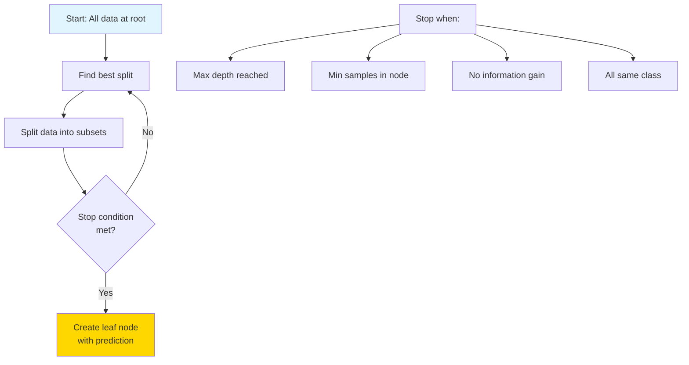

> [!red] ⚠️ **The Overfitting Problem**

```
No Constraints:            With Constraints:
(Overfits!)               (Better generalization)

    Root                      Root
   / | \ \                   /    \
  ● ● ● ●                   /      \
 /|\ /|\ ...              ●        ●
                         / \      / \
Memorizes training!    Pure    Pure

Depth = 20+            Depth = 5
100% train accuracy    90% train accuracy
60% test accuracy      85% test accuracy ✓
```

### Hyperparameters

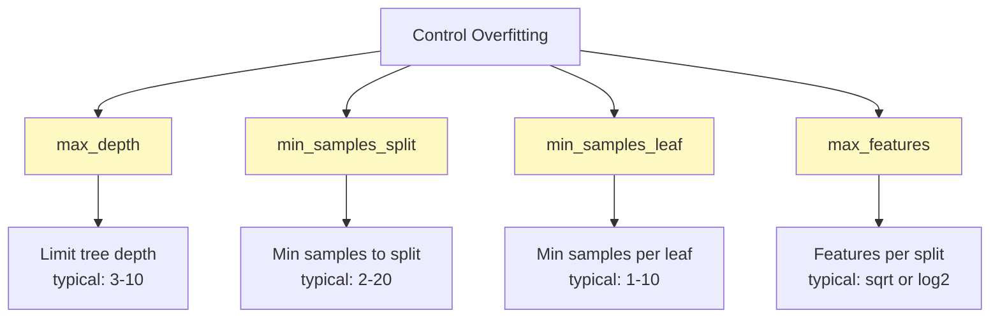

> [!green] ✅ **Advantages**
> ```
> ✅ Easy to understand and visualize
> ✅ No feature scaling needed
> ✅ Handles both numerical and categorical
> ✅ Automatic feature selection
> ✅ Non-linear relationships
> ✅ Feature interactions captured
> ```

> [!red] ⚠️ **Disadvantages**
> ```
> ❌ Prone to overfitting
> ❌ Unstable (small data change → big tree change)
> ❌ Biased with imbalanced data
> ❌ Greedy algorithm (not guaranteed optimal)
> ❌ Single tree often not accurate enough
> 
> Solution: Use ensemble methods! (Random Forest, Gradient Boosting)
> ```

---

## 4. RANDOM FOREST

> [!blue] 💙 **Core Concept**
> "Wisdom of the crowd" - Train many trees and let them vote!

### The Power of Ensemble

```
Single Tree:              Random Forest:
    🌳                   🌳 🌳 🌳 🌳 🌳
Accuracy: 75%            🌳 🌳 🌳 🌳 🌳
Unstable                 🌳 🌳 🌳 🌳 🌳
                         Accuracy: 90%+
                         Robust and stable!
```

### How It Works

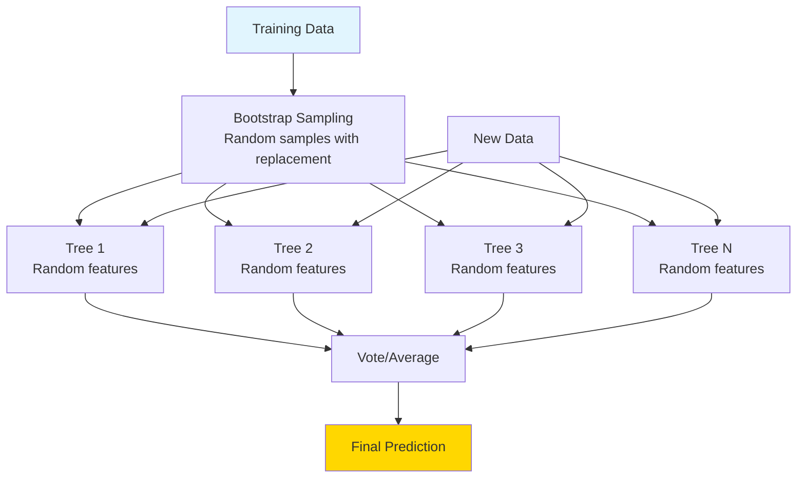

### Bootstrap Aggregating (Bagging)

```
Original Dataset (100 samples):
[1,2,3,4,5,...,100]

Bootstrap Sample 1:
[1,2,2,7,15,15,23,...,99]  ← Some repeated, some missing

Bootstrap Sample 2:
[3,5,8,8,12,14,14,...,98]  ← Different sample

Bootstrap Sample 3:
[2,4,6,6,9,11,13,...,100]  ← Different again

Each tree sees different data → diversity!
```

### Random Feature Selection

```
At each split, consider only √n features (for classification)

Total features: 16
Consider at each split: √16 = 4 random features

Tree 1 split 1: Consider features [2, 5, 9, 12]
Tree 1 split 2: Consider features [1, 7, 11, 15]
Tree 2 split 1: Consider features [3, 4, 8, 16]

Different features → different trees → diversity!
```

### Voting Mechanism

```
Classification (Majority Vote):

Tree 1: Class A
Tree 2: Class A
Tree 3: Class B
Tree 4: Class A
Tree 5: Class B

Final: Class A (3 votes vs 2)

Regression (Average):

Tree 1: $250K
Tree 2: $275K
Tree 3: $240K
Tree 4: $265K
Tree 5: $270K

Final: ($250K + $275K + $240K + $265K + $270K) / 5 = $260K
```

> [!yellow] ⭐ **Why Random Forest Works**

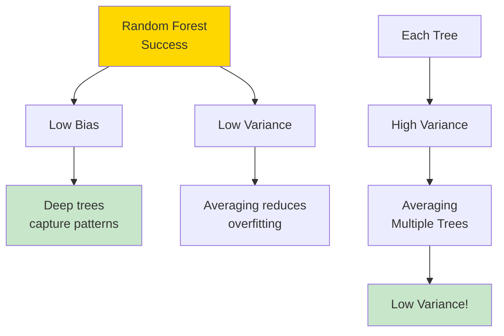

### Out-of-Bag (OOB) Error

```
Each tree trained on ~63% of data
Remaining ~37% not seen = "Out-of-bag" samples

Use OOB samples as validation set!
No need for separate validation → Free evaluation

OOB Score ≈ Cross-validation score
```

> [!green] ✅ **Advantages**
> ```
> ✅ High accuracy
> ✅ Robust to overfitting
> ✅ Handles missing values
> ✅ Feature importance
> ✅ Parallelizable (fast training)
> ✅ Works well out-of-box
> ✅ Less hyperparameter tuning needed
> ```

> [!yellow] 💡 **Key Hyperparameters**

| Parameter | What It Does | Typical Values |
|-----------|--------------|----------------|
| **n_estimators** | Number of trees | 100-500 |
| **max_depth** | Depth of each tree | 10-30 or None |
| **min_samples_split** | Min to split node | 2-10 |
| **min_samples_leaf** | Min in leaf | 1-5 |
| **max_features** | Features per split | 'sqrt' or 'log2' |

---

## 5. GRADIENT BOOSTING

> [!blue] 💙 **Core Concept**
> Train trees sequentially, each correcting errors of previous trees.

### Boosting vs Bagging

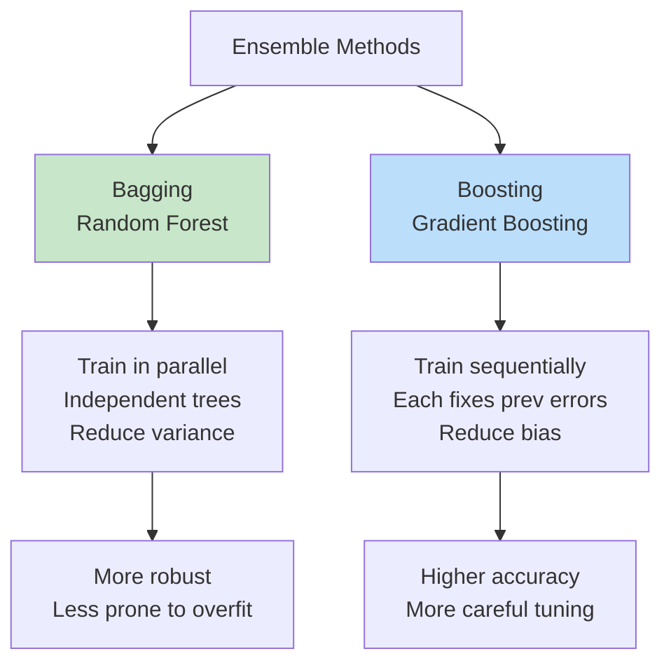

### Sequential Learning

```
Step 1: Train Tree 1
Predictions: [100, 95, 110]
Actual:      [105, 90, 115]
Errors:      [-5, +5, -5]

Step 2: Train Tree 2 to predict ERRORS
Learn to predict: [-5, +5, -5]

Step 3: Combine predictions
Final = Tree1 + α×Tree2
where α = learning rate (0.1)

Step 4: Calculate new errors, repeat...
```

### The Algorithm

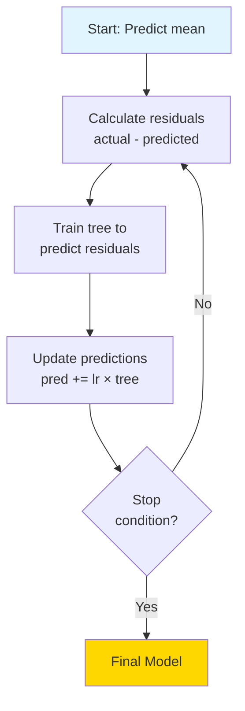

### Learning Rate

```
Learning Rate = How much to trust each tree

High LR (0.3):               Low LR (0.01):
   ●                            ●
  / \                          / \
Large   Quick                Small  Slow
steps   converge            steps  converge
Risk    but may             Safe   but takes
overfit overshoot           but    many trees
                            stable

Best: Low learning rate + Many trees
Typical: 0.01 - 0.1
```

> [!yellow] ⭐ **Modern Variants**

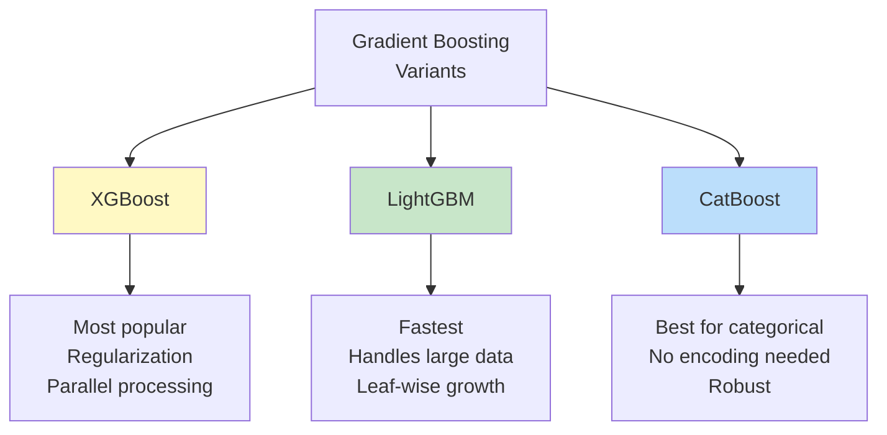

### XGBoost vs LightGBM vs CatBoost

| Feature | XGBoost | LightGBM | CatBoost |
|---------|---------|----------|----------|
| **Speed** | Fast | Fastest | Medium |
| **Memory** | Moderate | Low | Moderate |
| **Categorical** | Manual encoding | Manual encoding | Automatic! |
| **Overfitting** | Moderate risk | Higher risk | Lower risk |
| **Best For** | General purpose | Large datasets | Categorical features |
| **Default params** | Need tuning | Need tuning | Work well |

> [!red] ⚠️ **Common Issues**
> ```
> ❌ Overfitting (more than Random Forest)
> ❌ Slower training (sequential)
> ❌ More hyperparameters to tune
> ❌ Sensitive to outliers
> ❌ Need careful validation
> 
> Solutions:
> ✅ Lower learning rate
> ✅ Early stopping
> ✅ Max depth limit
> ✅ Subsample data
> ✅ Cross-validation
> ```

---

## 6. SUPPORT VECTOR MACHINES (SVM)

> [!blue] 💙 **Core Concept**
> Find the hyperplane that best separates classes with maximum margin.

### The Margin Concept

```
Bad Separator:           Good Separator (SVM):
     
 ●●●  |  ○○○           ●●● ||margin|| ○○○
 ●●● | ○○○             ●●● ||      || ○○○
 ●●● |  ○○○            ●●● ||      || ○○○

Too close!              Maximum margin!
Unstable                Robust to new points
```

### Linear SVM

```
Two Classes:
●●● | ○○○

Decision Boundary: w·x + b = 0
Margin: ±1

Support Vectors = Points on the margin
Only these matter! (other points ignored)

         Support
         Vectors
         ↓
     ●   |   ○
    ●●   |   ○○
     ●   |   ○
```

### The Kernel Trick

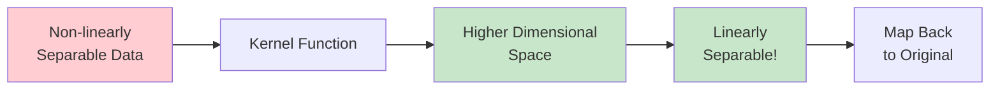

### Popular Kernels

```
1. LINEAR: K(x, y) = x·y
   Use: When data is linearly separable

2. RBF (Gaussian): K(x, y) = exp(-γ||x-y||²)
   Use: Most common, default choice
   
3. POLYNOMIAL: K(x, y) = (x·y + c)^d
   Use: When data has polynomial relationship

4. SIGMOID: K(x, y) = tanh(α·x·y + c)
   Use: Neural network-like behavior
```

### Hyperparameters

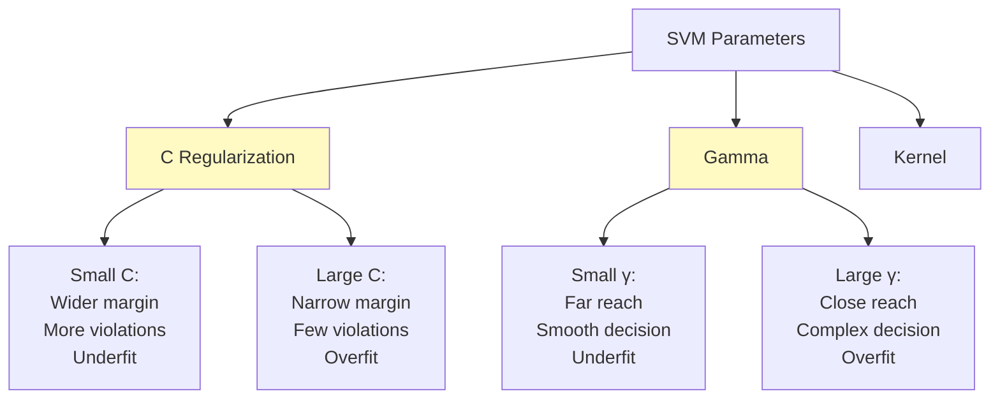

> [!red] ⚠️ **Important: Feature Scaling Required!**
> ```
> SVM is sensitive to feature scales
> 
> Without scaling:
> Feature 1: [0-100]    → Dominates!
> Feature 2: [0-1]      → Ignored!
> 
> With scaling:
> Feature 1: [0-1]      → Equal weight
> Feature 2: [0-1]      → Equal weight
> 
> Always use StandardScaler or MinMaxScaler!
> ```

> [!green] ✅ **When to Use SVM**
> ```
> ✅ High-dimensional data
> ✅ Clear margin of separation
> ✅ Small to medium datasets
> ✅ Binary classification
> ✅ Text classification
> 
> ❌ Very large datasets (slow)
> ❌ Noisy data with overlapping classes
> ❌ Need probability estimates (use Platt scaling)
> ❌ Interpretability needed (black box)
> ```

---

## 7. K-NEAREST NEIGHBORS (KNN)

> [!blue] 💙 **Core Concept**
> "You are the average of your K nearest friends!"

### How It Works

```
New point (?) appears:

    ○
  ○ ? ●
●   ● ○
  ●   ○

K=3 (3 nearest neighbors):
2 are ● (blue)
1 is ○ (red)

Prediction: ● (blue) wins!
```

### The Algorithm

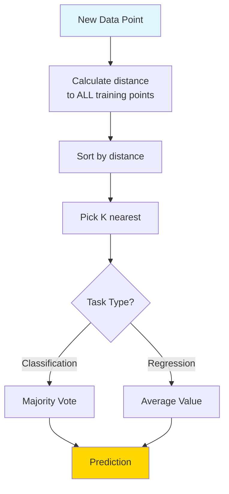

### Distance Metrics

```
1. EUCLIDEAN (Most Common):
   d = √[(x₁-x₂)² + (y₁-y₂)²]
   Straight-line distance

2. MANHATTAN:
   d = |x₁-x₂| + |y₁-y₂|
   Grid/city-block distance

3. MINKOWSKI (General):
   d = (Σ|xᵢ-yᵢ|^p)^(1/p)
   p=1 → Manhattan
   p=2 → Euclidean
   
4. COSINE:
   Use for text, high-dimensional
```

### Choosing K

```
K too small (K=1):       K too large (K=100):
  ●○●○●                     ●●●●●
  ○●○●○                     ●●●●●
  ●○●○●                     ○○○○○
Overfits (noisy)         Underfits (too smooth)

K just right (K=5):
  ●●●●●
  ●●●○○
  ○○○○○
Good balance!

Rule of thumb: K = √n
Typical: K = 3-10
Use cross-validation to find optimal K
```

### Weighted KNN

```
Standard KNN:            Weighted KNN:
All neighbors equal      Closer neighbors more weight

    1  1  1                 3  2  1
    ○  ○  ○                 ○  ○  ○
      ?                       ?
    
Equal vote               Distance-weighted vote
```

> [!yellow] 💡 **Pros and Cons**

| Advantages | Disadvantages |
|------------|---------------|
| ✅ Simple to understand | ❌ Slow prediction (must check all points) |
| ✅ No training phase | ❌ Memory intensive (stores all data) |
| ✅ No assumptions | ❌ Curse of dimensionality |
| ✅ Works with any distance | ❌ Sensitive to irrelevant features |
| ✅ Naturally multi-class | ❌ Sensitive to scale (must normalize!) |

> [!red] ⚠️ **Critical: Always Scale Features!**
> ```
> Without scaling:
> Age: [20-80]      → Range: 60
> Salary: [20K-200K] → Range: 180K
> 
> Distance dominated by salary!
> Age barely matters!
> 
> Solution: StandardScaler or MinMaxScaler
> ```

---

## 8. NAIVE BAYES

> [!blue] 💙 **Core Concept**
> Uses Bayes' Theorem with "naive" independence assumption.

### Bayes' Theorem

```
P(Class|Features) = P(Features|Class) × P(Class) / P(Features)

   Posterior    =    Likelihood    × Prior / Evidence

Example: Spam Detection
P(Spam|"free money") = P("free money"|Spam) × P(Spam) / P("free money")
```

### The "Naive" Assumption

```
Naive Assumption: All features are independent

Example: Email classification
Features: ["free", "money", "click"]

Naive Bayes assumes:
P("free" AND "money" AND "click"|Spam) = 
  P("free"|Spam) × P("money"|Spam) × P("click"|Spam)

Reality: These words are likely related!
But the assumption works surprisingly well!
```

### Types of Naive Bayes

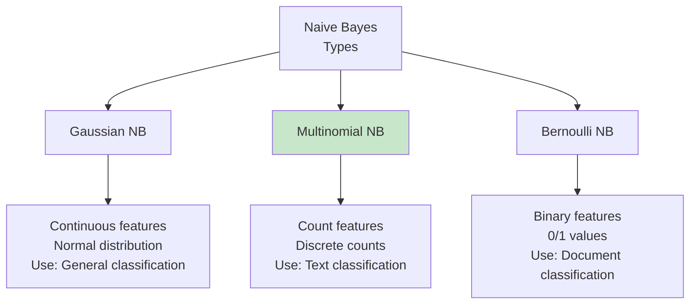

### Example: Email Spam

```
Training:
100 emails: 40 spam, 60 legitimate

Word "free":
- Appears in 30 spam emails
- Appears in 5 legitimate emails

New email contains "free"

P(Spam|"free") = P("free"|Spam) × P(Spam) / P("free")

P("free"|Spam) = 30/40 = 0.75
P(Spam) = 40/100 = 0.4
P("free") = 35/100 = 0.35

P(Spam|"free") = (0.75 × 0.4) / 0.35 = 0.857

87% probability it's spam!
```

> [!green] ✅ **Why Naive Bayes is Great**
> ```
> ✅ Fast training and prediction
> ✅ Works with small datasets
> ✅ Handles high dimensions well
> ✅ Good for text classification
> ✅ Probabilistic predictions
> ✅ Online learning possible
> ✅ Baseline model
> 
> Perfect for:
> - Spam filtering
> - Sentiment analysis
> - Document categorization
> - Real-time predictions
> ```

> [!yellow] 💡 **When to Use Each Algorithm**

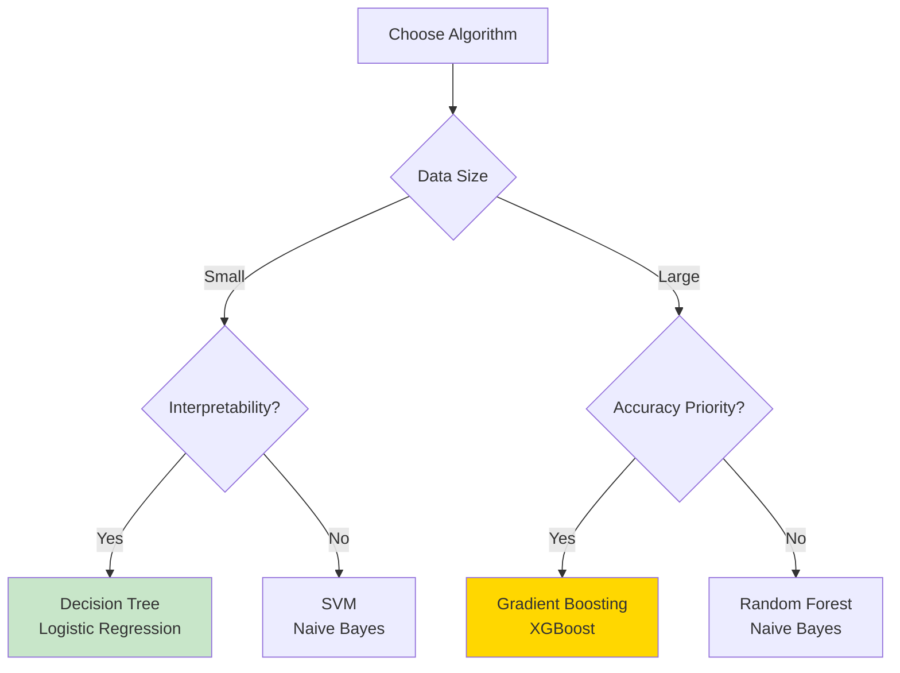

---

## 💎 INTERVIEW QUESTIONS

> [!yellow] 💎 **Q: Bias-Variance Tradeoff - explain with examples**
> 
> **Perfect Answer:**
> "The bias-variance tradeoff is fundamental to understanding model performance.
> 
> **Bias:** Error from wrong assumptions
> - High bias = Model too simple (underfitting)
> - Example: Linear model for non-linear data
> - Consistently off target
> 
> **Variance:** Error from sensitivity to training data
> - High variance = Model too complex (overfitting)
> - Example: Deep tree memorizing training data
> - All over the place
> 
> **Total Error = Bias² + Variance + Irreducible Error**
> 
> **Tradeoff:**
> Simple model → High bias, Low variance
> Complex model → Low bias, High variance
> 
> **Goal:** Find sweet spot in middle!
> 
> **In Practice:**
> - Start simple (linear/shallow tree)
> - Increase complexity if underfitting
> - Add regularization if overfitting
> - Use cross-validation to find balance"

> [!yellow] 💎 **Q: Random Forest vs Gradient Boosting - when to use?**
> 
> **Perfect Answer:**
> 
> **Random Forest:**
> - Parallel training (faster)
> - More robust to overfitting
> - Less tuning needed
> - Good default choice
> - Better with outliers/noise
> 
> **Gradient Boosting:**
> - Sequential training (slower)
> - Often higher accuracy
> - More tuning required
> - Better for competitions
> - Needs cleaner data
> 
> **My Approach:**
> 1. Start with Random Forest (quick baseline)
> 2. If need more accuracy → XGBoost/LightGBM
> 3. Tune hyperparameters carefully
> 4. Use early stopping
> 5. Cross-validate thoroughly
> 
> **Real Example:**
> Customer churn (imbalanced, noisy):
> → Random Forest (more robust)
> 
> Kaggle competition (clean data, need max accuracy):
> → Gradient Boosting (XGBoost)"

> [!yellow] 💎 **Q: Why scale features for some algorithms but not others?**
> 
> **Perfect Answer:**
> "Feature scaling is crucial for distance-based and gradient-based algorithms.
> 
> **Need Scaling:**
> - KNN (distance-based)
> - SVM (distance to hyperplane)
> - Neural Networks (gradient descent)
> - Linear/Logistic Regression (coefficient comparison)
> - K-Means (distance-based)
> - PCA (variance-based)
> 
> **Why?** These algorithms treat large-scale features as more important!
> 
> **Don't Need Scaling:**
> - Decision Trees (split-based, not distance)
> - Random Forest
> - XGBoost/LightGBM
> - Naive Bayes
> 
> **Why?** These use splits/probabilities, not distances.
> 
> **Example:**
> Age: [20-80] vs Income: [20K-200K]
> Without scaling → Income dominates distance!
> With scaling → Both features equal weight
> 
> **Best Practice:** Always scale unless using tree-based models!"

---

**Tags:** #supervised-learning #ml-algorithms #classification #regression #ensemble  
**Difficulty:** ⭐⭐⭐ Medium  
**Time to Master:** 3-4 weeks  
**Last Updated:** 2026-11-11
