# 🎯 SUPERVISED LEARNING

> [!yellow] ⭐ **THE FOUNDATION OF MACHINE LEARNING!**
> "In God we trust. All others must bring data." - W. Edwards Deming
> 
> Learn from labeled data to make predictions!
> 
> **Time to Complete:** 3-4 weeks  
> **Difficulty:** ⭐⭐⭐ Medium  
> **Interview Weight:** ⭐⭐⭐⭐⭐ EXTREMELY HIGH!

---

## 🗺️ SUPERVISED LEARNING ROADMAP

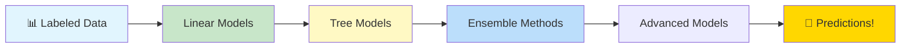

---

## 📚 TABLE OF CONTENTS

| # | Algorithm | Type | Best For | Link |
|---|-----------|------|----------|------|
| 1 | **Linear Regression** | Regression | Continuous predictions | [[#1-linear-regression\|Jump]] |
| 2 | **Logistic Regression** | Classification | Binary/Multi-class | [[#2-logistic-regression\|Jump]] |
| 3 | **Decision Trees** | Both | Interpretability | [[#3-decision-trees\|Jump]] |
| 4 | **Random Forest** | Both | Robust predictions | [[#4-random-forest\|Jump]] |
| 5 | **Gradient Boosting** | Both | High accuracy | [[#5-gradient-boosting\|Jump]] |
| 6 | **Support Vector Machines** | Both | Complex boundaries | [[#6-support-vector-machines\|Jump]] |
| 7 | **K-Nearest Neighbors** | Both | Simple baseline | [[#7-k-nearest-neighbors\|Jump]] |
| 8 | **Naive Bayes** | Classification | Text classification | [[#8-naive-bayes\|Jump]] |

---

## 1. LINEAR REGRESSION

> [!blue] 💙 **Core Concept**
> Finds the best-fitting straight line through data points to predict continuous values.

### The Equation

```
y = mx + b

y = predicted value
m = slope (coefficient)
x = input feature
b = intercept (bias)

Multi-variable:
y = b₀ + b₁x₁ + b₂x₂ + ... + bₙxₙ
```

### Visual Understanding

```
Price ($)
    │
500K│        ●
    │      ● ●
400K│    ●   ●
    │  ●     ●
300K│●       ●    Best Fit Line
    │      ●     ╱
200K│    ●     ╱
    │  ●     ╱
100K│●     ╱
    └────────────────── Size (sqft)
    1000  2000  3000

Prediction: Price = 150 × Size + 50,000
```

### How It Works

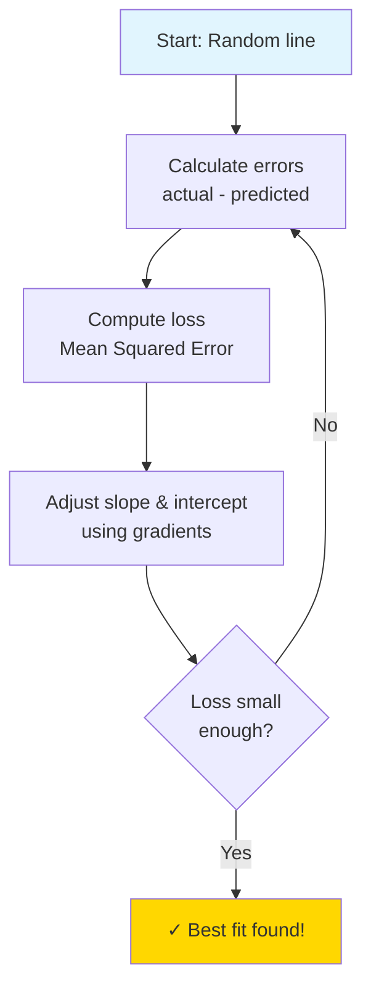

### Loss Function

```
Mean Squared Error (MSE):

MSE = (1/n) Σ(actual - predicted)²

Why square?
✅ Makes all errors positive
✅ Penalizes large errors more
✅ Smooth for optimization

Example:
Errors: [-2, 3, -1]
MSE = (4 + 9 + 1) / 3 = 4.67
```

> [!yellow] 💡 **When to Use**

| Use Linear Regression | Don't Use Linear Regression |
|----------------------|---------------------------|
| ✅ Linear relationships | ❌ Non-linear patterns |
| ✅ Continuous output | ❌ Classification (use logistic) |
| ✅ Fast baseline model | ❌ Many outliers present |
| ✅ Interpretability needed | ❌ Complex interactions |
| ✅ Small datasets OK | ❌ High-dimensional without regularization |

### Common Problems & Solutions

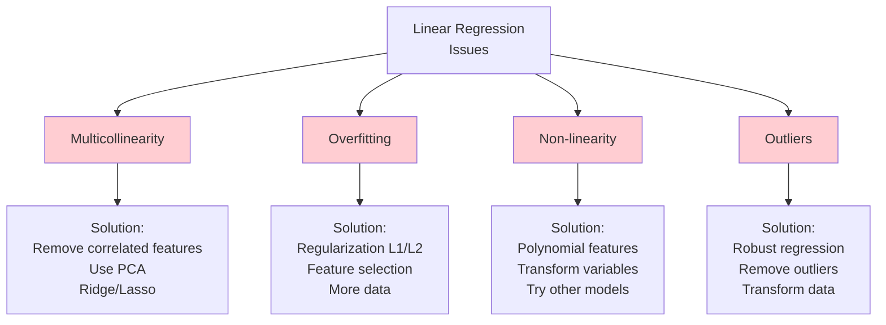

### Regularization

```
Ridge (L2):          Lasso (L1):
Penalty = λΣw²      Penalty = λΣ|w|

Ridge:               Lasso:
- Shrinks weights    - Can zero out weights
- Keeps all features - Feature selection
- Better with many   - Better with few
  correlated features  important features

Elastic Net = Ridge + Lasso (best of both!)
```

> [!red] ⚠️ **Common Mistakes**
> ```
> ❌ Not checking linearity assumption
> ❌ Ignoring outliers
> ❌ Using without scaling (when comparing coefficients)
> ❌ Interpreting correlation as causation
> ❌ Not checking residuals
> ```

---

## 2. LOGISTIC REGRESSION

> [!blue] 💙 **Core Concept**
> Despite the name, it's for CLASSIFICATION! Predicts probability that an example belongs to a class.

### The Sigmoid Function

```
Sigmoid: σ(z) = 1 / (1 + e^(-z))

Maps any value to probability (0 to 1)

    1.0 │        ___________
        │       /
    0.5 │      /
        │     /
    0.0 │___/
        └─────────────── z
       -∞  -3  0  3  +∞

Decision boundary: If σ(z) ≥ 0.5 → Class 1
                   If σ(z) < 0.5  → Class 0
```

### How It Works

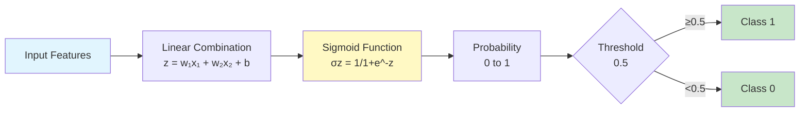

### Decision Boundary

```
Linear Decision Boundary:

Class 1 (●)          Class 0 (○)
     ●●●          ○○○
     ●●●    |     ○○○
     ●●●    |     ○○○
            |
    Decision boundary

Non-linear (with polynomial features):
     ●●●
    ●●●●●    )
     ●●●   /  ○○○
          (   ○○○
           )  ○○○
```

### Binary vs Multi-Class

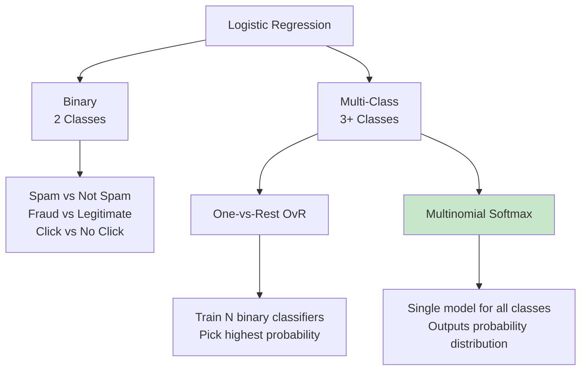

> [!yellow] 💡 **Interpreting Coefficients**
> ```
> Positive coefficient:
> → Feature increases probability of class 1
> 
> Negative coefficient:
> → Feature decreases probability of class 1
> 
> Magnitude:
> → Larger = stronger influence
> 
> Example: Email Spam
> Feature: "free" appears
> Coefficient: +2.5 (high positive)
> → Strong indicator of spam!
> ```

> [!yellow] ⭐ **Key Differences from Linear Regression**

| Aspect | Linear Regression | Logistic Regression |
|--------|------------------|---------------------|
| **Output** | Continuous number | Probability (0-1) |
| **Task** | Regression | Classification |
| **Activation** | None (linear) | Sigmoid |
| **Loss** | MSE | Log Loss (Cross-Entropy) |
| **Use Case** | Predict price, temperature | Predict category, class |

---

## 3. DECISION TREES

> [!blue] 💙 **Core Concept**
> Makes decisions by asking a series of questions, splitting data at each node.

### Tree Structure

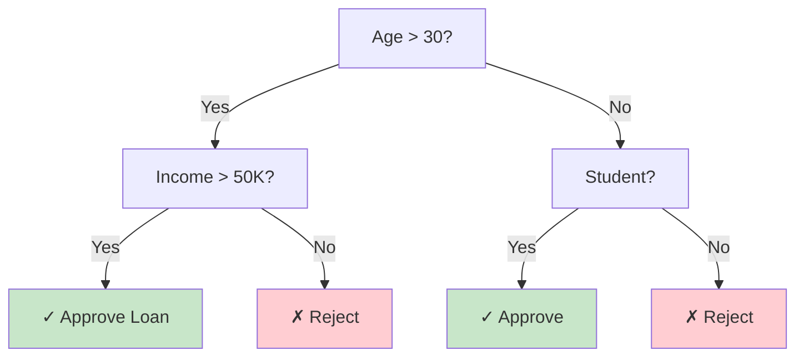

### How Splitting Works

```
Choose best split using:

1. GINI IMPURITY (Classification)
   Gini = 1 - Σ(pᵢ)²
   0 = Pure (all same class)
   0.5 = Impure (mixed)

2. ENTROPY (Classification)
   Entropy = -Σ(pᵢ × log₂(pᵢ))
   0 = Pure
   1 = Maximum impurity

3. VARIANCE (Regression)
   Choose split that minimizes variance

Goal: Create purest possible subsets
```

### Splitting Example

```
Before Split:
[●●●●○○○○]  ← Mixed (Gini = 0.5)

Bad Split:
[●●●○○○] vs [●○○]  ← Still mixed

Good Split:
[●●●●] vs [○○○○]  ← Pure! (Gini = 0)

Best split = Maximum Information Gain
```

### Tree Growth

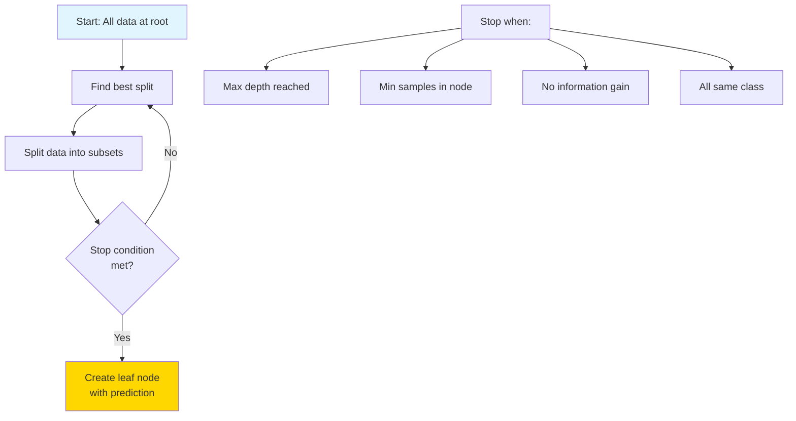

> [!red] ⚠️ **The Overfitting Problem**

```
No Constraints:            With Constraints:
(Overfits!)               (Better generalization)

    Root                      Root
   / | \ \                   /    \
  ● ● ● ●                   /      \
 /|\ /|\ ...              ●        ●
                         / \      / \
Memorizes training!    Pure    Pure

Depth = 20+            Depth = 5
100% train accuracy    90% train accuracy
60% test accuracy      85% test accuracy ✓
```

### Hyperparameters

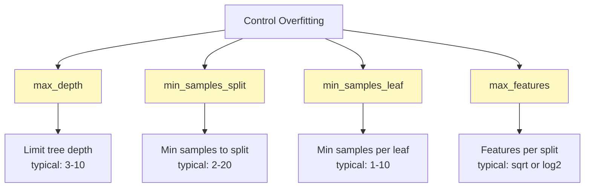

> [!green] ✅ **Advantages**
> ```
> ✅ Easy to understand and visualize
> ✅ No feature scaling needed
> ✅ Handles both numerical and categorical
> ✅ Automatic feature selection
> ✅ Non-linear relationships
> ✅ Feature interactions captured
> ```

> [!red] ⚠️ **Disadvantages**
> ```
> ❌ Prone to overfitting
> ❌ Unstable (small data change → big tree change)
> ❌ Biased with imbalanced data
> ❌ Greedy algorithm (not guaranteed optimal)
> ❌ Single tree often not accurate enough
> 
> Solution: Use ensemble methods! (Random Forest, Gradient Boosting)
> ```

---

## 4. RANDOM FOREST

> [!blue] 💙 **Core Concept**
> "Wisdom of the crowd" - Train many trees and let them vote!

### The Power of Ensemble

```
Single Tree:              Random Forest:
    🌳                   🌳 🌳 🌳 🌳 🌳
Accuracy: 75%            🌳 🌳 🌳 🌳 🌳
Unstable                 🌳 🌳 🌳 🌳 🌳
                         Accuracy: 90%+
                         Robust and stable!
```

### How It Works

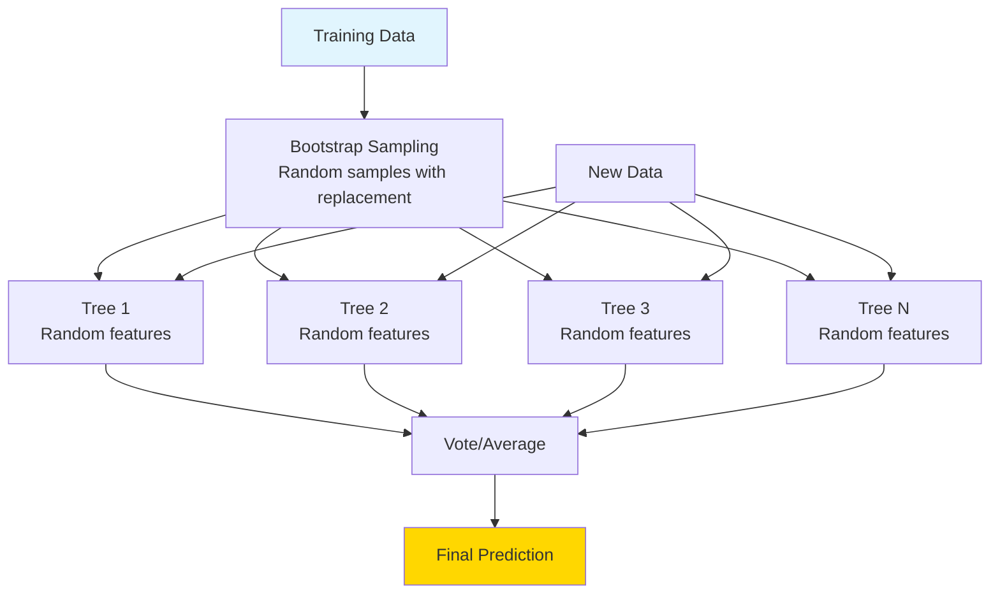

### Bootstrap Aggregating (Bagging)

```
Original Dataset (100 samples):
[1,2,3,4,5,...,100]

Bootstrap Sample 1:
[1,2,2,7,15,15,23,...,99]  ← Some repeated, some missing

Bootstrap Sample 2:
[3,5,8,8,12,14,14,...,98]  ← Different sample

Bootstrap Sample 3:
[2,4,6,6,9,11,13,...,100]  ← Different again

Each tree sees different data → diversity!
```

### Random Feature Selection

```
At each split, consider only √n features (for classification)

Total features: 16
Consider at each split: √16 = 4 random features

Tree 1 split 1: Consider features [2, 5, 9, 12]
Tree 1 split 2: Consider features [1, 7, 11, 15]
Tree 2 split 1: Consider features [3, 4, 8, 16]

Different features → different trees → diversity!
```

### Voting Mechanism

```
Classification (Majority Vote):

Tree 1: Class A
Tree 2: Class A
Tree 3: Class B
Tree 4: Class A
Tree 5: Class B

Final: Class A (3 votes vs 2)

Regression (Average):

Tree 1: $250K
Tree 2: $275K
Tree 3: $240K
Tree 4: $265K
Tree 5: $270K

Final: ($250K + $275K + $240K + $265K + $270K) / 5 = $260K
```

> [!yellow] ⭐ **Why Random Forest Works**

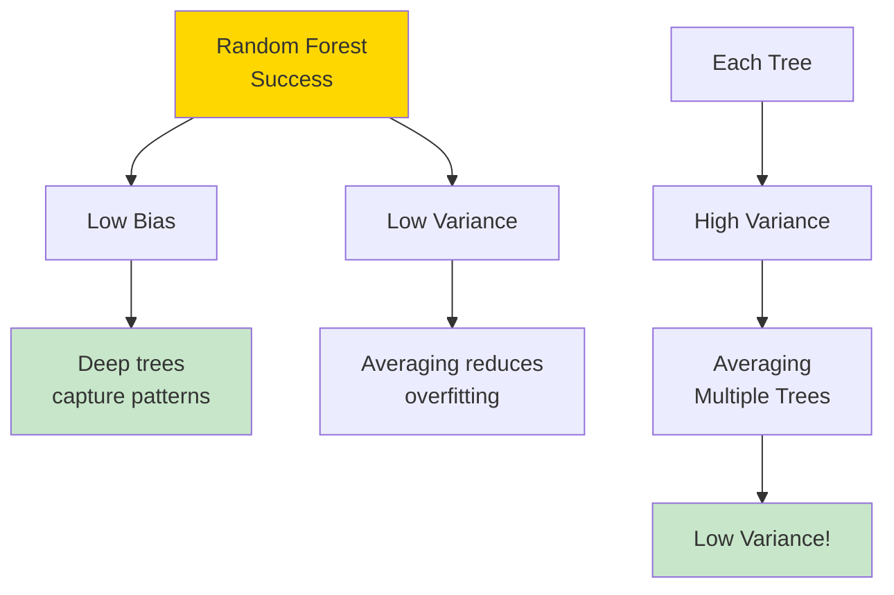

### Out-of-Bag (OOB) Error

```
Each tree trained on ~63% of data
Remaining ~37% not seen = "Out-of-bag" samples

Use OOB samples as validation set!
No need for separate validation → Free evaluation

OOB Score ≈ Cross-validation score
```

> [!green] ✅ **Advantages**
> ```
> ✅ High accuracy
> ✅ Robust to overfitting
> ✅ Handles missing values
> ✅ Feature importance
> ✅ Parallelizable (fast training)
> ✅ Works well out-of-box
> ✅ Less hyperparameter tuning needed
> ```

> [!yellow] 💡 **Key Hyperparameters**

| Parameter | What It Does | Typical Values |
|-----------|--------------|----------------|
| **n_estimators** | Number of trees | 100-500 |
| **max_depth** | Depth of each tree | 10-30 or None |
| **min_samples_split** | Min to split node | 2-10 |
| **min_samples_leaf** | Min in leaf | 1-5 |
| **max_features** | Features per split | 'sqrt' or 'log2' |

---

## 5. GRADIENT BOOSTING

> [!blue] 💙 **Core Concept**
> Train trees sequentially, each correcting errors of previous trees.

### Boosting vs Bagging

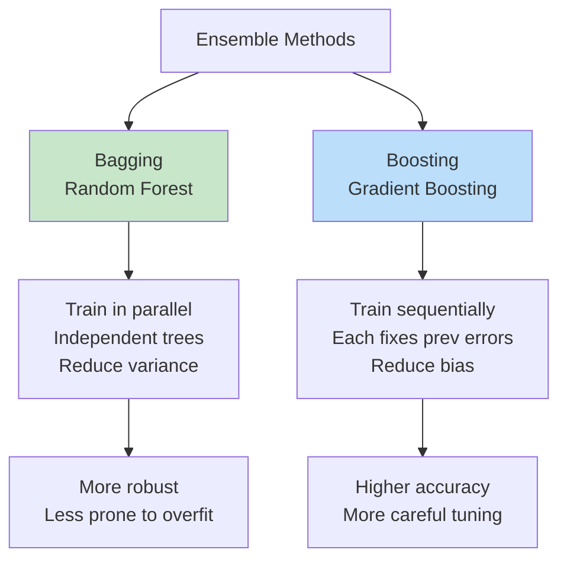

### Sequential Learning

```
Step 1: Train Tree 1
Predictions: [100, 95, 110]
Actual:      [105, 90, 115]
Errors:      [-5, +5, -5]

Step 2: Train Tree 2 to predict ERRORS
Learn to predict: [-5, +5, -5]

Step 3: Combine predictions
Final = Tree1 + α×Tree2
where α = learning rate (0.1)

Step 4: Calculate new errors, repeat...
```

### The Algorithm

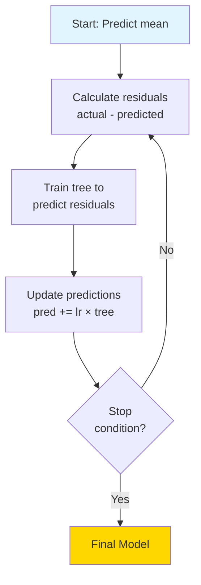

### Learning Rate

```
Learning Rate = How much to trust each tree

High LR (0.3):               Low LR (0.01):
   ●                            ●
  / \                          / \
Large   Quick                Small  Slow
steps   converge            steps  converge
Risk    but may             Safe   but takes
overfit overshoot           but    many trees
                            stable

Best: Low learning rate + Many trees
Typical: 0.01 - 0.1
```

> [!yellow] ⭐ **Modern Variants**

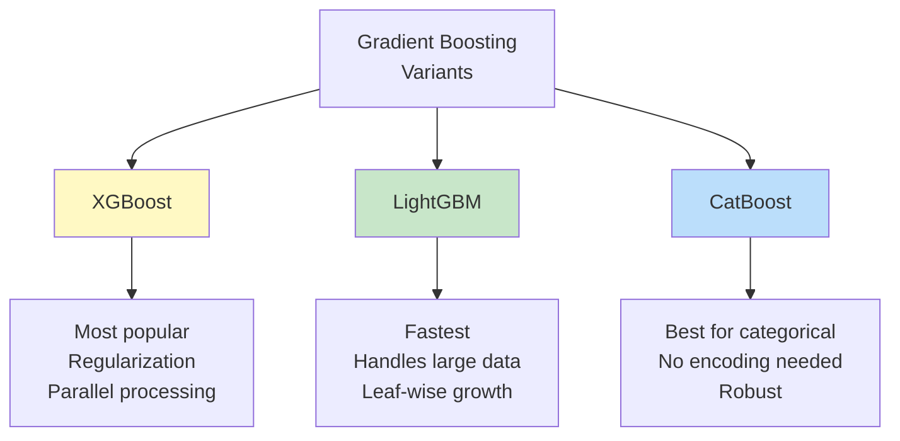

### XGBoost vs LightGBM vs CatBoost

| Feature | XGBoost | LightGBM | CatBoost |
|---------|---------|----------|----------|
| **Speed** | Fast | Fastest | Medium |
| **Memory** | Moderate | Low | Moderate |
| **Categorical** | Manual encoding | Manual encoding | Automatic! |
| **Overfitting** | Moderate risk | Higher risk | Lower risk |
| **Best For** | General purpose | Large datasets | Categorical features |
| **Default params** | Need tuning | Need tuning | Work well |

> [!red] ⚠️ **Common Issues**
> ```
> ❌ Overfitting (more than Random Forest)
> ❌ Slower training (sequential)
> ❌ More hyperparameters to tune
> ❌ Sensitive to outliers
> ❌ Need careful validation
> 
> Solutions:
> ✅ Lower learning rate
> ✅ Early stopping
> ✅ Max depth limit
> ✅ Subsample data
> ✅ Cross-validation
> ```

---

## 6. SUPPORT VECTOR MACHINES (SVM)

> [!blue] 💙 **Core Concept**
> Find the hyperplane that best separates classes with maximum margin.

### The Margin Concept

```
Bad Separator:           Good Separator (SVM):
     
 ●●●  |  ○○○           ●●● ||margin|| ○○○
 ●●● | ○○○             ●●● ||      || ○○○
 ●●● |  ○○○            ●●● ||      || ○○○

Too close!              Maximum margin!
Unstable                Robust to new points
```

### Linear SVM

```
Two Classes:
●●● | ○○○

Decision Boundary: w·x + b = 0
Margin: ±1

Support Vectors = Points on the margin
Only these matter! (other points ignored)

         Support
         Vectors
         ↓
     ●   |   ○
    ●●   |   ○○
     ●   |   ○
```

### The Kernel Trick

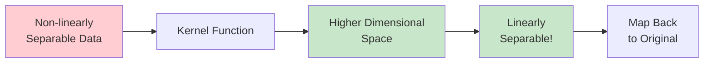

### Popular Kernels

```
1. LINEAR: K(x, y) = x·y
   Use: When data is linearly separable

2. RBF (Gaussian): K(x, y) = exp(-γ||x-y||²)
   Use: Most common, default choice
   
3. POLYNOMIAL: K(x, y) = (x·y + c)^d
   Use: When data has polynomial relationship

4. SIGMOID: K(x, y) = tanh(α·x·y + c)
   Use: Neural network-like behavior
```

### Hyperparameters

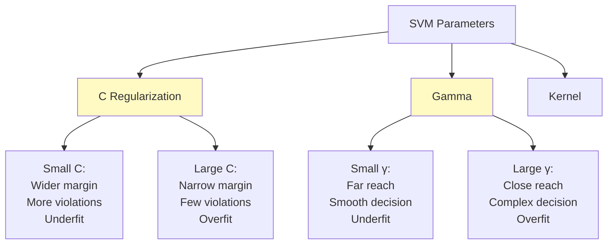

> [!red] ⚠️ **Important: Feature Scaling Required!**
> ```
> SVM is sensitive to feature scales
> 
> Without scaling:
> Feature 1: [0-100]    → Dominates!
> Feature 2: [0-1]      → Ignored!
> 
> With scaling:
> Feature 1: [0-1]      → Equal weight
> Feature 2: [0-1]      → Equal weight
> 
> Always use StandardScaler or MinMaxScaler!
> ```

> [!green] ✅ **When to Use SVM**
> ```
> ✅ High-dimensional data
> ✅ Clear margin of separation
> ✅ Small to medium datasets
> ✅ Binary classification
> ✅ Text classification
> 
> ❌ Very large datasets (slow)
> ❌ Noisy data with overlapping classes
> ❌ Need probability estimates (use Platt scaling)
> ❌ Interpretability needed (black box)
> ```

---

## 7. K-NEAREST NEIGHBORS (KNN)

> [!blue] 💙 **Core Concept**
> "You are the average of your K nearest friends!"

### How It Works

```
New point (?) appears:

    ○
  ○ ? ●
●   ● ○
  ●   ○

K=3 (3 nearest neighbors):
2 are ● (blue)
1 is ○ (red)

Prediction: ● (blue) wins!
```

### The Algorithm

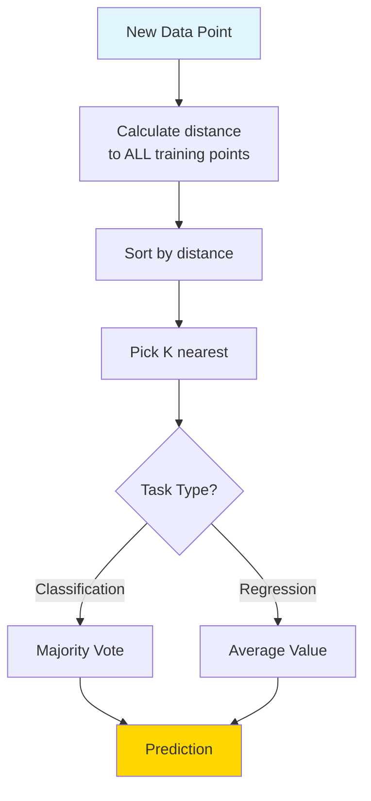

### Distance Metrics

```
1. EUCLIDEAN (Most Common):
   d = √[(x₁-x₂)² + (y₁-y₂)²]
   Straight-line distance

2. MANHATTAN:
   d = |x₁-x₂| + |y₁-y₂|
   Grid/city-block distance

3. MINKOWSKI (General):
   d = (Σ|xᵢ-yᵢ|^p)^(1/p)
   p=1 → Manhattan
   p=2 → Euclidean
   
4. COSINE:
   Use for text, high-dimensional
```

### Choosing K

```
K too small (K=1):       K too large (K=100):
  ●○●○●                     ●●●●●
  ○●○●○                     ●●●●●
  ●○●○●                     ○○○○○
Overfits (noisy)         Underfits (too smooth)

K just right (K=5):
  ●●●●●
  ●●●○○
  ○○○○○
Good balance!

Rule of thumb: K = √n
Typical: K = 3-10
Use cross-validation to find optimal K
```

### Weighted KNN

```
Standard KNN:            Weighted KNN:
All neighbors equal      Closer neighbors more weight

    1  1  1                 3  2  1
    ○  ○  ○                 ○  ○  ○
      ?                       ?
    
Equal vote               Distance-weighted vote
```

> [!yellow] 💡 **Pros and Cons**

| Advantages | Disadvantages |
|------------|---------------|
| ✅ Simple to understand | ❌ Slow prediction (must check all points) |
| ✅ No training phase | ❌ Memory intensive (stores all data) |
| ✅ No assumptions | ❌ Curse of dimensionality |
| ✅ Works with any distance | ❌ Sensitive to irrelevant features |
| ✅ Naturally multi-class | ❌ Sensitive to scale (must normalize!) |

> [!red] ⚠️ **Critical: Always Scale Features!**
> ```
> Without scaling:
> Age: [20-80]      → Range: 60
> Salary: [20K-200K] → Range: 180K
> 
> Distance dominated by salary!
> Age barely matters!
> 
> Solution: StandardScaler or MinMaxScaler
> ```

---

## 8. NAIVE BAYES

> [!blue] 💙 **Core Concept**
> Uses Bayes' Theorem with "naive" independence assumption.

### Bayes' Theorem

```
P(Class|Features) = P(Features|Class) × P(Class) / P(Features)

   Posterior    =    Likelihood    × Prior / Evidence

Example: Spam Detection
P(Spam|"free money") = P("free money"|Spam) × P(Spam) / P("free money")
```

### The "Naive" Assumption

```
Naive Assumption: All features are independent

Example: Email classification
Features: ["free", "money", "click"]

Naive Bayes assumes:
P("free" AND "money" AND "click"|Spam) = 
  P("free"|Spam) × P("money"|Spam) × P("click"|Spam)

Reality: These words are likely related!
But the assumption works surprisingly well!
```

### Types of Naive Bayes

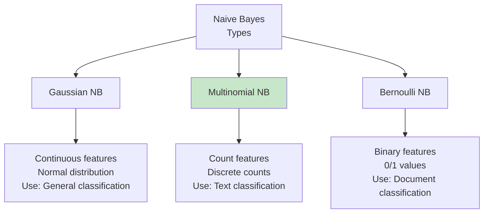

### Example: Email Spam

```
Training:
100 emails: 40 spam, 60 legitimate

Word "free":
- Appears in 30 spam emails
- Appears in 5 legitimate emails

New email contains "free"

P(Spam|"free") = P("free"|Spam) × P(Spam) / P("free")

P("free"|Spam) = 30/40 = 0.75
P(Spam) = 40/100 = 0.4
P("free") = 35/100 = 0.35

P(Spam|"free") = (0.75 × 0.4) / 0.35 = 0.857

87% probability it's spam!
```

> [!green] ✅ **Why Naive Bayes is Great**
> ```
> ✅ Fast training and prediction
> ✅ Works with small datasets
> ✅ Handles high dimensions well
> ✅ Good for text classification
> ✅ Probabilistic predictions
> ✅ Online learning possible
> ✅ Baseline model
> 
> Perfect for:
> - Spam filtering
> - Sentiment analysis
> - Document categorization
> - Real-time predictions
> ```

> [!yellow] 💡 **When to Use Each Algorithm**

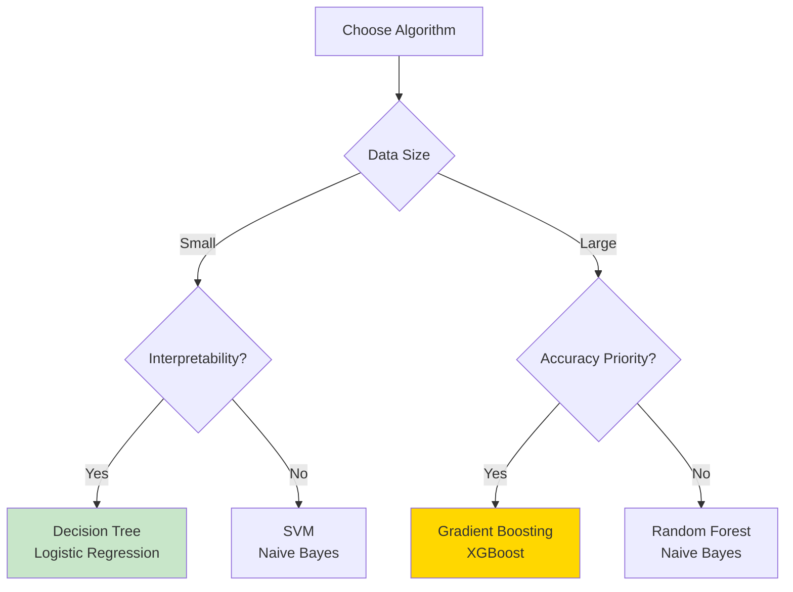

---

## 💎 INTERVIEW QUESTIONS

> [!yellow] 💎 **Q: Bias-Variance Tradeoff - explain with examples**
> 
> **Perfect Answer:**
> "The bias-variance tradeoff is fundamental to understanding model performance.
> 
> **Bias:** Error from wrong assumptions
> - High bias = Model too simple (underfitting)
> - Example: Linear model for non-linear data
> - Consistently off target
> 
> **Variance:** Error from sensitivity to training data
> - High variance = Model too complex (overfitting)
> - Example: Deep tree memorizing training data
> - All over the place
> 
> **Total Error = Bias² + Variance + Irreducible Error**
> 
> **Tradeoff:**
> Simple model → High bias, Low variance
> Complex model → Low bias, High variance
> 
> **Goal:** Find sweet spot in middle!
> 
> **In Practice:**
> - Start simple (linear/shallow tree)
> - Increase complexity if underfitting
> - Add regularization if overfitting
> - Use cross-validation to find balance"

> [!yellow] 💎 **Q: Random Forest vs Gradient Boosting - when to use?**
> 
> **Perfect Answer:**
> 
> **Random Forest:**
> - Parallel training (faster)
> - More robust to overfitting
> - Less tuning needed
> - Good default choice
> - Better with outliers/noise
> 
> **Gradient Boosting:**
> - Sequential training (slower)
> - Often higher accuracy
> - More tuning required
> - Better for competitions
> - Needs cleaner data
> 
> **My Approach:**
> 1. Start with Random Forest (quick baseline)
> 2. If need more accuracy → XGBoost/LightGBM
> 3. Tune hyperparameters carefully
> 4. Use early stopping
> 5. Cross-validate thoroughly
> 
> **Real Example:**
> Customer churn (imbalanced, noisy):
> → Random Forest (more robust)
> 
> Kaggle competition (clean data, need max accuracy):
> → Gradient Boosting (XGBoost)"

> [!yellow] 💎 **Q: Why scale features for some algorithms but not others?**
> 
> **Perfect Answer:**
> "Feature scaling is crucial for distance-based and gradient-based algorithms.
> 
> **Need Scaling:**
> - KNN (distance-based)
> - SVM (distance to hyperplane)
> - Neural Networks (gradient descent)
> - Linear/Logistic Regression (coefficient comparison)
> - K-Means (distance-based)
> - PCA (variance-based)
> 
> **Why?** These algorithms treat large-scale features as more important!
> 
> **Don't Need Scaling:**
> - Decision Trees (split-based, not distance)
> - Random Forest
> - XGBoost/LightGBM
> - Naive Bayes
> 
> **Why?** These use splits/probabilities, not distances.
> 
> **Example:**
> Age: [20-80] vs Income: [20K-200K]
> Without scaling → Income dominates distance!
> With scaling → Both features equal weight
> 
> **Best Practice:** Always scale unless using tree-based models!"

---

**Tags:** #supervised-learning #ml-algorithms #classification #regression #ensemble  
**Difficulty:** ⭐⭐⭐ Medium  
**Time to Master:** 3-4 weeks  
**Last Updated:** 2026-11-11
