# 🔮 UNSUPERVISED LEARNING

> [!yellow] ⭐ **FIND HIDDEN PATTERNS IN DATA!**
> "The goal is to discover the hidden patterns and structures in the data without labels."
> 
> **Time to Complete:** 2-3 weeks  
> **Difficulty:** ⭐⭐⭐ Medium  
> **Interview Weight:** ⭐⭐⭐⭐ Very Important!

---

## 🗺️ UNSUPERVISED LEARNING ROADMAP

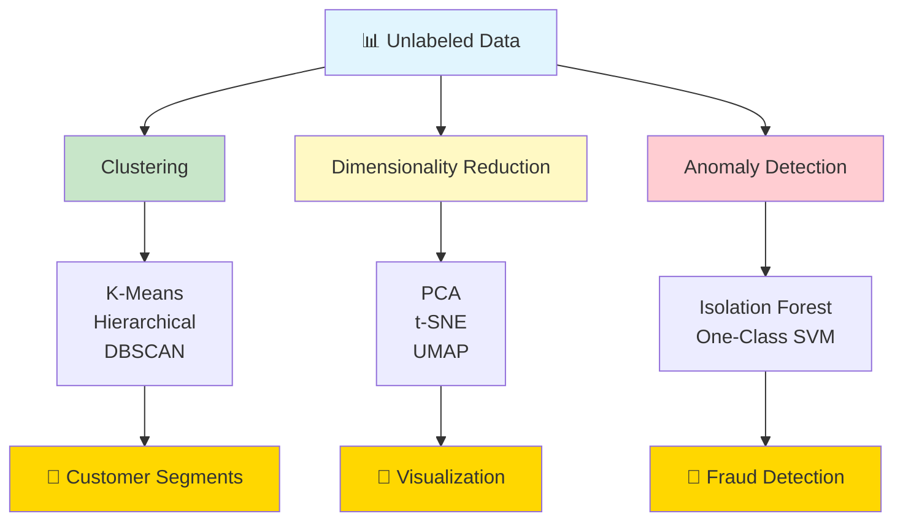

---

## 📚 TABLE OF CONTENTS

| # | Topic | Purpose | Link |
|---|-------|---------|------|
| 1 | **K-Means Clustering** | Group similar data | [[#1-k-means-clustering\|Jump]] |
| 2 | **Hierarchical Clustering** | Tree-based grouping | [[#2-hierarchical-clustering\|Jump]] |
| 3 | **DBSCAN** | Density-based clusters | [[#3-dbscan\|Jump]] |
| 4 | **PCA** | Reduce dimensions | [[#4-pca-principal-component-analysis\|Jump]] |
| 5 | **t-SNE & UMAP** | Visualization | [[#5-t-sne-and-umap\|Jump]] |
| 6 | **Anomaly Detection** | Find outliers | [[#6-anomaly-detection\|Jump]] |

---

## 1. K-MEANS CLUSTERING

> [!blue] 💙 **What is K-Means?**
> Groups data into K clusters by minimizing distance to cluster centers (centroids).

### How K-Means Works

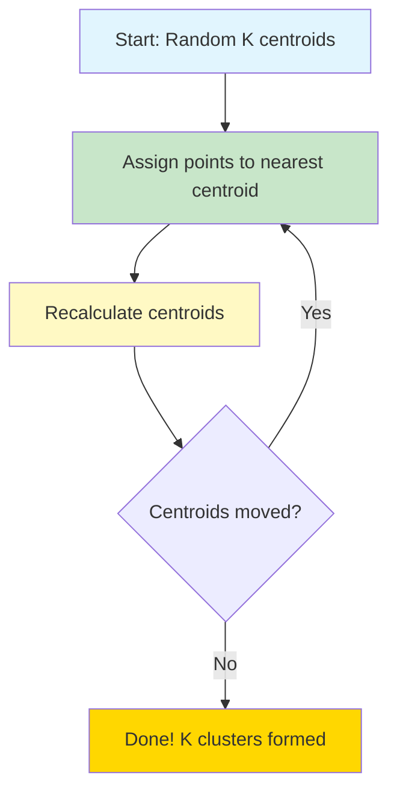

### Visual Understanding

```
Step 1: Initialize K=3 random centroids
    ●     ●     ●
    
Step 2: Assign points to nearest centroid
    ● ○○    ● △△    ● ◇◇
    ○○       △△       ◇◇
    
Step 3: Move centroids to center of clusters
      ●       ●       ●
    ○○○     △△△     ◇◇◇
    ○○       △△       ◇◇
    
Step 4: Reassign & repeat until stable
```

> [!yellow] 💡 **How to Choose K?**

**The Elbow Method:**

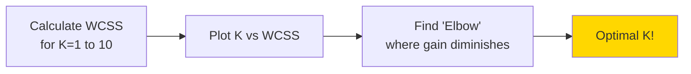

```
WCSS (Within-Cluster Sum of Squares):
Sum of squared distances from points to their centroid

Plot looks like an arm:
WCSS
  |
  |●
  |  ●
  |    ●← Elbow here! (K=3)
  |      ●
  |        ●●●●
  |_____________ K
    1 2 3 4 5 6 7
```

> [!green] ✅ **Real-World Applications**
> ```
> 1. CUSTOMER SEGMENTATION
>    - Group customers by behavior
>    - Target marketing campaigns
>    - Identify VIP customers
> 
> 2. IMAGE COMPRESSION
>    - Reduce colors in image
>    - K clusters = K colors
>    - Smaller file size
> 
> 3. DOCUMENT CLUSTERING
>    - Group similar articles
>    - News categorization
>    - Content recommendation
> 
> 4. ANOMALY DETECTION
>    - Points far from all centroids
>    - Fraud detection
>    - Quality control
> ```

> [!red] ⚠️ **Limitations of K-Means**
> ```
> ❌ Must specify K in advance
> ❌ Sensitive to outliers
> ❌ Assumes spherical clusters
> ❌ Sensitive to initialization
> ❌ Doesn't work well with:
>    - Non-spherical shapes
>    - Different sized clusters
>    - Different density clusters
> ```

---

## 2. HIERARCHICAL CLUSTERING

> [!blue] 💙 **What is Hierarchical Clustering?**
> Creates a tree (dendrogram) showing how clusters merge or split at different levels.

### Two Approaches

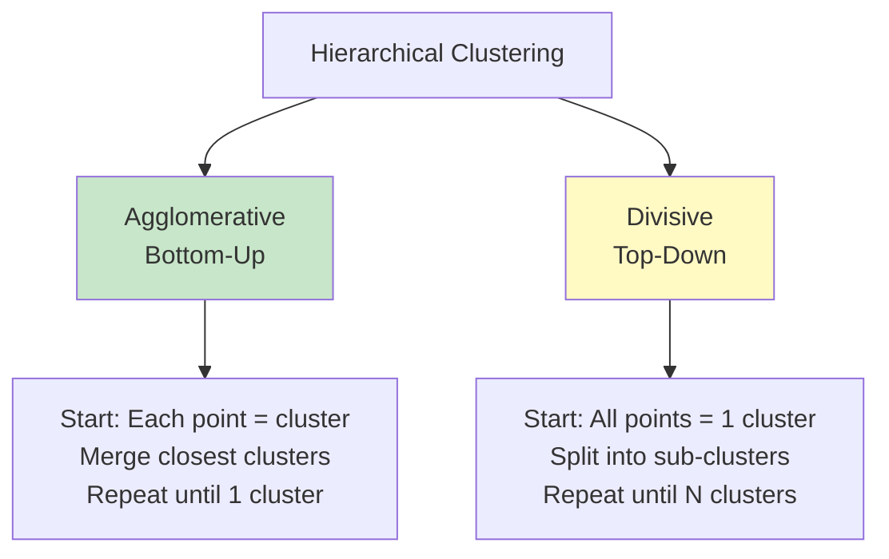

### Dendrogram Visualization

```
Height = Distance when clusters merge

        |
     ___|___
    |       |
   _|_     _|_
  |   |   |   |
  A   B   C   D

Cut here → 2 clusters: {A,B} and {C,D}
Cut here → 3 clusters: {A}, {B,C,D}
         → 4 clusters: {A}, {B}, {C}, {D}
```

> [!yellow] 💡 **Linkage Methods**

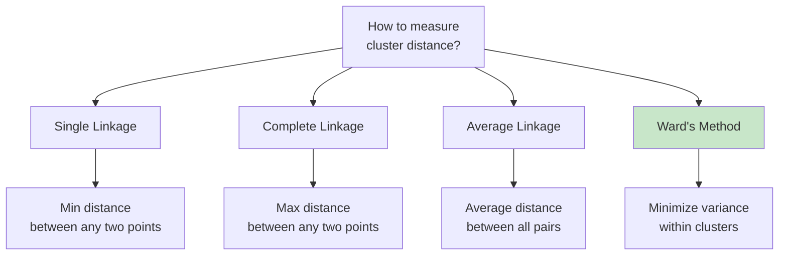

> [!green] ✅ **Advantages over K-Means**
> ```
> ✅ No need to specify K upfront
> ✅ Dendrogram shows cluster hierarchy
> ✅ Can cut at any level
> ✅ Deterministic (no random initialization)
> ✅ Works with any distance metric
> ✅ Better for non-spherical clusters
> ```

> [!red] ⚠️ **Disadvantages**
> ```
> ❌ Computationally expensive: O(n³)
> ❌ Not suitable for large datasets
> ❌ Sensitive to noise and outliers
> ❌ Once merged, cannot undo
> ```

---

## 3. DBSCAN

> [!blue] 💙 **What is DBSCAN?**
> Density-Based Spatial Clustering - finds clusters based on density, not distance!

**DBSCAN = Density-Based Spatial Clustering of Applications with Noise**

### Key Concepts

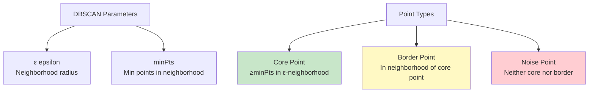

### Visual Understanding

```
ε = radius, minPts = 4

Core points (●):     Border points (○):    Noise (×):
  ●●●●                  ○                     ×
  ●●●●                ●●●●
  ●●●●                ●●●●                   ×
  
Cluster 1            Cluster 2             Not in any cluster
```

### How DBSCAN Works

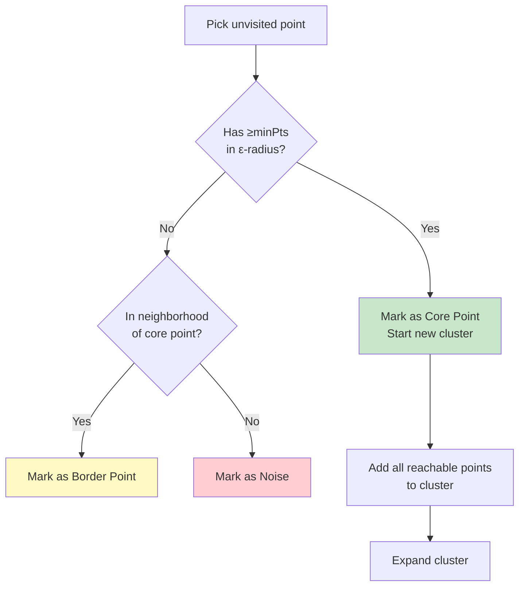

> [!yellow] ⭐ **Why DBSCAN is Powerful**
> ```
> ✅ Doesn't require K (number of clusters)
> ✅ Finds arbitrarily shaped clusters
> ✅ Handles different sized clusters
> ✅ Identifies outliers as noise
> ✅ Robust to outliers
> ✅ Only 2 parameters (ε, minPts)
> ```

> [!green] ✅ **Real-World Use Cases**
> ```
> 1. GEOGRAPHIC CLUSTERING
>    - Crime hotspots
>    - Restaurant locations
>    - Disease outbreaks
> 
> 2. ANOMALY DETECTION
>    - Network intrusion
>    - Fraud detection
>    - Manufacturing defects
> 
> 3. IMAGE SEGMENTATION
>    - Object detection
>    - Medical imaging
>    - Satellite imagery
> ```

> [!red] ⚠️ **When DBSCAN Struggles**
> ```
> ❌ Clusters with varying densities
> ❌ High-dimensional data (curse of dimensionality)
> ❌ Choosing ε is tricky
> ❌ Sensitive to parameter values
> ```

---

## 4. PCA (PRINCIPAL COMPONENT ANALYSIS)

> [!blue] 💙 **What is PCA?**
> Reduces dimensions while preserving maximum variance in data.

### The Core Idea

```
Original Data: 100 features → PCA → 10 features
While keeping 95% of information!

How? Find directions (principal components) with most variance.
```

### Visual Understanding (3D → 2D)

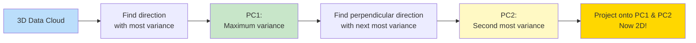

```
Original 3D:              After PCA (2D):
    z                          PC2
    |                           |
    |  ●●●                      |  ●●
    | ●●●●                      | ●●●
    |●●●●                       |●●●
    |____x                      |____PC1
   /                           
  /y                           
  
Lost 1 dimension, kept 95% variance!
```

> [!yellow] 💡 **How Many Components to Keep?**

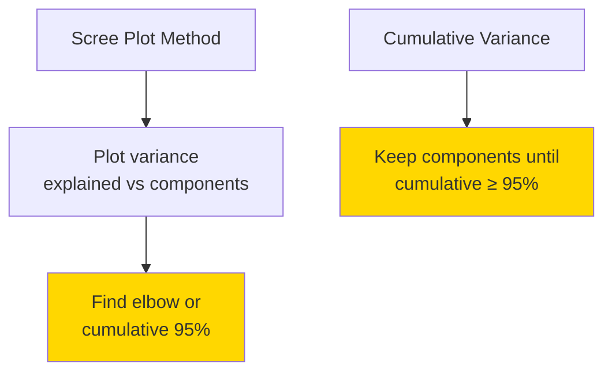

```
Variance Explained:
%
100|                  _____ Cumulative
 95|              ___/
 90|          ___/
   |      ___/
 50|   __/●  ← Elbow (keep 2-3 components)
   | _/
  0|●
   |_________________
    1  2  3  4  5  6
    Principal Components
```

> [!green] ✅ **When to Use PCA**
> ```
> ✅ High-dimensional data (100+ features)
> ✅ Features are correlated
> ✅ Visualization (reduce to 2D/3D)
> ✅ Speed up training
> ✅ Remove noise
> ✅ Overcome curse of dimensionality
> 
> Real Examples:
> - Image compression
> - Face recognition (Eigenfaces)
> - Gene expression analysis
> - Stock market analysis
> ```

> [!red] ⚠️ **PCA Limitations**
> ```
> ❌ Linear transformation only
> ❌ Assumes directions of max variance = important
> ❌ Principal components hard to interpret
> ❌ Sensitive to scale (must standardize first!)
> ❌ May lose important info in low-variance directions
> ```

### PCA vs Other Methods

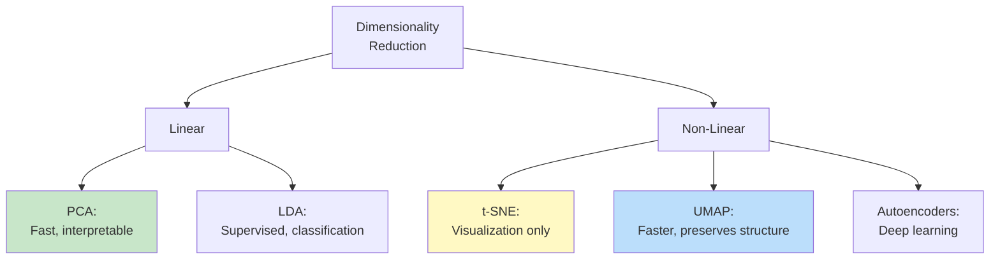

---

## 5. t-SNE AND UMAP

> [!blue] 💙 **What are t-SNE and UMAP?**
> Non-linear dimensionality reduction for **visualization** (not for modeling!)

### t-SNE (t-Distributed Stochastic Neighbor Embedding)

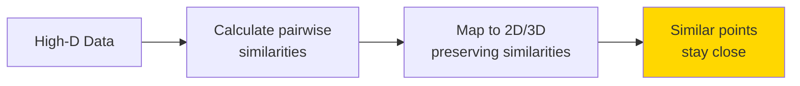

**Key Idea:** Similar points in high-D should be close in 2D

```
High-Dimensional:           t-SNE 2D:
Point A and B are close     A B  ← Still close!
   ●A  ●B                    
                            C    ← Far away
Point C is far              
      ●C
```

> [!yellow] ⭐ **t-SNE vs UMAP**

| Feature | t-SNE | UMAP |
|---------|-------|------|
| **Speed** | Slow (O(n²)) | Fast (O(n log n)) |
| **Large datasets** | ❌ Struggles | ✅ Handles well |
| **Preserves** | Local structure | Local + Global |
| **Deterministic** | ❌ Random | ✅ More stable |
| **Use for modeling** | ❌ No! | ⚠️ Maybe |
| **Best for** | Visualization | Visualization + preprocessing |

> [!green] ✅ **Amazing Use Cases**
> ```
> 1. VISUALIZE HIGH-D DATA
>    - 1000-D word embeddings → 2D plot
>    - See clusters and patterns
>    - Explore data structure
> 
> 2. MNIST DIGITS
>    - 784 pixels → 2D
>    - See digit clusters
>    - Understand what model sees
> 
> 3. SINGLE-CELL RNA
>    - 20,000 genes → 2D
>    - Identify cell types
>    - Discover new patterns
> 
> 4. DOCUMENT SIMILARITY
>    - Text embeddings → 2D
>    - See topic clusters
>    - Find similar documents
> ```

> [!red] ⚠️ **Important Warnings**
> ```
> ❌ DON'T use for feature engineering
> ❌ DON'T interpret distances quantitatively
> ❌ DON'T compare across different runs
> ❌ DON'T use as model input (use PCA instead)
> 
> ✅ DO use for visualization only
> ✅ DO try different perplexity values (t-SNE)
> ✅ DO standardize data first
> ✅ DO use UMAP for large datasets
> ```

---

## 6. ANOMALY DETECTION

> [!blue] 💙 **What is Anomaly Detection?**
> Finding rare items, events, or observations that differ significantly from the majority.

### Types of Anomalies

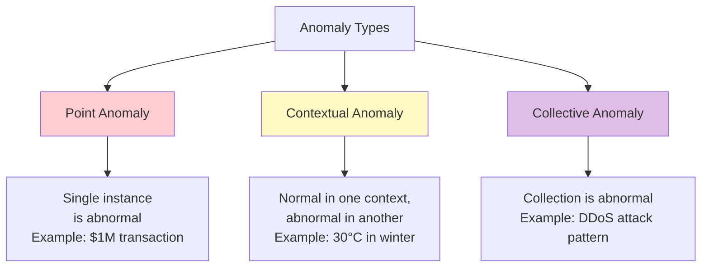

### Methods Comparison

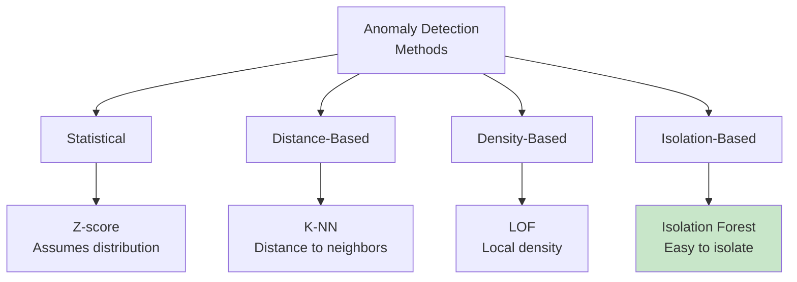

### Isolation Forest Concept

```
Normal points: Hard to isolate (need many splits)
Anomalies: Easy to isolate (few splits needed)

Normal:                 Anomaly:
  ●●●                      ●
  ●●●                   ●●●●
  ●●●                   ●●●●
Split many times          ×  ← Easy to isolate!
to isolate one point
```

> [!green] ✅ **Real-World Applications**
> ```
> 1. FRAUD DETECTION
>    - Credit card transactions
>    - Insurance claims
>    - Account takeovers
> 
> 2. NETWORK SECURITY
>    - Intrusion detection
>    - DDoS attacks
>    - Malware detection
> 
> 3. MANUFACTURING
>    - Defect detection
>    - Equipment failure
>    - Quality control
> 
> 4. HEALTHCARE
>    - Disease outbreak
>    - Medical imaging
>    - Vital sign monitoring
> 
> 5. FINANCE
>    - Market manipulation
>    - Unusual trading patterns
>    - Money laundering
> ```

> [!yellow] 💡 **Choosing the Right Method**

| Method | Best For | Pros | Cons |
|--------|----------|------|------|
| **Isolation Forest** | High-D data | Fast, scalable | Black box |
| **One-Class SVM** | Complex patterns | Flexible kernel | Slow, parameters |
| **LOF** | Density anomalies | Finds local outliers | Slow on large data |
| **Autoencoder** | Complex data | Deep learning power | Needs tuning |
| **Statistical** | Simple, Gaussian | Interpretable | Assumes distribution |

---

## 💎 INTERVIEW QUESTIONS

> [!yellow] 💎 **Q: K-Means vs Hierarchical Clustering - when to use which?**
> 
> **Perfect Answer:**
> 
> **Use K-Means when:**
> - Large datasets (>10,000 points)
> - Know approximate number of clusters
> - Clusters are spherical
> - Need fast results
> - Example: Customer segmentation
> 
> **Use Hierarchical when:**
> - Small to medium datasets
> - Don't know number of clusters
> - Need dendrogram visualization
> - Want to explore different K values
> - Clusters may have complex shapes
> - Example: Gene expression analysis
> 
> **Key Differences:**
> - K-Means: O(n) iterations | Hierarchical: O(n³)
> - K-Means: Need K upfront | Hierarchical: Cut dendrogram later
> - K-Means: Random start | Hierarchical: Deterministic
> - K-Means: Spherical clusters | Hierarchical: Any shape

> [!yellow] 💎 **Q: Explain curse of dimensionality**
> 
> **Perfect Answer:**
> "The curse of dimensionality refers to problems that arise when working with high-dimensional data:
> 
> **Problems:**
> 1. **Distance becomes meaningless**
>    - All points become equally distant
>    - Near and far lose meaning
> 
> 2. **Data becomes sparse**
>    - Points spread out in high-D space
>    - Need exponentially more data
> 
> 3. **Computation explodes**
>    - O(2^d) complexity
>    - Algorithms slow down
> 
> **Solutions:**
> - Feature selection (keep important features)
> - Dimensionality reduction (PCA, t-SNE)
> - Regularization
> - Domain knowledge (remove irrelevant features)
> 
> **Example:**
> - 1D: 10 points cover space well
> - 10D: Need 10^10 points for same coverage!
> - 100D: Distances all look the same"

> [!yellow] 💎 **Q: How do you evaluate clustering results?**
> 
> **Perfect Answer:**
> "Evaluating clustering is tricky since we don't have labels!
> 
> **Internal Metrics (no labels needed):**
> 
> 1. **Silhouette Score** (-1 to 1)
>    - Measures cluster cohesion & separation
>    - Higher is better
>    - >0.5 is good
> 
> 2. **Davies-Bouldin Index**
>    - Average similarity between clusters
>    - Lower is better
> 
> 3. **Calinski-Harabasz Score**
>    - Ratio of between-cluster to within-cluster variance
>    - Higher is better
> 
> **External Metrics (if labels available):**
> 
> 1. **Adjusted Rand Index (ARI)**
>    - Compare to ground truth
>    - 1 = perfect match
> 
> 2. **Normalized Mutual Information (NMI)**
>    - Information theoretic measure
> 
> **Business Metrics:**
> - Do clusters make business sense?
> - Can we action on them?
> - Do they align with domain knowledge?
> 
> **Best Practice:**
> - Use multiple metrics
> - Visualize clusters (t-SNE)
> - Validate with domain experts
> - A/B test in production"

---

**Tags:** #unsupervised-learning #clustering #dimensionality-reduction #anomaly-detection  
**Difficulty:** ⭐⭐⭐ Medium  
**Time to Master:** 2-3 weeks  
**Last Updated:** 2026-11-11
