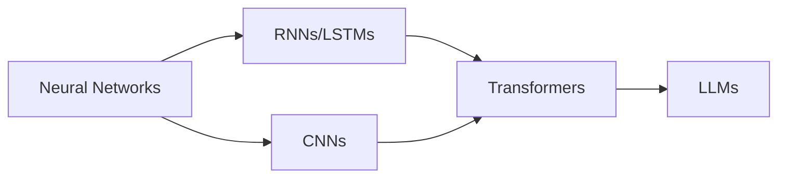

# 🧠 04 - Deep Learning

**💙 Deep Learning Section**
Neural networks and deep learning architectures from fundamentals to state-of-the-art models. Covers feed-forward networks, CNNs, RNNs, Transformers, and Large Language Models.

---

## 📂 Section Structure

### [[04-Deep-Learning/Neural-Networks/README|Neural Networks]]
Fundamentals of neural networks, backpropagation, activation functions, and optimization

### [[04-Deep-Learning/CNNs/README|CNNs]]
Convolutional Neural Networks for computer vision, image classification, and object detection

### [[04-Deep-Learning/RNNs-LSTMs/README|RNNs & LSTMs]]
Recurrent Neural Networks and Long Short-Term Memory networks for sequential data

### [[04-Deep-Learning/Transformers/README|Transformers]]
Attention mechanisms, Transformer architecture, and modern deep learning models

### [[04-Deep-Learning/LLMs/README|LLMs]]
Large Language Models - GPT, BERT, T5, and foundation model architectures

---

## 🎯 Learning Path

**Recommended Order:**
1. **Neural Networks** - Master the fundamentals first
2. **CNNs** - Understanding convolutional architectures
3. **RNNs/LSTMs** - Sequential data processing
4. **Transformers** - Attention mechanisms and modern architectures
5. **LLMs** - Large-scale pre-trained models

---

## 🔗 Prerequisites

From [[01-Foundations]]:
- Python programming
- NumPy for array operations
- Linear algebra (matrix operations, gradients)
- Calculus (derivatives, chain rule)
- Probability & statistics

From [[03-Machine-Learning]]:
- Supervised learning fundamentals
- Model evaluation metrics
- Optimization techniques

---

## 💡 Key Concepts Covered

**💡 Core Deep Learning Topics**
- Backpropagation and gradient descent
- Activation functions (ReLU, sigmoid, tanh)
- Regularization techniques (dropout, batch normalization)
- Convolutional layers and pooling
- Recurrent connections and gating mechanisms
- Attention mechanisms and self-attention
- Transfer learning and fine-tuning
- Pre-training strategies

---

## 📊 Progress Tracking

- [ ] Complete Neural Networks fundamentals
- [ ] Build CNN for image classification
- [ ] Implement RNN/LSTM for sequence modeling
- [ ] Understand Transformer architecture
- [ ] Fine-tune a pre-trained LLM
- [ ] Complete a deep learning project

---

## 🛠️ Tools & Frameworks

**Primary Frameworks:**
- **PyTorch** - Modern deep learning framework
- **TensorFlow/Keras** - Production-ready framework
- **Hugging Face Transformers** - Pre-trained models

**Supporting Tools:**
- **TensorBoard** - Visualization and monitoring
- **Weights & Biases** - Experiment tracking
- **ONNX** - Model interoperability

---

## 📚 Recommended Resources

**Books:**
- Deep Learning (Goodfellow, Bengio, Courville)
- Neural Networks and Deep Learning (Nielsen)
- Hands-On Machine Learning with Scikit-Learn, Keras & TensorFlow

**Courses:**
- Fast.ai Practical Deep Learning
- Stanford CS231n (CNNs)
- Stanford CS224n (NLP with Deep Learning)

**Papers:**
- "Attention Is All You Need" (Transformers)
- "ImageNet Classification with Deep CNNs" (AlexNet)
- "Deep Residual Learning for Image Recognition" (ResNet)

---

## 🔄 Related Sections

- [[03-Machine-Learning]] - ML foundations
- [[05-NLP]] - Natural Language Processing applications
- [[06-AI-Systems]] - Building AI systems with deep learning
- [[07-MLOps-Deployment]] - Deploying deep learning models

---

**Tags:** #deep-learning #neural-networks #cnn #rnn #transformers #llm
**Difficulty:** 🔥🔥🔥 Advanced
**Last Updated:** 2026-11-11
