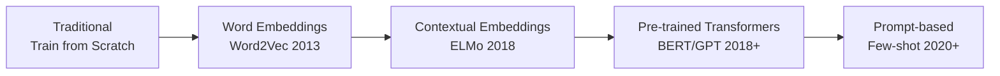
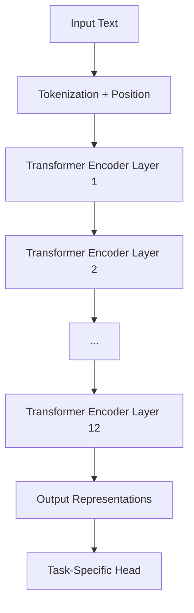
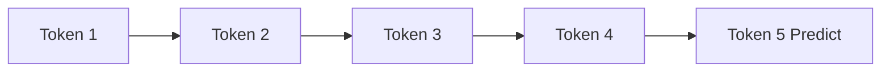
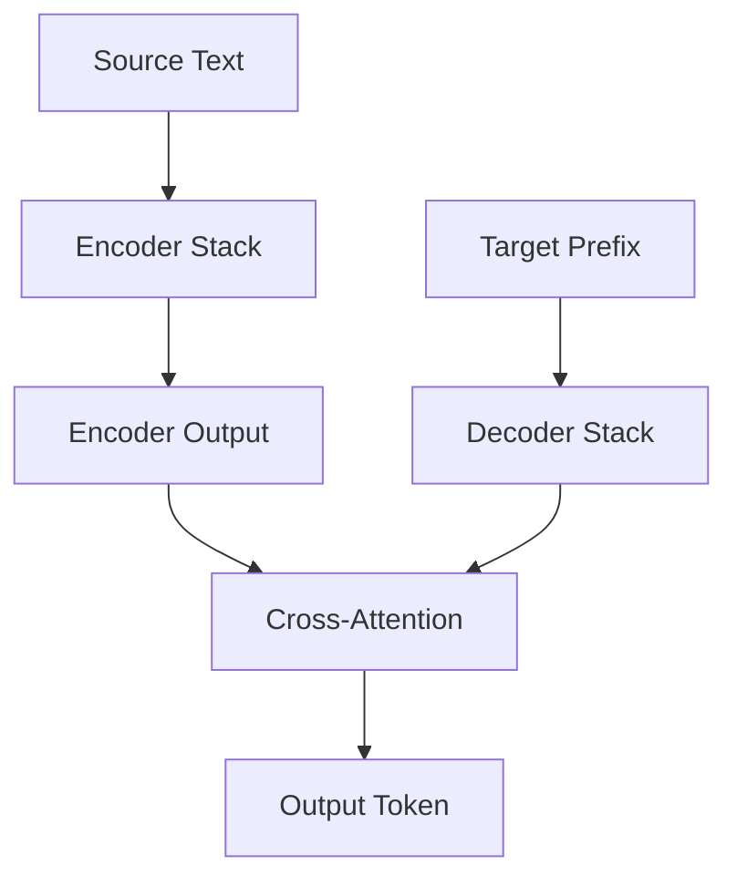
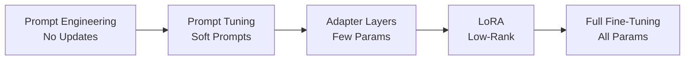
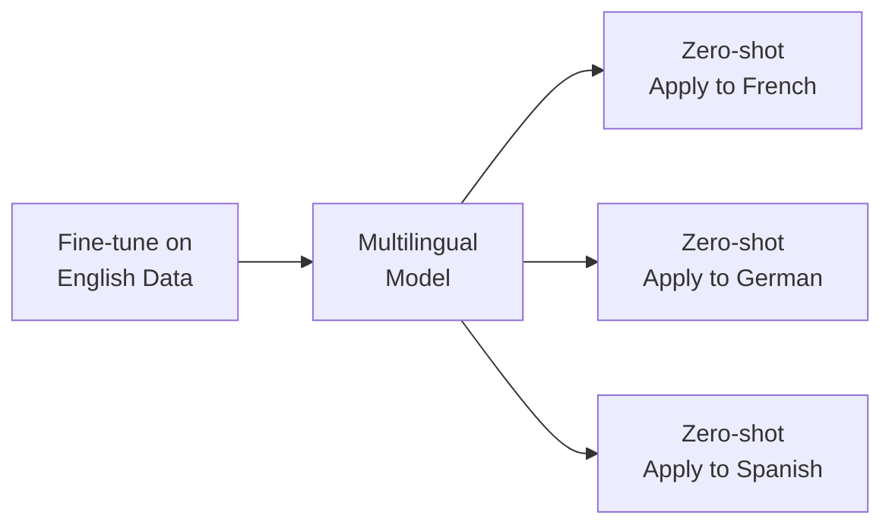

# 🚀 Advanced NLP

**💙 Modern NLP with Transformers**
Advanced NLP techniques using transformer models, fine-tuning strategies, and state-of-the-art approaches for language understanding and generation.

---

## 📚 Topics Covered

### Core Concepts
- **Transfer Learning in NLP** - Pre-training and fine-tuning paradigm
- **BERT and Variants** - Bidirectional encoder models
- **GPT and Autoregressive Models** - Causal language models
- **Encoder-Decoder Models** - T5, BART for seq2seq tasks
- **Fine-Tuning Strategies** - Full fine-tuning, adapter layers, LoRA
- **Prompt Engineering** - Zero-shot, few-shot learning
- **Multi-Task Learning** - Single model for multiple NLP tasks
- **Multilingual NLP** - Cross-lingual transfer

---

## 🎯 Learning Objectives

By the end of this section, you should be able to:
- [ ] Understand pre-training and fine-tuning paradigm
- [ ] Use BERT, GPT, and T5 for various NLP tasks
- [ ] Fine-tune transformer models on custom datasets
- [ ] Apply parameter-efficient fine-tuning methods
- [ ] Design effective prompts for LLMs
- [ ] Handle multilingual NLP tasks
- [ ] Evaluate model performance on benchmarks

---

## 📝 Key Concepts

### [[transfer-learning-nlp|Transfer Learning in NLP]]

**💙 Pre-training + Fine-tuning Paradigm**
Train large models on massive text data (pre-training), then adapt to specific tasks with small labeled datasets (fine-tuning).

**Transfer Learning Evolution:**

**Why Transfer Learning Works:**
- Models learn **general language understanding** from pre-training
- Fine-tuning requires **much less labeled data**
- **Faster convergence** than training from scratch
- **Better performance** on downstream tasks

**💡 Pre-training Objectives**
- **Masked Language Modeling (MLM):** BERT-style, predict masked tokens
- **Causal Language Modeling (CLM):** GPT-style, predict next token
- **Span Corruption:** T5-style, predict corrupted spans

---

### [[bert-family|BERT and Encoder Models]]

**💙 Bidirectional Encoder Representations from Transformers**
Encoder-only transformer that reads text bidirectionally. Best for understanding tasks (classification, NER, QA).

**BERT Architecture:**

**Pre-training Tasks:**
1. **Masked Language Modeling (MLM):** Predict [MASK] tokens (15% of tokens)
2. **Next Sentence Prediction (NSP):** Predict if sentence B follows sentence A

**BERT Variants:**
- **RoBERTa:** Improved BERT (more data, longer training, dynamic masking)
- **ALBERT:** Parameter sharing, factorized embeddings (lighter)
- **DistilBERT:** 60% smaller, 95% performance (knowledge distillation)
- **ELECTRA:** Replaced token detection (more efficient pre-training)
- **DeBERTa:** Disentangled attention, relative position encoding

**✅ Best For**
- Text classification (sentiment, topic)
- Named Entity Recognition (NER)
- Question Answering
- Sentence similarity

---

### [[gpt-autoregressive|GPT and Decoder Models]]

**💙 Generative Pre-trained Transformer**
Decoder-only transformer that generates text left-to-right. Best for generation tasks.

**Causal (Autoregressive) Modeling:**

**GPT Evolution:**
- **GPT-1 (2018):** 117M params, proof of concept
- **GPT-2 (2019):** 1.5B params, high-quality generation
- **GPT-3 (2020):** 175B params, few-shot learning emerges
- **GPT-4 (2023):** Multimodal, improved reasoning

**Key Properties:**
- **Autoregressive:** Predicts next token given previous tokens
- **Unidirectional:** Only sees past context (left-to-right)
- **Few-shot learning:** Can learn from examples in prompt
- **In-context learning:** No gradient updates needed

**✅ Best For**
- Text generation
- Creative writing
- Code generation
- Conversational AI
- Few-shot learning tasks

---

### [[encoder-decoder-models|Encoder-Decoder Models]]

**💙 Sequence-to-Sequence Transformers**
Full transformer with encoder and decoder. Best for tasks requiring input transformation (translation, summarization).

**Architecture:**

**Popular Models:**
- **T5 (Text-to-Text):** All tasks as text generation
- **BART:** Denoising autoencoder (corruption + reconstruction)
- **mT5:** Multilingual T5
- **PEGASUS:** Pre-trained specifically for summarization

**Text-to-Text Framework (T5):**
- All tasks formatted as text generation
- Input: "translate English to German: Hello"
- Output: "Hallo"

**✅ Best For**
- Machine translation
- Text summarization
- Question answering (generative)
- Paraphrasing

---

### [[fine-tuning-strategies|Fine-Tuning Strategies]]

**💙 Adapting Pre-trained Models**
Different approaches to adapt large models to specific tasks efficiently.

**Fine-Tuning Spectrum:**

**Methods:**

1. **Full Fine-Tuning**
   - Update all model parameters
   - Best performance
   - Requires most memory and compute

2. **Adapter Layers**
   - Add small trainable modules between frozen layers
   - ~3-5% additional parameters
   - Good performance with efficiency

3. **LoRA (Low-Rank Adaptation)**
   - Add low-rank matrices to attention layers
   - ~0.1-1% additional parameters
   - Comparable to full fine-tuning

4. **Prompt Tuning**
   - Learn soft prompt embeddings
   - Model weights frozen
   - Very parameter-efficient

**💡 Choosing Strategy**
- **Large dataset, compute available:** Full fine-tuning
- **Limited resources:** LoRA or Adapters
- **Very small dataset:** Prompt engineering or few-shot
- **Multiple tasks:** Adapters (task-specific adapters)

---

### [[multilingual-nlp|Multilingual NLP]]

**💙 Cross-Lingual Understanding**
Models and techniques for handling multiple languages, enabling zero-shot cross-lingual transfer.

**Multilingual Models:**
- **mBERT:** BERT trained on 104 languages
- **XLM-RoBERTa:** Improved multilingual model (100 languages)
- **mT5:** Multilingual T5 (101 languages)
- **BLOOM:** Multilingual GPT-style (46 languages)

**Cross-Lingual Transfer:**

**💡 Cross-Lingual Strategy**
- Fine-tune on high-resource language (English)
- Apply directly to low-resource languages
- Works due to shared multilingual representations
- Performance drops with language distance

---

## 🔬 Advanced Topics

**🔮 Domain Adaptation**
Adapting general models to specific domains (medical, legal, scientific):
- **Continued Pre-training:** Further pre-train on domain text
- **Domain-Specific Fine-tuning:** Use domain-labeled data
- **Hybrid:** Combine both approaches

**🔮 Multi-Task Learning**
Training single model on multiple tasks simultaneously:
- **T5 approach:** All tasks as text-to-text
- **Shared representations** across tasks
- **Auxiliary tasks** improve main task performance

**🔮 Knowledge Distillation**
Compressing large models into smaller ones:
- Student learns from teacher's soft predictions
- **DistilBERT:** 60% smaller, 95% performance
- Trade-off: size vs. accuracy

**🔮 Few-Shot and Zero-Shot Learning**
Learning with minimal or no task-specific training:
- **Zero-shot:** No examples, task description only
- **Few-shot:** 1-10 examples in prompt
- **In-context learning:** LLMs learn from prompt examples

---

## ⚠️ Common Pitfalls

**⚠️ Catastrophic Forgetting**
- **Problem:** Fine-tuning causes model to forget pre-trained knowledge
- **Solution:** Small learning rates, fewer epochs, LoRA, monitor validation

**⚠️ Overfitting on Small Datasets**
- **Problem:** Model memorizes training data
- **Solution:** Use LoRA, data augmentation, early stopping, larger pre-trained models

**⚠️ Wrong Model Choice**
- **Problem:** Using GPT for classification or BERT for generation
- **Solution:** Encoder (BERT) for understanding, Decoder (GPT) for generation

**⚠️ Ignoring Tokenization**
- **Problem:** Different models use different tokenizers (BERT WordPiece vs GPT BPE)
- **Solution:** Always use model's original tokenizer

---

## 💡 Best Practices

**💡 Model Selection**
- **Classification/NER:** BERT, RoBERTa, DeBERTa
- **Generation:** GPT, GPT-2, LLaMA
- **Summarization/Translation:** T5, BART, mT5
- **Multilingual:** XLM-RoBERTa, mBERT, mT5

**💡 Fine-Tuning Tips**
- Start with **small learning rates** (1e-5 to 5e-5)
- Use **warmup** for first 10% of steps
- Apply **gradient clipping** (max_norm=1.0)
- Monitor **validation loss** for early stopping
- Use **mixed precision** training for speed

**💡 Data Requirements**
- **Prompt engineering:** 0 examples (zero-shot)
- **Few-shot learning:** 1-100 examples
- **LoRA fine-tuning:** 100-1000 examples
- **Full fine-tuning:** 1000+ examples

---

## 🔗 Related Topics

- [[05-NLP/Basics/README|NLP Basics]] - Foundational concepts
- [[04-Deep-Learning/Transformers/README|Transformers]] - Architecture details
- [[04-Deep-Learning/LLMs/README|Large Language Models]] - Scaled transformers
- [[06-AI-Systems/Prompt-Engineering/README|Prompt Engineering]] - Effective prompting

---

## 📚 Resources

**Papers:**
- "BERT: Pre-training of Deep Bidirectional Transformers" (2018)
- "Language Models are Unsupervised Multitask Learners" (GPT-2, 2019)
- "Exploring the Limits of Transfer Learning with T5" (2019)
- "LoRA: Low-Rank Adaptation of Large Language Models" (2021)
- "Unsupervised Cross-lingual Representation Learning at Scale" (XLM-R, 2019)

**Benchmarks:**
- **GLUE:** General Language Understanding Evaluation
- **SuperGLUE:** More challenging language understanding
- **SQuAD:** Question Answering
- **XNLI:** Cross-lingual Natural Language Inference

**Libraries:**
- Hugging Face Transformers
- Adapters library
- PEFT (Parameter-Efficient Fine-Tuning)

---

**Tags:** #advanced-nlp #bert #gpt #transformers #fine-tuning #transfer-learning #multilingual
**Difficulty:** 🔥🔥🔥🔥 Expert
**Last Updated:** 2026-11-11
