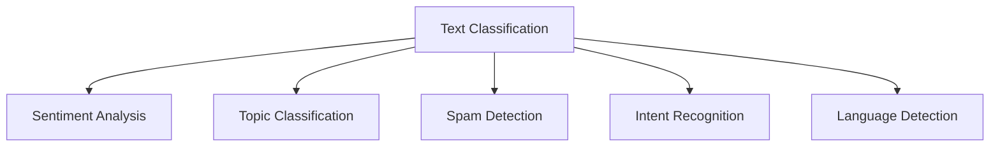
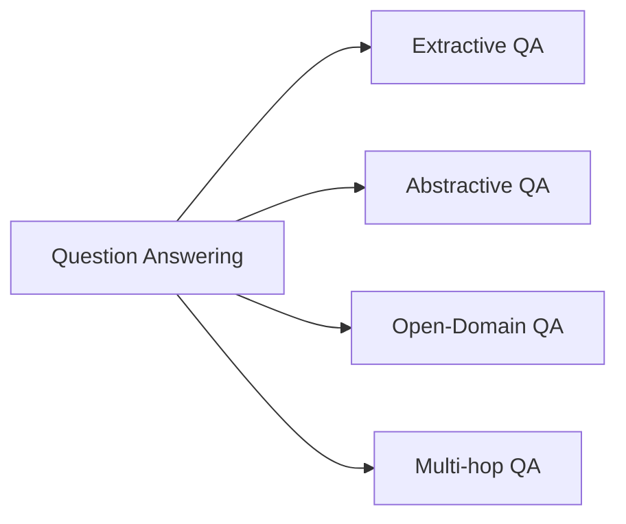
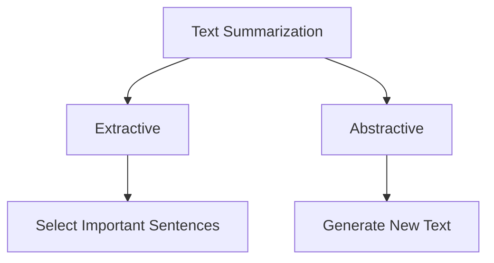
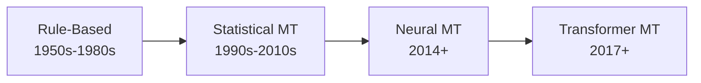
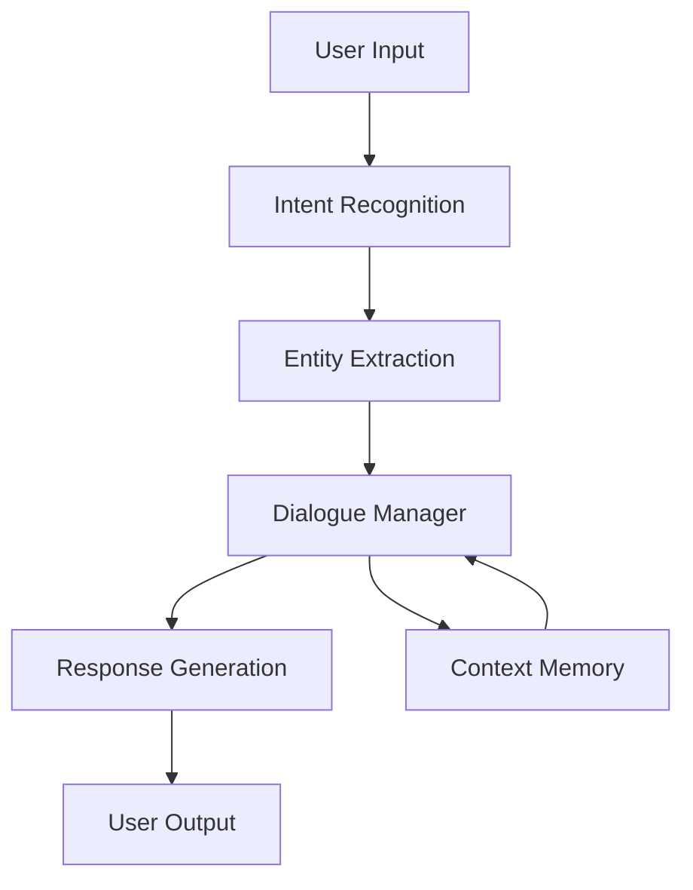
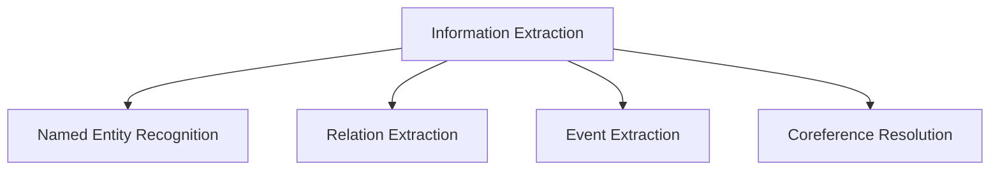

# 🎯 NLP Applications

**💙 Real-World NLP Systems**
Production NLP applications and use cases. Learn to build chatbots, sentiment analysis systems, question answering, text summarization, and machine translation systems.

---

## 📚 Topics Covered

### Core Applications
- **Text Classification** - Sentiment analysis, topic classification, spam detection
- **Named Entity Recognition** - Information extraction from documents
- **Question Answering** - Building QA systems
- **Text Summarization** - Extractive and abstractive summarization
- **Machine Translation** - Neural machine translation systems
- **Conversational AI** - Chatbots and dialogue systems
- **Information Retrieval** - Search and semantic matching
- **Text Generation** - Content creation and completion

---

## 🎯 Learning Objectives

By the end of this section, you should be able to:
- [ ] Build a sentiment analysis classifier
- [ ] Create a question-answering system
- [ ] Implement text summarization
- [ ] Build a chatbot with intent recognition
- [ ] Deploy NLP models to production
- [ ] Evaluate NLP system performance
- [ ] Handle common production challenges

---

## 📝 Key Applications

### [[text-classification|Text Classification]]

**💙 Categorizing Text into Classes**
Assigning predefined categories to text documents. Foundation for many NLP applications.

**Common Tasks:**

**Sentiment Analysis:**
- **Binary:** Positive vs Negative
- **Multi-class:** Positive, Neutral, Negative
- **Fine-grained:** 1-5 stars rating
- **Aspect-based:** Sentiment per product feature

**Use Cases:**
- Customer feedback analysis
- Social media monitoring
- Product review classification
- Email spam filtering

**💡 Approach Selection**
- **Small dataset:** Pre-trained BERT + fine-tuning
- **Large dataset:** Train from scratch or use GPT with prompts
- **Real-time:** DistilBERT or smaller models
- **Multilingual:** XLM-RoBERTa

---

### [[question-answering|Question Answering (QA)]]

**💙 Automatic Answer Extraction**
Systems that answer questions from text passages or knowledge bases.

**QA Types:**

**Extractive QA:**
- Answer is a span from the given context
- Example: SQuAD dataset, reading comprehension
- Model: BERT for QA, RoBERTa

**Abstractive QA:**
- Generate answer in natural language
- Not limited to exact text spans
- Model: T5, BART

**Open-Domain QA:**
- Answer questions without given context
- Retrieve relevant documents first (RAG)
- Then extract/generate answer

**✅ Building QA System**
1. **Retrieval:** Find relevant documents (BM25, dense retrieval)
2. **Reader:** Extract answer from documents (BERT QA)
3. **Re-ranking:** Score and rank answers
4. **Generation:** Optionally reformulate answer

---

### [[text-summarization|Text Summarization]]

**💙 Condensing Text into Key Points**
Automatically generating shorter versions of documents while preserving key information.

**Summarization Types:**

**Extractive Summarization:**
- Select important sentences from original text
- No text generation required
- Methods: TextRank, TF-IDF scoring
- Fast, grammatically correct

**Abstractive Summarization:**
- Generate new sentences (like human summary)
- May use words not in original text
- Models: T5, BART, PEGASUS
- More flexible but harder

**Evaluation Metrics:**
- **ROUGE:** Overlap with reference summaries
- **BLEU:** Precision-based metric
- **BERTScore:** Semantic similarity
- **Human evaluation:** Gold standard

**💡 When to Use Each**
- **Extractive:** News articles, reports, when accuracy is critical
- **Abstractive:** Creative summaries, different style needed
- **Hybrid:** Combine both for best results

---

### [[machine-translation|Machine Translation]]

**💙 Automatic Language Translation**
Translating text from one language to another using neural networks.

**Translation Evolution:**

**Neural Machine Translation (NMT):**
- Encoder-decoder architecture
- Attention mechanism for alignment
- End-to-end differentiable

**Modern Approaches:**
- **mT5, mBART:** Multilingual transformers
- **No Language Left Behind (NLLB):** 200+ languages
- **GPT-4, Claude:** Via prompting

**Challenges:**
- Low-resource languages
- Domain-specific terminology
- Cultural context and idioms
- Maintaining formality/tone

**⚠️ Translation Pitfalls**
- Word-by-word translation loses meaning
- Gender and formality handling
- Named entities (don't translate)
- Cultural references may not transfer

---

### [[conversational-ai|Conversational AI & Chatbots]]

**💙 Building Dialogue Systems**
Creating AI systems that can have natural conversations with users.

**Chatbot Architecture:**

**Components:**
1. **Intent Recognition:** What user wants (book_flight, check_weather)
2. **Entity Extraction:** Specific details (date, location, product)
3. **Dialogue Management:** Track conversation state
4. **Response Generation:** Create appropriate reply
5. **Context Memory:** Remember conversation history

**Types:**
- **Rule-based:** Predefined responses, decision trees
- **Retrieval-based:** Select best response from database
- **Generative:** Generate responses (GPT, T5)
- **Hybrid:** Combine approaches

**✅ Modern Approach**
- Use LLMs (GPT-4, Claude) as backbone
- Add retrieval (RAG) for knowledge
- Intent recognition for routing
- Function calling for actions

---

### [[information-extraction|Information Extraction]]

**💙 Structured Data from Unstructured Text**
Extracting structured information (entities, relationships, events) from raw text.

**Extraction Tasks:**

**Components:**
- **NER:** Extract entities (people, places, organizations)
- **Relation Extraction:** Identify relationships between entities
- **Event Extraction:** Detect events and participants
- **Coreference Resolution:** Link mentions to same entity

**Applications:**
- Knowledge graph construction
- Resume parsing
- Contract analysis
- Scientific literature mining

---

## 🔬 Advanced Applications

**🔮 Semantic Search**
Search based on meaning rather than keywords:
- Encode queries and documents as vectors
- Find most similar using cosine similarity
- Better than keyword matching for complex queries

**🔮 Text-to-SQL**
Convert natural language to database queries:
- "Show me sales from last quarter" → SQL query
- Models: T5, CodeX, GPT-4
- Enables non-technical users to query databases

**🔮 Document Understanding**
Analyze document structure and extract information:
- Layout analysis (PDFs, scanned documents)
- Table extraction
- Form understanding
- Models: LayoutLM, Donut

**🔮 Content Moderation**
Automatically detect harmful content:
- Hate speech detection
- Toxicity classification
- Sensitive content filtering
- Challenges: Context, sarcasm, evolving language

---

## ⚠️ Common Pitfalls

**⚠️ Not Handling Edge Cases**
- **Problem:** Model fails on unusual inputs, typos, slang
- **Solution:** Test on diverse data, add fallback responses, handle out-of-vocabulary

**⚠️ Ignoring Latency Requirements**
- **Problem:** Large models too slow for production
- **Solution:** Use distilled models, caching, batch processing

**⚠️ Poor Error Handling**
- **Problem:** System crashes on unexpected input
- **Solution:** Input validation, graceful degradation, logging

**⚠️ Bias in Models**
- **Problem:** Models reflect biases from training data
- **Solution:** Test on diverse examples, use debiasing techniques, human oversight

---

## 💡 Best Practices

**💡 Production NLP System**
- **Start simple:** Rule-based or simple ML before complex models
- **Monitor performance:** Track accuracy, latency, user satisfaction
- **Version control:** Track model versions and data
- **A/B testing:** Compare models in production
- **Human in the loop:** Allow human override/review

**💡 Evaluation Strategy**
- **Offline metrics:** Accuracy, F1, ROUGE (during development)
- **Online metrics:** User satisfaction, task completion (in production)
- **Error analysis:** Manually review failures
- **Continuous evaluation:** Monitor drift over time

**💡 Handling Failures**
- **Confidence thresholds:** Only answer when confident
- **Fallback responses:** "I don't know" is better than wrong answer
- **Escalation:** Route to human agent when needed
- **Learning from failures:** Log and analyze mistakes

---

## 🔗 Related Topics

- [[05-NLP/Basics/README|NLP Basics]] - Foundational techniques
- [[05-NLP/Advanced/README|Advanced NLP]] - Transformer models
- [[06-AI-Systems/RAG/README|RAG]] - Retrieval-augmented QA systems
- [[06-AI-Systems/Agents/README|AI Agents]] - Conversational agents
- [[07-MLOps-Deployment/LLMOps/README|LLMOps]] - Deploying NLP systems

---

## 📚 Resources

**Datasets:**
- **GLUE/SuperGLUE:** Language understanding benchmarks
- **SQuAD:** Question answering
- **CNN/DailyMail:** Summarization
- **WMT:** Machine translation
- **IMDB, SST:** Sentiment analysis

**Libraries:**
- **Hugging Face Transformers:** Pre-trained models
- **spaCy:** Production NLP pipelines
- **Rasa:** Conversational AI framework
- **Haystack:** NLP search and QA

**Tools:**
- **Gradio/Streamlit:** Quick demos
- **FastAPI:** Model serving
- **Weights & Biases:** Experiment tracking
- **LangSmith:** LLM debugging

---

**Tags:** #nlp-applications #text-classification #qa #summarization #chatbots #machine-translation
**Difficulty:** 🔥🔥🔥 Advanced
**Last Updated:** 2026-11-11
