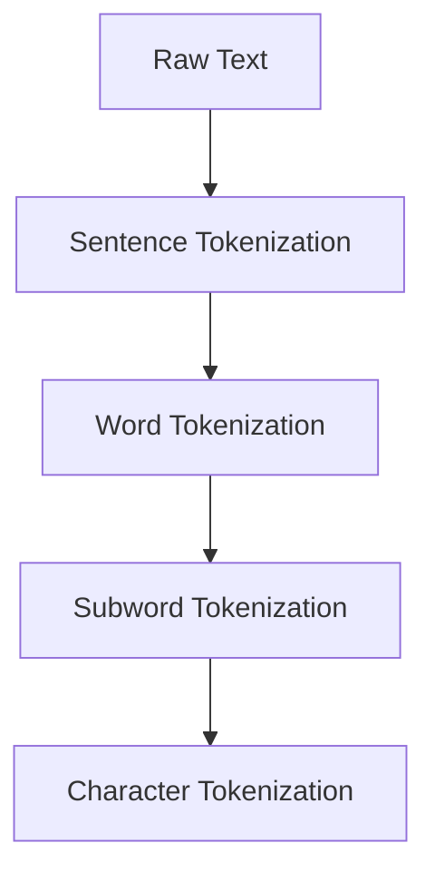
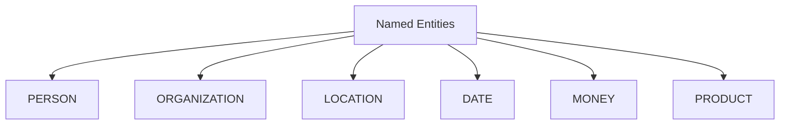

# 📝 NLP Basics

**💙 Natural Language Processing Foundations**
Fundamental concepts and techniques for processing and understanding human language. Learn text preprocessing, tokenization, embeddings, and classical NLP approaches.

---

## 📚 Topics Covered

### Core Concepts
- **Text Preprocessing** - Cleaning, normalization, lowercasing
- **Tokenization** - Word, subword, character-level splitting
- **Stopwords & Stemming** - Removing common words, reducing to root forms
- **Part-of-Speech Tagging** - Identifying grammatical roles
- **Named Entity Recognition (NER)** - Extracting entities (person, place, organization)
- **Word Embeddings** - Word2Vec, GloVe, FastText
- **Text Representation** - Bag of Words, TF-IDF, n-grams
- **Language Models** - N-gram models, probability estimation

---

## 🎯 Learning Objectives

By the end of this section, you should be able to:
- [ ] Clean and preprocess raw text data
- [ ] Tokenize text using different strategies
- [ ] Understand and apply word embeddings
- [ ] Use spaCy or NLTK for NLP pipelines
- [ ] Implement TF-IDF for text representation
- [ ] Perform NER and POS tagging
- [ ] Build simple n-gram language models
- [ ] Evaluate text similarity

---

## 📝 Key Concepts

### [[tokenization|Tokenization]]

**💙 What is Tokenization?**
Breaking text into smaller units (tokens) - words, subwords, or characters. Foundation for all NLP tasks.

**Tokenization Hierarchy:**

**Types:**
- **Word Tokenization:** "Hello world" → ["Hello", "world"]
- **Subword (BPE):** "unhappiness" → ["un", "happiness"]
- **Character:** "cat" → ["c", "a", "t"]

**💡 When to Use Each**
- **Word:** Simple tasks, small vocabulary
- **Subword:** LLMs, handles unknown words, morphology
- **Character:** Very robust, any language, long sequences

---

### [[word-embeddings|Word Embeddings]]

**💙 Semantic Vector Representations**
Dense vector representations that capture semantic meaning. Words with similar meanings have similar vectors.

**Evolution of Word Representations:**

**Key Properties:**
- **king - man + woman ≈ queen** (semantic relationships)
- **Similar words cluster together** in vector space
- **Dimensionality:** Typically 100-300 dimensions

**⚠️ Limitation of Static Embeddings**
- Same word always has same embedding regardless of context
- "bank" (river) vs "bank" (financial) → same vector
- **Solution:** Contextual embeddings (BERT, ELMo)

---

### [[text-preprocessing|Text Preprocessing]]

**💙 Cleaning Raw Text**
Transforming raw text into a clean, standardized format for analysis.

**Preprocessing Pipeline:**

**Common Operations:**
1. **Lowercasing:** "Hello" → "hello"
2. **Remove HTML/URLs:** Clean web-scraped text
3. **Remove special characters:** Keep only alphanumeric
4. **Stopword removal:** Remove "the", "is", "and"
5. **Stemming:** "running" → "run"
6. **Lemmatization:** "better" → "good"

**💡 Stemming vs Lemmatization**
- **Stemming:** Fast, crude chopping ("studies" → "studi")
- **Lemmatization:** Proper words, slower ("studies" → "study")
- Use lemmatization for accuracy, stemming for speed

---

### [[tfidf|TF-IDF (Term Frequency-Inverse Document Frequency)]]

**💙 Importance-Weighted Text Representation**
Statistical measure of how important a word is to a document in a corpus.

**Formula:**
- **TF (Term Frequency):** How often term appears in document
- **IDF (Inverse Document Frequency):** How rare term is across all documents
- **TF-IDF = TF × IDF**

**Intuition:**
- Words appearing often in document → High TF
- Words rare across corpus → High IDF
- Common words ("the", "is") → Low TF-IDF
- Distinctive words → High TF-IDF

**✅ Use Cases**
- Document similarity
- Search engines
- Keyword extraction
- Document classification

---

### [[named-entity-recognition|Named Entity Recognition (NER)]]

**💙 Extracting Entities from Text**
Identifying and classifying named entities (people, organizations, locations, dates) in text.

**Common Entity Types:**

**Example:**
- Input: "Apple Inc. was founded by Steve Jobs in Cupertino on April 1, 1976"
- Output:
  - **ORGANIZATION:** Apple Inc.
  - **PERSON:** Steve Jobs
  - **LOCATION:** Cupertino
  - **DATE:** April 1, 1976

**💡 Applications**
- Information extraction from documents
- Building knowledge graphs
- Customer support automation
- Resume parsing

---

### [[pos-tagging|Part-of-Speech (POS) Tagging]]

**💙 Grammatical Role Identification**
Assigning grammatical categories (noun, verb, adjective) to each word.

**Common POS Tags:**
- **NN:** Noun (cat, dog)
- **VB:** Verb (run, eat)
- **JJ:** Adjective (happy, blue)
- **RB:** Adverb (quickly, very)
- **DT:** Determiner (the, a)
- **IN:** Preposition (in, on, at)

**Example:**
- "The quick brown fox jumps"
- DT JJ JJ NN VB

---

## 🔬 Advanced Concepts

**🔮 N-gram Language Models**
Predicting next word based on previous N words. Foundation for pre-transformer language modeling.
- **Unigram:** P(word) - no context
- **Bigram:** P(word | previous word)
- **Trigram:** P(word | previous 2 words)

**🔮 Contextual Embeddings**
Modern embeddings that change based on context:
- **ELMo (2018):** Bidirectional LSTM embeddings
- **BERT (2018):** Transformer-based contextual representations
- Each word gets different embedding based on surrounding words

**🔮 Subword Tokenization Methods**
- **Byte Pair Encoding (BPE):** Merge most frequent pairs iteratively
- **WordPiece:** Used by BERT, similar to BPE
- **SentencePiece:** Language-agnostic tokenization
- **Handles:** Unknown words, morphology, multilingual text

---

## ⚠️ Common Pitfalls

**⚠️ Over-Preprocessing**
- **Problem:** Removing too much information (punctuation can be meaningful)
- **Solution:** Experiment with minimal preprocessing, especially for deep learning

**⚠️ Ignoring Context**
- **Problem:** Static embeddings miss word sense disambiguation
- **Solution:** Use contextual embeddings (BERT) for modern applications

**⚠️ Language Assumptions**
- **Problem:** Techniques designed for English may fail for other languages
- **Solution:** Use language-specific models or multilingual approaches

**⚠️ Vocabulary Size Issues**
- **Problem:** Huge vocabulary with word-level tokenization
- **Solution:** Use subword tokenization (BPE, WordPiece)

---

## 💡 Best Practices

**💡 Preprocessing Strategy**
- Start with **minimal preprocessing** for neural models
- Use **aggressive preprocessing** for classical ML (Naive Bayes, SVM)
- Always **lowercase** for case-insensitive tasks
- **Keep punctuation** for sentiment analysis
- Remove **stopwords** only for topic modeling, keyword extraction

**💡 Choosing Tokenization**
- **Classical ML:** Word tokenization + stopword removal
- **Deep Learning:** Subword tokenization (BPE, WordPiece)
- **Multilingual:** SentencePiece
- **Character-level:** Rare for modern NLP

**💡 Word Embeddings Selection**
- **Small datasets:** Pre-trained Word2Vec/GloVe
- **Large datasets:** Train custom embeddings
- **Modern NLP:** Use BERT/RoBERTa contextual embeddings
- **Dimension:** 100-300 for static, 768-1024 for contextual

---

## 🔗 Related Topics

- [[05-NLP/Advanced/README|Advanced NLP]] - Transformers and modern techniques
- [[04-Deep-Learning/Transformers/README|Transformers]] - BERT architecture
- [[03-Machine-Learning/Feature-Engineering/README|Feature Engineering]] - Text features
- [[02-Statistics-and-Data/Statistics/README|Statistics]] - Statistical NLP methods

---

## 📚 Resources

**Libraries:**
- **spaCy** - Production NLP pipelines
- **NLTK** - Educational NLP toolkit
- **Gensim** - Topic modeling and embeddings
- **Hugging Face Tokenizers** - Fast tokenization

**Books:**
- Speech and Language Processing (Jurafsky & Martin)
- Natural Language Processing with Python (NLTK Book)

**Papers:**
- "Efficient Estimation of Word Representations" (Word2Vec, 2013)
- "GloVe: Global Vectors for Word Representation" (2014)
- "Enriching Word Vectors with Subword Information" (FastText, 2017)

---

**Tags:** #nlp #tokenization #word-embeddings #text-preprocessing #ner #pos-tagging
**Difficulty:** 🔥🔥 Intermediate
**Last Updated:** 2026-11-11
