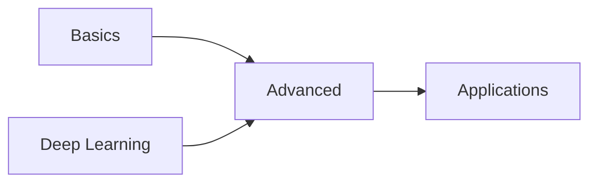

# 🗣️ 05 - Natural Language Processing (NLP)

> [!blue] 💙 **NLP Section**
> Natural Language Processing techniques from basics to advanced applications. Covers text preprocessing, embeddings, language models, and production NLP systems.

---

## 📂 Section Structure

### [[05-NLP/Basics/README|Basics]]
Text preprocessing, tokenization, embeddings, and foundational NLP concepts

### [[05-NLP/Advanced/README|Advanced]]
Advanced techniques including transformers, fine-tuning, and transfer learning

### [[05-NLP/Applications/README|Applications]]
Real-world NLP applications - chatbots, summarization, translation, sentiment analysis

---

## 🎯 Learning Path

**Recommended Order:**
1. **Basics** - Tokenization, embeddings, classical NLP
2. **Advanced** - Transformers, BERT, GPT, fine-tuning
3. **Applications** - Build production NLP systems

---

## 🔗 Prerequisites

From [[04-Deep-Learning]]:
- Neural Networks fundamentals
- Transformers architecture
- Large Language Models (LLMs)

From [[01-Foundations]]:
- Python programming
- Text processing with Python

---

## 💡 Key Concepts Covered

> [!yellow] 💡 **Core NLP Topics**
> - **Text Preprocessing:** Tokenization, normalization, stopwords
> - **Embeddings:** Word2Vec, GloVe, FastText, contextual embeddings
> - **Language Models:** N-grams, RNNs, Transformers
> - **Transfer Learning:** BERT, GPT, T5, fine-tuning strategies
> - **Tasks:** Classification, NER, QA, summarization, translation
> - **Evaluation:** BLEU, ROUGE, perplexity, human evaluation

---

## 📊 Progress Tracking

- [ ] Master text preprocessing and tokenization
- [ ] Understand word embeddings (Word2Vec, BERT)
- [ ] Fine-tune a transformer model
- [ ] Build a text classification system
- [ ] Create a question-answering application
- [ ] Deploy an NLP model to production

---

## 🛠️ Tools & Libraries

**Core Libraries:**
- **Hugging Face Transformers** - Pre-trained models
- **spaCy** - Production NLP pipelines
- **NLTK** - Traditional NLP toolkit
- **Gensim** - Topic modeling and embeddings

**Model Frameworks:**
- **PyTorch** / **TensorFlow** - Model training
- **FastAPI** - Model serving
- **LangChain** - LLM application framework

**Evaluation:**
- **NLTK Metrics** - BLEU, ROUGE
- **sklearn.metrics** - Classification metrics
- **Weights & Biases** - Experiment tracking

---

## 📚 Recommended Resources

**Courses:**
- Stanford CS224n: NLP with Deep Learning
- Hugging Face NLP Course
- Fast.ai NLP

**Books:**
- Speech and Language Processing (Jurafsky & Martin)
- Natural Language Processing with Transformers
- Practical Natural Language Processing

**Key Papers:**
- "Attention Is All You Need" (Transformers)
- "BERT: Pre-training of Deep Bidirectional Transformers"
- "Language Models are Few-Shot Learners" (GPT-3)

---

## 🔄 Related Sections

- [[04-Deep-Learning]] - Deep learning foundations
- [[06-AI-Systems]] - RAG, Agents, and AI applications
- [[07-MLOps-Deployment/LLMOps]] - Deploying NLP models
- [[09-Interview-Prep/ML-Theory]] - NLP interview questions

---

**Tags:** #nlp #natural-language-processing #transformers #embeddings #text-processing
**Difficulty:** 🔥🔥🔥 Advanced
**Last Updated:** 2026-11-11
