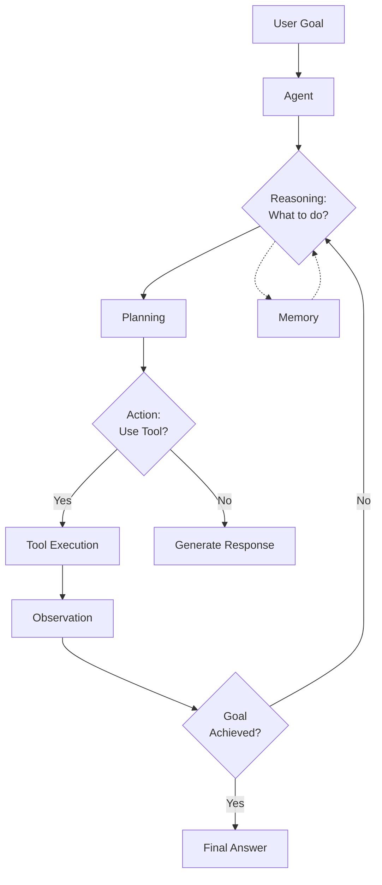
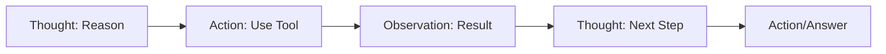
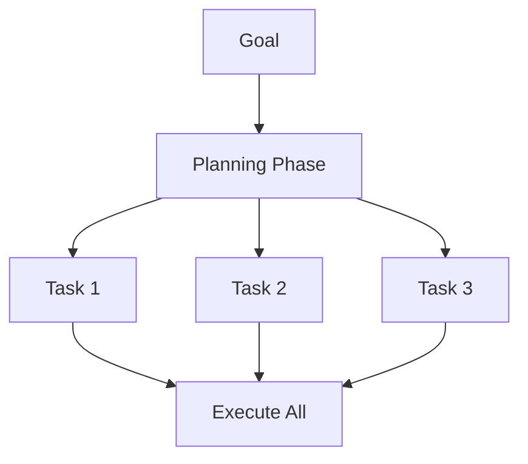
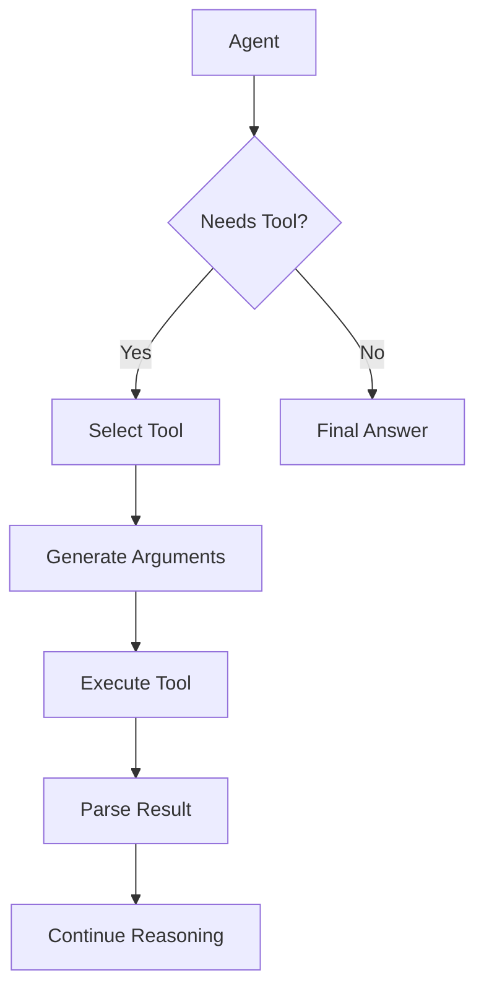
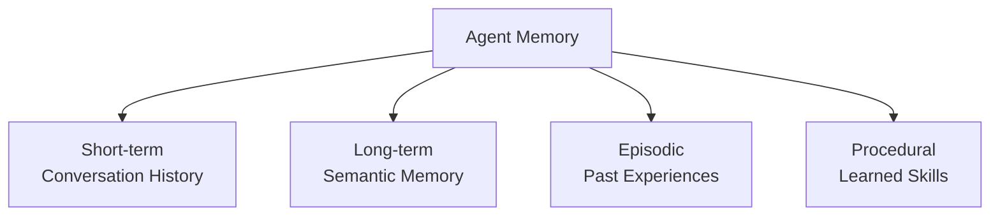
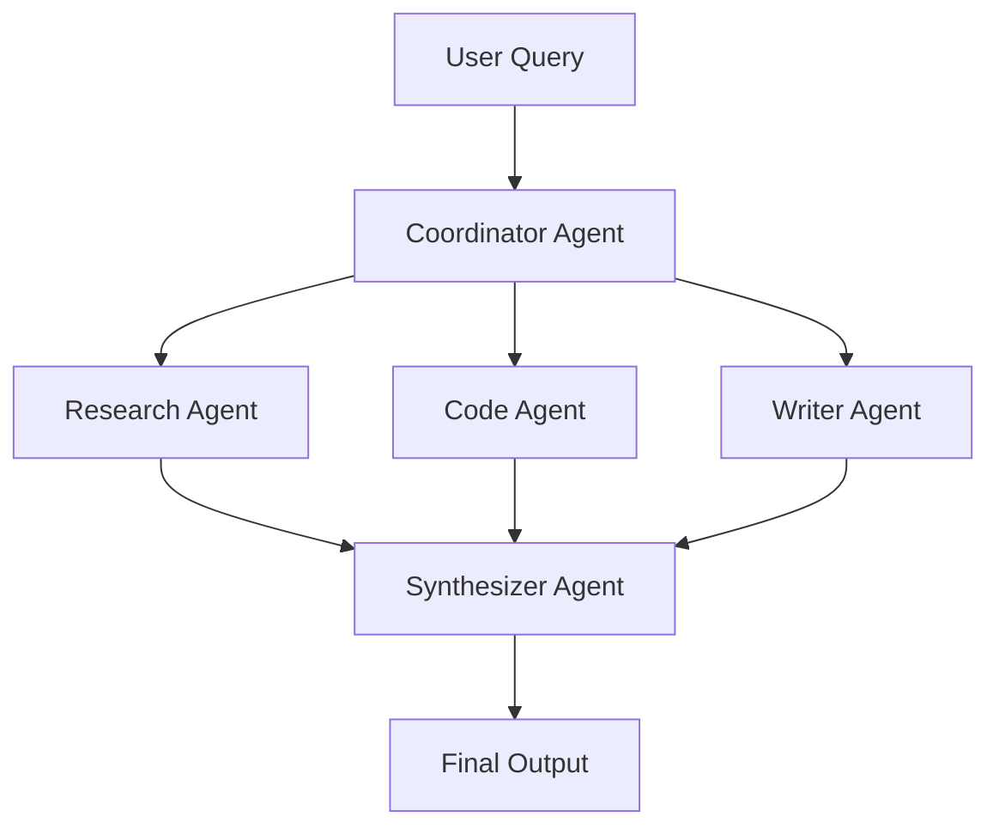
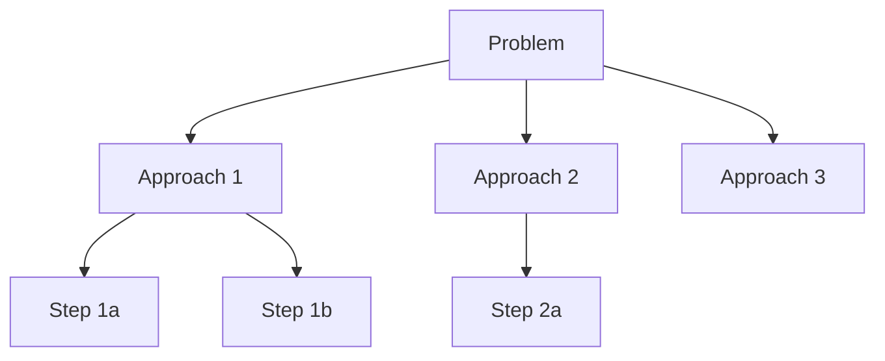

# 🤖 AI Agents

> [!blue] 💙 **Autonomous AI Systems**
> Building LLM-powered agents that can reason, plan, use tools, and take actions autonomously. Learn agent architectures, tool use, memory systems, and multi-agent patterns.

---

## 📚 Topics Covered

### Core Concepts
- **Agent Architecture** - ReAct, Plan-and-Execute, ReWOO
- **Tool Use** - Function calling, API integration
- **Memory Systems** - Short-term, long-term, episodic memory
- **Planning & Reasoning** - Goal decomposition, chain-of-thought
- **Multi-Agent Systems** - Agent collaboration and communication
- **Agent Evaluation** - Success metrics and safety

---

## 🎯 Learning Objectives

By the end of this section, you should be able to:
- [ ] Understand different agent architectures
- [ ] Build agents with tool use capabilities
- [ ] Implement memory systems for agents
- [ ] Create multi-agent systems
- [ ] Handle agent failures and safety
- [ ] Evaluate agent performance
- [ ] Deploy agents to production

---

## 📝 Key Concepts

### [[agent-architecture|Agent Architecture]]

> [!blue] 💙 **Core Agent Components**
> An AI agent consists of perception, reasoning, action, and memory components working together to achieve goals.

**Agent Loop:**

**Key Components:**
1. **Perception:** Understand user input and environment
2. **Reasoning:** Decide what action to take
3. **Action:** Execute tools or generate response
4. **Memory:** Remember past interactions and learnings
5. **Observation:** Process tool outputs and feedback

---

### [[agent-patterns|Agent Patterns]]

> [!blue] 💙 **Common Agent Architectures**
> Different patterns for building agents, each with tradeoffs.

**ReAct (Reasoning + Acting):**

- Interleave reasoning and acting
- LLM generates thought → action → observe loop
- Most popular pattern

**Plan-and-Execute:**

- Plan all steps upfront
- Execute plan sequentially
- Re-plan if execution fails

**ReWOO (Reasoning WithOut Observation):**
- Generate full plan without tool execution
- Execute all tools in parallel
- Solve with all observations
- More efficient, less flexible

> [!yellow] 💡 **Pattern Selection**
> - **ReAct:** General purpose, good for exploration
> - **Plan-and-Execute:** Complex goals, multi-step tasks
> - **ReWOO:** When tools can run in parallel

---

### [[tool-use|Tool Use & Function Calling]]

> [!blue] 💙 **Extending Agent Capabilities**
> Enable agents to use external tools (APIs, calculators, databases) to accomplish tasks beyond pure generation.

**Tool Use Flow:**

**Common Tools:**
- **Search:** Web search (Google, Bing), Wikipedia
- **Calculators:** Math operations, unit conversion
- **Databases:** SQL queries, vector search
- **APIs:** Weather, stock prices, calendar
- **Code Execution:** Run Python, shell commands
- **File Operations:** Read, write, search files

**Function Calling:**
- LLM outputs structured tool call
- Format: `{"tool": "calculator", "input": "25 * 4"}`
- Execute tool, return result to LLM
- LLM continues with observation

> [!green] ✅ **Tool Design Best Practices**
> - **Clear descriptions:** LLM needs to know when to use each tool
> - **Typed parameters:** Use JSON schema for tool inputs
> - **Error handling:** Return informative errors to agent
> - **Idempotent:** Safe to retry failed tool calls

---

### [[agent-memory|Agent Memory Systems]]

> [!blue] 💙 **Remembering Past Interactions**
> Memory enables agents to learn from experience, maintain context, and personalize interactions.

**Memory Types:**

**Memory Hierarchy:**

1. **Short-term Memory**
   - Current conversation context
   - Last N messages in prompt
   - Limited by context window

2. **Long-term Memory**
   - Vector database of past interactions
   - Semantic search to retrieve relevant memories
   - Unlimited storage

3. **Episodic Memory**
   - Specific past events
   - "Remember when user asked about X?"
   - Timestamped experiences

4. **Procedural Memory**
   - Learned procedures and workflows
   - "How did I solve similar problems?"
   - Reusable strategies

**Implementation:**
- Short-term: In-context messages
- Long-term: Vector DB (ChromaDB, Pinecone)
- Retrieval: Semantic search on query relevance

> [!yellow] 💡 **Memory Strategy**
> - Always use short-term for current conversation
> - Add long-term for personalization, learning
> - Retrieve selectively (don't overload context)
> - Summarize old conversations periodically

---

### [[multi-agent-systems|Multi-Agent Systems]]

> [!blue] 💙 **Agent Collaboration**
> Multiple specialized agents working together, each with different roles and capabilities.

**Multi-Agent Patterns:**

**Collaboration Patterns:**

1. **Hierarchical**
   - Manager agent delegates to worker agents
   - Clear roles and responsibilities
   - Efficient coordination

2. **Sequential**
   - Agents form a pipeline
   - Output of one → input of next
   - Specialized processing

3. **Debate/Consensus**
   - Agents discuss and critique
   - Better quality through multiple perspectives
   - Slower but more robust

**Use Cases:**
- **Software development:** PM + Developer + QA agents
- **Research:** Researcher + Fact-checker + Writer
- **Customer support:** Classifier + Specialist + Escalation

> [!red] ⚠️ **Multi-Agent Challenges**
> - Coordination overhead
- Communication clarity between agents
> - Cost multiplies with agent count
> - Debugging is harder

---

### [[agent-planning|Planning & Reasoning]]

> [!blue] 💙 **Goal Decomposition and Strategy**
> Breaking down complex goals into executable steps through reasoning and planning.

**Planning Approaches:**

**Chain-of-Thought (CoT):**
- Step-by-step reasoning
- "Let's think through this..."
- Improves complex reasoning

**Tree of Thoughts (ToT):**

- Explore multiple reasoning paths
- Backtrack if path fails
- More robust, more expensive

**Goal Decomposition:**
1. Break high-level goal into sub-goals
2. Order sub-goals by dependencies
3. Execute each sub-goal
4. Combine results

> [!yellow] 💡 **When to Plan**
> - **Simple tasks:** Direct ReAct, no planning
> - **Multi-step:** Plan-and-Execute
> - **Complex/Ambiguous:** Tree of Thoughts
> - **Research tasks:** Iterative planning

---

## 🔬 Advanced Topics

> [!purple] 🔮 **Self-Reflection**
> Agent critiques its own outputs:
> - Generate answer
> - Critique quality, identify issues
> - Regenerate if needed
> - Improves reliability

> [!purple] 🔮 **Human-in-the-Loop**
> Agent requests human input when uncertain:
> - Confidence scoring
> - Escalation to human
> - Learn from human feedback
> - Critical for high-stakes tasks

> [!purple] 🔮 **Agent Training**
> Improving agents through learning:
> - **Prompt engineering:** Refine system prompts
> - **Few-shot examples:** Add successful trajectories
> - **Fine-tuning:** Train on agent traces
> - **RLHF:** Reward good agent behavior

> [!purple] 🔮 **Agentic RAG**
> Agent decides when and what to retrieve:
> - Query planning
> - Multi-hop retrieval
> - Information synthesis
> - Better than static RAG

---

## ⚠️ Common Pitfalls

> [!red] ⚠️ **Infinite Loops**
> - **Problem:** Agent repeats same action indefinitely
> - **Solution:** Max iterations limit, loop detection, varied prompts

> [!red] ⚠️ **Hallucinated Tool Calls**
> - **Problem:** Agent invents non-existent tools or parameters
> - **Solution:** Strict tool schemas, validation, few-shot examples

> [!red] ⚠️ **Context Window Overflow**
> - **Problem:** Long conversations exceed token limit
> - **Solution:** Summarization, memory management, truncation strategy

> [!red] ⚠️ **Cost Explosion**
> - **Problem:** Complex agents make many LLM calls
> - **Solution:** Budget limits, caching, smaller models for simple steps

---

## 💡 Best Practices

> [!yellow] 💡 **Agent Development**
> - **Start simple:** Single agent, few tools
> - **Add tools incrementally:** Test each addition
> - **Clear tool descriptions:** Critical for correct usage
> - **Logging:** Log all agent actions and reasoning
> - **Human oversight:** Review agent decisions initially

> [!yellow] 💡 **Safety & Reliability**
> - **Confirmation for destructive actions:** Delete, send, pay
> - **Rate limiting:** Prevent runaway agents
> - **Sandboxing:** Isolate tool execution
> - **Monitoring:** Track success rates, failures
> - **Fallbacks:** Graceful degradation on errors

> [!yellow] 💡 **Performance Optimization**
> - **Caching:** Cache tool results, avoid redundant calls
> - **Parallel execution:** Run independent tools together
> - **Smaller models:** Use GPT-3.5 for simple steps
> - **Early termination:** Stop when goal achieved

---

## 🔗 Related Topics

- [[06-AI-Systems/RAG/README|RAG]] - Knowledge retrieval for agents
- [[06-AI-Systems/Prompt-Engineering/README|Prompt Engineering]] - Agent prompts
- [[04-Deep-Learning/LLMs/README|Large Language Models]] - Foundation models
- [[07-MLOps-Deployment/LLMOps/README|LLMOps]] - Deploying agents

---

## 📚 Resources

**Frameworks:**
- **LangChain:** Agent framework with tools
- **AutoGPT:** Autonomous agent
- **BabyAGI:** Task-driven autonomous agent
- **LangGraph:** Build stateful multi-agent workflows

**Papers:**
- "ReAct: Synergizing Reasoning and Acting in Language Models" (2022)
- "Tree of Thoughts: Deliberate Problem Solving with LLMs" (2023)
- "Toolformer: Language Models Can Teach Themselves to Use Tools" (2023)
- "Generative Agents: Interactive Simulacra of Human Behavior" (2023)

**Tools:**
- LangSmith: Agent debugging
- Weights & Biases: Agent monitoring
- Helicone: LLM observability

---

**Tags:** #ai-agents #tool-use #multi-agent #react #planning #agent-memory
**Difficulty:** 🔥🔥🔥🔥 Expert
**Last Updated:** 2026-11-11
