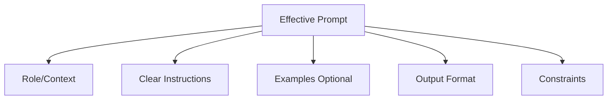
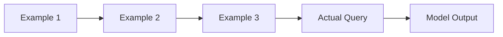
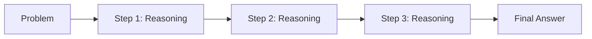
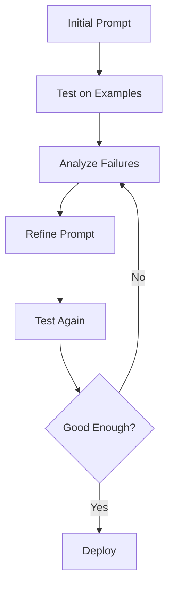

# 💬 Prompt Engineering

**💙 Effective Communication with LLMs**
The art and science of crafting prompts to get desired outputs from language models. Learn zero-shot, few-shot, chain-of-thought, and advanced prompting techniques.

---

## 📚 Topics Covered

### Core Concepts
- **Prompt Structure** - Clear instructions, context, examples
- **Zero-Shot Prompting** - No examples, pure instruction
- **Few-Shot Prompting** - Learning from examples
- **Chain-of-Thought** - Step-by-step reasoning
- **Prompt Templates** - Reusable prompt patterns
- **System Messages** - Setting model behavior
- **Prompt Optimization** - Iterative improvement

---

## 🎯 Learning Objectives

By the end of this section, you should be able to:
- [ ] Write clear and effective prompts
- [ ] Use few-shot learning for complex tasks
- [ ] Apply chain-of-thought reasoning
- [ ] Design prompt templates
- [ ] Optimize prompts iteratively
- [ ] Handle edge cases and failures
- [ ] Evaluate prompt quality

---

## 📝 Key Concepts

### [[prompt-fundamentals|Prompt Fundamentals]]

**💙 Anatomy of a Good Prompt**
A well-structured prompt has clear instructions, context, examples (optional), and output format specification.

**Prompt Structure:**


**Components:**

1. **Role/Context**
   - Set the model's perspective
   - "You are an expert data scientist..."
   - Provides framing for the task

2. **Task Instructions**
   - Clear, specific, unambiguous
   - "Classify the sentiment as positive, negative, or neutral"
   - Avoid vague requests

3. **Examples (Few-Shot)**
   - Show desired input-output pairs
   - 1-5 examples typically enough
   - Use diverse, representative cases

4. **Output Format**
   - Specify desired format (JSON, markdown, bullet points)
   - Helps with parsing and consistency
   - Example: "Return answer as JSON: {\"sentiment\": \"...\", \"confidence\": 0.95}"

5. **Constraints**
   - Length limits, tone, what to avoid
   - "Answer in 2-3 sentences"
   - "Use simple language for a 10-year-old"

---

### [[zero-shot-prompting|Zero-Shot Prompting]]

**💙 No Examples Needed**
Relying on model's pre-trained knowledge without providing examples. Works for common, well-defined tasks.

**When Zero-Shot Works:**
- Simple, common tasks (classification, summarization)
- Clear, unambiguous instructions
- Powerful models (GPT-4, Claude)

**Example:**
```
Task: Classify the sentiment of the following review.
Review: "This product exceeded my expectations! Great quality."
Sentiment:
```

**💡 Zero-Shot Best Practices**
- Be extremely clear and specific
- Define all terms and categories
- Specify output format explicitly
- Test with edge cases

---

### [[few-shot-prompting|Few-Shot Prompting]]

**💙 Learning from Examples**
Providing input-output examples to demonstrate the task pattern. Significantly improves performance on complex tasks.

**Few-Shot Pattern:**


**Example:**
```
Classify entities in the text as PERSON, LOCATION, or ORGANIZATION.

Text: "Steve Jobs founded Apple in Cupertino."
Entities: Steve Jobs (PERSON), Apple (ORGANIZATION), Cupertino (LOCATION)

Text: "Microsoft CEO Satya Nadella spoke at the Seattle conference."
Entities: Microsoft (ORGANIZATION), Satya Nadella (PERSON), Seattle (LOCATION)

Text: "Barack Obama visited Paris last week."
Entities:
```

**Few-Shot Guidelines:**
- **Number:** 2-5 examples usually optimal
- **Diversity:** Cover different cases and edge cases
- **Format consistency:** Keep format identical across examples
- **Order:** Sometimes order matters (put similar examples near query)

**✅ When to Use Few-Shot**
- Complex or nuanced tasks
- Custom output formats
- Domain-specific terminology
- When zero-shot performance is insufficient

---

### [[chain-of-thought|Chain-of-Thought (CoT)]]

**💙 Reasoning Step-by-Step**
Prompting the model to show its reasoning process before giving the final answer. Dramatically improves complex reasoning tasks.

**CoT Flow:**


**Zero-Shot CoT (Simplest):**
```
Question: Roger has 5 tennis balls. He buys 2 more cans of tennis balls. 
Each can has 3 tennis balls. How many tennis balls does he have now?

Let's think step by step:
```

**Few-Shot CoT (Best Performance):**
```
Question: Mary has 3 apples. She buys 2 more. How many does she have?
Answer: Let's think step by step.
1. Mary starts with 3 apples
2. She buys 2 more
3. 3 + 2 = 5
Therefore, Mary has 5 apples.

Question: Roger has 5 tennis balls. He buys 2 more cans. Each can has 3 balls. How many does he have now?
Answer: Let's think step by step.
```

**When CoT Helps:**
- Math word problems
- Multi-hop reasoning
- Logic puzzles
- Complex decision-making

**💡 CoT Variants**
- **Zero-Shot CoT:** Add "Let's think step by step"
- **Few-Shot CoT:** Show reasoning in examples
- **Self-Consistency:** Generate multiple CoT, pick most common answer
- **Tree of Thoughts:** Explore multiple reasoning paths

---

### [[advanced-prompting|Advanced Prompting Techniques]]

**💙 Beyond Basic Prompts**
Sophisticated prompting strategies for complex tasks and better reliability.

**Advanced Techniques:**

**1. Role Prompting:**
```
You are an expert SQL developer with 10 years of experience in database optimization.
Your task is to write an efficient query that...
```
- Sets expertise level and perspective
- Improves quality for specialized tasks

**2. Structured Output:**
```
Return your answer as JSON with the following schema:
{
  "summary": "Brief summary",
  "key_points": ["point1", "point2"],
  "confidence": 0.95
}
```
- Ensures parseable outputs
- Critical for programmatic use

**3. Constraints and Guardrails:**
```
Rules:
- Do not make up information
- If uncertain, say "I don't know"
- Cite sources when available
- Keep responses under 100 words
```

**4. Multi-Step Prompts:**
```
Step 1: Analyze the problem
Step 2: List possible solutions
Step 3: Evaluate each solution
Step 4: Recommend the best solution with justification
```

**5. Self-Critique:**
```
First, provide your answer.
Then, critique your answer for potential issues.
Finally, provide an improved answer based on your critique.
```

---

### [[prompt-optimization|Prompt Optimization]]

**💙 Iterative Improvement**
Systematically improving prompts through testing, analysis, and refinement.

**Optimization Cycle:**


**Optimization Strategies:**

1. **Add Examples**
   - Include edge cases in few-shot
   - Cover failure modes

2. **Clarify Instructions**
   - Remove ambiguity
   - Define terms explicitly
   - Add constraints

3. **Adjust Format**
   - Specify output structure
   - Add delimiters, markers
   - Use JSON schema

4. **Add Reasoning Steps**
   - Request chain-of-thought
   - Break into sub-tasks

5. **Test Systematically**
   - Build evaluation set
   - Track metrics (accuracy, consistency)
   - A/B test variations

**💡 Optimization Tools**
- **Promptfoo:** Prompt testing framework
- **LangSmith:** LangChain evaluation
- **Weights & Biases:** Experiment tracking
- **Manual review:** Still essential

---

## 🔬 Advanced Topics

**🔮 Prompt Compression**
Reducing token usage while maintaining quality:
- Remove verbose examples
- Use abbreviations
- Compress with specialized models
- Critical for long contexts

**🔮 Adversarial Prompting**
Testing robustness against edge cases:
- Injection attacks
- Contradictory instructions
- Malformed inputs
- Safety testing

**🔮 Automatic Prompt Engineering**
Using AI to generate/optimize prompts:
- **DSPy:** Programmatic prompt optimization
- **APE (Automatic Prompt Engineer):** LLM generates prompts
- **Gradient-based:** Optimize prompts like model weights

**🔮 Meta-Prompting**
LLM generates prompts for other LLMs:
- Describe task, LLM writes prompt
- Iterative refinement
- Better than manual sometimes

---

## ⚠️ Common Pitfalls

**⚠️ Vague Instructions**
- **Problem:** "Summarize this" - how long? what style?
- **Solution:** "Summarize in 3 bullet points, technical audience"

**⚠️ Too Many Instructions**
- **Problem:** Overloading prompt with rules
- **Solution:** Prioritize key instructions, use examples

**⚠️ Inconsistent Examples**
- **Problem:** Few-shot examples vary in format
- **Solution:** Use identical structure across all examples

**⚠️ Not Testing Edge Cases**
- **Problem:** Prompt works on happy path only
- **Solution:** Test with empty input, long input, malformed data

---

## 💡 Best Practices

**💡 Prompt Design Principles**
- **Be specific:** Clear, concrete instructions
- **Provide context:** Background info, role, purpose
- **Show, don't tell:** Use examples when possible
- **Specify format:** JSON, bullet points, etc.
- **Iterate:** Test and refine continuously

**💡 Common Patterns**
- **Classification:** Few-shot with all classes shown
- **Extraction:** Specify output format (JSON), show examples
- **Generation:** Set tone/style, give constraints
- **Reasoning:** Use chain-of-thought
- **Summarization:** Specify length and key points

**💡 Testing Strategy**
- Create evaluation dataset (20-50 examples)
- Cover edge cases (empty, long, ambiguous)
- Measure accuracy/quality metrics
- Compare prompt variations (A/B test)
- Review failures manually

---

## 🔗 Related Topics

- [[06-AI-Systems/RAG/README|RAG]] - Prompts for retrieval-augmented systems
- [[06-AI-Systems/Agents/README|AI Agents]] - Agent prompts and tool use
- [[04-Deep-Learning/LLMs/README|Large Language Models]] - Understanding LLMs
- [[07-MLOps-Deployment/LLMOps/README|LLMOps]] - Production prompt management

---

## 📚 Resources

**Guides:**
- OpenAI Prompt Engineering Guide
- Anthropic Prompt Engineering Guide
- Prompt Engineering Guide (DAIR.AI)

**Tools:**
- **Promptfoo:** Testing framework
- **LangSmith:** Debugging and evaluation
- **PromptLayer:** Prompt management
- **Humanloop:** Prompt version control

**Papers:**
- "Chain-of-Thought Prompting Elicits Reasoning in LLMs" (2022)
- "Large Language Models are Zero-Shot Reasoners" (2022)
- "Self-Consistency Improves Chain of Thought Reasoning" (2022)
- "Tree of Thoughts: Deliberate Problem Solving" (2023)

**Courses:**
- DeepLearning.AI: ChatGPT Prompt Engineering for Developers
- Coursera: Prompt Engineering Specialization

---

**Tags:** #prompt-engineering #few-shot #chain-of-thought #zero-shot #llm-prompting
**Difficulty:** 🔥🔥🔥 Advanced
**Last Updated:** 2026-11-11
