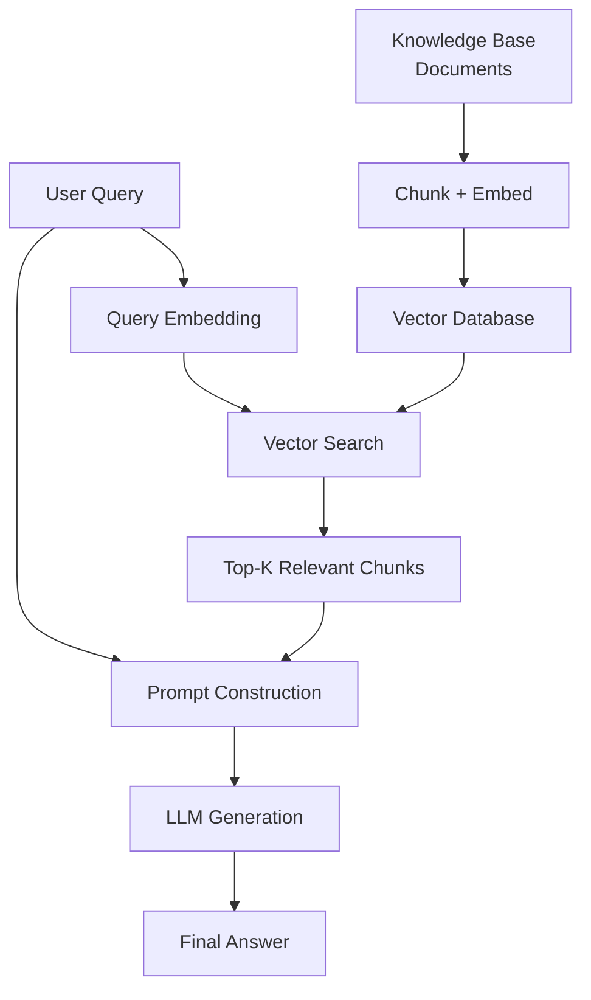
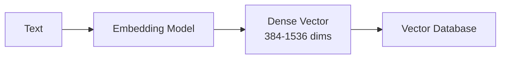
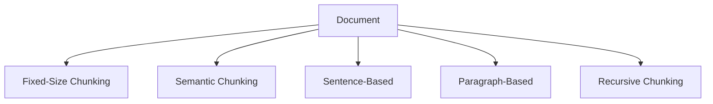
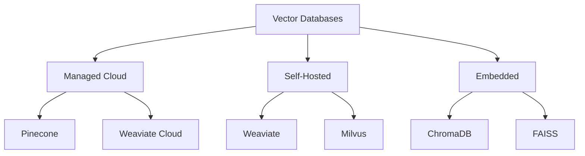
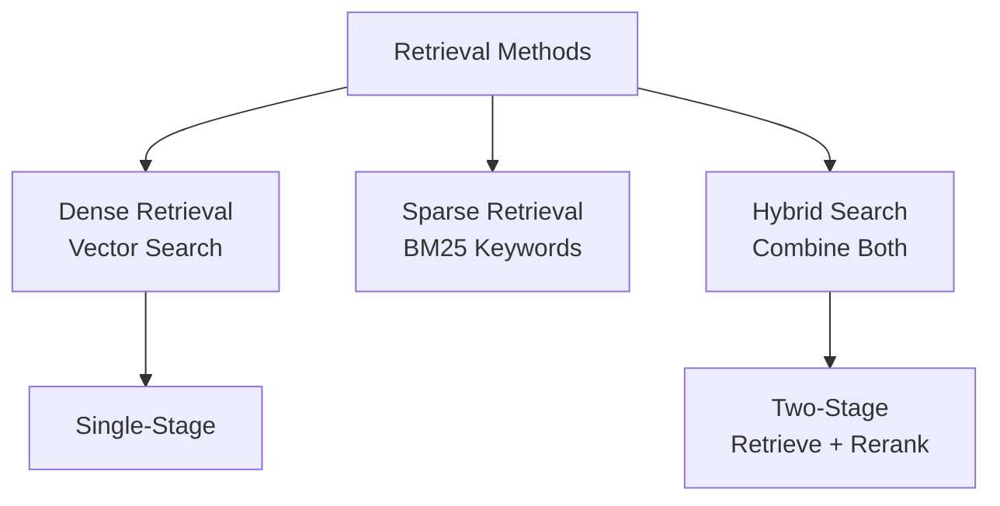

# 🔍 RAG (Retrieval-Augmented Generation)

**💙 Knowledge-Enhanced LLM Systems**
Combining retrieval from knowledge bases with language model generation. Enable LLMs to access external knowledge and provide factual, up-to-date responses.

---

## 📚 Topics Covered

### Core Concepts
- **RAG Architecture** - Retrieval + generation pipeline
- **Vector Embeddings** - Dense representations for semantic search
- **Vector Databases** - Storing and querying embeddings
- **Chunking Strategies** - Breaking documents into retrievable pieces
- **Retrieval Methods** - Dense retrieval, hybrid search, re-ranking
- **Context Management** - Handling retrieved information
- **Evaluation** - Measuring RAG system quality

---

## 🎯 Learning Objectives

By the end of this section, you should be able to:
- [ ] Understand how RAG solves LLM limitations
- [ ] Build a basic RAG system
- [ ] Choose appropriate chunking strategies
- [ ] Implement vector similarity search
- [ ] Use vector databases (Pinecone, Weaviate, ChromaDB)
- [ ] Evaluate RAG system performance
- [ ] Handle common RAG challenges

---

## 📝 Key Concepts

### [[rag-architecture|RAG Architecture]]

**💙 Retrieval-Augmented Generation Pipeline**
Retrieve relevant information from knowledge base, then use it as context for LLM generation.

**RAG Flow:**


**Why RAG?**
- **Factual accuracy:** Ground answers in retrieved documents
- **Up-to-date:** Add new knowledge without retraining
- **Source attribution:** Cite where information came from
- **Domain-specific:** Works with private/specialized knowledge

**✅ RAG vs Fine-Tuning**
- **RAG:** External knowledge, dynamic, no training needed
- **Fine-tuning:** Internalized knowledge, static, requires training
- **Best:** Combine both for optimal performance

---

### [[vector-embeddings|Vector Embeddings]]

**💙 Semantic Vector Representations**
Converting text into dense vectors that capture semantic meaning. Similar texts have similar vectors.

**Embedding Models:**


**Popular Embedding Models:**
- **sentence-transformers:** all-MiniLM-L6-v2 (384d), all-mpnet-base-v2 (768d)
- **OpenAI:** text-embedding-3-small (1536d), text-embedding-3-large (3072d)
- **Cohere:** embed-english-v3.0, embed-multilingual-v3.0
- **Voyage AI:** voyage-2 (1024d)

**Key Properties:**
- **Dimensionality:** Typically 384-1536 dimensions
- **Semantic similarity:** Cosine similarity measures closeness
- **Domain-specific:** Better to use domain-tuned embeddings

**💡 Choosing Embedding Model**
- **General purpose:** OpenAI text-embedding-3-small
- **Open source:** sentence-transformers (all-mpnet-base-v2)
- **Multilingual:** Cohere embed-multilingual
- **Code:** OpenAI text-embedding-3-large, CodeBERT

---

### [[chunking-strategies|Chunking Strategies]]

**💙 Breaking Documents into Retrievable Units**
Splitting large documents into smaller chunks for effective retrieval and context fitting.

**Chunking Methods:**


**Chunking Approaches:**

1. **Fixed-Size Chunking**
   - Split every N tokens (e.g., 512 tokens)
   - Simple, predictable
   - May break semantic units

2. **Sentence-Based**
   - Keep sentences together
   - Semantic coherence
   - Variable chunk sizes

3. **Paragraph/Section-Based**
   - Split at natural boundaries
   - Preserve document structure
   - Better context

4. **Recursive Chunking**
   - Try paragraph → sentence → fixed-size
   - Best of both worlds

5. **Semantic Chunking**
   - Embed sentences, split where similarity drops
   - Most coherent chunks
   - More computation

**Overlap Strategy:**
- Add overlap between chunks (e.g., 50-100 tokens)
- Prevents losing context at boundaries
- Improves retrieval recall

**💡 Chunk Size Guidelines**
- **Typical size:** 256-512 tokens per chunk
- **Too small:** Lose context, many retrievals needed
- **Too large:** Irrelevant info, exceed LLM context
- **Rule of thumb:** Fit 3-5 chunks in LLM context window

---

### [[vector-databases|Vector Databases]]

**💙 Efficient Similarity Search at Scale**
Specialized databases for storing vectors and performing fast similarity search (nearest neighbor).

**Vector DB Landscape:**


**Popular Options:**
- **Pinecone:** Managed, serverless, easy to use
- **Weaviate:** Open source, GraphQL API, hybrid search
- **ChromaDB:** Embedded, Python-native, simple
- **Qdrant:** High performance, Rust-based, filtering
- **FAISS:** Facebook's library, in-memory, fast

**Key Features:**
- **Similarity search:** Find top-K nearest vectors
- **Metadata filtering:** Filter by attributes (date, category)
- **Hybrid search:** Combine vector + keyword search
- **Scalability:** Handle millions to billions of vectors

**💡 Choosing Vector Database**
- **Quick prototype:** ChromaDB (embedded)
- **Production, managed:** Pinecone, Weaviate Cloud
- **Self-hosted:** Weaviate, Qdrant, Milvus
- **Cost-sensitive:** FAISS (free, in-memory)

---

### [[retrieval-methods|Retrieval Methods]]

**💙 Finding Relevant Information**
Techniques for retrieving the most relevant documents given a query.

**Retrieval Approaches:**


**Dense Retrieval (Vector Search):**
- Embed query and documents
- Cosine similarity search
- Captures semantic meaning
- Best for conceptual queries

**Sparse Retrieval (BM25):**
- Traditional keyword matching
- Term frequency-based scoring
- Good for exact matches
- Fast, explainable

**Hybrid Search:**
- Combine dense + sparse scores
- Best of both worlds
- More robust

**Two-Stage Retrieval:**
1. **First stage:** Fast retrieval (get top 100)
2. **Second stage:** Re-rank with cross-encoder (get top 5)

**💡 Retrieval Strategy**
- **Semantic queries:** Dense retrieval
- **Keyword/exact match:** Sparse (BM25)
- **Best quality:** Hybrid + re-ranking
- **Speed critical:** Single-stage dense

---

### [[rag-evaluation|RAG Evaluation]]

**💙 Measuring RAG System Quality**
Evaluating both retrieval quality and generation quality separately and together.

**Evaluation Framework:**
```mermaid
graph TD
    A[RAG Evaluation] --> B[Retrieval Metrics]
    A --> C[Generation Metrics]
    B --> D[Recall@K]
    B --> E[Precision@K]
    B --> F[MRR]
    C --> G[Answer Relevance]
    C --> H[Faithfulness]
    C --> I[Groundedness]
```

**Retrieval Metrics:**
- **Recall@K:** Are relevant docs in top-K?
- **Precision@K:** What % of top-K are relevant?
- **MRR (Mean Reciprocal Rank):** Position of first relevant doc

**Generation Metrics:**
- **Answer Relevance:** Does answer address the question?
- **Faithfulness:** Is answer grounded in retrieved docs?
- **Groundedness:** No hallucinations beyond context
- **Context Precision:** Relevance of retrieved chunks

**Tools:**
- **RAGAS:** RAG evaluation framework
- **TruLens:** LLM observability and evaluation
- **LangSmith:** LangChain debugging and eval

---

## 🔬 Advanced Techniques

**🔮 Query Transformation**
Modify queries for better retrieval:
- **HyDE:** Generate hypothetical document, embed, retrieve
- **Multi-query:** Generate multiple query variations
- **Query expansion:** Add synonyms and related terms

**🔮 Advanced Chunking**
- **Contextual chunks:** Add document summary to each chunk
- **Hierarchical chunking:** Parent-child chunk relationships
- **Propositionization:** Split into atomic facts

**🔮 Re-ranking**
Two-stage retrieval for better quality:
- First: Fast retrieval (top 100)
- Second: Cross-encoder re-ranking (top 5)
- Models: Cohere rerank, bge-reranker

**🔮 Agentic RAG**
LLM decides when and what to retrieve:
- Query planning
- Iterative retrieval
- Multi-hop reasoning

---

## ⚠️ Common Pitfalls

**⚠️ Poor Chunking**
- **Problem:** Chunks too large/small, lose context
- **Solution:** Experiment with size (256-512), add overlap, preserve structure

**⚠️ Embedding Mismatch**
- **Problem:** Different embeddings for indexing vs retrieval
- **Solution:** Use same embedding model consistently

**⚠️ Context Stuffing**
- **Problem:** Too many irrelevant chunks in context
- **Solution:** Use re-ranking, reduce top-K, filter by relevance score

**⚠️ No Evaluation**
- **Problem:** Don't know if system is working well
- **Solution:** Build evaluation set, track metrics, iterate

---

## 💡 Best Practices

**💡 Building RAG System**
1. **Start simple:** ChromaDB + OpenAI embeddings + GPT-4
2. **Chunk wisely:** 256-512 tokens with 50-token overlap
3. **Evaluate early:** Create test set of Q&A pairs
4. **Iterate:** Try different chunking, embeddings, retrieval
5. **Add re-ranking:** For production quality

**💡 Production Considerations**
- **Caching:** Cache embeddings and responses
- **Monitoring:** Track retrieval quality, latency, costs
- **Fallbacks:** Handle no-results, low-confidence scenarios
- **Citation:** Always include sources in response
- **Updates:** Plan for updating knowledge base

**💡 Optimization Tips**
- **Batch embedding:** Embed multiple docs at once
- **Index optimization:** Use HNSW, IVF for large scale
- **Metadata filtering:** Pre-filter by date, category
- **Compression:** Quantization for vector storage

---

## 🔗 Related Topics

- [[06-AI-Systems/Prompt-Engineering/README|Prompt Engineering]] - Effective prompts with RAG
- [[06-AI-Systems/Agents/README|AI Agents]] - Agentic RAG systems
- [[05-NLP/Applications/README|NLP Applications]] - Question answering
- [[07-MLOps-Deployment/LLMOps/README|LLMOps]] - Deploying RAG systems

---

## 📚 Resources

**Frameworks:**
- **LangChain:** RAG orchestration
- **LlamaIndex:** Data framework for LLMs
- **Haystack:** NLP framework with RAG

**Vector Databases:**
- Pinecone, Weaviate, ChromaDB, Qdrant
- FAISS (Facebook AI Similarity Search)

**Evaluation:**
- RAGAS framework
- TruLens
- LangSmith

**Papers:**
- "Retrieval-Augmented Generation for Knowledge-Intensive NLP" (2020)
- "Dense Passage Retrieval for Open-Domain Question Answering" (2020)
- "Improving Language Models by Retrieving from Trillions of Tokens" (RETRO, 2021)

---

**Tags:** #rag #retrieval-augmented-generation #vector-database #embeddings #semantic-search
**Difficulty:** 🔥🔥🔥🔥 Expert
**Last Updated:** 2026-11-11
