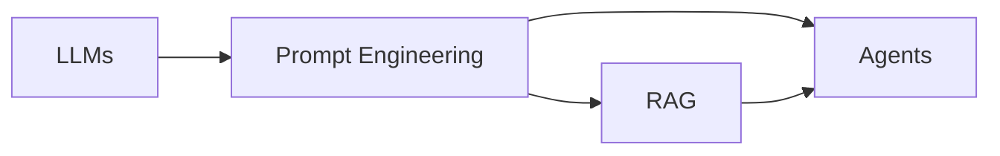

# 🤖 06 - AI Systems

**💙 AI Systems Section**
Building production AI systems using Large Language Models. Covers RAG, AI Agents, Prompt Engineering, and advanced LLM application patterns.

---

## 📂 Section Structure

### [[06-AI-Systems/RAG/README|RAG (Retrieval-Augmented Generation)]]
Vector databases, semantic search, and retrieval-augmented generation systems

### [[06-AI-Systems/Agents/README|AI Agents]]
Building autonomous agents with tool use, memory, and multi-step reasoning

### [[06-AI-Systems/Prompt-Engineering/README|Prompt Engineering]]
Effective prompting techniques, few-shot learning, and prompt optimization

---

## 🎯 Learning Path

**Recommended Order:**
1. **Prompt Engineering** - Master effective prompting first
2. **RAG** - Build retrieval-augmented systems
3. **Agents** - Create autonomous AI agents

---

## 🔗 Prerequisites

From [[04-Deep-Learning/LLMs]]:
- Large Language Models fundamentals
- Transformer architecture
- Fine-tuning and inference

From [[05-NLP]]:
- Text embeddings
- NLP applications
- Tokenization

---

## 💡 Key Concepts Covered

**💡 Core AI Systems Topics**
- **Prompt Engineering:** Few-shot, chain-of-thought, role prompting
- **RAG Architecture:** Chunking, embedding, retrieval, generation
- **Vector Databases:** Pinecone, Weaviate, ChromaDB, FAISS
- **Agent Design:** ReAct, tool use, memory systems
- **Evaluation:** Answer relevance, faithfulness, retrieval quality
- **Production Patterns:** Caching, streaming, error handling

---

## 📊 Progress Tracking

- [ ] Master prompt engineering techniques
- [ ] Build a basic RAG system
- [ ] Implement vector search
- [ ] Create a tool-using agent
- [ ] Add memory to an agent
- [ ] Deploy a production AI system

---

## 🛠️ Tools & Frameworks

**LLM Frameworks:**
- **LangChain** - LLM application framework
- **LlamaIndex** - Data framework for LLMs
- **Haystack** - NLP framework with LLM support
- **Semantic Kernel** - Microsoft's LLM SDK

**Vector Databases:**
- **Pinecone** - Managed vector database
- **Weaviate** - Open-source vector search
- **ChromaDB** - Embedded vector database
- **FAISS** - Facebook's vector similarity search

**LLM APIs:**
- **OpenAI API** - GPT-4, GPT-3.5
- **Anthropic API** - Claude models
- **Cohere API** - Embeddings and generation
- **Hugging Face** - Open-source models

**Monitoring & Evaluation:**
- **LangSmith** - LangChain debugging
- **Weights & Biases** - Experiment tracking
- **Arize Phoenix** - LLM observability

---

## 📚 Recommended Resources

**Courses:**
- DeepLearning.AI LangChain courses
- LlamaIndex course
- Prompt Engineering for Developers

**Books:**
- Building LLM Applications (Cobus Greyling)
- Designing Machine Learning Systems (Chip Huyen)

**Key Papers:**
- "Retrieval-Augmented Generation for Knowledge-Intensive NLP"
- "ReAct: Synergizing Reasoning and Acting in Language Models"
- "Tree of Thoughts: Deliberate Problem Solving with LLMs"

**Documentation:**
- LangChain Docs
- LlamaIndex Docs
- OpenAI Cookbook
- Anthropic Prompt Engineering Guide

---

## 🎯 Real-World Applications

**✅ Production Use Cases**
- **Customer Support:** AI chatbots with knowledge bases
- **Document Q&A:** Question answering over private documents
- **Code Assistant:** AI-powered code generation and explanation
- **Research Assistant:** Automated literature review and summarization
- **Data Analysis:** Natural language to SQL/Python
- **Content Generation:** Blog posts, marketing copy, summaries

---

## 🔄 Related Sections

- [[04-Deep-Learning/LLMs]] - LLM fundamentals
- [[05-NLP]] - NLP techniques
- [[07-MLOps-Deployment/LLMOps]] - Deploying AI systems
- [[08-Projects]] - Hands-on AI projects
- [[09-Interview-Prep/System-Design]] - AI system design

---

**Tags:** #ai-systems #rag #agents #prompt-engineering #llm #vector-database
**Difficulty:** 🔥🔥🔥🔥 Expert
**Last Updated:** 2026-11-11
