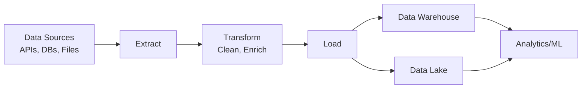
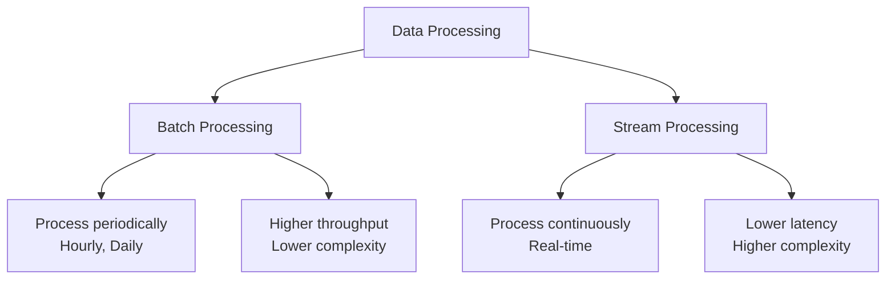
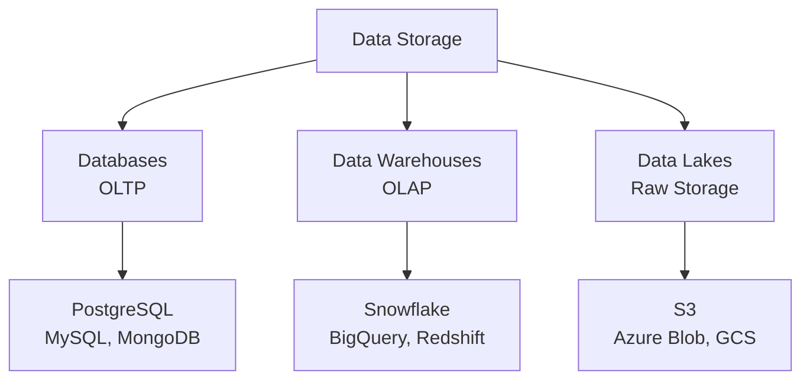
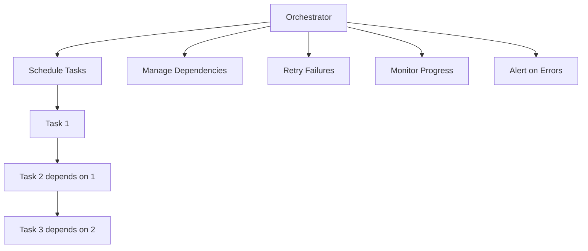
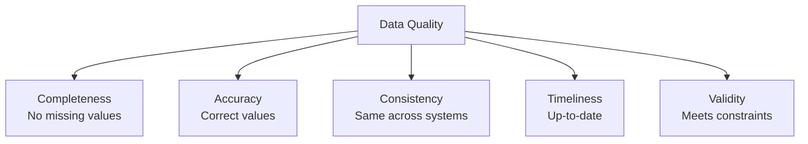
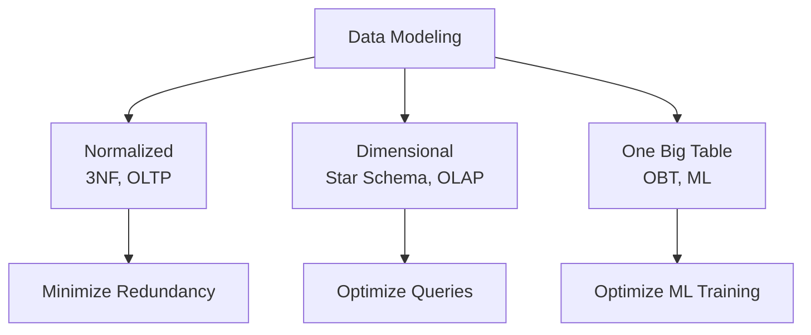

# 🔄 Data Engineering

> [!blue] 💙 **Building Data Infrastructure**
> Designing and building systems for data collection, storage, processing, and delivery. Foundation for machine learning and analytics pipelines.

---

## 📚 Topics Covered

### Core Concepts
- **Data Pipelines** - ETL/ELT workflows
- **Data Warehousing** - Structured data storage
- **Data Lakes** - Raw data storage
- **Batch vs Streaming** - Processing paradigms
- **Data Quality** - Validation and monitoring
- **Orchestration** - Airflow, Prefect, Dagster
- **Data Modeling** - Schema design

---

## 🎯 Learning Objectives

By the end of this section, you should be able to:
- [ ] Design and build data pipelines
- [ ] Choose appropriate storage solutions
- [ ] Implement data quality checks
- [ ] Orchestrate complex workflows
- [ ] Handle batch and streaming data
- [ ] Design efficient data models
- [ ] Monitor data pipeline health

---

## 📝 Key Concepts

### [[data-pipelines|Data Pipelines]]

> [!blue] 💙 **Automated Data Workflows**
> End-to-end systems that extract, transform, and load data from sources to destinations.

**Pipeline Architecture:**

**ETL vs ELT:**

**ETL (Extract, Transform, Load):**
- Transform before loading
- Traditional approach
- Good for complex transformations
- Example: Extract from MySQL → Transform in Python → Load to warehouse

**ELT (Extract, Load, Transform):**
- Load raw data first, transform later
- Modern approach with cloud warehouses
- Leverage warehouse compute power
- Example: Load to BigQuery → Transform with SQL

> [!yellow] 💡 **Pipeline Design Principles**
> - **Idempotency:** Re-running produces same result
> - **Incrementality:** Only process new/changed data
> - **Monitoring:** Track success, failures, data quality
> - **Error handling:** Retry transient errors, alert on persistent failures

---

### [[batch-vs-streaming|Batch vs Streaming Processing]]

> [!blue] 💙 **Data Processing Paradigms**
> Two fundamental approaches to processing data - periodic batches vs continuous streams.

**Processing Comparison:**

**Batch Processing:**
- **When:** Process data in chunks (hourly, daily)
- **Examples:** Daily reports, model training, data aggregation
- **Tools:** Apache Spark, Airflow, dbt
- **Pros:** Simpler, cheaper, higher throughput
- **Cons:** Higher latency, not real-time

**Stream Processing:**
- **When:** Process data as it arrives
- **Examples:** Fraud detection, real-time recommendations, monitoring
- **Tools:** Apache Kafka, Flink, Spark Streaming
- **Pros:** Real-time, immediate insights
- **Cons:** More complex, more expensive

**Lambda Architecture:**
- Combine batch and streaming
- Batch layer: Historical data processing
- Speed layer: Real-time processing
- Serving layer: Merge results

> [!green] ✅ **Choosing Batch vs Streaming**
> - **Batch:** Reports, analytics, model training, cost-sensitive
> - **Streaming:** Real-time alerts, live dashboards, fraud detection
> - **Hybrid:** Most systems use both

---

### [[data-storage|Data Storage Solutions]]

> [!blue] 💙 **Where to Store Data**
> Different storage systems optimized for different access patterns and use cases.

**Storage Landscape:**

**Storage Types:**

**1. Operational Databases (OLTP)**
- **Purpose:** Transaction processing, applications
- **Examples:** PostgreSQL, MySQL, MongoDB
- **Characteristics:** Row-oriented, low latency, high concurrency
- **Use cases:** User data, orders, real-time updates

**2. Data Warehouses (OLAP)**
- **Purpose:** Analytics, business intelligence
- **Examples:** Snowflake, BigQuery, Redshift
- **Characteristics:** Column-oriented, optimized for queries
- **Use cases:** Reporting, dashboards, ML feature engineering

**3. Data Lakes**
- **Purpose:** Store raw, unstructured data
- **Examples:** S3, Azure Blob, Google Cloud Storage
- **Characteristics:** Schema-on-read, cheap, scalable
- **Use cases:** Data archives, ML datasets, logs

**4. Data Lakehouses**
- **Modern approach:** Combine lake and warehouse
- **Examples:** Databricks (Delta Lake), Apache Iceberg
- **Benefits:** ACID transactions on lake data

> [!yellow] 💡 **Storage Strategy**
> - **OLTP:** Application databases
> - **Lake:** Raw data dump from all sources
> - **Warehouse:** Cleaned, modeled data for analytics
> - **Lakehouse:** Emerging unified approach

---

### [[orchestration|Workflow Orchestration]]

> [!blue] 💙 **Managing Pipeline Execution**
> Tools for scheduling, monitoring, and coordinating data pipeline tasks with dependencies.

**Orchestrator Role:**

**Popular Orchestrators:**

**Apache Airflow:**
- Most popular
- Python-based DAGs (Directed Acyclic Graphs)
- Rich UI and integrations
- Complex setup

**Prefect:**
- Modern alternative to Airflow
- Python-native, easier to use
- Better error handling
- Cloud-managed option

**Dagster:**
- Software-defined assets
- Strong typing, testing
- Development-focused
- Asset-oriented paradigm

**Managed Options:**
- **AWS Step Functions:** Serverless workflows
- **Google Cloud Composer:** Managed Airflow
- **Azure Data Factory:** No-code pipelines

> [!yellow] 💡 **Orchestration Best Practices**
> - Define task dependencies explicitly
> - Make tasks idempotent
> - Set appropriate retries and timeouts
> - Monitor task duration and failures
> - Use sensors for external dependencies

---

### [[data-quality|Data Quality]]

> [!blue] 💙 **Ensuring Data Reliability**
> Validating, testing, and monitoring data to catch issues early and maintain trust.

**Data Quality Dimensions:**

**Quality Checks:**

**1. Schema Validation**
- Expected columns present?
- Correct data types?
- New unexpected columns?

**2. Value Validation**
- Within expected ranges?
- Matches allowed categories?
- No nulls where required?

**3. Distribution Checks**
- Mean/median in expected range?
- No sudden spikes or drops?
- Outlier detection

**4. Freshness Checks**
- Data arrived on time?
- No stale data?
- Upstream delays?

**Data Quality Tools:**
- **Great Expectations:** Python framework for data testing
- **dbt tests:** Built-in data testing in dbt
- **Soda:** Data quality platform
- **Monte Carlo:** Data observability

> [!red] ⚠️ **Data Quality Anti-Patterns**
> - No validation until production breaks
> - Manual quality checks (automate!)
> - Catching issues too late in pipeline
> - No alerts on quality degradation

---

### [[data-modeling|Data Modeling]]

> [!blue] 💙 **Structuring Data for Use**
> Designing schemas and tables optimized for analytics and machine learning.

**Modeling Approaches:**

**Dimensional Modeling (Data Warehouse):**
- **Fact tables:** Measurements, events (sales, clicks)
- **Dimension tables:** Context (customers, products, dates)
- **Star schema:** Fact in center, dimensions around
- **Snowflake schema:** Normalized dimensions

**One Big Table (ML):**
- Denormalized, all features in one table
- Fast for ML training (no joins)
- Increased storage, easier to use

**Slowly Changing Dimensions (SCD):**
- Type 1: Overwrite old value
- Type 2: Keep history with version/timestamp
- Type 3: Keep old and new in separate columns

> [!yellow] 💡 **Modeling Guidelines**
> - **OLTP:** Normalize for updates
> - **Analytics:** Denormalize for query speed
> - **ML:** One big table with all features
> - **Use dbt** for transformation logic

---

## 🔬 Advanced Topics

> [!purple] 🔮 **Change Data Capture (CDC)**
> Capture changes from databases in real-time:
> - Debezium for streaming DB changes
> - Keep warehouse in sync with operational DB
> - Enables real-time analytics

> [!purple] 🔮 **Data Versioning**
> Version control for datasets:
> - DVC (Data Version Control)
> - Track dataset changes like code
> - Reproducibility for ML experiments

> [!purple] 🔮 **Feature Engineering Pipelines**
> Automated feature computation:
> - Feature stores (Feast, Tecton)
> - Consistent features across training/serving
> - Reusable features across teams

> [!purple] 🔮 **Data Mesh**
> Decentralized data architecture:
> - Domain-oriented ownership
> - Data as a product
> - Self-serve infrastructure

---

## ⚠️ Common Pitfalls

> [!red] ⚠️ **No Incremental Processing**
> - **Problem:** Reprocessing all data every time (slow, expensive)
> - **Solution:** Track watermarks, process only new data

> [!red] ⚠️ **Ignoring Data Quality**
> - **Problem:** Bad data breaks ML models and analytics
> - **Solution:** Validation checks, automated testing, monitoring

> [!red] ⚠️ **Not Handling Failures**
> - **Problem:** Pipeline breaks, no retry, manual intervention
> - **Solution:** Idempotent operations, retries, alerts

> [!red] ⚠️ **Over-Engineering**
> - **Problem:** Building complex systems before needed
> - **Solution:** Start simple (cron + SQL), add complexity as needed

---

## 💡 Best Practices

> [!yellow] 💡 **Pipeline Design**
> - Make operations idempotent
> - Process data incrementally
> - Fail fast with clear errors
> - Log everything for debugging
> - Monitor data quality

> [!yellow] 💡 **Starting Simple**
> 1. **Day 1:** Cron + SQL scripts
> 2. **Scale:** Airflow for orchestration
> 3. **More scale:** Spark for big data
> 4. **Streaming:** Kafka for real-time
> 5. **Don't over-engineer early**

> [!yellow] 💡 **Data Engineer Mindset**
> - Data quality is paramount
> - Build for reliability, not just features
> - Monitor everything
> - Document data lineage
> - Make data discoverable

---

## 🔗 Related Topics

- [[07-MLOps-Deployment/MLOps/README|MLOps]] - ML pipelines
- [[03-Machine-Learning/Feature-Engineering/README|Feature Engineering]] - Creating features
- [[02-Statistics-and-Data/EDA/README|EDA]] - Exploring data
- [[01-Foundations/SQL/README|SQL]] - Querying data

---

## 📚 Resources

**Tools:**
- **Airflow:** Orchestration
- **dbt:** SQL transformations
- **Spark:** Big data processing
- **Kafka:** Streaming platform
- **Great Expectations:** Data quality

**Books:**
- Fundamentals of Data Engineering (Reis & Housley)
- Designing Data-Intensive Applications (Kleppmann)
- The Data Warehouse Toolkit (Kimball)

**Courses:**
- DataCamp: Data Engineering track
- Udemy: Apache Airflow, Spark courses

---

**Tags:** #data-engineering #data-pipelines #etl #airflow #data-quality #orchestration
**Difficulty:** 🔥🔥🔥 Advanced
**Last Updated:** 2026-11-11
