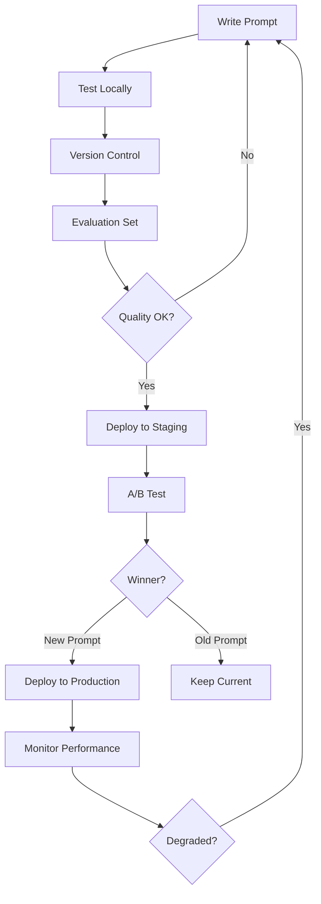
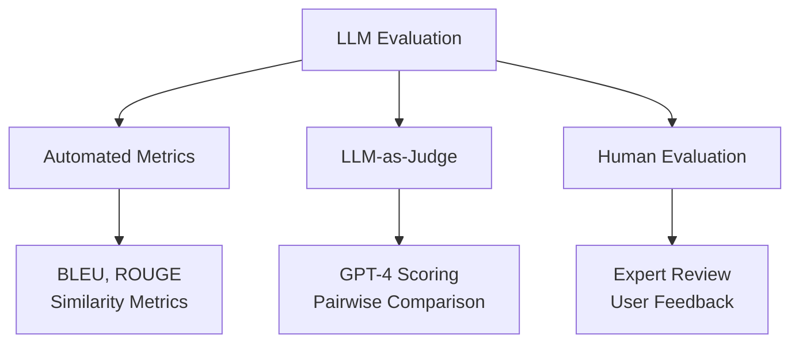
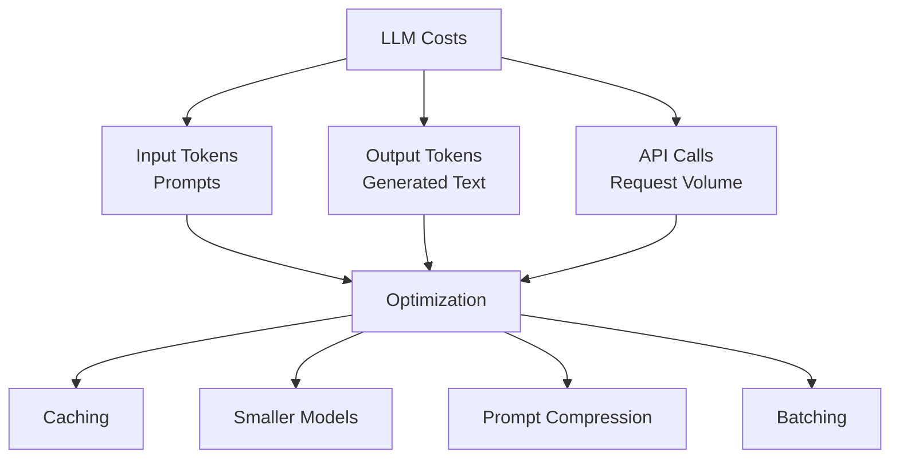
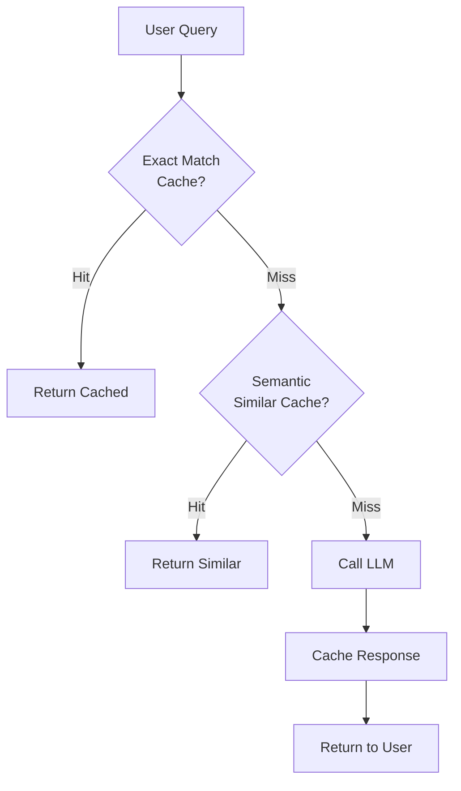
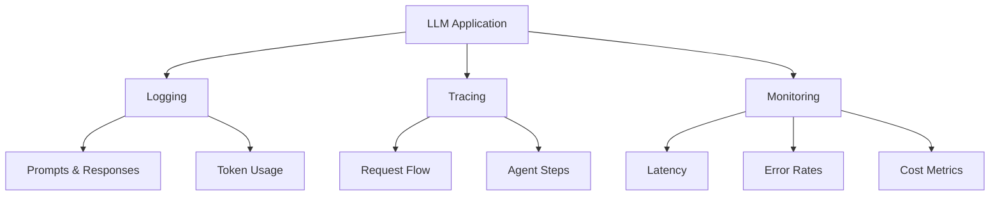
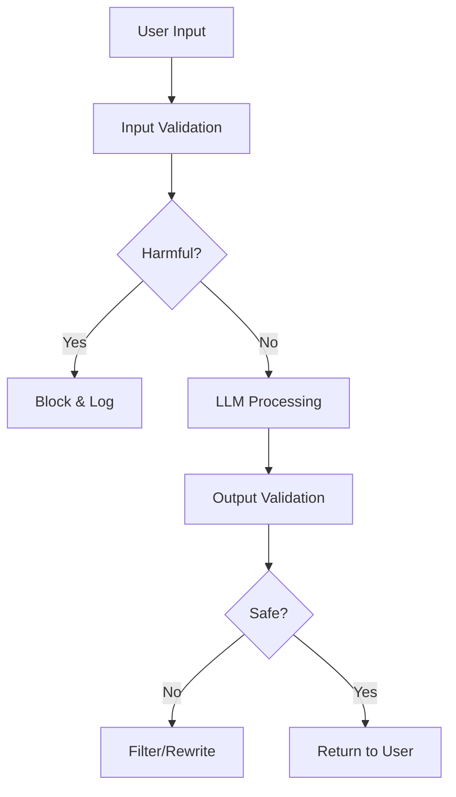

# 🚀 LLMOps (Large Language Model Operations)

**💙 Production LLM Systems**
Specialized MLOps practices for Large Language Models. Learn prompt management, LLM evaluation, monitoring, cost optimization, and deployment strategies.

---

## 📚 Topics Covered

### Core Concepts
- **Prompt Management** - Versioning, testing, optimization
- **LLM Evaluation** - Measuring output quality
- **Cost Monitoring** - Token usage and optimization
- **Caching Strategies** - Reducing redundant calls
- **Safety & Guardrails** - Content moderation, alignment
- **Observability** - Logging, tracing, debugging
- **Deployment Patterns** - API, self-hosted, edge

---

## 🎯 Learning Objectives

By the end of this section, you should be able to:
- [ ] Manage and version prompts systematically
- [ ] Evaluate LLM outputs effectively
- [ ] Monitor and optimize LLM costs
- [ ] Implement caching strategies
- [ ] Deploy LLMs to production
- [ ] Handle safety and moderation
- [ ] Debug LLM applications

---

## 📝 Key Concepts

### [[prompt-management|Prompt Management]]

**💙 Version Control for Prompts**
Systematic management of prompts with versioning, testing, and deployment tracking.

**Prompt Lifecycle:**

**Prompt Versioning:**
- Track prompt changes over time
- Link prompts to model versions
- Rollback to previous prompts
- A/B test different variations

**Prompt Testing:**
- Build evaluation dataset (Q&A pairs)
- Automated testing on prompt changes
- Regression testing (ensure old cases still work)
- Edge case coverage

**💡 Prompt Management Tools**
- **LangSmith:** LangChain's prompt management
- **Promptfoo:** Open-source prompt testing
- **Humanloop:** Prompt IDE and versioning
- **PromptLayer:** Prompt tracking and analytics

---

### [[llm-evaluation|LLM Evaluation]]

**💙 Measuring LLM Quality**
Assessing LLM outputs when ground truth is unavailable or subjective.

**Evaluation Approaches:**

**Evaluation Dimensions:**

**1. Relevance**
- Does output address the input?
- On-topic and focused?
- Method: LLM-as-judge or embedding similarity

**2. Faithfulness/Groundedness**
- Is output supported by context (RAG)?
- No hallucinations?
- Method: Check if claims exist in retrieved docs

**3. Coherence**
- Logically consistent?
- Well-structured?
- Method: LLM-as-judge

**4. Safety**
- No harmful content?
- Appropriate tone?
- Method: Content moderation APIs

**5. Task-Specific**
- For code: Does it run? Pass tests?
- For summarization: ROUGE score
- For classification: Accuracy

**✅ LLM-as-Judge Pattern**
Use powerful LLM (GPT-4) to evaluate outputs:
- Define evaluation criteria
- Provide scoring rubric (1-5 scale)
- Request justification for scores
- Aggregate across multiple evaluators

---

### [[cost-optimization|Cost Monitoring & Optimization]]

**💙 Managing LLM Expenses**
Tracking and reducing token usage costs for API-based and self-hosted LLMs.

**Cost Structure:**

**Cost Optimization Strategies:**

**1. Caching**
- Cache responses for identical prompts
- Semantic caching for similar queries
- Cache embeddings for RAG
- TTL-based invalidation

**2. Model Selection**
- Use smaller models for simple tasks (GPT-3.5 vs GPT-4)
- Route intelligently (classifier decides model)
- Self-hosted for high volume

**3. Prompt Engineering**
- Shorter, more efficient prompts
- Remove verbose examples
- Use few-shot only when needed

**4. Batching**
- Batch multiple requests together
- Trade latency for throughput
- Reduce fixed overhead per request

**5. Early Termination**
- Stop generation when answer is complete
- Use max_tokens wisely
- Detect repetition and stop

**💡 Cost Monitoring**
- Track tokens per user, per feature
- Set budget alerts
- Monitor cost per successful request
- Analyze cost trends over time

---

### [[llm-caching|Caching Strategies]]

**💙 Reducing Redundant LLM Calls**
Intelligent caching to improve latency and reduce costs without sacrificing quality.

**Caching Layers:**

**Caching Types:**

**1. Exact Match Caching**
- Hash of prompt → response
- Fast, simple
- Misses slight variations

**2. Semantic Caching**
- Embed prompt, find similar cached prompts
- Return cached response if similarity > threshold
- More flexible, slight accuracy trade-off

**3. Prompt Prefix Caching**
- Cache common prompt prefixes
- Reduce input tokens for similar prompts
- Anthropic Claude, OpenAI support this

**Cache Invalidation:**
- Time-based (TTL)
- Event-based (new data available)
- Version-based (prompt/model change)
- Manual purge

**⚠️ Caching Considerations**
- Don't cache personalized responses
- Handle cache misses gracefully
- Monitor cache hit rate
- Balance freshness vs cost

---

### [[llm-observability|Observability & Debugging]]

**💙 Understanding LLM Behavior**
Logging, tracing, and debugging LLM applications to identify and fix issues.

**Observability Stack:**

**What to Log:**
- **Inputs:** Full prompt sent to LLM
- **Outputs:** Complete LLM response
- **Metadata:** Model, temperature, tokens, latency
- **User feedback:** Thumbs up/down, corrections
- **Errors:** Failures, timeouts, rate limits
- **Context:** User ID, session ID, feature flag

**Tracing:**
- Track request through entire pipeline
- See each LLM call in agent workflow
- Identify bottlenecks
- Debug multi-step reasoning

**Tools:**
- **LangSmith:** LangChain debugging
- **Helicone:** LLM observability
- **Phoenix (Arize):** Open-source monitoring
- **Datadog / New Relic:** General APM

**💡 Debugging Workflow**
1. Identify failing cases from logs
2. Reproduce locally with exact prompt
3. Analyze LLM reasoning (if available)
4. Iterate on prompt or add examples
5. Test fix, deploy, monitor

---

### [[safety-guardrails|Safety & Guardrails]]

**💙 Ensuring Safe LLM Outputs**
Preventing harmful, inappropriate, or incorrect outputs through moderation and validation.

**Safety Layers:**

**Safety Mechanisms:**

**1. Input Moderation**
- Detect prompt injection attempts
- Block harmful requests
- Sanitize inputs

**2. Output Moderation**
- Check for toxic content
- Verify factual claims (if possible)
- Filter PII/sensitive data

**3. Guardrails**
- Detect off-topic responses
- Ensure policy compliance
- Check for hallucinations

**4. Rate Limiting**
- Prevent abuse
- Per-user quotas
- Anomaly detection

**Tools:**
- **OpenAI Moderation API:** Toxicity detection
- **Perspective API:** Content moderation
- **NeMo Guardrails:** Programmable guardrails
- **Guardrails AI:** Validation framework

**⚠️ Safety Challenges**
- Adversarial users (jailbreaking)
- Context-dependent appropriateness
- False positives (blocking legitimate content)
- Evolving attack methods

---

## 🔬 Advanced Topics

**🔮 Continuous Evaluation**
Monitor LLM quality in production:
- Sample predictions regularly
- Run automated evals on live traffic
- Track quality metrics over time
- Detect regressions early

**🔮 Prompt Optimization Pipelines**
Automatically improve prompts:
- DSPy: Programmatic optimization
- Genetic algorithms for prompt evolution
- A/B test variations continuously

**🔮 Multi-Model Routing**
Route requests to optimal model:
- Simple queries → small/cheap model
- Complex queries → large/expensive model
- Classifier predicts complexity
- Balance cost and quality

**🔮 Feedback Loops**
Learn from production usage:
- Collect user corrections
- Add to few-shot examples
- Retrain classifiers
- Update retrieval systems

---

## ⚠️ Common Pitfalls

**⚠️ Not Versioning Prompts**
- **Problem:** Can't reproduce issues or roll back
- **Solution:** Git for prompts, version with model updates

**⚠️ Ignoring Costs**
- **Problem:** Unexpected bills, inefficient usage
- **Solution:** Monitor spending, set alerts, optimize aggressively

**⚠️ Insufficient Logging**
- **Problem:** Can't debug failures
- **Solution:** Log everything (prompts, responses, errors)

**⚠️ No Evaluation Process**
- **Problem:** Don't know if prompt changes help
- **Solution:** Build eval set, automated testing

---

## 💡 Best Practices

**💡 LLMOps Checklist**
- ✅ Version control for prompts
- ✅ Automated evaluation pipeline
- ✅ Comprehensive logging and tracing
- ✅ Cost monitoring and alerts
- ✅ Caching strategy implemented
- ✅ Safety guardrails in place
- ✅ Rollback plan for failures
- ✅ User feedback collection

**💡 Starting LLMOps**
1. Add logging (LangSmith, Helicone)
2. Build evaluation dataset (20-50 examples)
3. Version prompts in Git
4. Monitor costs and set budgets
5. Implement caching
6. Add safety checks
7. Set up continuous evaluation

**💡 Production Deployment**
- Start with staging environment
- Gradual rollout (10% → 50% → 100%)
- Monitor closely for issues
- Have rollback plan ready
- Collect user feedback

---

## 🔗 Related Topics

- [[07-MLOps-Deployment/MLOps/README|MLOps]] - General ML operations
- [[06-AI-Systems/Prompt-Engineering/README|Prompt Engineering]] - Effective prompts
- [[06-AI-Systems/RAG/README|RAG]] - RAG system deployment
- [[06-AI-Systems/Agents/README|AI Agents]] - Agent deployment

---

## 📚 Resources

**Tools:**
- **LangSmith:** LangChain observability
- **Promptfoo:** Prompt testing framework
- **Helicone:** LLM monitoring
- **Weights & Biases:** Experiment tracking

**Platforms:**
- **Humanloop:** Prompt management
- **PromptLayer:** Logging and analytics
- **Vellum:** LLM product development

**Papers:**
- "Measuring Massive Multitask Language Understanding" (MMLU)
- "HumanEval: Evaluating Code Generation"
- "TruthfulQA: Measuring Truthfulness"

---

**Tags:** #llmops #prompt-management #llm-evaluation #cost-optimization #observability
**Difficulty:** 🔥🔥🔥🔥 Expert
**Last Updated:** 2026-11-11
