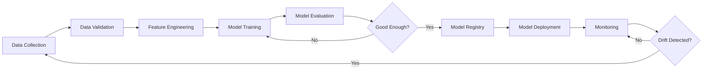
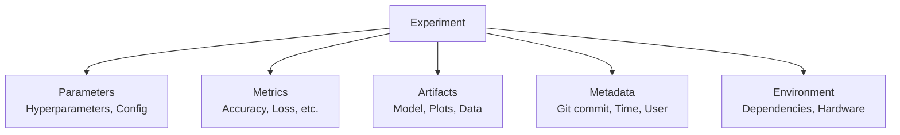
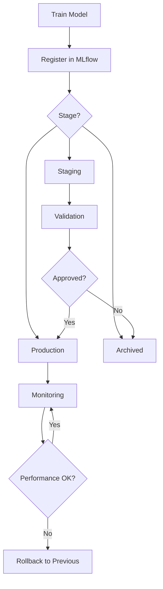
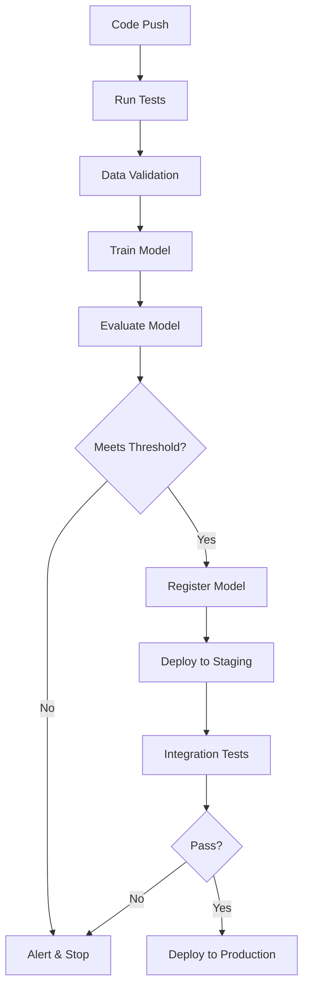
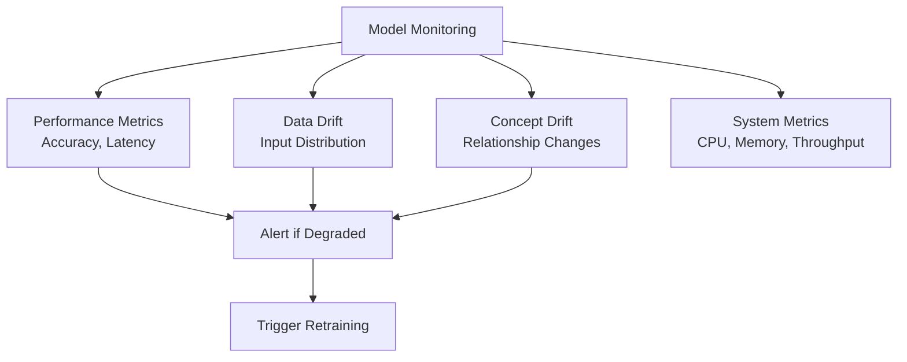
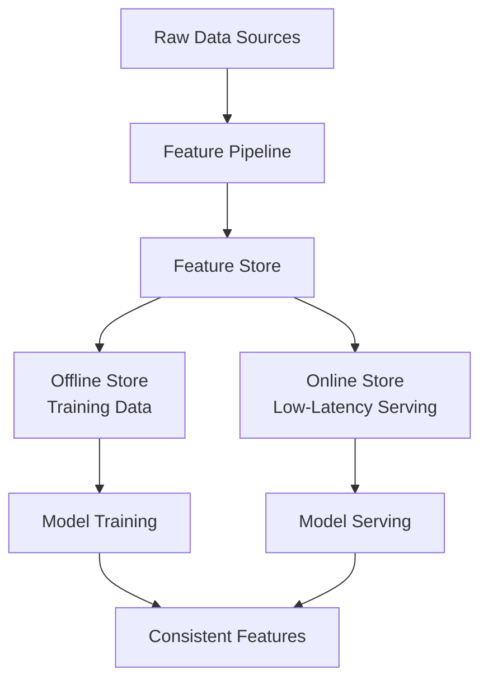

# 🔧 MLOps (Machine Learning Operations)

**💙 Production ML Lifecycle**
Engineering practices for deploying, monitoring, and maintaining machine learning models in production. Learn CI/CD for ML, experiment tracking, model versioning, and monitoring.

---

## 📚 Topics Covered

### Core Concepts
- **ML Pipeline Automation** - Training, validation, deployment
- **Experiment Tracking** - MLflow, Weights & Biases
- **Model Versioning** - Model registry and lineage
- **CI/CD for ML** - Automated testing and deployment
- **Model Monitoring** - Performance tracking, drift detection
- **Feature Stores** - Centralized feature management
- **Model Serving** - Inference APIs and batch prediction

---

## 🎯 Learning Objectives

By the end of this section, you should be able to:
- [ ] Build automated ML pipelines
- [ ] Track experiments systematically
- [ ] Version and manage models
- [ ] Implement CI/CD for ML projects
- [ ] Monitor model performance in production
- [ ] Detect and handle data/model drift
- [ ] Use feature stores effectively

---

## 📝 Key Concepts

### [[mlops-lifecycle|MLOps Lifecycle]]

**💙 End-to-End ML Pipeline**
Complete lifecycle from data to production, with automation and monitoring at every stage.

**MLOps Pipeline:**

**Phases:**
1. **Development:** Experiment, train models
2. **Staging:** Validate on production-like data
3. **Production:** Serve predictions at scale
4. **Monitoring:** Track performance, detect issues
5. **Retraining:** Update models when needed

---

### [[experiment-tracking|Experiment Tracking]]

**💙 Systematic Experiment Management**
Logging parameters, metrics, artifacts for every experiment to enable reproducibility and comparison.

**What to Track:**

**Key Information:**
- **Parameters:** Learning rate, batch size, model architecture
- **Metrics:** Accuracy, precision, recall, loss
- **Artifacts:** Model files, confusion matrices, plots
- **Code Version:** Git commit hash
- **Environment:** Python version, library versions

**Popular Tools:**
- **MLflow:** Open-source, comprehensive
- **Weights & Biases:** Beautiful UI, collaboration features
- **Neptune.ai:** Enterprise-grade tracking
- **TensorBoard:** Deep learning visualization

**💡 Tracking Best Practices**
- Track every experiment, even failed ones
- Use descriptive experiment names
> - Tag experiments by project/iteration
> - Compare experiments side-by-side
> - Document hypothesis for each run

---

### [[model-versioning|Model Versioning & Registry]]

**💙 Managing Model Lifecycle**
Systematic versioning of models with metadata, enabling rollback and model governance.

**Model Registry Flow:**

**Model Stages:**
- **None/Development:** Experimental models
- **Staging:** Models under validation
- **Production:** Currently serving models
- **Archived:** Deprecated models

**Model Metadata:**
- Version number
- Training date and parameters
- Performance metrics
- Training data version
- Approval status and reviewer

**✅ Benefits**
- Quick rollback if issues arise
- Audit trail for compliance
- A/B test different model versions
- Reproduce any past model

---

### [[cicd-ml|CI/CD for Machine Learning]]

**💙 Automated ML Pipelines**
Continuous Integration and Deployment adapted for machine learning workflows.

**ML CI/CD Pipeline:**

**CI/CD Components:**

**Continuous Integration:**
- Unit tests for data processing
- Integration tests for model training
- Data validation checks
- Model performance tests

**Continuous Deployment:**
- Automated model deployment
- Canary releases (gradual rollout)
- A/B testing infrastructure
- Automatic rollback on errors

**Testing Strategies:**
- **Unit tests:** Functions, data transformations
- **Integration tests:** Full pipeline
- **Model tests:** Performance thresholds
- **Data tests:** Schema, distribution checks

**💡 CI/CD Tools**
- **GitHub Actions / GitLab CI:** General CI/CD
- **Jenkins:** Traditional CI/CD
- **Kubeflow Pipelines:** Kubernetes-native ML
- **Apache Airflow:** Workflow orchestration

---

### [[model-monitoring|Model Monitoring]]

**💙 Production Model Health**
Continuously tracking model performance, detecting issues, and triggering retraining when needed.

**Monitoring Dashboard:**

**What to Monitor:**

**1. Model Performance:**
- Prediction accuracy
- Precision/recall
- Business metrics (conversion rate, revenue)
- Monitor on recent data window

**2. Data Drift:**
- Input feature distributions changing
- New categories appearing
- Missing values increasing
- Detect with statistical tests (KS test, PSI)

**3. Concept Drift:**
- Relationship between X and Y changes
- Model assumptions no longer hold
- Retrain when detected

**4. System Health:**
- Latency (p50, p95, p99)
- Throughput (requests/second)
- Error rates
- Resource utilization

**⚠️ Drift Detection**
- **Data drift:** Input distribution changes (weather patterns shift)
- **Concept drift:** Target relationship changes (customer behavior evolves)
- **Solution:** Automated retraining pipelines, champion/challenger setup

---

### [[feature-stores|Feature Stores]]

**💙 Centralized Feature Management**
Repository for storing, versioning, and serving features consistently across training and serving.

**Feature Store Architecture:**

**Key Benefits:**
- **Consistency:** Same features for training and serving
- **Reusability:** Share features across teams/models
- **Versioning:** Track feature changes over time
- **Efficiency:** Pre-computed features, fast serving

**Feature Store Components:**
- **Feature Definitions:** How to compute each feature
- **Offline Store:** Historical features (S3, data warehouse)
- **Online Store:** Real-time features (Redis, DynamoDB)
- **Feature Registry:** Metadata and documentation

**Popular Feature Stores:**
- **Feast:** Open-source, flexible
- **Tecton:** Enterprise, fully managed
- **Hopsworks:** ML platform with feature store
- **AWS SageMaker Feature Store**

**💡 When to Use Feature Stores**
- Multiple models using same features
- Training-serving skew issues
- Real-time prediction requirements
- Team collaboration on features

---

## 🔬 Advanced Topics

**🔮 A/B Testing for Models**
Deploy multiple model versions, route traffic, compare metrics:
- Champion (current) vs Challenger (new)
- Statistical significance testing
- Gradual rollout based on performance

**🔮 Model Explainability in Production**
Providing interpretations for predictions:
- SHAP values for feature importance
- Logging explanations with predictions
- Debugging individual predictions

**🔮 Shadow Mode Deployment**
New model runs alongside production without affecting users:
- Compare predictions offline
- Detect issues before full deployment
- Build confidence in new model

**🔮 Auto-Retraining Pipelines**
Automatically retrain when triggers fire:
- Performance degradation detected
- New data available (daily, weekly)
- Manual trigger by data scientist

---

## ⚠️ Common Pitfalls

**⚠️ Training-Serving Skew**
- **Problem:** Features computed differently in training vs serving
- **Solution:** Feature stores, shared preprocessing code, integration tests

**⚠️ Not Monitoring Enough**
- **Problem:** Model degrades silently in production
- **Solution:** Comprehensive monitoring, alerts, automated checks

**⚠️ Manual Deployment Process**
- **Problem:** Slow, error-prone, not repeatable
- **Solution:** Automate with CI/CD, infrastructure as code

**⚠️ Ignoring Model Lineage**
- **Problem:** Can't reproduce model or trace back to training data
- **Solution:** Track everything - data version, code, parameters

---

## 💡 Best Practices

**💡 MLOps Maturity**
- **Level 0:** Manual process, notebooks
- **Level 1:** Automated training pipeline
- **Level 2:** Automated deployment with CI/CD
- **Level 3:** Full automation with monitoring & retraining

**💡 Getting Started**
1. Start with experiment tracking (MLflow)
2. Add model registry and versioning
3. Automate training pipeline
4. Implement monitoring
5. Add CI/CD for deployment
6. Consider feature store for scale

**💡 Key Metrics to Track**
- Model performance (accuracy, latency)
- Data quality (completeness, freshness)
- System health (uptime, throughput)
- Business impact (revenue, conversions)

---

## 🔗 Related Topics

- [[07-MLOps-Deployment/LLMOps/README|LLMOps]] - MLOps for LLMs
- [[07-MLOps-Deployment/Data-Engineering/README|Data Engineering]] - Data pipelines
- [[03-Machine-Learning/Model-Evaluation/README|Model Evaluation]] - Evaluation metrics
- [[09-Interview-Prep/System-Design/README|System Design]] - ML system design

---

## 📚 Resources

**Books:**
- Designing Machine Learning Systems (Chip Huyen)
- Machine Learning Engineering (Andriy Burkov)
- Introducing MLOps (Treveil et al.)

**Tools:**
- **MLflow:** Experiment tracking, model registry
- **Kubeflow:** ML on Kubernetes
- **Airflow:** Workflow orchestration
- **Feast:** Feature store

**Courses:**
- MLOps Specialization (DeepLearning.AI)
- Full Stack Deep Learning
- Made With ML

---

**Tags:** #mlops #ml-pipelines #experiment-tracking #model-monitoring #feature-stores #cicd
**Difficulty:** 🔥🔥🔥🔥 Expert
**Last Updated:** 2026-11-11
