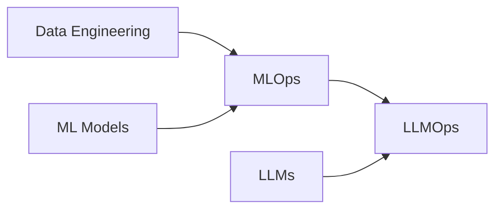

# 🚀 07 - MLOps & Deployment

**💙 MLOps & Deployment Section**
Production machine learning and LLM systems. Covers MLOps practices, LLMOps, data engineering, and deploying ML models at scale.

---

## 📂 Section Structure

### [[07-MLOps-Deployment/MLOps/README|MLOps]]
ML pipelines, model versioning, monitoring, and production ML practices

### [[07-MLOps-Deployment/LLMOps/README|LLMOps]]
LLM-specific operations - prompt management, evaluation, and deployment

### [[07-MLOps-Deployment/Data-Engineering/README|Data Engineering]]
Data pipelines, ETL, data quality, and feature stores

---

## 🎯 Learning Path

**Recommended Order:**
1. **Data Engineering** - Build data pipelines first
2. **MLOps** - Production ML practices
3. **LLMOps** - Deploy and monitor LLM systems

---

## 🔗 Prerequisites

From [[03-Machine-Learning]]:
- Machine learning fundamentals
- Model evaluation
- Feature engineering

From [[04-Deep-Learning]] & [[05-NLP]]:
- Neural networks
- Deep learning models
- NLP applications

From [[06-AI-Systems]]:
- RAG systems
- AI agents
- LLM applications

---

## 💡 Key Concepts Covered

**💡 Core MLOps Topics**
- **CI/CD for ML:** Automated training, testing, deployment
- **Model Versioning:** DVC, MLflow, model registry
- **Monitoring:** Data drift, model performance, alerts
- **Feature Stores:** Centralized feature management
- **Experiment Tracking:** MLflow, Weights & Biases
- **LLM Evaluation:** Prompt testing, output quality
- **Data Pipelines:** Apache Airflow, Prefect, Dagster

---

## 📊 Progress Tracking

- [ ] Set up experiment tracking
- [ ] Build a data pipeline
- [ ] Create an ML training pipeline
- [ ] Deploy a model with CI/CD
- [ ] Implement model monitoring
- [ ] Build an LLM evaluation framework
- [ ] Set up a feature store

---

## 🛠️ Tools & Frameworks

**MLOps Platforms:**
- **MLflow** - Experiment tracking, model registry
- **Weights & Biases** - Experiment tracking, visualization
- **Kubeflow** - ML pipelines on Kubernetes
- **SageMaker** - AWS managed ML platform

**LLMOps Tools:**
- **LangSmith** - LLM debugging and evaluation
- **Promptfoo** - Prompt testing framework
- **Helicone** - LLM observability
- **Arize Phoenix** - LLM monitoring

**Data Engineering:**
- **Apache Airflow** - Workflow orchestration
- **Prefect** - Modern workflow orchestration
- **dbt** - Data transformation
- **Great Expectations** - Data quality

**Model Serving:**
- **FastAPI** - REST API framework
- **BentoML** - Model serving framework
- **TorchServe** - PyTorch model serving
- **TensorFlow Serving** - TF model serving

**Feature Stores:**
- **Feast** - Open-source feature store
- **Tecton** - Enterprise feature platform
- **Hopsworks** - Feature store platform

---

## 📚 Recommended Resources

**Books:**
- Designing Machine Learning Systems (Chip Huyen)
- Machine Learning Engineering (Andriy Burkov)
- Introducing MLOps (Treveil et al.)
- Building LLM Applications (Cobus Greyling)

**Courses:**
- MLOps Specialization (DeepLearning.AI)
- Full Stack Deep Learning
- Made With ML

**Documentation:**
- MLflow Documentation
- Kubeflow Guides
- LangSmith Docs
- Airflow Tutorials

---

## 🎯 Production Checklist

**💡 Deployment Readiness**
- ✅ Model versioning and registry set up
- ✅ Automated training pipeline
- ✅ Model evaluation and validation
- ✅ CI/CD pipeline configured
- ✅ Monitoring and alerting in place
- ✅ Data quality checks
- ✅ Rollback strategy defined
- ✅ API rate limiting and caching
- ✅ Cost monitoring
- ✅ Documentation complete

---

## ⚠️ Common Pitfalls

**⚠️ Production Mistakes to Avoid**
- Deploying without monitoring
- No data drift detection
- Missing rollback strategy
- Inadequate logging
- No cost tracking for LLM APIs
- Skipping prompt versioning
- Insufficient load testing
- No A/B testing framework

---

## 🔄 Related Sections

- [[03-Machine-Learning]] - ML fundamentals
- [[04-Deep-Learning]] - Deep learning models
- [[06-AI-Systems]] - AI applications to deploy
- [[07-MLOps-Deployment/Data-Engineering]] - Data pipeline foundation
- [[09-Interview-Prep/System-Design]] - ML system design

---

**Tags:** #mlops #llmops #data-engineering #deployment #production-ml #monitoring
**Difficulty:** 🔥🔥🔥🔥 Expert
**Last Updated:** 2026-11-11
