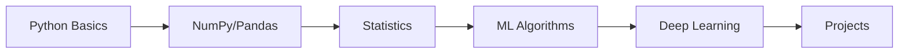
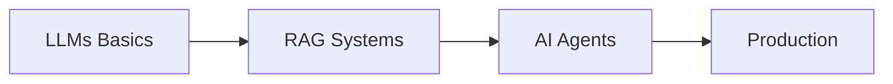

# 🎓 Data Science & AI Learning Vault

> **A comprehensive, production-ready learning resource covering Data Science and AI from foundations to advanced topics with deep mathematical treatment, algorithms, and real-world applications.**

[](https://choosealicense.com/licenses/mit/)
[](https://github.com/subhashdixit/data-science-ai-learning-vault/issues)

---

## 📊 Repository Stats

- 📝 **27,000+** lines of comprehensive content
- 📚 **44** markdown files
- 🎯 **Deep mathematical foundations** with equations and derivations
- 💻 **Real-world applications** and use cases
- 🔬 **Algorithm complexity analysis** (time & space)
- 📈 **Visual representations** with diagrams
- ✅ **Production-ready** content

---

## 🗺️ Quick Navigation

### 🔰 **Foundations** → [View Section](./01-Foundations/)
Master the fundamentals before diving into ML/AI

| Topic | Status | Description | Link |
|-------|--------|-------------|------|
| **Python** | ✅ Complete | Data types, lists, algorithms, memory | [📖 Read](./01-Foundations/Python/README.md) |
| **NumPy** | ✅ Complete | SIMD, cache, vectorization, performance | [📖 Read](./01-Foundations/NumPy/README.md) |
| **Pandas** | 🔄 In Progress | Data manipulation and analysis | [📖 Read](./01-Foundations/Pandas/README.md) |
| **SQL** | 🔄 In Progress | Database queries and operations | [📖 Read](./01-Foundations/SQL/README.md) |
| **Math** | 🔄 In Progress | Linear Algebra, Calculus, Probability | [📖 Read](./01-Foundations/Math/README.md) |

### 📊 **Statistics & Data** → [View Section](./02-Statistics-and-Data/)
Statistical foundations for data analysis

| Topic | Status | Description | Link |
|-------|--------|-------------|------|
| **Statistics** | 🔄 In Progress | Distributions, hypothesis testing | [📖 Read](./02-Statistics-and-Data/Statistics/README.md) |
| **EDA** | 🔄 In Progress | Exploratory Data Analysis | [📖 Read](./02-Statistics-and-Data/EDA/README.md) |
| **Data Visualization** | 🔄 In Progress | Charts, graphs, storytelling | [📖 Read](./02-Statistics-and-Data/Data-Visualization/README.md) |
| **Time Series** | 🔄 In Progress | Temporal data analysis | [📖 Read](./02-Statistics-and-Data/Time-Series/README.md) |

### 🤖 **Machine Learning** → [View Section](./03-Machine-Learning/)
Classical ML algorithms with complete mathematical treatment

| Algorithm | Status | Features | Link |
|-----------|--------|----------|------|
| **Linear Regression** | ✅ Complete | Gradient descent, Normal equation, Regularization (L1/L2) | [📖 Read](./03-Machine-Learning/Supervised-Learning/README.md#1-linear-regression) |
| **Logistic Regression** | ✅ Complete | Sigmoid, Cross-entropy, Multi-class, ROC/PR curves | [📖 Read](./03-Machine-Learning/Supervised-Learning/README.md#2-logistic-regression) |
| **Decision Trees** | 🔄 50% | Gini, Entropy, Information Gain, Pruning | [📖 Read](./03-Machine-Learning/Supervised-Learning/README.md#3-decision-trees) |
| **Random Forest** | ⏳ Planned | Ensemble, Bagging, Feature importance | [📖 Read](./03-Machine-Learning/Supervised-Learning/README.md) |
| **Gradient Boosting** | ⏳ Planned | XGBoost, LightGBM, CatBoost | [📖 Read](./03-Machine-Learning/Supervised-Learning/README.md) |
| **SVM** | ⏳ Planned | Kernels, Support vectors, Margin | [📖 Read](./03-Machine-Learning/Supervised-Learning/README.md) |
| **K-Nearest Neighbors** | ⏳ Planned | Distance metrics, KD-trees | [📖 Read](./03-Machine-Learning/Supervised-Learning/README.md) |
| **Naive Bayes** | ⏳ Planned | Bayes theorem, Text classification | [📖 Read](./03-Machine-Learning/Supervised-Learning/README.md) |

**Other ML Topics:**
- [Unsupervised Learning](./03-Machine-Learning/Unsupervised-Learning/README.md) - Clustering, PCA, Dimensionality reduction
- [Model Evaluation](./03-Machine-Learning/Model-Evaluation/README.md) - Metrics, Cross-validation, Bias-variance
- [Feature Engineering](./03-Machine-Learning/Feature-Engineering/README.md) - Feature selection, Transformation, Encoding

### 🧠 **Deep Learning** → [View Section](./04-Deep-Learning/)
Neural networks from basics to state-of-the-art

| Topic | Status | Description | Link |
|-------|--------|-------------|------|
| **Neural Networks** | 🔄 In Progress | Backpropagation, Activation functions, Optimization | [📖 Read](./04-Deep-Learning/Neural-Networks/README.md) |
| **CNNs** | 🔄 In Progress | Convolution, Pooling, Transfer learning | [📖 Read](./04-Deep-Learning/CNNs/README.md) |
| **RNNs & LSTMs** | 🔄 In Progress | Sequential data, Gates, Attention | [📖 Read](./04-Deep-Learning/RNNs-LSTMs/README.md) |
| **Transformers** | 🔄 In Progress | Self-attention, Multi-head, BERT, GPT | [📖 Read](./04-Deep-Learning/Transformers/README.md) |
| **LLMs** | 🔄 In Progress | Fine-tuning, LoRA, RLHF, Deployment | [📖 Read](./04-Deep-Learning/LLMs/README.md) |

### 🗣️ **Natural Language Processing** → [View Section](./05-NLP/)
Text processing and language understanding

| Topic | Status | Description | Link |
|-------|--------|-------------|------|
| **NLP Basics** | 🔄 In Progress | Tokenization, Embeddings, TF-IDF | [📖 Read](./05-NLP/Basics/README.md) |
| **Advanced NLP** | 🔄 In Progress | BERT, GPT, Transfer learning | [📖 Read](./05-NLP/Advanced/README.md) |
| **Applications** | 🔄 In Progress | Classification, QA, Summarization | [📖 Read](./05-NLP/Applications/README.md) |

### 🤖 **AI Systems** → [View Section](./06-AI-Systems/)
Building production AI applications

| Topic | Status | Description | Link |
|-------|--------|-------------|------|
| **RAG** | 🔄 In Progress | Vector DBs, Retrieval, Generation | [📖 Read](./06-AI-Systems/RAG/README.md) |
| **AI Agents** | 🔄 In Progress | ReAct, Tool use, Memory | [📖 Read](./06-AI-Systems/Agents/README.md) |
| **Prompt Engineering** | 🔄 In Progress | Few-shot, Chain-of-thought, Optimization | [📖 Read](./06-AI-Systems/Prompt-Engineering/README.md) |

### 🚀 **MLOps & Deployment** → [View Section](./07-MLOps-Deployment/)
Production ML and LLM systems

| Topic | Status | Description | Link |
|-------|--------|-------------|------|
| **MLOps** | 🔄 In Progress | Pipelines, Monitoring, CI/CD | [📖 Read](./07-MLOps-Deployment/MLOps/README.md) |
| **LLMOps** | 🔄 In Progress | Prompt management, Evaluation, Cost | [📖 Read](./07-MLOps-Deployment/LLMOps/README.md) |
| **Data Engineering** | 🔄 In Progress | ETL, Orchestration, Quality | [📖 Read](./07-MLOps-Deployment/Data-Engineering/README.md) |

---

## 🎯 Learning Paths

### 🔰 **Path 1: Complete Beginner → Data Scientist**
**Timeline:** 4-6 months



1. **Month 1-2:** [Foundations](./01-Foundations/) - Python, NumPy, Pandas, SQL, Math
2. **Month 2-3:** [Statistics & Data](./02-Statistics-and-Data/) - Statistical inference, EDA
3. **Month 3-4:** [Machine Learning](./03-Machine-Learning/) - All classical algorithms
4. **Month 4-5:** [Deep Learning](./04-Deep-Learning/) - Neural networks, CNNs, RNNs
5. **Month 5-6:** [Projects](./08-Projects/) - Build portfolio projects

### 🎯 **Path 2: ML Engineer → AI Systems**
**Timeline:** 2-3 months



1. **Week 1-4:** [LLMs](./04-Deep-Learning/LLMs/README.md) - Fine-tuning, LoRA, Deployment
2. **Week 5-8:** [AI Systems](./06-AI-Systems/) - RAG, Agents, Prompt Engineering
3. **Week 9-12:** [MLOps/LLMOps](./07-MLOps-Deployment/) - Production deployment

### 📝 **Path 3: Interview Preparation**
**Timeline:** 1-2 months

1. **Week 1-2:** [Coding Practice](./09-Interview-Prep/Coding/) - Algorithms, Data structures
2. **Week 3-4:** [ML Theory](./09-Interview-Prep/ML-Theory/) - Algorithm questions
3. **Week 5-6:** [System Design](./09-Interview-Prep/System-Design/) - ML systems
4. **Week 7-8:** [Behavioral](./09-Interview-Prep/Behavioral/) - STAR method

---

## 📖 What Makes This Different?

### ✨ **Comprehensive Coverage**
- **Mathematical Foundations:** Full derivations of algorithms (Gradient Descent, Backpropagation)
- **Complexity Analysis:** Time and space complexity for every algorithm
- **Real-World Applications:** Practical use cases for each technique
- **Visual Learning:** Diagrams, flowcharts, decision trees

### 🎓 **Production-Ready Content**

**Example: Linear Regression includes:**
- Complete mathematical derivation
- Normal Equation vs Gradient Descent (with O(n³) vs O(kn) analysis)
- All 5 Gauss-Markov assumptions with diagnostic plots
- Regularization (L1, L2, Elastic Net) with geometric interpretation
- Real-world applications (price prediction, forecasting)
- Feature engineering techniques
- Common pitfalls and solutions

**Example: Logistic Regression includes:**
- Sigmoid function properties and derivative
- Binary Cross-Entropy derivation from Maximum Likelihood
- Complete gradient descent algorithm
- Multi-class: One-vs-Rest vs Softmax
- All evaluation metrics (Confusion Matrix, ROC, PR curves)
- Real-world applications (medical, credit, fraud detection)

### 🔬 **Deep Technical Depth**

**NumPy Performance Analysis:**
- SIMD vectorization (AVX/SSE instructions)
- CPU cache hierarchy impact (L1/L2/L3)
- Memory layout (contiguous vs scattered)
- Actual CPU cycle counts and speedup calculations

---

## 📁 Repository Structure

```
data-science-ai-learning-vault/
│
├── 📂 01-Foundations/              # Programming & Math fundamentals
│   ├── Python/                     # ✅ Complete: Data types, lists, complexity
│   ├── NumPy/                      # ✅ Complete: SIMD, cache, vectorization
│   ├── Pandas/                     # 🔄 In Progress
│   ├── SQL/                        # 🔄 In Progress
│   └── Math/                       # 🔄 In Progress
│       ├── Linear-Algebra/
│       ├── Calculus/
│       └── Probability/
│
├── 📂 02-Statistics-and-Data/      # Statistical foundations
│   ├── Statistics/
│   ├── EDA/
│   ├── Data-Visualization/
│   └── Time-Series/
│
├── 📂 03-Machine-Learning/         # Classical ML algorithms
│   ├── Supervised-Learning/        # ✅ 2/8 algorithms complete
│   │   ├── Linear Regression       # ✅ Complete
│   │   ├── Logistic Regression     # ✅ Complete
│   │   ├── Decision Trees          # 🔄 50% done
│   │   ├── Random Forest           # ⏳ Planned
│   │   ├── Gradient Boosting       # ⏳ Planned
│   │   ├── SVM                     # ⏳ Planned
│   │   ├── KNN                     # ⏳ Planned
│   │   └── Naive Bayes             # ⏳ Planned
│   ├── Unsupervised-Learning/
│   ├── Model-Evaluation/
│   └── Feature-Engineering/
│
├── 📂 04-Deep-Learning/            # Neural networks & modern AI
│   ├── Neural-Networks/
│   ├── CNNs/
│   ├── RNNs-LSTMs/
│   ├── Transformers/
│   └── LLMs/
│
├── 📂 05-NLP/                      # Natural Language Processing
│   ├── Basics/
│   ├── Advanced/
│   └── Applications/
│
├── 📂 06-AI-Systems/               # Production AI applications
│   ├── RAG/
│   ├── Agents/
│   └── Prompt-Engineering/
│
├── 📂 07-MLOps-Deployment/         # MLOps & LLMOps
│   ├── MLOps/
│   ├── LLMOps/
│   └── Data-Engineering/
│
├── 📂 08-Projects/                 # Hands-on projects
│
├── 📂 09-Interview-Prep/           # Interview preparation
│   ├── Coding/
│   ├── ML-Theory/
│   ├── System-Design/
│   └── Behavioral/
│
├── 📂 10-Daily-Notes/              # Learning journal
│
├── 📂 11-Resources/                # External resources
│
└── 📂 docs/reference/              # Documentation
    ├── 00-TEMPLATE.md              # Note template
    ├── COLOR-CODING-GUIDE.md       # Color system guide
    ├── GITHUB-SETUP.md             # Git workflow
    ├── QUICK-START.md              # Getting started
    ├── INDEX.md                    # Full index
    └── NAVIGATION.md               # Navigation guide
```

---

## 🚀 Getting Started

### For Learners
1. **Clone the repository:**
   ```bash
   git clone https://github.com/subhashdixit/data-science-ai-learning-vault.git
   cd data-science-ai-learning-vault
   ```

2. **Choose your learning path:**
   - Complete beginner? Start with [01-Foundations](./01-Foundations/)
   - ML background? Jump to [04-Deep-Learning](./04-Deep-Learning/)
   - Building AI systems? Go to [06-AI-Systems](./06-AI-Systems/)

3. **Follow the structure:**
   - Each section has a README with overview
   - Topics include mathematical foundations
   - Real-world examples and applications
   - Practice problems and projects

### For Contributors
1. **Fork the repository**
2. **Create a feature branch:** `git checkout -b feature/add-topic`
3. **Follow the template:** Use `docs/reference/00-TEMPLATE.md`
4. **Commit your changes:** `git commit -m 'Add comprehensive XYZ topic'`
5. **Push to the branch:** `git push origin feature/add-topic`
6. **Open a Pull Request**

---

## 📚 Reference Documentation

- [📋 Template](./docs/reference/00-TEMPLATE.md) - Note structure template
- [🎨 Color Guide](./docs/reference/COLOR-CODING-GUIDE.md) - Color-coding system
- [🔧 Setup](./docs/reference/GITHUB-SETUP.md) - Git workflow
- [⚡ Quick Start](./docs/reference/QUICK-START.md) - Getting started
- [📇 Index](./docs/reference/INDEX.md) - Complete topic index
- [🗺️ Navigation](./docs/reference/NAVIGATION.md) - Navigation guide

---

## 🎨 Color-Coding System

All notes use a consistent 5-color callout system:

| Color | Purpose | When to Use |
|-------|---------|-------------|
| 💙 **Blue** | Concepts & Definitions | Core ideas, mathematical definitions |
| 💚 **Green** | Examples & Working Solutions | Practical examples, use cases |
| ❤️ **Red** | Warnings & Common Mistakes | Pitfalls, errors to avoid |
| 💛 **Yellow** | Tips & Best Practices | Important insights, recommendations |
| 💜 **Purple** | Advanced & Deep Dives | Complex topics, research-level content |

---

## 🤝 Contributing

Contributions are welcome! Whether you want to:
- Fix a typo or error
- Add a new topic or algorithm
- Improve explanations
- Add more examples
- Enhance visualizations

Please see [CONTRIBUTING.md](./CONTRIBUTING.md) for guidelines.

---

## 📄 License

This project is licensed under the MIT License - see the [LICENSE](./LICENSE) file for details.

---

## 🙏 Acknowledgments

- Inspired by best practices from Stanford CS229, MIT 6.S191, and Fast.ai
- Mathematical notation follows standard ML textbooks
- Built with Obsidian for knowledge management
- Mermaid.js for diagrams and flowcharts

---

## 📬 Contact

**Subhash Dixit**
- GitHub: [@subhashdixit](https://github.com/subhashdixit)
- Repository: [data-science-ai-learning-vault](https://github.com/subhashdixit/data-science-ai-learning-vault)

---

## ⭐ Star History

If you find this repository helpful, please consider giving it a star ⭐

[](https://star-history.com/#subhashdixit/data-science-ai-learning-vault&Date)

---

**Last Updated:** November 11, 2024  
**Total Content:** 27,000+ lines | 44 files | 12 commits
