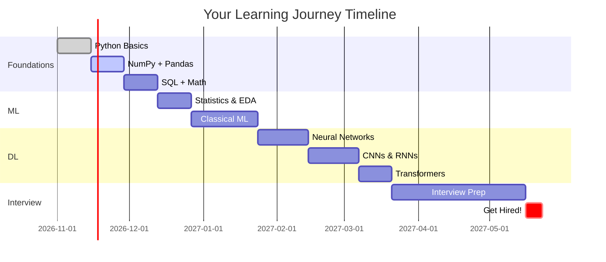

# 🗺️ LEARNING VAULT - MAIN NAVIGATION

**💡 YOUR COMPLETE LEARNING JOURNEY**
From Zero to Hero - Build your Data Science & AI skills step by step!

---

## 🎯 START HERE - YOUR LEARNING MAP


---

## 📊 YOUR CURRENT PROGRESS

**💙 Overall Progress: 15%**

| Track | Progress | Status | Start Here |
|-------|----------|--------|------------|
| 🐍 Foundations | █████░░░░░ 50% | 🔥 Active | [[01-Foundations/README\|Go →]] |
| 📊 Statistics | ██░░░░░░░░ 20% | 📝 Next | [[02-Statistics-and-Data/README\|Go →]] |
| 🤖 ML | █░░░░░░░░░ 10% | 📝 Soon | [[03-Machine-Learning/README\|Go →]] |
| 🧠 Deep Learning | ░░░░░░░░░░ 0% | 💤 Later | [[04-Deep-Learning/README\|Go →]] |
| 🔤 NLP | ░░░░░░░░░░ 0% | 💤 Later | [[05-NLP/README\|Go →]] |
| 🚀 AI Systems | ░░░░░░░░░░ 0% | 💤 Later | [[06-AI-Systems/README\|Go →]] |
| 🔧 MLOps | ░░░░░░░░░░ 0% | 💤 Later | [[07-MLOps-Deployment/README\|Go →]] |
| 🎯 Interview Prep | ███░░░░░░░ 30% | 🔥 Active | [[09-Interview-Prep/README\|Go →]] |

---

## 🚀 QUICK START PATHS

### Path 1️⃣: Complete Beginner (6-12 months)

**✅ Start from zero - build everything step by step**

```
Week 1-4  → 🐍 Python Basics
Week 5-8  → 🔢 NumPy + 🐼 Pandas  
Week 9-12 → 📊 Statistics + Visualization
Week 13-16 → 🤖 Classical ML
Week 17-20 → 🧠 Deep Learning Basics
Week 21-24 → 📚 Your First Project
Week 25+ → 🎯 Interview Prep
```

**👉 Start:** [[01-Foundations/Python/README|Python Fundamentals]]

---

### Path 2️⃣: Know Programming (3-6 months)

**⭐ Skip basics, focus on ML/AI**

```
Week 1-2  → ➗ Math Review + 📊 Statistics
Week 3-6  → 🤖 Machine Learning
Week 7-10 → 🧠 Deep Learning + 🤖 Transformers
Week 11-12 → 📚 Build 2 Projects
Week 13+ → 🎯 Interview Prep
```

**👉 Start:** [[01-Foundations/Math/README|Math for ML]]

---

### Path 3️⃣: Interview Prep Only (2-3 months)

**⚠️ Already know ML? Prepare for interviews!**

```
Week 1-4  → 💻 LeetCode (2-3 daily)
Week 5-6  → 🧠 ML Theory (100+ questions)
Week 7-8  → 🏗️ System Design (10+ designs)
Week 9-12 → 🎤 Mock Interviews
```

**👉 Start:** [[09-Interview-Prep/README|Interview Hub]]

---

## 📚 ALL LEARNING TRACKS

### 🟦 Track 1: FOUNDATIONS

**💙 BUILD YOUR BASE - Everything starts here!**
Time: 4-6 weeks | Priority: ⭐⭐⭐ CRITICAL

#### 📖 Topics:

| Topic | Status | Time | Link |
|-------|--------|------|------|
| 🐍 **Python** | ✅ In Progress | 2 weeks | [[01-Foundations/Python/README\|Start Learning]] |
| 🔢 **NumPy** | ✅ In Progress | 1 week | [[01-Foundations/NumPy/README\|Start Learning]] |
| 🐼 **Pandas** | 📝 To Do | 1 week | [[01-Foundations/Pandas/README\|Start Learning]] |
| 🗃️ **SQL** | 📝 To Do | 1 week | [[01-Foundations/SQL/README\|Start Learning]] |
| ➗ **Linear Algebra** | 📝 To Do | 1 week | [[01-Foundations/Math/Linear-Algebra/README\|Start Learning]] |
| 📐 **Calculus** | 📝 To Do | 1 week | [[01-Foundations/Math/Calculus/README\|Start Learning]] |
| 🎲 **Probability** | 📝 To Do | 1 week | [[01-Foundations/Math/Probability/README\|Start Learning]] |

**💡 Key Concepts to Master:**
- ✅ Python: Mutable vs Immutable, List Comprehensions, OOP
- ✅ NumPy: Broadcasting, Vectorization, Matrix Operations
- ✅ Pandas: GroupBy, Merge/Join, Data Cleaning
- ✅ SQL: JOINs, Aggregations, Window Functions
- ✅ Math: Matrices, Derivatives, Distributions

---

### 🟩 Track 2: STATISTICS & DATA

**💚 ANALYZE DATA LIKE A PRO**
Time: 3-4 weeks | Priority: ⭐⭐⭐ CRITICAL

#### 📖 Topics:

| Topic | Focus Area | Link |
|-------|------------|------|
| 📊 **Statistics** | Distributions, Hypothesis Testing, p-values | [[02-Statistics-and-Data/Statistics/README\|Start]] |
| 🔍 **EDA** | Data Cleaning, Outliers, Missing Values | [[02-Statistics-and-Data/EDA/README\|Start]] |
| 📈 **Visualization** | Matplotlib, Seaborn, Plotly | [[02-Statistics-and-Data/Data-Visualization/README\|Start]] |
| ⏱️ **Time Series** | Trends, Seasonality, Forecasting | [[02-Statistics-and-Data/Time-Series/README\|Start]] |

**⚠️ Interview Must-Knows:**
- How to detect outliers (IQR, Z-score)
- Explain p-value in simple terms
- Handle missing data strategies
- Choose the right visualization

---

### 🟨 Track 3: MACHINE LEARNING

**⭐ BUILD YOUR FIRST ML MODELS**
Time: 6-8 weeks | Priority: ⭐⭐⭐ CRITICAL

#### 📖 Topics:

| Topic | Algorithms | Link |
|-------|-----------|------|
| 📈 **Supervised** | Linear/Logistic Regression, Trees, Random Forest, XGBoost | [[03-Machine-Learning/Supervised-Learning/README\|Start]] |
| 🔄 **Unsupervised** | K-Means, PCA, DBSCAN, Hierarchical | [[03-Machine-Learning/Unsupervised-Learning/README\|Start]] |
| ✅ **Evaluation** | Accuracy, Precision, Recall, F1, ROC-AUC, Confusion Matrix | [[03-Machine-Learning/Model-Evaluation/README\|Start]] |
| 🔧 **Features** | Scaling, Encoding, Selection, Engineering | [[03-Machine-Learning/Feature-Engineering/README\|Start]] |

**🔮 Deep Concepts:**
- Bias-Variance Tradeoff 🎯
- Overfitting vs Underfitting 🎯
- Cross-Validation 🎯
- Regularization (L1/L2) 🎯
- Feature Importance 🎯

---

### 🟪 Track 4: DEEP LEARNING

**🔮 NEURAL NETWORKS & MODERN AI**
Time: 8-10 weeks | Priority: ⭐⭐⭐ CRITICAL

#### 📖 Topics:

| Topic | What You'll Learn | Link |
|-------|-------------------|------|
| 🧠 **Neural Networks** | Backpropagation, Activation Functions, Optimization | [[04-Deep-Learning/Neural-Networks/README\|Start]] |
| 🖼️ **CNNs** | Computer Vision, Image Classification, Object Detection | [[04-Deep-Learning/CNNs/README\|Start]] |
| 🔄 **RNNs/LSTMs** | Sequential Data, Time Series, Text Generation | [[04-Deep-Learning/RNNs-LSTMs/README\|Start]] |
| 🤖 **Transformers** | Attention Mechanism, BERT, GPT Architecture | [[04-Deep-Learning/Transformers/README\|Start]] |
| 📚 **LLMs** | Large Language Models, Fine-tuning, Prompting | [[04-Deep-Learning/LLMs/README\|Start]] |

**🔥 Hot Interview Topics:**
- Explain attention mechanism
- Vanishing gradient problem
- Batch normalization vs Layer normalization
- Transfer learning strategies

---

### 🟦 Track 5: NLP

**💙 PROCESS TEXT LIKE A HUMAN**
Time: 4-6 weeks | Priority: ⭐⭐ IMPORTANT

#### 📖 Topics:

| Topic | Techniques | Link |
|-------|------------|------|
| 🔤 **Basics** | Tokenization, Embeddings, Word2Vec, GloVe | [[05-NLP/Basics/README\|Start]] |
| 🚀 **Advanced** | Named Entity Recognition, POS Tagging, Dependency Parsing | [[05-NLP/Advanced/README\|Start]] |
| 💼 **Applications** | Sentiment Analysis, Text Classification, Question Answering | [[05-NLP/Applications/README\|Start]] |

---

### 🟣 Track 6: AI SYSTEMS

**🔮 BUILD PRODUCTION AI APPS**
Time: 4-5 weeks | Priority: 🔥🔥🔥 VERY HOT

#### 📖 Topics:

| System | What It Does | Link |
|--------|--------------|------|
| 🔍 **RAG** | Retrieval-Augmented Generation for Q&A systems | [[06-AI-Systems/RAG/README\|Start]] |
| 🤖 **Agents** | Autonomous AI that can use tools and make decisions | [[06-AI-Systems/Agents/README\|Start]] |
| 💬 **Prompting** | Optimize LLM responses with better prompts | [[06-AI-Systems/Prompt-Engineering/README\|Start]] |

**💡 Why These Are Hot:**
- RAG: Every company wants Q&A over their docs
- Agents: Future of AI automation
- Prompting: Essential skill for LLM era

---

### 🟧 Track 7: MLOps & DEPLOYMENT

**💡 TAKE MODELS TO PRODUCTION**
Time: 3-4 weeks | Priority: ⭐⭐ IMPORTANT

#### 📖 Topics:

| Topic | Skills | Tools | Link |
|-------|--------|-------|------|
| 🔧 **MLOps** | CI/CD, Model Versioning, Monitoring | MLflow, DVC, Airflow | [[07-MLOps-Deployment/MLOps/README\|Start]] |
| 🤖 **LLMOps** | Deploying LLMs, Prompt Management | LangChain, W&B | [[07-MLOps-Deployment/LLMOps/README\|Start]] |
| 🔄 **Data Eng** | Pipelines, ETL, Data Quality | dbt, Spark | [[07-MLOps-Deployment/Data-Engineering/README\|Start]] |

---

### 🟥 Track 8: INTERVIEW PREPARATION

**⚠️ THIS IS YOUR GOAL - GET HIRED!**
Time: Ongoing | Priority: 🔥🔥🔥 CRITICAL

#### 📖 Categories:

| Category | What to Practice | Priority | Link |
|----------|------------------|----------|------|
| 💻 **Coding** | LeetCode, Algorithms, Data Structures | ⭐⭐⭐ CRITICAL | [[09-Interview-Prep/Coding/README\|Start]] |
| 🧠 **ML Theory** | ML concepts, math, statistics questions | ⭐⭐⭐ CRITICAL | [[09-Interview-Prep/ML-Theory/README\|Start]] |
| 🏗️ **System Design** | Design ML systems at scale | ⭐⭐⭐ CRITICAL | [[09-Interview-Prep/System-Design/README\|Start]] |
| 💬 **Behavioral** | STAR method, past experiences | ⭐⭐ IMPORTANT | [[09-Interview-Prep/Behavioral/README\|Start]] |

**💎 Interview Readiness Checklist:**
- [ ] Solved 100+ LeetCode problems
- [ ] Can explain all ML algorithms
- [ ] Designed 5+ ML systems
- [ ] Prepared 10+ behavioral stories
- [ ] Built 3+ projects in portfolio

---

## 📅 DAILY WORKFLOW

### Morning Routine (1-2 hours)

**💙 Start Your Day Right**

1. 📅 Open [[10-Daily-Notes/README|Daily Notes]] and create today's note
2. 📖 Review yesterday's learnings (5 min)
3. 🎯 Set 3 specific goals for today

### Learning Session (3-4 hours)

**✅ Deep Dive Time**

1. 📚 Pick ONE topic from your current track
2. 💻 Code along with ALL examples
3. ✍️ Take notes using [[COLOR-CODING-GUIDE|color system]]
4. 🎯 Complete exercises

### Practice Session (2-3 hours)

**⭐ Apply What You Learned**

1. 💻 Solve 2-3 coding problems
2. 🤔 Review ML concepts
3. 🏗️ Work on personal project

### Evening Review (30 mins)

**🔮 Reflect & Plan**

1. ✅ Update progress tracker
2. 📝 Write daily summary in [[10-Daily-Notes/README|Daily Notes]]
3. 🎯 Plan tomorrow's focus

---

## 📈 WEEKLY GOALS

**⭐ This Week's Focus**

### Goals:
- [ ] Complete Python functions & OOP
- [ ] Finish NumPy arrays & broadcasting
- [ ] Solve 10 LeetCode easy problems
- [ ] Start one project

### Projects:
- [ ] Titanic dataset analysis
- [ ] House price prediction
- [ ] Basic web scraper

---

## 📊 QUICK STATS

**💙 Your Learning Journey**

| Metric | Count |
|--------|-------|
| 📝 Total Notes | 45+ |
| 🎯 Topics Covered | 12 |
| 💻 LeetCode Solved | 15 |
| 📚 Projects Built | 2 |
| 🔥 Day Streak | 3 |
| ⭐ Topics Mastered | 5 |

---

## 🎯 CRITICAL TOPICS (Review Weekly!)

**⚠️ MASTER THESE - They appear in EVERY interview!**

### Python:
- [[01-Foundations/Python/mutable-vs-immutable|Mutable vs Immutable]] ⭐⭐⭐
- List Comprehensions ⭐⭐⭐
- Decorators ⭐⭐
- Generators ⭐⭐
- OOP Concepts ⭐⭐

### NumPy:
- Broadcasting ⭐⭐⭐
- Vectorization ⭐⭐⭐
- Array Indexing ⭐⭐

### Pandas:
- GroupBy Operations ⭐⭐⭐
- Merge/Join ⭐⭐⭐
- Data Cleaning ⭐⭐⭐

### Machine Learning:
- Bias-Variance Tradeoff ⭐⭐⭐
- Overfitting Solutions ⭐⭐⭐
- Cross-Validation ⭐⭐⭐
- Feature Engineering ⭐⭐⭐

### Deep Learning:
- Backpropagation ⭐⭐⭐
- Vanishing Gradients ⭐⭐
- Batch Normalization ⭐⭐
- Attention Mechanism ⭐⭐⭐

---

## 📁 OTHER RESOURCES

### Learning Resources:
- [[11-Resources/README|Books & Courses]]
- [[11-Resources/README|YouTube Channels]]
- [[11-Resources/README|Useful Links]]
- [[11-Resources/README|Cheat Sheets]]

### Project Ideas:
- [[08-Projects/README|All Projects]]
- Beginner: Titanic, House Prices, Iris
- Intermediate: Sentiment Analysis, CNN Classifier
- Advanced: RAG System, AI Agent

---

## 🔗 IMPORTANT GUIDES

| Guide | Purpose | Link |
|-------|---------|------|
| 🎨 Color Guide | How to use colors in notes | [[COLOR-CODING-GUIDE\|Read]] |
| 📝 Template | Template for new notes | [[00-TEMPLATE\|Use]] |
| 📅 Daily Notes | Daily learning journal | [[10-Daily-Notes/README\|Start]] |
| 🎯 Interview Hub | All interview prep | [[09-Interview-Prep/README\|Prepare]] |

---

## 🎓 YOUR TIMELINE TO SUCCESS



---

**✅ Remember:**
"The expert in anything was once a beginner"

🚀 **Start with:** [[01-Foundations/Python/README|Python Basics]]

💪 **You got this!**

---

**Last Updated:** 2026-11-11  
**Next Review:** Weekly
